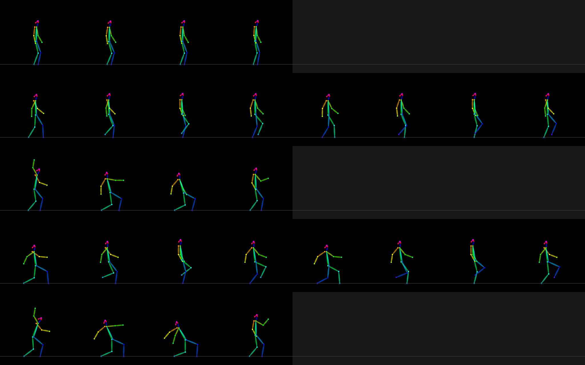
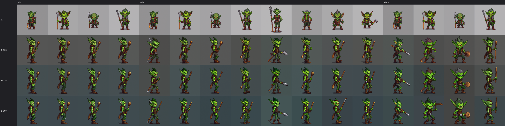
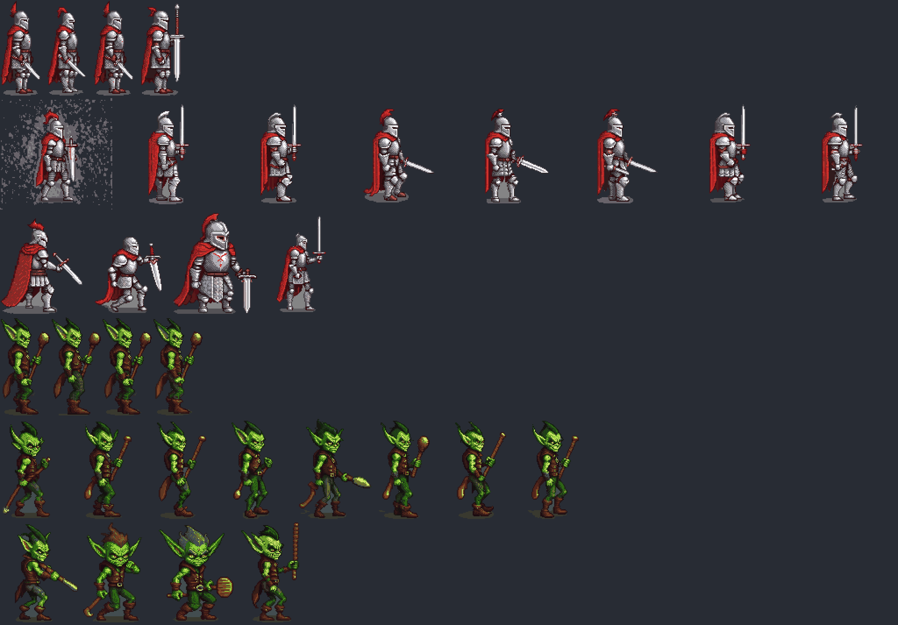

# ComfyUI pose-to-frame benchmark (in progress)

Work toward [#79](https://github.com/gfargo/pixelkiln/issues/79): a versioned
ComfyUI recipe that turns an ordered set of pose maps into a pixel-art frame
set, and a benchmark that shows where it works and where it fails. This folder
holds the model audit, the pose maps, the generation graph, a two-frame smoke
test, and the first full run (lanes A and B, two characters) with a lane D
trial on its 0.75 frames. The rubric has not been scored yet, so no quality
claim or recipe exists.

## Model audit

Every file below was hashed on the test machine and matched to its public
source by the SHA-256 that Hugging Face records for it (November 2026). No
weights are committed or downloaded by PixelKiln.

| Role | File (ComfyUI folder) | SHA-256 | Source | License | Commercial output |
|---|---|---|---|---|---|
| SDXL checkpoint | `checkpoints/sd_xl_base_1.0.safetensors` | `31e35c80fc4829d14f90153f4c74cd59c90b779f6afe05a74cd6120b893f7e5b` | [stabilityai/stable-diffusion-xl-base-1.0](https://huggingface.co/stabilityai/stable-diffusion-xl-base-1.0/blob/main/sd_xl_base_1.0.safetensors) | [CreativeML Open RAIL++-M](https://huggingface.co/stabilityai/stable-diffusion-xl-base-1.0/blob/main/LICENSE.md) | Yes. "Licensor claims no rights in the Output"; the use restrictions in its Attachment A apply. |
| Pixel-art LoRA | `loras/pixel-art-xl.safetensors` | `4234637cb80c998f41e348e6a6cb6bc20d8d038b2b0f256b6129b3b5e353eef7` | [nerijs/pixel-art-xl](https://huggingface.co/nerijs/pixel-art-xl/blob/main/pixel-art-xl.safetensors) | CreativeML Open RAIL-M (model card) | Yes, under the same RAIL terms. The card links no license file of its own. |
| Pose ControlNet | `controlnet/controlnet-openpose-sdxl-1.0.safetensors` | `b8524e557a7df60d081f5d4a0eb109967d107df217943bf88c2d99b9ebcc06c5` | [xinsir/controlnet-openpose-sdxl-1.0](https://huggingface.co/xinsir/controlnet-openpose-sdxl-1.0/blob/main/diffusion_pytorch_model.safetensors) (`diffusion_pytorch_model.safetensors`, renamed) | Apache-2.0 | Yes. |
| Alternative ControlNet | `controlnet/controlnet-union-sdxl-promax.safetensors` | `9fae2e50cb431bfcbe05822b59ec2228df545ef27f711dea8949e9f4ed9f7cdc` | [xinsir/controlnet-union-sdxl-1.0](https://huggingface.co/xinsir/controlnet-union-sdxl-1.0/blob/main/diffusion_pytorch_model_promax.safetensors) (`diffusion_pytorch_model_promax.safetensors`, renamed) | Apache-2.0 | Yes. Takes OpenPose among other controls; a candidate if the dedicated model loses identity. |
| SD 1.5 checkpoint | `checkpoints/v1-5-pruned-emaonly-fp16.safetensors` | `e9476a13728cd75d8279f6ec8bad753a66a1957ca375a1464dc63b37db6e3916` | [Comfy-Org/stable-diffusion-1.5](https://huggingface.co/Comfy-Org/stable-diffusion-1.5/blob/main/v1-5-pruned-emaonly-fp16.safetensors) | CreativeML Open RAIL-M | Yes. |

Rejected or not yet available:

- `thibaud/controlnet-openpose-sdxl-1.0` is tagged `license: other` on
  Hugging Face; not used.
- **The SD 1.5 lane is incomplete.** It needs an SD 1.5 OpenPose ControlNet and
  an SD 1.5 pixel-art LoRA whose license allows commercial use, and neither is
  installed. It is set aside until the SDXL lane has results.

The OpenRAIL licenses restrict uses (Attachment A), not ownership of the
output. Whoever ships the art still has to read them for their own case; this
audit records what each file is and where its terms are.

## Pose maps

[`poses/`](poses) holds the varying input: OpenPose maps (18-keypoint body,
`controlnet_aux` colours, no face or hands) at 1024x1024. Each figure is seen
from the side, faces right, and stands on one ground line (y = 900), so scale
and camera do not move between frames or motions.

| Motion | Frames | What changes |
|---|---|---|
| `idle` | 4 | a breath: hips sink and rise 8px, arms sway |
| `walk` | 8 | contact, down, passing, up on each leg; the planted foot stays on the ground |
| `attack` | 4 | wind-up, lunge and strike, follow-through, recover |

`poses/make-poses.py` draws them; the PNGs are what gets reviewed, hashed and
sent, and a wrong limb can be fixed in the script or by hand.
[`poses/sheet.png`](poses/sheet.png) shows all sixteen.



## Generation graph

[`workflow-pose-api.json`](workflow-pose-api.json) is the pose lane (lane B in
#79) in ComfyUI API format, using only ComfyUI's built-in nodes, no custom
nodes: SDXL base, Pixel Art XL at 0.85, `ControlNetLoader` +
`ControlNetApplyAdvanced` (strength 0.75, start 0, end 1), a 1024x1024 empty
latent, `KSampler` (32 steps, cfg 6, `dpmpp_2m` / `karras`, fixed seed 31415),
then save. Its sampler settings are those of the existing
`comfyui/pixel-art-xl-environment@1.0.0` recipe. The pose image, prompt and seed
are the bindings a recipe will expose.

## Smoke test

Two frames, one prompt ("full body side view of a knight in steel armor with a
red cape and a sword, facing right"), seed 31415, strength 0.75:


- Both frames follow their pose: the walk's passing step and the attack's lunge
  with the sword arm forward. The knight is drawn taller than the skeleton.
- Both read as pixel art at 1024px; nothing is refined to a native grid yet.
- Time: 223s for the first frame (models loading) and 163s for the second, on
  an Apple M1 Max (64 GB, MPS), ComfyUI 0.35.0, PyTorch 2.12.1.

Raw frames: [`smoke/walk-frame-02.png`](smoke/walk-frame-02.png),
[`smoke/attack-frame-01.png`](smoke/attack-frame-01.png).

## Running the benchmark

[`run-benchmark.py`](run-benchmark.py) renders every lane through a ComfyUI
that is already running, using only its HTTP API and Python's standard library:

```bash
python run-benchmark.py --host http://127.0.0.1:8188 --out runs/<name>
python run-benchmark.py --host http://127.0.0.1:8188 --out runs/<name> --lanes B-0.75 --characters knight
```

| Lane | What it renders |
|---|---|
| `A` | prompt only: the ControlNet nodes removed, the seed stepped by one per frame |
| `B-0.55`, `B-0.75`, `B-0.90` | OpenPose ControlNet at that strength, fixed seed 31415 |
| `repeat` | `B-0.75` for the first character's walk again, to check byte-for-byte repeats |

Two characters (a knight and a goblin) over three motions make 16 frames per
lane per character, or 136 frames for a full run. Each frame lands at
`<out>/<lane>/<character>/<motion>/frame-NN.png`. `runs.json` records each
frame's seed, strength, seconds and SHA-256. Frames already on disk are
skipped, so a stopped run picks up where it left off.

Raw 1024px renders go to `runs/`, which git ignores (a full run is about 77 MB).
[`make-sheets.py`](make-sheets.py) turns a run into contact sheets and lane GIFs,
and [`key-and-crop.py`](key-and-crop.py) clears the background of refined frames
and crops each motion to one shared box. Both write into `results/`.

## Run 1: Forge, November 2026

136 frames on an RTX 3060 (ComfyUI 0.34.0, the machine's own install and
models), median 31.6 s a frame, 69 minutes in all. Everything is in
[`results/forge-shared/`](results/forge-shared), with each render's seed,
strength, seconds and hash in [`runs.json`](results/forge-shared/runs.json).

**Repeatability:** the `repeat` lane rendered the knight's walk at 0.75 a second
time, and all 8 frames matched the first pass byte for byte. Same machine, same
ComfyUI, same inputs, same bytes.

### Lanes A and B




Side-by-side GIFs, the four lanes playing each motion:
[knight idle](results/forge-shared/knight-idle.gif),
[walk](results/forge-shared/knight-walk.gif),
[attack](results/forge-shared/knight-attack.gif);
[goblin idle](results/forge-shared/goblin-idle.gif),
[walk](results/forge-shared/goblin-walk.gif),
[attack](results/forge-shared/goblin-attack.gif).

What the sheets show, before anyone scores them:

- **Lane A is not a motion baseline.** It has one prompt and a seed stepped per
  frame index, so frame N of every motion is the same image: its idle, the
  first four walk frames and its attack are identical. It still shows what the
  model draws without the pose: mostly front views where the prompt asked for a
  side view, a different knight each frame, and in one frame a sword standing
  apart from him. A fair motion baseline needs the motion in the prompt. That
  is a change for the next run.
- **Lane B follows every pose and keeps the side view.** The design holds
  (red cape and plume, armour; green skin, ears, vest), but small parts drift:
  the plume comes and goes, the helmet changes shape, and the knight's sword
  moves between raised, lowered and pointing forward within one walk.
- **Props drift most.** The pose map has no joint for a weapon, so nothing
  holds it. The goblin's club becomes a spear in the walk, and in the attack a
  spear, a fist, a shield and a stick.
- **Scale jumps on the strike frame.** Attack frame 02 is drawn about a fifth
  larger than its neighbours for both characters, though the skeleton is not.
- **Strength barely matters between 0.55 and 0.90.** The three rows are close;
  0.90 is a little stiffer. The drift above appears at every strength, so it
  is not a strength problem.
- **The background changes.** The flat grey from the prompt shifts in tone and
  hue between frames (the goblin's from grey to blue-grey), and one knight walk
  frame came back with a mottled background.

### Lane D trial: native frames

The 32 B-0.75 frames went through `pixelkiln refine` with the pinned Pixel Art
Fixer, a 24-colour palette per character (23 colours taken from the character
pixels across its frames, plus the background grey), then `key-and-crop.py`:



The native frames, strips and 4x GIFs are in
[`results/forge-shared/native/`](results/forge-shared/native), and the grid
each frame got is in
[`refine.json`](results/forge-shared/native/refine.json).

- **Every frame lands on one grid:** 8px cells at phase 0, so each 1024px render
  becomes 128x128 native art, and every loop shares it. 26 of 32 passed the
  default high-confidence gate. `refine` refused the other 6 and wrote nothing.
  Rerun with `--min-grid-confidence low`, all 6 detected the same 8px grid at
  phase 0. In a frame set, the confident frames could vouch for the others.
  `refine` checks each frame alone today.
- **The characters are about 110 to 117 pixels tall** inside the 128px canvas.
  Cropped to one box per motion, the knight's idle is 53x110 and the goblin's
  walk 85x116. Those sizes come from where the 1024px render places the figure.
  To get a smaller sprite, render the figure smaller in the frame. Shrinking the
  native frame afterwards would blur it.
- **A flat key clears 31 of 32 backgrounds.** After refine the background is one
  palette colour, so a flood fill from the edge removes it. The mottled walk
  frame breaks into speckles, and the drop shadow stays because it is a
  different grey. A prompt without a shadow, or a background-removal step in
  the graph, would fix both. Neither is tested yet.
- **It takes about 20 s a frame** on an M1 Max, almost all of it in the fixer.

## Findings log

What each run taught us about running this graph, newest first. Quality
findings wait for the rubric scores.

- **November 2026, lane D on run 1.** SDXL with Pixel Art XL draws on a steady
  8px grid at 1024px, so every frame in a set refines to the same 128x128 grid.
  The fixer's confidence varies frame to frame, but its answer did not.
  Palettes taken from the character pixels work; palettes taken from whole
  frames are mostly background grey. Background removal and smaller sprites
  have to be handled at render time, not after.
- **November 2026, run 1 lanes A and B.** A fixed seed with the OpenPose
  ControlNet keeps one character across a loop, but not their props, and the
  strike frame grows. Strength from 0.55 to 0.90 changes little. The same
  inputs repeat byte for byte. Next run: put the motion in lane A's prompt, add
  the prop to the pose (or a reference image, lane C), and ask for no shadow.
- **November 2026, RTX 3060 12 GB (Windows).** The machine already ran a
  ComfyUI 0.34.0 with the same three models, under the same file names. A
  second ComfyUI 0.46.0 on the same card took 310 to 415 s a frame, because the
  two competed for VRAM. Sending the graph to the existing server instead took
  about 31 s a frame (55 s for the first, while the models loaded), so a full
  136-frame run takes about 75 minutes. The core-node graph ran unchanged on both versions. ComfyUI
  0.46.0 needed PyTorch 2.11 (cu128); on 2.6 it failed at startup.
- **November 2026, Apple M1 Max.** Smoke test: 223 s for the first frame and
  163 s for the second (ComfyUI 0.35.0, MPS).

The machine-level notes are in
[Set up ComfyUI: Run on a shared GPU machine](../../../docs/COMFYUI.md#run-on-a-shared-gpu-machine).

## What is left

Done in run 1: lanes A and B for two characters, the strength sweep, the
byte-for-byte repeat, and a lane D trial (grid recovery works).

1. **Human scores:** the 1x rubric in #79, by a person, on run 1's sheets and
   native frames.
2. **Run 2:** lane A with the motion in its prompt, a no-shadow prompt, and a
   fix for prop drift: a prop joint in the pose map, or **lane C** (an identity
   or prop reference; not chosen yet).
3. **Lane D in full:** a background-removal step in the graph, the figure
   rendered at the target size, then `refine` as a frame set, approval and
   packing. `refine` could also take a frame set's grid from its confident
   frames, so one unsure frame does not block the set.
4. The recipe (`comfyui/pixel-art-pose-frames@1.0.0`), docs, skill and site.
