# ComfyUI pose-to-frame benchmark (in progress)

Work toward [#79](https://github.com/gfargo/pixelkiln/issues/79): a versioned
ComfyUI recipe that turns an ordered set of pose maps into a pixel-art frame
set, and a benchmark that shows where it works and where it fails. This folder
holds the model audit, the pose maps, the generation graph, a two-frame smoke
test, and the first full run (lanes A and B, two characters) with a lane D
trial on its 0.75 frames. The rubric has not been scored yet, so no quality
claim or recipe exists.

## Model audit

Every file below was hashed on the test machine and matched to its public
source by the SHA-256 that Hugging Face records for it (November 2026). No
weights are committed or downloaded by PixelKiln.

| Role | File (ComfyUI folder) | SHA-256 | Source | License | Commercial output |
|---|---|---|---|---|---|
| SDXL checkpoint | `checkpoints/sd_xl_base_1.0.safetensors` | `31e35c80fc4829d14f90153f4c74cd59c90b779f6afe05a74cd6120b893f7e5b` | [stabilityai/stable-diffusion-xl-base-1.0](https://huggingface.co/stabilityai/stable-diffusion-xl-base-1.0/blob/main/sd_xl_base_1.0.safetensors) | [CreativeML Open RAIL++-M](https://huggingface.co/stabilityai/stable-diffusion-xl-base-1.0/blob/main/LICENSE.md) | Yes. "Licensor claims no rights in the Output"; the use restrictions in its Attachment A apply. |
| Pixel-art LoRA | `loras/pixel-art-xl.safetensors` | `4234637cb80c998f41e348e6a6cb6bc20d8d038b2b0f256b6129b3b5e353eef7` | [nerijs/pixel-art-xl](https://huggingface.co/nerijs/pixel-art-xl/blob/main/pixel-art-xl.safetensors) | CreativeML Open RAIL-M (model card) | Yes, under the same RAIL terms. The card links no license file of its own. |
| Pose ControlNet | `controlnet/controlnet-openpose-sdxl-1.0.safetensors` | `b8524e557a7df60d081f5d4a0eb109967d107df217943bf88c2d99b9ebcc06c5` | [xinsir/controlnet-openpose-sdxl-1.0](https://huggingface.co/xinsir/controlnet-openpose-sdxl-1.0/blob/main/diffusion_pytorch_model.safetensors) (`diffusion_pytorch_model.safetensors`, renamed) | Apache-2.0 | Yes. |
| Alternative ControlNet | `controlnet/controlnet-union-sdxl-promax.safetensors` | `9fae2e50cb431bfcbe05822b59ec2228df545ef27f711dea8949e9f4ed9f7cdc` | [xinsir/controlnet-union-sdxl-1.0](https://huggingface.co/xinsir/controlnet-union-sdxl-1.0/blob/main/diffusion_pytorch_model_promax.safetensors) (`diffusion_pytorch_model_promax.safetensors`, renamed) | Apache-2.0 | Yes. Takes OpenPose among other controls; a candidate if the dedicated model loses identity. |
| SD 1.5 checkpoint | `checkpoints/v1-5-pruned-emaonly-fp16.safetensors` | `e9476a13728cd75d8279f6ec8bad753a66a1957ca375a1464dc63b37db6e3916` | [Comfy-Org/stable-diffusion-1.5](https://huggingface.co/Comfy-Org/stable-diffusion-1.5/blob/main/v1-5-pruned-emaonly-fp16.safetensors) | CreativeML Open RAIL-M | Yes. |

Rejected or not yet available:

- `thibaud/controlnet-openpose-sdxl-1.0` is tagged `license: other` on
  Hugging Face; not used.
- **The SD 1.5 lane is incomplete.** It needs an SD 1.5 OpenPose ControlNet and
  an SD 1.5 pixel-art LoRA whose license allows commercial use, and neither is
  installed. It is set aside until the SDXL lane has results.

The OpenRAIL licenses restrict uses (Attachment A), not ownership of the
output. Whoever ships the art still has to read them for their own case; this
audit records what each file is and where its terms are.

## Pose maps

[`poses/`](poses) holds the varying input: OpenPose maps (18-keypoint body,
`controlnet_aux` colours, no face or hands) at 1024x1024. Each figure is seen
from the side, faces right, and stands on one ground line (y = 900), so scale
and camera do not move between frames or motions.

| Motion | Frames | What changes |
|---|---|---|
| `idle` | 4 | a breath: hips sink and rise 8px, arms sway |
| `walk` | 8 | contact, down, passing, up on each leg; the planted foot stays on the ground |
| `attack` | 4 | wind-up, lunge and strike, follow-through, recover |

`poses/make-poses.py` draws them; the PNGs are what gets reviewed, hashed and
sent, and a wrong limb can be fixed in the script or by hand.
[`poses/sheet.png`](poses/sheet.png) shows all sixteen.


## Generation graph

[`workflow-pose-api.json`](workflow-pose-api.json) is the pose lane (lane B in
#79) in ComfyUI API format, using only ComfyUI's built-in nodes, no custom
nodes: SDXL base, Pixel Art XL at 0.85, `ControlNetLoader` +
`ControlNetApplyAdvanced` (strength 0.75, start 0, end 1), a 1024x1024 empty
latent, `KSampler` (32 steps, cfg 6, `dpmpp_2m` / `karras`, fixed seed 31415),
then save. Its sampler settings are those of the existing
`comfyui/pixel-art-xl-environment@1.0.0` recipe. The pose image, prompt and seed
are the bindings a recipe will expose.

## Smoke test

Two frames, one prompt ("full body side view of a knight in steel armor with a
red cape and a sword, facing right"), seed 31415, strength 0.75:

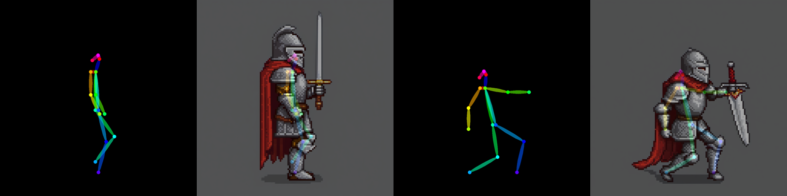

- Both frames follow their pose: the walk's passing step and the attack's lunge
  with the sword arm forward. The knight is drawn taller than the skeleton.
- Both read as pixel art at 1024px; nothing is refined to a native grid yet.
- Time: 223s for the first frame (models loading) and 163s for the second, on
  an Apple M1 Max (64 GB, MPS), ComfyUI 0.35.0, PyTorch 2.12.1.

Raw frames: [`smoke/walk-frame-02.png`](smoke/walk-frame-02.png),
[`smoke/attack-frame-01.png`](smoke/attack-frame-01.png).

## Running the benchmark

[`run-benchmark.py`](run-benchmark.py) renders every lane through a ComfyUI
that is already running, using only its HTTP API and Python's standard library:

```bash
python run-benchmark.py --host http://127.0.0.1:8188 --out runs/<name>
python run-benchmark.py --host http://127.0.0.1:8188 --out runs/<name> --lanes B-0.75 --characters knight
```

| Lane | What it renders |
|---|---|
| `A` | prompt only: the ControlNet nodes removed, the seed stepped by one per frame |
| `B-0.55`, `B-0.75`, `B-0.90` | OpenPose ControlNet at that strength, fixed seed 31415 |
| `repeat` | `B-0.75` for the first character's walk again, to check byte-for-byte repeats |

Two characters (a knight and a goblin) over three motions make 16 frames per
lane per character, or 136 frames for a full run. Each frame lands at
`<out>/<lane>/<character>/<motion>/frame-NN.png`. `runs.json` records each
frame's seed, strength, seconds and SHA-256. Frames already on disk are
skipped, so a stopped run picks up where it left off.

Raw 1024px renders go to `runs/`, which git ignores (a full run is about 77 MB).
[`make-sheets.py`](make-sheets.py) turns a run into contact sheets and lane GIFs,
and [`key-and-crop.py`](key-and-crop.py) clears the background of refined frames
and crops each motion to one shared box. Both write into `results/`.

## Run 1: Forge, November 2026

136 frames on an RTX 3060 (ComfyUI 0.34.0, the machine's own install and
models), median 31.6 s a frame, 69 minutes in all. Everything is in
[`results/forge-shared/`](results/forge-shared), with each render's seed,
strength, seconds and hash in [`runs.json`](results/forge-shared/runs.json).

**Repeatability:** the `repeat` lane rendered the knight's walk at 0.75 a second
time, and all 8 frames matched the first pass byte for byte. Same machine, same
ComfyUI, same inputs, same bytes.

### Lanes A and B

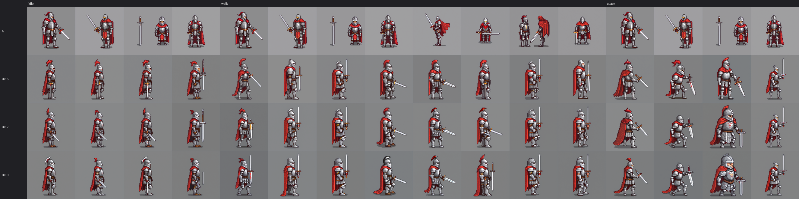


Side-by-side GIFs, the four lanes playing each motion:
[knight idle](results/forge-shared/knight-idle.gif),
[walk](results/forge-shared/knight-walk.gif),
[attack](results/forge-shared/knight-attack.gif);
[goblin idle](results/forge-shared/goblin-idle.gif),
[walk](results/forge-shared/goblin-walk.gif),
[attack](results/forge-shared/goblin-attack.gif).

What the sheets show, before anyone scores them:

- **Lane A is not a motion baseline.** It has one prompt and a seed stepped per
  frame index, so frame N of every motion is the same image: its idle, the
  first four walk frames and its attack are identical. It still shows what the
  model draws without the pose: mostly front views where the prompt asked for a
  side view, a different knight each frame, and in one frame a sword standing
  apart from him. A fair motion baseline needs the motion in the prompt. That
  is a change for the next run.
- **Lane B follows every pose and keeps the side view.** The design holds
  (red cape and plume, armour; green skin, ears, vest), but small parts drift:
  the plume comes and goes, the helmet changes shape, and the knight's sword
  moves between raised, lowered and pointing forward within one walk.
- **Props drift most.** The pose map has no joint for a weapon, so nothing
  holds it. The goblin's club becomes a spear in the walk, and in the attack a
  spear, a fist, a shield and a stick.
- **Scale jumps on the strike frame.** Attack frame 02 is drawn about a fifth
  larger than its neighbours for both characters, though the skeleton is not.
- **Strength barely matters between 0.55 and 0.90.** The three rows are close;
  0.90 is a little stiffer. The drift above appears at every strength, so it
  is not a strength problem.
- **The background changes.** The flat grey from the prompt shifts in tone and
  hue between frames (the goblin's from grey to blue-grey), and one knight walk
  frame came back with a mottled background.

### Lane D trial: native frames

The 32 B-0.75 frames went through `pixelkiln refine` with the pinned Pixel Art
Fixer, a 24-colour palette per character (23 colours taken from the character
pixels across its frames, plus the background grey), then `key-and-crop.py`:


The native frames, strips and 4x GIFs are in
[`results/forge-shared/native/`](results/forge-shared/native), and the grid
each frame got is in
[`refine.json`](results/forge-shared/native/refine.json).

- **Every frame lands on one grid:** 8px cells at phase 0, so each 1024px render
  becomes 128x128 native art, and every loop shares it. 26 of 32 passed the
  default high-confidence gate. `refine` refused the other 6 and wrote nothing.
  Rerun with `--min-grid-confidence low`, all 6 detected the same 8px grid at
  phase 0. In a frame set, the confident frames could vouch for the others.
  `refine` checks each frame alone today.
- **The characters are about 110 to 117 pixels tall** inside the 128px canvas.
  Cropped to one box per motion, the knight's idle is 53x110 and the goblin's
  walk 85x116. Those sizes come from where the 1024px render places the figure.
  To get a smaller sprite, render the figure smaller in the frame. Shrinking the
  native frame afterwards would blur it.
- **A flat key clears 31 of 32 backgrounds.** After refine the background is one
  palette colour, so a flood fill from the edge removes it. The mottled walk
  frame breaks into speckles, and the drop shadow stays because it is a
  different grey. A prompt without a shadow, or a background-removal step in
  the graph, would fix both. Neither is tested yet.
- **It takes about 20 s a frame** on an M1 Max, almost all of it in the fixer.

## Run 2: consistency lanes, November 2026

Run 1's frames were each drawn from fresh noise, so props, helmets and faces
jumped between frames. Run 2 tried four ways of holding one character across a
loop, on the same machine and graph. Raw renders stay in `runs/run2`; the
comparisons are in [`results/run2/`](results/run2), made with
[`compare-lanes.py`](compare-lanes.py).

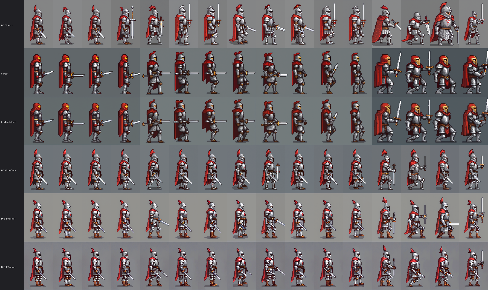

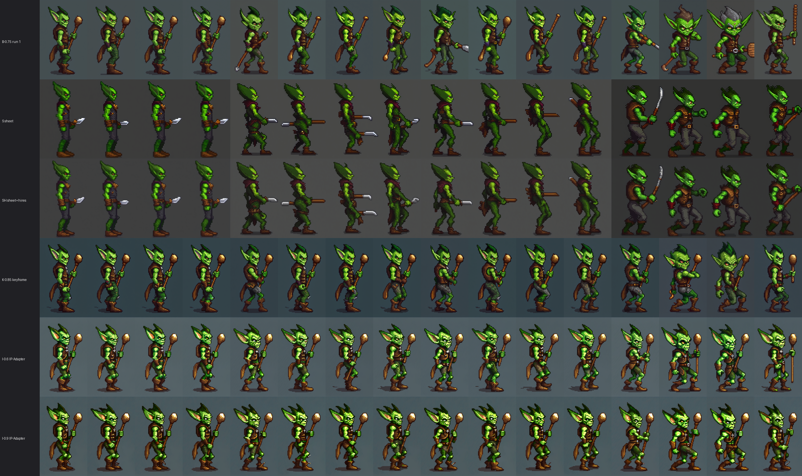

The lanes playing side by side:
[knight idle](results/run2/compare-knight-idle.gif),
[walk](results/run2/compare-knight-walk.gif),
[attack](results/run2/compare-knight-attack.gif);
[goblin idle](results/run2/compare-goblin-idle.gif),
[walk](results/run2/compare-goblin-walk.gif),
[attack](results/run2/compare-goblin-attack.gif).

- **S, one sheet per motion** ([`poses/make-pose-sheets.py`](poses/make-pose-sheets.py)):
  every frame of a loop in one 1536x640 image (the walk 1536x1280). Frames
  within a loop match each other far better than run 1's. Each motion is a
  separate sheet, though, so each motion is a different design: the knight is
  hooded in his idle and attack and wears a plumed helmet in his walk. Arms
  follow the pose loosely.
- **Sheet size.** At 1x the native frames are 48x80, consistent but chunky. At
  1.5x (2304x960 for a row of four) the idle came out 72x120 and still
  consistent. At 2x the design drifted between cells, and the 1.5x walk
  (two rows, 4.4 MP) fell apart: past about 2.2 MP, SDXL stops drawing one
  character. The grid stays 8px at every size.
- **SH, sheet plus a hires pass** (latent 1.5x, redrawn at denoise 0.5): keeps
  the 1x layout and enlarges the pixel blocks. It does not give finer pixels.
- **K, keyframe img2img** (run 1's B-0.75 idle frame 0 as the start latent, pose
  ControlNet at 0.90): at denoise 0.55 to 0.85 the keyframe wins and the poses
  are mostly ignored. Same character everywhere, but the upper body stays in
  the idle pose, so there is little motion.
- **I, IP-Adapter** (Plus, SDXL, ViT-H, fed the keyframe; pose ControlNet 0.75):
  the best identity across motions, the same knight and the same goblin with
  his club in every loop, and the legs follow the walk. The reference pulls
  arms and props back toward the keyframe, so the attack is smaller than the
  skeleton asks for. At 0.9 identity is stronger and pose weaker; 0.6 is the
  better balance. Small parts still drift frame to frame: the sword can change
  hands and the goblin's face changes. IP-Adapter passes the reference as one
  CLIP embedding of a 224px image, which carries the overall look but not
  which hand holds what.

## Run 3: the keyframe in the sheet, November 2026

Three lanes that combine run 2's two fixes, 22 renders in 23 minutes. The
comparisons are in [`results/run3/`](results/run3); each sheet's rows are
run 1 (B-0.75), run 2's I-0.6, then the three new lanes.

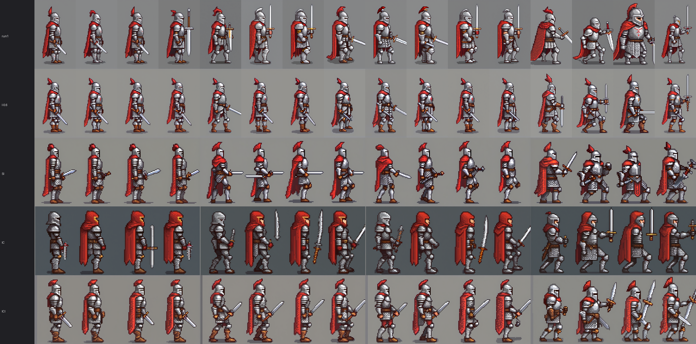

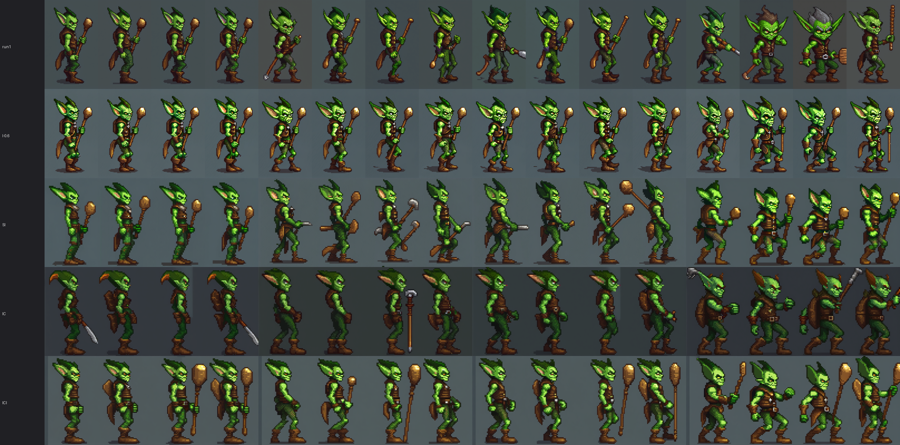

GIFs: [knight idle](results/run3/compare-knight-idle.gif),
[walk](results/run3/compare-knight-walk.gif),
[attack](results/run3/compare-knight-attack.gif);
[goblin idle](results/run3/compare-goblin-idle.gif),
[walk](results/run3/compare-goblin-walk.gif),
[attack](results/run3/compare-goblin-attack.gif).

- **IC, the keyframe fixed in cell 0 of a five-cell row**
  ([`poses/make-incontext-sheets.py`](poses/make-incontext-sheets.py); the
  latent noise is masked to cells 1-4): it does not work with SDXL base. The
  model ignores the fixed cell. The knight came out hooded, the background went
  dark, and swords float beside the figure. Copying from a neighbouring cell
  needs a model trained to inpaint, which this one is not.
- **ICI, the same plus IP-Adapter at 0.6:** the best knight so far. Same plume,
  cape and sword hand through each loop, and close to the keyframe in every
  motion. The goblin keeps his face and vest, but his club comes and goes
  (missing in two idle frames and most of the walk). The gain over I-0.6 comes
  from IP-Adapter, not from the fixed cell.
- **SI, sheet plus IP-Adapter at 0.6:** every motion is now the same character
  (run 2's S drew a different knight per motion), and frames within a loop
  match. Props are still the weak point: the goblin's walk sheet has extra
  clubs and an axe, and the knight's attack sheet swaps the sword for an axe
  in one cell.

## Run 4: a LoRA per character, November 2026

One LoRA per character, trained on frames from earlier runs that match the
keyframe, then three lanes that use it. The comparisons are in
[`results/run4/`](results/run4); each sheet's rows are run 1 (B-0.75), I-0.6,
ICI, then the three LoRA lanes.

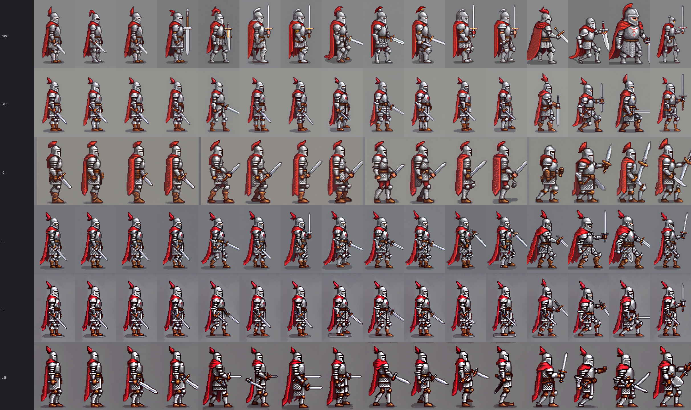

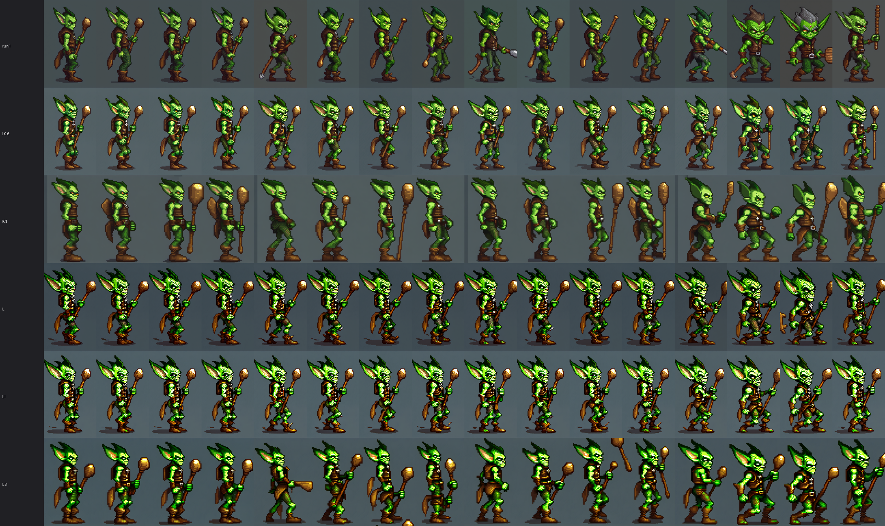

GIFs: [knight idle](results/run4/compare-knight-idle.gif),
[walk](results/run4/compare-knight-walk.gif),
[attack](results/run4/compare-knight-attack.gif);
[goblin idle](results/run4/compare-goblin-idle.gif),
[walk](results/run4/compare-goblin-walk.gif),
[attack](results/run4/compare-goblin-attack.gif).

**Training.** [`train-lora.py`](train-lora.py) runs kohya sd-scripts on the
same GPU as a shared ComfyUI. It waits until ComfyUI's queue is empty and the
GPU has been under 10% busy for a set time, asks ComfyUI to unload its models
(`POST /free`), trains, and copies the LoRA into ComfyUI's `loras` folder. The
base is SDXL with Pixel Art XL merged in at 0.85 (`--base_weights`), the stack
the benchmark renders with, so the LoRA only has to learn the character. UNet
only, rank 16, AdamW8bit, bf16, 10 repeats for 6 epochs, about 1.06 s a step
on the RTX 3060.

| Character | Images | Steps | Time | Final loss |
|---|---|---|---|---|
| knight | 23 | 1380 | 24:29 | 0.067 |
| goblin | 25 | 1500 | 26:27 | 0.075 |

The training sets are in [`lora/`](lora): 512x1024 crops of run 2's I-0.6 and
I-0.9 frames and run 1's idle frame 0, each with a caption that starts with the
trigger word (`pxkknight`, `pxkgoblin`). ComfyUI's own trainer
(`TrainLoraNode`) also runs, but took 40 to 540 s a step on 12 GB, against
about 1 s for kohya.

**Renders.** 64 frames at a median of 34.8 s and 6 sheets at 71.9 s, LoRA at
0.8.

- **L, the LoRA with the pose ControlNet:** the same character in every frame
  of every motion. The knight holds the sword low in the front hand through
  idle and walk and raises it in the attack; the goblin keeps one face, one
  vest and the club in the same hand. The cost is motion: the goblin's frames
  are nearly identical across idle, walk and attack, and the knight's walk
  legs barely move. The goblin also comes out over-sharpened and crowds the
  cell edges.
- **LI, plus IP-Adapter at 0.6:** the most uniform row, and about as still as
  L. Some knight frames gain a small ground ellipse.
- **LSI, a sheet plus the LoRA and IP-Adapter:** follows the poses best of the
  three (wider strides, a raised sword, lunges), but props drift again: extra
  blades in the knight's walk, a spade-like shape in the last attack frame,
  the goblin's club leaving the cell in two attack frames.

The LoRA fixes identity and the prop hand, and costs pose. The training frames
came from lanes whose poses barely moved, so the LoRA learned the stance along
with the character.

## Run 5: a looser LoRA, November 2026

Does a weaker LoRA, or an earlier checkpoint, let the pose move the figure
again? Five lanes, 160 frames at a median of 31.6 s. The comparisons are in
[`results/run5/`](results/run5); each sheet's rows are run 4's L (LoRA at 0.8),
then the five new lanes.

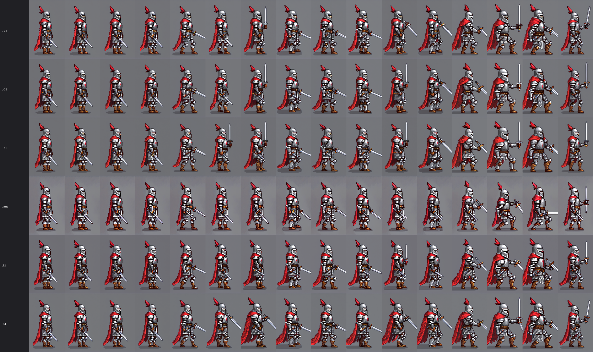

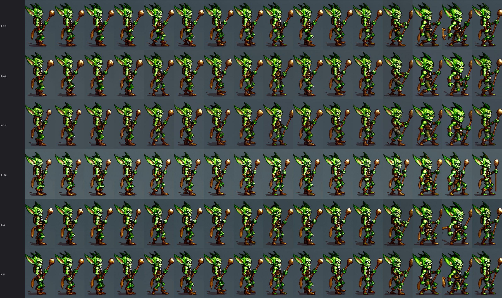

GIFs: [knight idle](results/run5/compare-knight-idle.gif),
[walk](results/run5/compare-knight-walk.gif),
[attack](results/run5/compare-knight-attack.gif);
[goblin idle](results/run5/compare-goblin-idle.gif),
[walk](results/run5/compare-goblin-walk.gif),
[attack](results/run5/compare-goblin-attack.gif).

- **L-0.6 and L-0.5, the final LoRA at a lower strength:** the same character
  as at 0.8, and nearly the same poses. The knight raises the sword in a few
  more walk frames at 0.5, which reads as the attack pose leaking into the
  walk, not as more stride. The goblin's face starts to drift in the attack
  frames.
- **LI-0.6, plus IP-Adapter at 0.6:** the stillest walk, a cloudy background,
  and the most artifacts (a loose blade in the knight's attack, a stray pole
  beside the goblin).
- **LE2 and LE4, the checkpoints after epoch 2 and 4 of 6, at 0.8:** identity
  holds as well as the final LoRA. LE4 gives the knight the most lean and a
  trailing cape in the walk. LE2 adds a second, dagger-like blade in two
  attack frames.

None of the five changes the motion much. Every row has a still idle, small
leg changes in the walk and a clear attack. Run 1's frames, which used no LoRA,
also moved the legs only a little in the walk, so the LoRA is not the only
cause: the pose ControlNet at 0.75 does not force a full stride either.
Strength and early checkpoints are not the lever; the next tries are a stronger
pose ControlNet (0.9 to 1.0) with LE4, and a LoRA retrained on frames in
varied poses.

## Run 6: a stronger pose ControlNet, November 2026

Three lanes with the pose ControlNet raised from 0.75: the epoch 4 LoRA at
pose 0.9 and 1.0, and the final LoRA at 0.5 with pose 1.0. 96 frames at a
median of 31.5 s. The comparisons are in [`results/run6/`](results/run6); each
sheet's rows are run 1's B-0.90 (no LoRA, pose 0.9), run 5's LE4, then the
three new lanes.

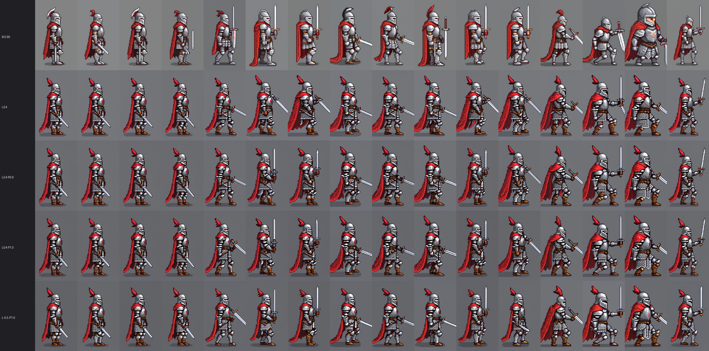

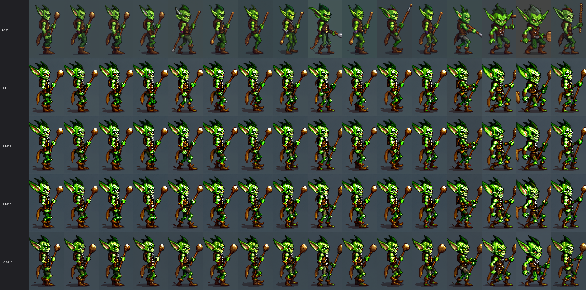

- **The knight** raises his sword upright in two or three walk frames in every
  new lane, and L-0.5-P1.0 opens the stride a little in frames 7 and 12. The
  legs still never reach a full step. Pose 0.9 and 1.0 look the same.
- **The goblin** is unchanged from LE4 in all three lanes: same face, same club
  hand, small foot and tail shifts in the walk, a clear crouch in the attack.
- Identity and the prop hand hold in every lane, with no new artifacts.

A stronger pose control does not give a full stride. Run 1's B-0.90 row, with
no LoRA at all, also keeps the walk's legs close together, so the limit sits
before the LoRA: the OpenPose ControlNet on this SDXL stack follows arm and
torso changes but barely the leg spread in these walk maps. The next things to
try are a pose set with wider leg spread (an exaggerated walk), a depth or
lineart control from a posed reference instead of OpenPose, or a LoRA retrained
on frames that already show a full stride.

## Run 7: an exaggerated walk, November 2026

New walk maps in [`poses/walk-wide/`](poses/walk-wide), drawn by
[`poses/make-poses.py`](poses/make-poses.py): a 330 px stride instead of 190,
the knee lifted to 115 px instead of 55, twice the arm swing, a 10 degree lean,
and a bob (the hips drop 30 px on contact). Three lanes render only the walk
on them: LE4-W (the epoch 4 LoRA, pose 0.75), LE4-W-P1.0 (pose 1.0) and L-0.5-W
(the final LoRA at 0.5). 48 frames at a median of 31.6 s. The comparisons are
in [`results/run7/`](results/run7); the first two rows are run 5's LE4 and run
6's L-0.5-P1.0 on the old walk maps.

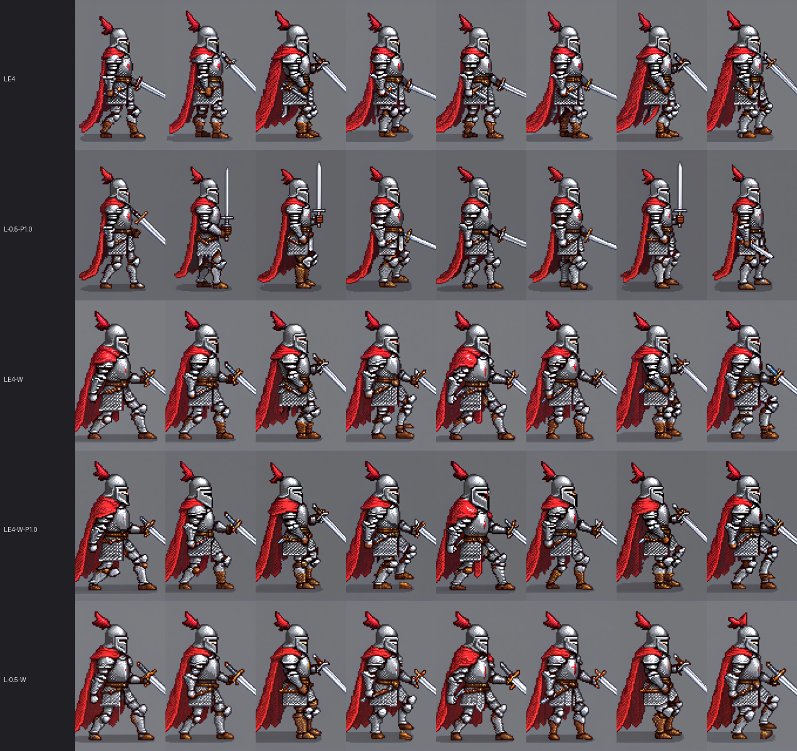

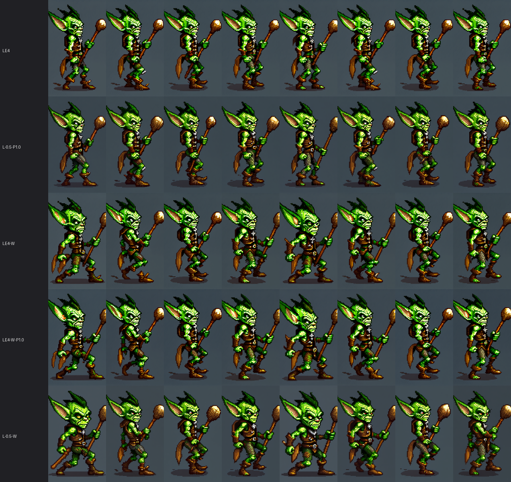

GIFs: [knight walk](results/run7/compare-knight-walk.gif),
[goblin walk](results/run7/compare-goblin-walk.gif).

- **LE4-W:** the first real walk in the benchmark. Both characters step out
  in frames 0 and 4 and bring the legs together in between, the torso leans,
  and the character, outfit and weapon hand stay the same through the cycle.
  The goblin's feet and tail get messy at the widest steps (frames 0 and 1
  show extra claw-like shapes by the back foot).
- **LE4-W-P1.0:** nearly the same as LE4-W, so the pose strength again adds
  little. One stray boot fragment in the knight's frame 3.
- **L-0.5-W:** a narrower stride, and with the LoRA at 0.5 the goblin drifts
  (a bigger head, darker outfit, the club held low or out of the frame).

The stiff walk in runs 1 to 6 came from the walk maps, not the LoRA or the
ControlNet strength: SDXL's OpenPose ControlNet draws a smaller stride than the
map shows, so the map has to overshoot. The best setting so far is the epoch 4
LoRA at 0.8 with pose 0.75 on the exaggerated maps.

## Run 8: a LoRA retrained on the wide walk, November 2026

Each character LoRA was trained again with run 7's best wide-walk frames added
to its set (`train-lora.py --set w`, sets in [`lora/`](lora) as
`pixelkiln-lora-<character>-w/`): all 8 knight frames from LE4-W plus frames 0
and 4 from LE4-W-P1.0, and 9 goblin frames, leaving out the ones with the stray
claw shape. The new frames are 832x1024 crops, so the sword and cape fit, and
kohya buckets by size without upscaling, so both crop sizes train at their own
pixel scale. Captions add "walking with a long stride".

| Character | Images | Steps | Time | Final loss |
|---|---|---|---|---|
| knight | 33 | 1980 | 41:58 | 0.069 |
| goblin | 34 | 2040 | 42:59 | 0.073 |

**Renders.** Lanes LW-W (the final LoRA) and LWE4-W (its epoch 4 save), LoRA
0.8, pose 0.75, wide walk maps, idle and attack on their usual maps: 64 frames
at a median of 31.6 s. Results in [`results/run8`](results/run8), with
`compare-<character>-walk-vs-run7.png` setting the walk beside run 7's LE4-W.

- **Walk:** the stride holds, about as wide as run 7. The goblin is cleaner:
  the stray foot pieces in frames 0 and 1 are mostly gone, with one small claw
  left behind the back foot in frame 0. The knight's walk is about the same as
  run 7's, with sharper, more contrasted plate armour (a small style shift
  from the new frames).
- **Idle:** unchanged; the added walk frames did not leak a stride into it.
- **Attack:** still stiff. The knight keeps the sword low and forward and the
  goblin keeps the club upright in all four frames, the same as runs 4 to 7.
  The attack maps were never exaggerated, so this is the next thing to fix.
- **LW-W against LWE4-W:** hard to tell apart.

Retraining on the wide walk tidies the goblin's feet and keeps the stride,
without hurting idle. It does not change the attack: the motion comes from the
maps, and the attack maps still undershoot.

## Run 9: an exaggerated attack, November 2026

New maps in `poses/attack-wide/` (from `make-poses.py`): the sword arm up and
back on the wind-up and straight out in front on the strike, a longer lunge
(feet 300 px apart instead of 230) and more lean. Lanes LW-A and LW-A-P1.0
render them with run 8's LoRA (`pxk-<character>-w`) at pose 0.75 and 1.0: 16
frames at about 31.6 s, in [`results/run9`](results/run9) beside run 8's attack.

- **Legs:** they follow. Both characters lunge deeper on the strike and
  follow-through than in run 8.
- **Weapon arm and weapon:** they mostly don't. The knight never raises the
  sword on the wind-up and pushes it only partway out on the strike; in the
  recover frame it holds it straight up, which the map does not ask for. The
  goblin holds the club upright in all four frames, as in every run since the
  LoRA.
- **Pose 1.0:** about the same as 0.75.

Overshooting the map moves the body but not the weapon. The OpenPose map has
no joint for the prop, and the LoRA has only seen it in one or two positions,
so it draws the prop where its training frames had it. A weapon that swings
needs to be in the control image (a prop line in the pose map, or a lineart or
depth control) or in training frames that show it raised and swung.

## Run 10: the weapon in a control image, November 2026

`make-poses.py` now also draws the weapon for each attack-wide frame as white
strokes on black (`poses/attack-wide-prop-<character>/`): a sword with a
crossguard for the knight, a club with a round head for the goblin, held at
the near wrist and pointing up and back, forward, down and back, then up in
guard. The graph chains a second ControlNet after the pose one: the union
model (`controlnet-union-sdxl-promax`) in scribble mode, at 0.5 (LW-AP-0.5)
or 0.8 (LW-AP-0.8), with run 8's LoRA. 16 frames, in
[`results/run10`](results/run10) beside run 9's LW-A.

- **Knight at 0.8:** the sword follows on the strike (straight out in front)
  and the follow-through (down and back across the body), which no earlier
  run managed. The wind-up still does not raise it. At 0.5 only the strike
  moves a little.
- **Goblin:** the club does not swing; the model draws a second, loose club
  head where the stroke is (a white ball by the head in the wind-up, an orange
  ball by the feet in the follow-through) and keeps the held club upright.
- **Cost:** about 110 s a frame against about 32 s, since the second ControlNet
  model has to share 12 GB with the rest.

A drawn prop steers a prop the model already draws as a line (the sword)
part of the way. It does not move a prop the LoRA has fixed in place (the
club); it duplicates it instead. The wind-up, where the prop is furthest from
every training frame, fails for both.

## Run 11: swing frames in the training set, November 2026

To get the weapon into training, I first rendered candidates with the LoRA
loosened to 0.5 and the prop control at 0.9 (lanes CW-s1 to CW-s3, three
seeds). Most broke identity before the weapon moved: front-facing figures,
upside-down and mirrored ones, extra weapons. Four knight frames were usable
(run 10's strike and follow-through, and two raised guards from the
candidates) and one goblin frame, so only the knight was retrained. The four
frames sit in `lora/pixelkiln-lora-knight-s/` and `train-lora.py --set w,s`
adds them at 30 repeats beside the wide-walk set, giving `pxk-knight-w-s`
(61 minutes on the 3060). Lanes LWS-A (no prop) and LWS-AP-0.8 render the
attack with it, 8 frames in [`results/run11`](results/run11) beside run 9's
LW-A and run 10's LW-AP-0.8.

- **Without the prop (LWS-A):** close to run 9. The sword stays forward in
  the first three frames; the last frame now holds it raised in guard, the
  pose two of the new training frames show.
- **With the prop (LWS-AP-0.8):** the wind-up raises the sword above and
  behind the head for the first time in any run. The strike and
  follow-through match run 10.
- **Drift:** the guard frame comes out smaller and thinner than the others in
  both lanes, and the cape grows. Four frames at 30 repeats pull the
  character toward their crops.

Four swing frames are enough to teach the poses they show, and only those.
The wind-up worked only with the prop control on top. The goblin needs a
different source of swing frames (hand edits, or a looser model) before the
same step can run for it.

## PixelLab skeleton animation of the knight keyframe, November 2026

The ComfyUI attacks stayed choppy, short and inconsistent, so I animated the
knight keyframe in PixelLab with `animate_with_skeleton_v3` instead. Results
are in [`results/pixellab-knight`](results/pixellab-knight): 15 frames, the
GIF, the reference sprite, the 28-joint rig and the skeletons sent.

- **Reference.** The keyframe was box-downscaled to 128 px and the background
  removed. It then sits on a 192 px canvas so the raised sword has room, and its blade
  was lengthened by hand from about 22 px to about 40 px. PixelLab copies the
  blade length from the reference, and on a 128 px canvas the overhead frames
  clipped it.
- **Rig.** A custom rig from `estimate_custom_skeleton`: body, cape chain,
  plume, both arms with the wrists on one grip point in every frame, and
  three sword joints. The standard 18-joint skeleton lost the sword, and with
  the wrists apart the back hand left the grip.
- **One pass.** All 15 frames come from one call (4 generations) that ends on
  the idle pose. Earlier attempts mixed frames from separate passes, as
  in-betweens and hand-pasted torsos. Those shifted colour, dropped the ground
  shadow and jumped at the loop point.
- **Remaining fixes.** One frame's blade came out dotted and was redrawn by
  hand. The chest still turns slightly toward the camera in two recovery
  frames.

About 34 generations went into this, most of it on the earlier attempts.

## Findings log

What each run taught us about running this graph, newest first. Quality
findings wait for the rubric scores.

- **November 2026, PixelLab knight.** Skeleton-driven animation with a custom
  rig gives a full 15-frame sword swing with consistent texture, which no
  ComfyUI run managed. All frames must come from one pass, because mixing
  passes shows as colour and shadow flicker. Give the reference sprite the
  weapon length you want and enough canvas for it.

- **November 2026, run 11.** Retraining the knight with four swing frames
  (harvested from runs at LoRA 0.5 and prop 0.9, where most candidates broke
  identity) plus the prop control at 0.8 gives the first full sword swing:
  raised behind the head, forward, down and back, guard. Without the prop the
  LoRA alone only learns the guard. The goblin gave one usable frame and was
  not retrained.

- **November 2026, run 10.** The weapon drawn as a scribble control (union
  ControlNet at 0.8, after the pose ControlNet) swings the knight's sword
  through the strike and follow-through, but not the wind-up, and makes a
  second club for the goblin instead of moving the first. It costs about 3.5x
  the render time on 12 GB. Training frames with the weapon in these
  positions are the remaining lever.

- **November 2026, run 9.** Exaggerated attack maps move the legs (a deeper
  lunge) but not the weapon: the LoRA keeps the prop where its training
  frames held it, and the OpenPose map has no joint for it. The swing has to
  come from a prop drawn into a control image or from training frames with
  the weapon raised.

- **November 2026, run 8.** Retraining the character LoRA with the approved
  wide-walk frames added keeps the full stride and cleans up the goblin's feet,
  without changing idle. The attack is still stiff, so its pose maps need the
  same overshoot as the walk. Training took about 42 minutes per character
  with 33 to 34 images at mixed sizes.

- **November 2026, run 7.** Exaggerated walk maps (stride 330 px instead of
  190, knee lift doubled, a bob) give a real stride with the character LoRA
  still holding identity and the weapon hand. The ControlNet undershoots the
  map, so pose maps for SDXL should overshoot the motion wanted. Feet and
  tails get messy at the widest steps.

- **November 2026, run 6.** Raising the pose ControlNet to 0.9 or 1.0 with
  the character LoRA changes almost nothing: the knight gains a raised sword
  in a few walk frames, the goblin nothing. Without a LoRA the walk was just as
  narrow, so the stiff walk comes from the OpenPose control and the walk maps,
  not the LoRA. Settings: LE4 (epoch 4 checkpoint, LoRA 0.8, pose 0.75) is the
  best identity setting found so far.

- **November 2026, run 5.** Lowering the character LoRA to 0.5 or 0.6, or
  using its epoch 2 or 4 checkpoint, keeps the identity and barely changes the
  motion. Adding IP-Adapter on top makes it worse. The epoch 4 checkpoint is
  the best of the set by a small margin. The walk was already stiff without a
  LoRA, so the pose ControlNet strength is the next thing to raise.

- **November 2026, run 4.** A per-character LoRA trained on about 24 matching
  frames holds the face, outfit and prop hand across every frame and motion,
  which no earlier lane did. It also learns the stance of its training frames,
  so the pose ControlNet barely moves the figure; a sheet gets the motion back
  and the prop drift with it. Kohya trains one in about 25 minutes on a 12 GB
  card; ComfyUI's built-in trainer is too slow there. Next: LoRA strength 0.5
  to 0.6, the epoch 2 or 4 checkpoint, and training frames with varied poses.

- **November 2026, run 3.** IP-Adapter does the work; a fixed keyframe cell
  beside the frames does nothing with SDXL base (no inpainting model). Sheet or
  row plus IP-Adapter gives one character per loop and across loops. What still
  drifts is props: the pose map has no joint for them and the reference image
  does not say where they go. Next: a prop drawn into the pose or control image,
  a per-character LoRA, or an inpainting model for the in-context row.

- **November 2026, run 2.** Two kinds of drift need two fixes. Drawing a whole
  loop in one image holds a character within the loop; a reference image
  (IP-Adapter at 0.6) holds it across loops. Neither holds which hand carries a
  prop or the details of a face. Keyframe img2img holds identity by giving up
  the motion. Larger canvases do not give finer pixels: SDXL with Pixel Art XL
  keeps an 8px grid, and past about 2.2 MP a sheet stops being one character.

- **November 2026, lane D on run 1.** SDXL with Pixel Art XL draws on a steady
  8px grid at 1024px, so every frame in a set refines to the same 128x128 grid.
  The fixer's confidence varies frame to frame, but its answer did not.
  Palettes taken from the character pixels work; palettes taken from whole
  frames are mostly background grey. Background removal and smaller sprites
  have to be handled at render time, not after.
- **November 2026, run 1 lanes A and B.** A fixed seed with the OpenPose
  ControlNet keeps one character across a loop, but not their props, and the
  strike frame grows. Strength from 0.55 to 0.90 changes little. The same
  inputs repeat byte for byte. Next run: put the motion in lane A's prompt, add
  the prop to the pose (or a reference image, lane C), and ask for no shadow.
- **November 2026, RTX 3060 12 GB (Windows).** The machine already ran a
  ComfyUI 0.34.0 with the same three models, under the same file names. A
  second ComfyUI 0.46.0 on the same card took 310 to 415 s a frame, because the
  two competed for VRAM. Sending the graph to the existing server instead took
  about 31 s a frame (55 s for the first, while the models loaded), so a full
  136-frame run takes about 75 minutes. The core-node graph ran unchanged on both versions. ComfyUI
  0.46.0 needed PyTorch 2.11 (cu128); on 2.6 it failed at startup.
- **November 2026, Apple M1 Max.** Smoke test: 223 s for the first frame and
  163 s for the second (ComfyUI 0.35.0, MPS).

The machine-level notes are in
[Set up ComfyUI: Run on a shared GPU machine](../../../docs/COMFYUI.md#run-on-a-shared-gpu-machine).

## What is left

Done in run 1: lanes A and B for two characters, the strength sweep, the
byte-for-byte repeat, and a lane D trial (grid recovery works).

1. **Human scores:** the 1x rubric in #79, by a person, on run 1's sheets and
   native frames.
2. **Run 2:** lane A with the motion in its prompt, a no-shadow prompt, and a
   fix for prop drift: a prop joint in the pose map, or **lane C** (an identity
   or prop reference; not chosen yet).
3. **Lane D in full:** a background-removal step in the graph, the figure
   rendered at the target size, then `refine` as a frame set, approval and
   packing. `refine` could also take a frame set's grid from its confident
   frames, so one unsure frame does not block the set.
4. The recipe (`comfyui/pixel-art-pose-frames@1.0.0`), docs, skill and site.
