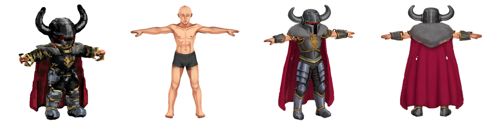
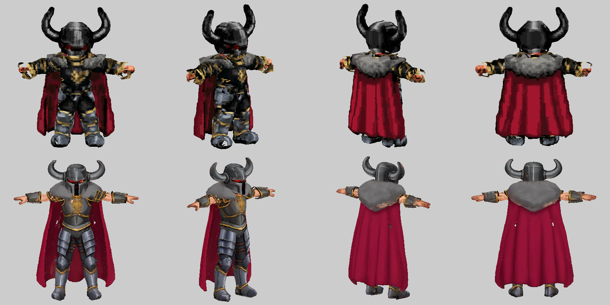

# 3D characters from sprites

A rigged, animated 3D character built from sprites PixelKiln generates: a bare
body and each thing it wears as separate meshes on one skeleton, in one `.glb`
a game engine imports.



**This is an experiment, not a PixelKiln command.** The steps below are
scripts in [`research/scripts`](../research/README.md). They are rough, take
paths as arguments, and may change. PixelKiln itself is used for the first
step only: generating the sprites. The [3D characters page](https://pixelkiln.griffen.codes/3d)
has the finished models to turn and dress, and the
[research note](./RESEARCH_3D.md) records every experiment behind this guide,
in order, with what failed.

Everything here was measured in November 2026 on one PixelLab account and one
machine with a 12 GB RTX 3060.

## What you get

- **One file.** A `.glb` with a body, its items, a skeleton and animations.
- **Parts, not a statue.** The body and each item are separate meshes skinned
  to the same bones, so a game can dress the same body differently.
- **Skin that hides.** The body is split by what covers it. Each piece lists
  the items that hide it in its node's `extras`, as `"hiddenBy": ["Cuirass"]`.
  Hide a piece while any item in its list is worn, and nothing shows through.
- **A standard skeleton.** Twenty-one bones under the names Unity's and Godot's
  humanoid profiles use. Godot 4.7's `SkeletonProfileHumanoid` finds every bone
  it requires, by name.
- **Hands that close,** on the painted path. Where the mesh has a thumb apart
  from the fingers, each hand gets a thumb, one chain for the four fingers
  together, and a point that marks where a grip goes. A hand drawn as a
  closed fist gets the grip point alone, which is enough to hold something.
- **Stock animations.** Motions from a humanoid library made for another
  skeleton, carried over bone by bone.

## Choose a path

The same pipeline runs from small sprites or from large ones. Neither is the
wrong one.



| | Pixel path | Painted path |
|---|---|---|
| Sprites | 64 pixels: a body, and one layer per item | 256 pixels: a body, and the body wearing each item |
| Generations | About 53: 2 for the body, 10 a layer, under 1 for joints | About 110: 9 for the body, up to 25 a worn version, under 1 for joints |
| Before meshing | The sprites, enlarged smoothly | Each sprite redrawn at 1024 pixels by an image model on your own GPU |
| GPU time, body and four items | About 45 minutes | About two hours |
| Build | About four heads tall | About seven heads tall |
| Surface | The sprite's colours, soft up close; meant to be drawn small with a pixel filter | Plates, trim, faces and cloth painted in |
| The example file | 9,300 triangles, 1.0 MB | 19,500 triangles with a sword and shield, 2.8 MB |

**Take the pixel path** when the game is pixel art, the camera is far, and
cost matters. Its limits are known:

- **It is stocky.** A face needs about a dozen pixels, which at 64 pixels is a
  quarter of the figure's height, and the mesh keeps that build.
- **Thin items can come out ragged,** because a sleeve four pixels wide gives
  the mesh model little to go on.
- **Detail stops at what 64 pixels hold.** A crest is a blob of gold.

**Take the painted path** when the model will be seen close or large. Its
limits:

- **The redrawn directions do not agree on every detail.** Each is redrawn
  alone, and the paint blends them.
- **Colours can drift from the sprite's.** The redraw holds them; the paint
  stage can still move them.
- **It costs twice as much** in generations and in time.

A model from either path can be drawn pixelated afterwards. The reverse is not
true: detail that was never painted cannot be added by a filter.

## What you need

- **PixelKiln and a PixelLab account,** for the sprites.
- **A machine with an NVIDIA card of 12 GB or more running ComfyUI,** with
  Hunyuan3D-2mv for meshes and Hunyuan3D's paint stage for textures. The
  painted path also uses an SDXL checkpoint and a tile control model. The
  research note's steps 8 and 17 say how they were installed.
- **Python with numpy, scipy, pillow, trimesh, xatlas and fast-simplification,**
  and Node 22, on the machine that runs the scripts.

## The steps

Each step reads files and writes files. Paths in angle brackets are yours.

### 1. Draw the sprites

**Pixel path.** A bare body in eight directions with the arms out, then one
[`layer`](./PAPERDOLL.md) asset per item over those eight frames:

```json
"body": {
  "prompt": "blank paperdoll base body: bald adult human figure, slim and lean, no clothing, standing straight with both arms held straight out to the sides"
},
"body.plate": {
  "prompt": "Dress every one in the same black steel plate cuirass with gold trim ...",
  "layer": { "of": ["body"], "columns": 4 }
}
```

**Painted path.** The same body prompt at 256 pixels, then one state per item
through PixelLab's character-state tool: "wearing a black steel plate cuirass
...". A state redraws all eight directions of the same figure in the same
pose. There are no separate item layers on this path; where each item is comes
from comparing the worn figure with the bare one.

Arms out to the sides matters on both paths. With arms at the sides the mesh
model fuses them to the body.

### 2. Redraw large (painted path only)

```bash
python3 research/scripts/redraw.py <sprites> <name> <redraws> "<what the character is>"
```

An image model redraws each sprite at 1024 pixels while a control model holds
the layout, and the sprite's colours are put back under the new detail.
`OUTLINE=own` keeps the outline the model drew, which is what gives a round
skull and tapered arms; the sprite's own outline is a staircase.

### 3. Mesh

```bash
python3 research/scripts/hunyuan3d.py <inputs> <name> <meshes>
```

Once for the body and once for the body wearing each item. A thin item meshed
on its own collapses into slabs; meshed on the body, the body gives it shape.

### 4. Fit, paint and bake

```bash
TURNS=0 CAMERA=<body.camera.json> python3 research/scripts/texture.py <sprites> <name> <mesh.glb> <fitted>
TOP=45 SPREAD=22 VIEW=768 STAGE=paint python3 research/scripts/hunyuan3d_paint_turn.py <fitted.glb> <pictures> <name> <views>
python3 research/scripts/bake.py <fitted.glb> <views>/<name>.views.json <baked> <name> 2048
```

The fit puts every mesh in the body's frame, so items land where they are
worn. The paint stage paints one direction at a time with that direction's
picture as its reference, and `TOP=45` adds views from above and below so arm
tops and shoulders are painted and not left to dark outlines.

### 5. Cut the items out

```bash
BODY=<body.baked.glb> python3 research/scripts/cut_item.py <worn.baked.glb> <mask.textured.glb> <item.glb>
```

The mask says roughly where the item is; with `BODY` the paint decides the
edge, so a strip of hand does not come along and a sleeve does not stop short.

### 6. Thin

```bash
TEX=512 python3 research/scripts/thin.py <item.glb> <item-light.glb> 3000
```

Reduces a part to the triangle count given, unwraps it again, and bakes its
colours and a normal map from the dense mesh. The painted example went from
79,819 triangles to 16,496 with no visible loss.

### 7. Rig

```bash
ITEMS="Helm=<helm.glb>:Head;Cape=<cape.glb>:Hips,Spine,Chest:loose;Cuirass=<cuirass.glb>" JPEG=90 \
  python3 research/scripts/rig.py <body-light.glb> <body.rig.json> - - <character.glb>
```

Puts the skeleton in from joints found in the sprites (the same 18 joints the
[skeletons guide](./SKELETONS.md#rig-a-3d-model) covers, estimated in each
direction and combined into positions in space), moves each item to just
above the skin, gives it the bone weights of the body under it, and splits the
body by what covers it. A name after the colon limits an item to those bones;
`loose` marks one that hides no skin.

Hands are measured on the mesh here too. A hand with a thumb standing apart
gets seven more bones: `LeftThumbMetacarpal`, `LeftThumbProximal`,
`LeftThumbDistal`, `LeftMiddleProximal`, `LeftMiddleIntermediate`,
`LeftMiddleDistal` (the four fingers move as one, under the middle finger's
names) and `LeftGrip`, which carries no skin and marks where a grip goes. A
hand with no thumb to find, which is every 64 pixel hand and any hand drawn as
a fist, gets no finger bones. If it is a fist (a ball wider than the wrist
behind it), it gets its wrist moved to the narrowest place and `LeftGrip` or
`RightGrip` in the middle of the fist. The script says which it found for each
hand. `FINGERS=0` turns all of this off.

### 8. Animate

```bash
python3 research/scripts/retarget.py <character.glb> <library.glb> <animated.glb>
```

Carries animations over from a humanoid library. The example uses
[Quaternius's Universal Animation Library](https://quaternius.com/packs/universalanimationlibrary.html),
which is CC0 and is not included in this repository.

### 9. Swing what hangs

```bash
python3 research/scripts/sway.py <animated.glb> <out.glb>
```

With `CHAINS="Cape=3x4"` at the rig step, the cape hangs from three columns of
four bones. This simulates them through every animation and stores the swing
as keys, so the cape moves in any engine with no physics to set up.

### 10. Dress another body

```bash
ONLY=Head python3 research/scripts/refit.py <helm.glb> <first.skin.npz> <second.skin.npz> <helm-for-second.glb>
```

An item made on one body can be worn by another. Make the second body's own
mesh and rig (steps 1 to 7, the body only), write each body's bones with
`SKIN=<file>` at the rig step, and reshape each item from the first to the
second. Then rig the second body with the reshaped items as usual.

### 11. Put something in a hand

```bash
ITEMS="Sword=<sword.glb>:RightHand:held;Cuirass=<cuirass.glb>" python3 research/scripts/rig.py <body-light.glb> <body.rig.json> - - <character.glb>
```

A held thing is made on its own: eight directions of the object upright
(a PixelLab object, 25 generations at 128 pixels), meshed, coloured from the
sprites with `texture.py`, and thinned. `held` lays its longest line across
the palm of the hand named, puts its grip at that hand's grip point, and makes
it `HELD_LENGTH` of the body's height long (default 0.5). The file's own
frame does not matter. It needs a hand with a grip point: one with finger
bones, or a closed fist. In a fist the grip runs through the fist from front
to back, blade to the front, a little short of square to the forearm
(`FIST_LEAN`, 80 degrees), and the guard is kept clear of the fist's side.

Either hand works: name `LeftHand` for the left.

A shield, or anything flat carried on an arm, is `strapped` to a forearm:

```bash
ITEMS="Shield=<shield.glb>:LeftLowerArm:strapped;Sword=<sword.glb>:RightHand:held" python3 research/scripts/rig.py <body-light.glb> <body.rig.json> - - <character.glb>
```

Make it the same way as the sword, drawn upright with its face to the viewer;
unlike a held thing, its file has to keep that frame, which `texture.py`
gives it. Its back goes to the back of the forearm, its top towards the
elbow, so it stands upright when the arm hangs, and it is made
`STRAPPED_LENGTH` of the body's height tall (default 0.36). `STRAPPED_TURN=90`
lays it across the arm. It follows the forearm alone and needs no hand
bones.

Two hands on one grip takes the `two-handed` kind and one more script:

```bash
HELD_LENGTH=0.8 ITEMS="Greatsword=<greatsword.glb>:RightHand:two-handed" python3 research/scripts/rig.py <body-light.glb> <body.rig.json> - - <character.glb>
python3 research/scripts/retarget.py <character.glb> <library.glb> <animated.glb>
python3 research/scripts/offhand.py <animated.glb> <two-handed.glb>
```

The hand named leads and sits under the guard. `rig.py` leaves a bone,
`RightGrip2`, where the other hand belongs. `offhand.py` then goes through
every animation: it pulls the grip in front of the body until both arms can
reach it, bends both arms to meet it, and stores the result as keys. It
prints, for each animation, how far the grip was pulled, whether the hand
ever fell short and how far a wrist bends. Run it after `retarget.py` and
before `sway.py`. An engine with its own arm solver can use the `RightGrip2`
bone and skip the script.

Those are one-handed motions bent to fit. For motions made for two hands,
run one more script after it:

```bash
python3 research/scripts/wield.py <two-handed.glb> <with-great-motions.glb>
```

It adds `Great_Idle`, `Great_Walk`, `Great_Jog` and `Great_Attack`: the
sword's path is written in the script, both arms are solved to it, and the
legs and trunk come from the stock idle, walk and jog. It prints how far each
wrist bends, how far the blade is off its edge and whether a hand fell short.
To add a motion, add an entry to `MOTIONS` at the top of the script. An entry's
`feet` list moves and turns the hips and steps a foot, as the attack does.

A spear or staff has no guard and its hands go apart. Say where they go, give
it to the hand that is forward, and ask for the spear motions:

```bash
HELD_LENGTH=1.1 GRIP_AT=0.45 GRIP_APART=0.2 ITEMS="Spear=<spear.glb>:LeftHand:two-handed" python3 research/scripts/rig.py <body-light.glb> <body.rig.json> - - <character.glb>
python3 research/scripts/retarget.py <character.glb> <library.glb> <animated.glb>
SET=spear python3 research/scripts/wield.py <animated.glb> <with-spear-motions.glb>
```

`GRIP_AT` is where the forward hand's middle is, as a share of the item's
length from its butt, and `GRIP_APART` how far behind it the other hand is.
That adds `Spear_Idle`, `Spear_Advance`, `Spear_Walk`, `Spear_Jog` and `Spear_Thrust`. The
idle is a side-on stance: the hips turned 45 degrees so the forward shoulder
leads, the forward foot ahead, the other behind and turned out, and the head
looking along the shaft. The walk and jog turn the hips less (28 and 14
degrees), and the thrust squares them up as the point goes out.
`Spear_Advance` moves forward in the stance, the forward foot stepping and
the other following without passing it; it is made in place, and the report's
`groundMetresALoop` says how far to move the character in one loop. The
stock one-handed motions do not suit a shaft; `offhand.py` can still be run
on them, but the rear hand is often off the shaft.

Then animate as in step 8. `retarget.py` carries the library's thumb and
middle finger over, so the hand is a fist in a walk and closed round the grip
in a sword attack. A fist has no fingers to move and holds as drawn.

## In a game engine

The example file was imported into Godot 4.7.2 with no errors: one skeleton of
47 bones (21 for the body, 14 for the hands, 12 for the cape), eleven skinned meshes, twelve animations, and each body piece's
`hiddenBy` list in its node metadata. Godot drops a trailing `_Loop` from
animation names, so the library's `Walk_Loop` arrives as `Walk`.

The motions are made in place. For an engine that moves a character by its
animation, run this last:

```
python3 research/scripts/rootmotion.py <animated.glb> <with-root-motion.glb>
```

It adds a `Root` bone under the hips and keys it forward in every walk, run and
advance, at the pace the planted foot goes back. In Godot, set the animation
player's `root_motion_track` to that bone. The report gives each motion's
speed and how far a foot still slides at it; the walk and the advance are
good, the jog and sprint rough. Keep the file without it for anything that
plays animations plainly, where the character would walk off and jump back.

Not tried: Unity and Unreal, Godot's retargeting onto its own humanoid rest
pose, and how the model looks drawn in any engine but three.js.

## Sprite cards: the other answer

A character can also be shown as its own sprites, cut into a piece per bone
and carried on the skeleton as flat cards that face the camera. The pixels on
screen are the drawn ones, so nothing is lost to painting. It needs no mesh
texture at all, only the mesh to say which pixel belongs to which bone.

```bash
SKIN=<skin.npz> python3 research/scripts/rig.py <body.textured.glb> <body.rig.json> - - <skeleton.glb>
LAYERS="Body=<body>;Cape=<cape>:Spine:behind;Helm=<helm>:Head" python3 research/scripts/cards.py <skin.npz> <body.camera.json> <sprites> <out-prefix>
```

It has eight directions and no lighting, and joints open a little as limbs
swing. See step 31 of the research note.

## What is not done

- **A command.** None of this is `pixelkiln` yet.
- **Hand-made topology.** The thinned mesh has no edge loops at the joints and
  its unwrap is dozens of pieces.
- **Materials.** Colour and a normal map only: no metal or roughness, and the
  redraw's lighting is painted in.
- **Separate fingers, eyes and a jaw** in the skeleton. The four fingers
  move as one, and only on the painted path.
- **Held items beyond swords and a shield.** A shield gripped in the fist is
  untried, the grip is not sized to the hand, there are four motions made for two hands
  and the rest are stock one-handed ones bent to fit, which can bend a wrist
  too far,
  and the animation library has no left-handed or shield motions, so a shield
  is carried, not used. A fist cannot open, so it cannot let go or change its hold.
- **Many bodies.** The items have been worn by two: the one they were cut on
  and one much heavier man, after `refit.py` reshaped them for him. Other
  heights and builds are untried.
