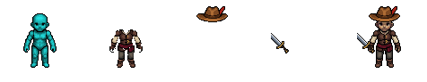
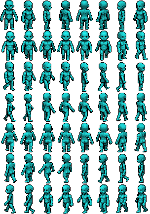
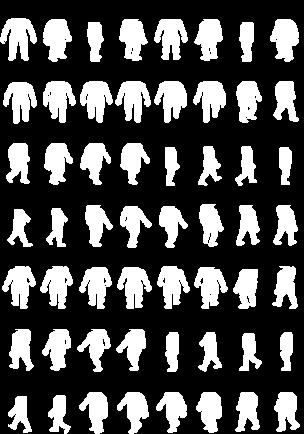
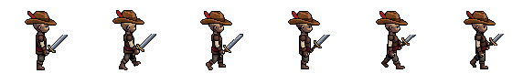
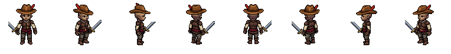

# Paperdoll layers

One bare character, any number of outfits, hats and held items, each a
transparent layer that lines up with every frame of every animation. A
`layer` asset draws its prompt over frames you already have and hands back
only what it added.



Everything on this page was measured on one PixelLab account in November
2026, on a 64px bare base with an 8-direction walk. Where a number is a
measurement it says so, and [Cost and limits](#cost-and-limits) lists what
was not tested.

## How it works

Games that ship swappable gear on pixel sprites (Ultima Online, Diablo II,
Flare) all work the same way: the body is a full set of frames, every item is
a full set of frames for the same poses, and the game draws body frame N and
then each item's frame N. The hard part is making frame N of the item match
frame N of the body.

Asking a model for "the same character in armour" does not do it. The model
redraws the body, a pixel here and a shade there, and the difference between
the two images is no longer just the armour.

A layer avoids the problem by painting the item onto the body's own frames:

1. **Clean.** Loop frames are stripped of the ghost pixels an animation model
   leaves around a figure. See [Cleaning loops](#cleaning-loops).
2. **Sheet.** Every frame of every source asset is centred on a common canvas,
   cut to the one box that holds them all, and laid on a single sheet.
3. **Key.** Skin is repainted cyan, keeping its shading.
4. **Mask.** White where the provider may paint, black where it may not.
5. **Inpaint.** One masked inpaint over the whole sheet.
6. **Cut.** Pixels the provider repainted, that are not still cyan, are the
   layer. It is split back into one PNG per source frame.

| What the provider is sent | The mask | What it returns |
|---|---|---|
|  |  |  |

Three choices carry the result:

- **One sheet, one request.** The model sees every pose at once, so the
  outfit is the same in all of them. Two requests with the same prompt give
  two different outfits.
- **A masked inpaint.** PixelLab's `/inpaint-v3` returns every pixel outside
  the mask exactly as it was sent. In the four live runs that counted, zero
  pixels outside the mask changed. Part of every figure is always outside the
  mask (the head for an outfit, the body for a hat), and a model cannot move
  a figure it may not touch, so the poses hold.
- **Cyan skin.** Asked to keep the skin, a model returns skin tones that
  overlap leather, hair and wood, and the body can no longer be told from the
  outfit. Cyan comes back as shades of cyan, and dropping it is a hue test.

## Quick start

```json
{
  "styles": {
    "cast": { "generator": "character", "mode": "v3", "size": 64, "view": "low top-down", "outDir": "art" }
  },
  "assets": {
    "hero": {
      "prompt": "blank paperdoll base body: bald genderless humanoid figure with smooth plain light tan skin, no clothing, no hair, no accessories, neutral standing pose with arms held slightly away from the body"
    },
    "hero.walk": {
      "animation": { "of": "hero", "template": "walking", "clean": true,
        "directions": ["south", "south-east", "east", "north-east", "north", "north-west", "west", "south-west"] }
    },
    "hero.leather": {
      "prompt": "Dress every masked cyan mannequin on this spritesheet in the same coherent leather ranger armour: dark-brown leather cuirass with small brass buckles, a dark-red sash at the waist, cream undershirt with rolled sleeves, dark trousers, strapped leather boots. Adapt that exact outfit to every existing pose. Preserve the visible cyan skin on hands, forearms and neck as cyan. Do not alter heads. Do not add hair, hats, weapons, props, backgrounds or extra characters.",
      "layer": { "of": ["hero", "hero.walk.south", "hero.walk.south-east", "hero.walk.east", "hero.walk.north-east",
                         "hero.walk.north", "hero.walk.north-west", "hero.walk.west", "hero.walk.south-west"] }
    }
  }
}
```

```bash
pixelkiln plan
```

```bash
pixelkiln gen
```

`gen` runs in waves: the base, then the loops, then the layer, which stays
`blocked` until every asset it dresses is downloaded. Measured cost of that
manifest: 2 generations for the base, 8 for the walk, 25 for the layer.

The layer's files are named after what they sit over:

```text
art/hero-south.png                              the base, facing south
art/hero.leather-hero-south.png                 its layer
art/hero.walk.south-frame-00.png                a walk frame
art/hero.leather-hero-walk-south-frame-00.png   its layer
```

Draw the source frame, then the layer at the same position.



## A base built for layers

Everything is fitted to the base, so settle it before making layers.

- **Bare and bald.** Clothing on the base shows at the edges of every outfit
  that is narrower than it. Hair is a layer like any other, and a bald head
  gives the neck detection a clean shape.
- **Arms away from the body.** An arm drawn against the torso gives the model
  no way to put a sleeve on it.
- **Native size.** Generate at the size you will ship. A 64px character
  resized to 32px loses the face.
- **The prompt above passed PixelLab's content filter** on the first try,
  twice, in skin tones and in cyan. Words like "mannequin" and "doll-like"
  pulled the proportions towards a toddler at 64px; describe the proportions
  you want.
- **Turn on `clean` for every loop** before generating any layer. See
  [Cleaning loops](#cleaning-loops).

The base does not need to be cyan. Keying happens locally, on the sheet, and
the files in your project keep their own colours.

## Outfits

The default. `region` is `body`: the provider may repaint the figure's own
pixels below the neck and nothing else, so clothing cannot grow past the
silhouette and the head cannot move.

```json
"hero.leather": {
  "prompt": "Dress every masked cyan mannequin on this spritesheet in the same ...",
  "layer": { "of": ["hero", "hero.walk.south"] }
}
```

Prompt notes, from the runs that worked:

- Say that it is a sheet of the same figure and that every one gets the
  **same** outfit.
- List the garments and their colours. The model fills gaps differently in
  each cell otherwise.
- Tell it to **keep the cyan skin cyan** on hands, forearms and neck.
- List what not to add: hair, hats, weapons, props, backgrounds.
- The style's `promptPrefix` and `promptSuffix` are not applied to a layer.
  They describe the character, who is already on the sheet.

Measured on 56 frames (8 rotations and a 6-frame walk in 8 directions): every
frame dressed, the outfit consistent across all of them, and the layer
covering 80 to 92% of each figure's masked area, the rest being skin left
bare.

**A character that is not bare** needs `skin`: the colours that are skin, so
that only they are keyed. It works, but the old clothes show wherever the new
outfit is narrower (80 stray pixels across 38 frames in the one run that
tried it).

```json
"layer": { "of": ["mira", "mira.walk.south"], "skin": ["#f6b58a", "#e58a62", "#f2a076", "#d87855"] }
```

## Hats and hair

`"region": "head"` masks everything from the top of each cell down to the
neck, empty space included, and leaves the body black. `padding` adds empty
pixels around every figure so there is room for a brim or a tall crown.

```json
"hero.hat": {
  "prompt": "Put the same wide-brimmed brown leather ranger hat with a small red feather on the head of every cyan mannequin on this spritesheet. The hat follows the direction each head faces. Keep the hat the same shape, size and colours in every cell. Keep each head exactly where it is and keep the cyan face and ears below the brim cyan. Do not add hair, bodies, clothes, weapons or extra characters.",
  "layer": { "of": ["hero", "hero.walk.south", "hero.walk.east"], "region": "head", "padding": 10 }
}
```

Measured on 20 frames (8 rotations, two 6-frame walks) with 10px of padding:
the hat was the same shape and colours in all 20 and turned correctly with
the head, front, side, back and diagonals.

**A padded layer comes back on a larger canvas.** Each frame is its source
frame's canvas grown by `padding` on every side, because a hat above a head
that touches the top of a 64px frame has nowhere to go inside it. A 64px
frame with `"padding": 10` gives an 84px layer. The two share a centre: draw
them centred on the same point, or draw the layer at the frame's position
minus `padding` in both axes.

Padding makes the sheet bigger, so fewer frames fit. See
[Cost and limits](#cost-and-limits).

## Held items and accessories

`"region": "around"` masks everything below the neck, empty space included,
and leaves the head black: room beside the body for a sword, a shield, a
cape or a pack.

```json
"hero.sword": {
  "prompt": "Give every cyan mannequin on this spritesheet the same steel longsword with a brown leather grip and brass crossguard, held in its right hand, blade pointing up and slightly outward. Draw it correctly for the direction each figure faces. Keep the sword the same length, shape and colours in every cell. Do not change the cyan bodies: keep every body, arm, leg and pose exactly as it is and keep the skin cyan. Do not add clothes, armour, hats, hair, shields or extra characters.",
  "layer": { "of": ["hero", "hero.walk.south", "hero.walk.east"], "region": "around", "padding": 12 }
}
```

Measured on the same 20 frames with 12px of padding: the sword kept its
length, shape and colours in all 20, and was drawn correctly for each of the
8 directions.

**Which hand is not reliable.** In the south-facing walk the sword was in the
character's right hand for 4 frames and its left for 2. The east walk held it
on one side for all 6. Check a held item's loop frame by frame. When it swaps,
generate the layer again, or move the offending loop into a layer of its own
so that only it is redone. This is the same handedness problem PixelLab's animation tools have,
and a mask does not fix it.

**Item layers are tidied.** Given room around the figure, a provider redraws
stretches of the body's outline a pixel off, leaves dark blots where it
redrew an eye or a shadow, and lets a long blade run into the next cell. For
`head` and `around` layers the cut step drops:

- dark pixels that neither border a coloured layer pixel nor sit in a solid
  2×2 block (outline scribbles),
- fragments with no coloured pixel at all, under 40 pixels (blots),
- fragments under 8 pixels, and fragments under 20 that touch their cell's
  edge (specks, and tips bleeding in from the next cell).

An item smaller than 8 pixels does not survive that. Give it a hand-made
`mask` and the `body` region instead, which is not tidied.

A blade longer than the padding still crosses into the next cell, and one
such fragment survived in 20 frames. Raise `padding` until the item fits.

## Composing layers in a game

Layers from separate `layer` assets stack. The outfit, hat and sword on this
page are three assets, generated separately, drawn over one base:



- **Order.** Body, then outfit, then held items, then hat is a workable
  default. A cape or a sword on the back wants to be drawn behind the body
  when the character faces the viewer and in front when it faces away; keep
  a small table of order per direction in your game, the way Ultima Online
  and Flare do.
- **Position.** An unpadded layer has its source frame's canvas: same
  position. A padded one is larger by `padding` on every side: same centre.
- **Frame for frame.** Layer frame N belongs to source frame N. There is one
  layer file per source file and the names pair them up.
- **Hidden parts are not there.** A layer holds what the frame shows. Hair
  behind a head, an arm behind a torso, the part of a hat a raised arm would
  cover: none of it is drawn, so removing a layer never reveals more of the
  one beneath.
- **Mirrors.** A layer over a mirrored loop is painted on the flipped frames,
  so anything one-sided (a sword, a shoulder strap) is drawn for that side
  rather than flipped. Dress the mirror, do not mirror the layer.

`layout.json` in the layer's work folder lists every frame's asset, role,
canvas, padding and cell, for a build step that wants to pack layers itself.

## Masks and overrides

Every step's file is kept in `.pixelkiln/layers/<style>/<asset>/`:

| File | Is |
|---|---|
| `sheet.png` | The frames as they are, cleaned, on one sheet. |
| `keyed.png` | The sheet with skin keyed: what the provider was sent. |
| `mask.png` | White where it could paint. |
| `result.png` | What it returned. |
| `layout.json` | Which cell is which frame, and the sheet's size. |

When a step produces the wrong thing, replace its file. The computed mask
finds each neck as the narrowest row in the upper part of the figure. That
holds for a bald base with its arms down, and fails for hair wider than the
head or an arm raised beside it. To fix it:

1. Run the layer once.
2. Open `mask.png` from the work folder in any pixel editor.
3. Paint white where the layer may go and black everywhere else. Pure white
   and pure black only.
4. Save it into the project (the work folder is git-ignored) and name it:

```json
"layer": { "of": ["hero", "hero.wave"], "mask": "masks/hero-wave.png" }
```

`keyed` does the same for the keyed sheet. A supplied file must be the
sheet's exact size, so it stays valid only while `of`, `columns`, `padding`
and the frames themselves do. The layer fails before any request, with both
sizes, when they differ.

Two of the steps are also [`derive` transforms](./MANIFEST.md#derived-and-external-assets)
for single images, free and local: `key-skin` and `despeckle`.

## Cleaning loops

An animation model leaves ghost pixels around a moving figure: pale arcs
beside the head, fragments off a hand or a foot. A layer cleans the frames on
its own sheet, but the loop's files are what your game draws the layer over,
so clean those too:

```json
"hero.walk.south": { "animation": { "of": "hero", "template": "walking", "direction": "south", "clean": true } }
```


Each frame is judged against the parent's rotations. A colour the rotations
barely use, on the outside of the figure, is debris; so is a fragment in such
colours that outline has sealed off beside the figure. Colours the rotations
do use are never removed.

Measured on the walk above: 608 stray near-white pixels across 48 frames
before, 2 after. Run over the 8 rotations themselves, it removed 1 pixel.

Cleaning is post-processing. Turning it on for a loop that is already
downloaded shows in `plan` as `recoverable`, and `pixelkiln fetch`
re-processes the frames at no cost. Do it before generating layers: a loop
the cleaning changed makes a layer over it `stale`.

More in [Characters](./CHARACTERS.md#cleaning-a-loops-frames).

## Cost and limits

A layer is one `/inpaint-v3` call, priced by the sheet's canvas whatever the
frame count.

| Sheet | Frames | Layer | Generations |
|---|---|---|---|
| 304×434 | 56 (8 rotations, walk in 8 directions) | outfit | 25, billed |
| 384×320 | 38 (clothed character, mixed loops) | outfit | 25, quoted |
| 290×328 | 20, 10px padding | hat | 15, quoted |
| 310×344 | 20, 12px padding | sword | 25, quoted |

"Billed" was read back from the finished job; "quoted" is what PixelLab
stated when the job was submitted.

- **The plan prices every layer at 25**, the top tier, because the sheet's
  size depends on the frames' own pixels and planning does not read them.
  The lock records what was billed.
- **PixelLab's tiers**: 10 up to a 256×256 square, 15 up to about 341×341,
  25 above, with other aspect ratios measured against their own ceilings.
- **Everything must fit one 512px sheet.** 56 unpadded frames of a 64px
  character fit. Padding of 10 takes the same 56 frames past the limit; the
  20-frame sheets above are what fit comfortably. When the frames do not fit,
  the layer fails before any request and names the sizes.
- **Split when you must.** Two layers over different loops are two requests
  and may not match each other. Put the base's rotations in both so each has
  the same anchor, and compare the results.
- **PixelLab only.** The layer uses `/inpaint-v3`. Pro Flash inpainting was
  tried and left 3 of 18 frames undressed and erased props in others.

Not tested: sizes other than 64px, quadrupeds, more than 56 frames,
attack animations (where limbs cross the head and the neck detection is
weakest), hair, capes, shields, and two held items at once.

## Field reference

A `layer` asset needs a `prompt` and a `layer` object. It takes no
`reference` or `concept`, and belongs in a `character` style.

| Field | Default | Does |
|---|---|---|
| `of` | required | One asset id or a list, in the same style: a base, its states, its loops. Their frames share one sheet in this order. |
| `region` | `body` | `body`: the figure's own pixels below the neck. `head`: the cell from its top to the neck. `around`: everything below the neck. |
| `padding` | 0 for `body`, 8 otherwise | Empty pixels around every figure, 0 to 64. Layer frames grow by this on every side. |
| `mask` | computed | A black-and-white PNG the size of the sheet. |
| `keyed` | computed | A PNG the size of the sheet, sent instead of the keyed sheet. |
| `skin` | all but outline | The colours that are skin, for a character that is not bare. |
| `key` | `#00ffff` | The stand-in colour. Change it for an item that is itself cyan. |
| `clean` | `true` | Clean loop frames against the stills among `of` before sheeting them. |
| `columns` | fitted | Sheet columns. |

Plan states: `blocked` until every source is downloaded and current, `stale`
when a source is regenerated or re-processed, or when the prompt or any
field above changes.

On a loop, `animation.clean` (default off) cleans its frames at download.

## Troubleshooting

| What you see | Why | Do |
|---|---|---|
| Pale specks around the dressed character | The loop's own files were never cleaned; the layer is fine. | Set `"clean": true` on the loop and run `pixelkiln fetch`. |
| Sleeves or collar missing where an arm is raised | The computed mask put the neck in the wrong row for that frame. | Supply a `mask`. |
| The outfit differs between two loops | They were dressed by two layers. | Put both loops in one layer's `of`. |
| Old clothes show at the edges | The base is not bare. | Use a bare base, or accept it. |
| A fringe in the key colour at wrists or collar | Shades of the key the cut did not recognise. | Change `key` to a colour further from the outfit's, or open an issue with `result.png`. |
| A hat is cut off at the top | Not enough room in the cell. | Raise `padding`. |
| A blade tip appears beside a neighbouring frame | The item ran past its cell. | Raise `padding`. |
| A sword changes hands mid-walk | The model, not the mask. | Generate the layer again, or give that loop its own layer. |
| "do not fit one 512px sheet" | Too many frames, or too much padding. | Lower `padding`, or split the layer. |
| The layer is `stale` after turning on `clean` | Its sources' bytes changed. | Turn `clean` on first next time; regenerate the layer. |
