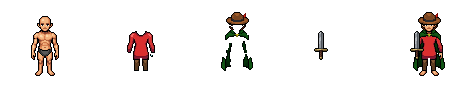
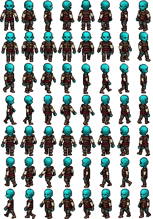
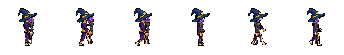
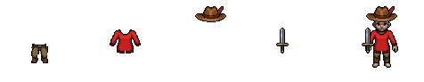
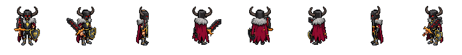
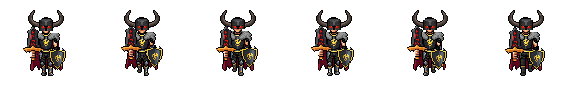
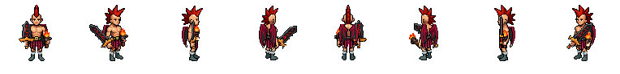
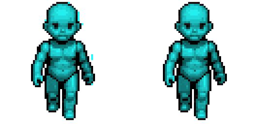

# Paperdoll layers

One bare character, any number of outfits, hats and held items, each a
transparent layer that lines up with every frame of every animation. A
`layer` asset draws its prompt over frames you already have and hands back
only what it added. A rigid item, a sword or a shield, can skip the drawing:
a layer with `attach` pins a sprite you already have to the hand in every
frame, for free.



The [site](https://pixelkiln.griffen.codes/paperdoll#paperdoll-builder) has a character you
can dress from twenty such layers, and
[`examples/paperdoll`](../examples/paperdoll) is its manifest.

Everything on this page was measured on one PixelLab account in November
2026, at 64px, on two bare bases: a first one with an 8-direction walk, which
most of the numbers come from, and the one in the pictures, with a walk in
four directions. Where a number is a
measurement it says so, and [Cost and limits](#cost-and-limits) lists what
was not tested.

## How it works

Games that ship swappable gear on pixel sprites (Ultima Online, Diablo II,
Flare) all work the same way: the body is a full set of frames, every item is
a full set of frames for the same poses, and the game draws body frame N and
then each item's frame N. The hard part is making frame N of the item match
frame N of the body.

Asking a model for "the same character in armour" does not do it. The model
redraws the body, a pixel here and a shade there, and the difference between
the two images is no longer just the armour.

A layer avoids the problem by painting the item onto the body's own frames:

1. **Clean.** Loop frames are stripped of the ghost pixels an animation model
   leaves around a figure. See [Cleaning loops](#cleaning-loops).
2. **Sheet.** Every frame of every source asset is centred on a common canvas,
   cut to the one box that holds them all, and laid on a single sheet.
3. **Mask.** White where the provider may paint, black where it may not.
4. **Key.** Inside the mask, skin is repainted cyan, keeping its shading.
   Outside it the frame keeps its own colours.
5. **Inpaint.** One masked inpaint over the whole sheet.
6. **Cut.** Pixels the provider repainted, that are not still cyan, are the
   layer. It is split back into one PNG per source frame.

| What the provider is sent | The mask | What it returns |
|---|---|---|
|  |  |  |

Three choices carry the result:

- **One sheet, one request.** The model sees every pose at once, so the
  outfit is the same in all of them. Two requests with the same prompt give
  two different outfits.
- **A masked inpaint.** PixelLab's `/inpaint-v3` returns every pixel outside
  the mask exactly as it was sent. In the four live runs that counted, zero
  pixels outside the mask changed. Part of every figure is always outside the
  mask (the head for an outfit, the body for a hat), and a model cannot move
  a figure it may not touch, so the poses hold.
- **Cyan skin.** Asked to keep the skin, a model returns skin tones that
  overlap leather, hair and wood, and the body can no longer be told from the
  outfit. Cyan comes back as shades of cyan, and dropping it is a hue test.
  Only the part the provider may repaint is keyed. The rest comes back
  identical whatever colour it went in as, and in its own colours it tells
  the provider things cyan does not: under an outfit's mask it is the head,
  and a head with a face on it is a figure seen from the front.

## Quick start

```json
{
  "styles": {
    "cast": { "generator": "character", "mode": "v3", "size": 64, "view": "low top-down", "outDir": "art" }
  },
  "assets": {
    "hero": {
      "prompt": "blank paperdoll base body: bald genderless humanoid figure with smooth plain light tan skin, no clothing, no hair, no accessories, neutral standing pose with arms held slightly away from the body"
    },
    "hero.walk": {
      "animation": { "of": "hero", "template": "walking", "clean": true,
        "directions": ["south", "south-east", "east", "north-east", "north", "north-west", "west", "south-west"] }
    },
    "hero.leather": {
      "prompt": "Dress every masked cyan mannequin on this spritesheet in the same coherent leather ranger armour: dark-brown leather cuirass with small brass buckles, a dark-red sash at the waist, cream undershirt with rolled sleeves, dark trousers, strapped leather boots. Adapt that exact outfit to every existing pose. Preserve the visible cyan skin on hands, forearms and neck as cyan. Do not alter heads. Do not add hair, hats, weapons, props, backgrounds or extra characters.",
      "layer": { "of": ["hero", "hero.walk.south", "hero.walk.south-east", "hero.walk.east", "hero.walk.north-east",
                         "hero.walk.north", "hero.walk.north-west", "hero.walk.west", "hero.walk.south-west"] }
    }
  }
}
```

```bash
pixelkiln plan
```

```bash
pixelkiln gen
```

`gen` runs in waves: the base, then the loops, then the layer, which stays
`blocked` until every asset it dresses is downloaded. Measured cost of that
manifest: 2 generations for the base, 8 for the walk, 25 for the layer.

The layer's files are named after what they sit over:

```text
art/hero-south.png                              the base, facing south
art/hero.leather-hero-south.png                 its layer
art/hero.walk.south-frame-00.png                a walk frame
art/hero.leather-hero-walk-south-frame-00.png   its layer
```

Draw the source frame, then the layer at the same position.



## A base built for layers

Everything is fitted to the base, so settle it before making layers.

- **Bare and bald.** Clothing on the base shows at the edges of every outfit
  that is narrower than it. Hair is a layer like any other, and a bald head
  gives the neck detection a clean shape.
- **Arms away from the body.** An arm drawn against the torso gives the model
  no way to put a sleeve on it.
- **Native size.** Generate at the size you will ship. A 64px character
  resized to 32px loses the face.
- **The prompt above passed PixelLab's content filter** on the first try,
  twice, in skin tones and in cyan. Words like "mannequin" and "doll-like"
  pulled the proportions towards a toddler at 64px; describe the proportions
  you want.
- **Turn on `clean` for every loop** before generating any layer. See
  [Cleaning loops](#cleaning-loops).

The base does not need to be cyan. Keying happens locally, on the sheet, and
the files in your project keep their own colours.

## Outfits

The default. `region` is `body`: the provider may repaint the figure's own
pixels below the neck and nothing else, so clothing cannot grow past the
silhouette and the head cannot move.

```json
"hero.leather": {
  "prompt": "Dress every masked cyan mannequin on this spritesheet in the same ...",
  "layer": { "of": ["hero", "hero.walk.south"] }
}
```

Prompt notes, from the runs that worked:

- Say that it is a sheet of the same figure and that every one gets the
  **same** outfit.
- List the garments and their colours. The model fills gaps differently in
  each cell otherwise.
- Tell it to **keep the cyan skin cyan** on hands, forearms and neck.
- List what not to add: hair, hats, weapons, props, backgrounds.
- The style's `promptPrefix` and `promptSuffix` are not applied to a layer.
  They describe the character, who is already on the sheet.

Measured on 56 frames (8 rotations and a 6-frame walk in 8 directions): every
frame dressed, the outfit consistent across all of them, and the layer
covering 80 to 92% of each figure's masked area, the rest being skin left
bare.

**A character that is not bare** needs `skin`: the colours that are skin, so
that only they are keyed. It works, but the old clothes show wherever the new
outfit is narrower (80 stray pixels across 38 frames in the one run that
tried it).

```json
"layer": { "of": ["mira", "mira.walk.south"], "skin": ["#f6b58a", "#e58a62", "#f2a076", "#d87855"] }
```

### One piece at a time

An outfit does not have to be one layer. Ask for a single garment and say
what stays bare, and the same mask gives a layer holding only that garment:
whatever the provider leaves cyan is dropped, so nothing marks where the
shirt ends but the shirt.

```json
"hero.shirt": {
  "prompt": "Dress every cyan mannequin on this spritesheet in the same red long-sleeved tunic shirt with a darker red hem, covering the chest, back, shoulders and arms down to the wrists and ending at the hips. Keep the shirt the same colour and cut in every cell. Only the shirt: leave the hips, legs, feet, hands, neck and head bare cyan exactly as they are. Do not add trousers, shorts, underwear, belts, shoes, gloves, hats, hair or items.",
  "layer": { "of": ["hero", "hero.walk.south", "hero.walk.east"] }
},
"hero.trousers": {
  "prompt": "Dress every cyan mannequin on this spritesheet in the same pair of brown trousers with a dark leather belt, covering the hips and both legs from the waist down to the ankles. Keep the trousers the same colour and cut in every cell. Only the trousers: leave the chest, back, shoulders, arms, hands, feet, neck and head bare cyan exactly as they are. Do not add shirts, shoes, boots, gloves, hats, hair or items.",
  "layer": { "of": ["hero", "hero.walk.south", "hero.walk.east"] }
}
```



The shirt and trousers above, measured on 20 frames: both runs dressed every frame with only the garment
asked for, and the two stack, trousers first, with the shirt's hem over the
waistband. Each cost 10 generations as quoted, the sheet being small.

Draw the pieces in the order they are worn: trousers, shirt, coat. Two pieces
are two requests, so they are consistent with themselves and not designed
together; name colours that go with each other.

### Colours for nothing

A drawn layer can be recoloured locally, every frame at once, with a
[`derive`](./MANIFEST.md#derived-and-external-assets) asset. `hue-shift`
turns the hue and keeps each pixel's shading, and `hue` limits it to one
range of colour so that trim in another colour stays put:

```json
"hero.warcape.blue":  { "derive": { "from": "hero.warcape", "transform": "hue-shift", "degrees": -120, "hue": [320, 20] } },
"hero.robe.crimson":  { "derive": { "from": "hero.robe", "transform": "hue-shift", "degrees": 72, "hue": [240, 320],
                                    "saturation": 1.5, "brightness": 1.3 } }
```

The first turns a crimson cape blue and leaves its grey fur collar alone,
since grey has no hue to turn. The second takes a purple robe to red and
leaves the gold trim gold; dark purple turned to red comes out brown until
it is brightened, hence the two multipliers. Each writes one frame per frame
of its source under the same names, costs nothing, and is `stale` when the
layer it came from is regenerated. Five such variants of the layers on this
page took one free `gen`.

It recolours; it does not redesign. A layer whose parts share a hue all turn
together.

**Skin tones.** The same transform on the bare base gives other skins, since
a base built for layers is nothing but skin and outline. Derive the base and
each of its loops with the same numbers:

```json
"hero.brown":            { "derive": { "from": "hero", "transform": "hue-shift", "hue": [0, 45],
                                       "degrees": -4, "saturation": 1.3, "brightness": 0.64 } },
"hero.walk.south.brown": { "derive": { "from": "hero.walk.south", "transform": "hue-shift", "hue": [0, 45],
                                       "degrees": -4, "saturation": 1.3, "brightness": 0.64 } }
```

Tried on this page's base: `brightness` 0.86, 0.64 and 0.44 with
`saturation` 1.2 to 1.3 gave tan, brown and deep brown that read as skin,
and turning the hue instead gave an orc green (`degrees` 78) and a frost
blue (-175). Every drawn layer goes over them unchanged, because a layer has
no skin in it.

A `grasp` layer does have skin in it: the fingers, in the first base's
colours. Derive it with the same numbers and the item's own warm colours
turn too; a torch's flame and a gold crossguard went green with the orc.
`reference` prevents that. It limits the change to pixels in a colour the
named PNGs use, and the base's own frames use only skin and outline:

```json
"hero.torch.orc": { "derive": { "from": "hero.torch", "transform": "hue-shift", "hue": [0, 45],
                                "degrees": 78, "saturation": 0.95, "brightness": 0.82,
                                "reference": ["art/hero-south.png", "art/hero.walk.south-frame-00.png"] } }
```

List every frame of the base and its loops, up to 64 files; the fingers
were coloured from all of them. On the four gripped items here that moved
the fingers and left the items alone, since each item sprite shared at most
one warm colour with the base.

One thing does not follow: a near-white highlight has no hue, so it is left
alone, and a sheen that was invisible on pale skin shows as white specks on
dark. The stills had none; one walk frame did.

Layers are keyed against the base they were generated over, so make them on
the original and put them over any of its recolours.

**The wire figure.** Asked for part of an outfit, a provider still redraws
the outline of the limbs it left bare, slightly changed, and those pixels
would come back as a thin outline of the whole body in every layer. The cut
step removes them: a dark pixel stays only when it borders a coloured layer
pixel or sits in a solid 2×2 block. On the two runs above that removed 1,623
and 2,265 outline pixels and 1 coloured one. On the 56-frame full outfit it
removed 551, the outline around the bare hands and neck, and no coloured
ones.

## Hats and hair

`"region": "head"` masks everything from the top of each cell down to the
neck, empty space included, and leaves the body black. `padding` adds empty
pixels around every figure so there is room for a brim or a tall crown.

```json
"hero.hat": {
  "prompt": "Put the same wide-brimmed brown leather ranger hat with a small red feather on the head of every cyan mannequin on this spritesheet. The hat follows the direction each head faces. Keep the hat the same shape, size and colours in every cell. Keep each head exactly where it is and keep the cyan face and ears below the brim cyan. Do not add hair, bodies, clothes, weapons or extra characters.",
  "layer": { "of": ["hero", "hero.walk.south", "hero.walk.east"], "region": "head", "padding": 10 }
}
```

Measured on 20 frames (8 rotations, two 6-frame walks) with 10px of padding:
the hat was the same shape and colours in all 20 and turned correctly with
the head, front, side, back and diagonals.

**A padded layer comes back on a larger canvas.** Each frame is its source
frame's canvas grown by `padding` on every side, because a hat above a head
that touches the top of a 64px frame has nowhere to go inside it. A 64px
frame with `"padding": 10` gives an 84px layer. The two share a centre: draw
them centred on the same point, or draw the layer at the frame's position
minus `padding` in both axes.

Padding makes the sheet bigger, so fewer frames fit. See
[Cost and limits](#cost-and-limits).

### Nudging a layer into place

A provider does not always seat a hat where you would. `offset` moves a
layer by whole pixels, x to the right and y down:

```json
"layer": { "of": ["hero", "hero.walk.south"], "region": "head", "padding": 10, "offset": [0, -2] }
```

It can also seat it differently per source asset, which is what a hat that
sits right on the stills and low on one walk needs. `"*"` is every asset not
named:

```json
"offset": { "*": [0, -1], "hero.walk.south": [0, -3] }
```

On a drawn layer the move is applied when the frames are downloaded, not
when they are generated. Changing it shows in `plan` as `recoverable`, and
`pixelkiln fetch` moves the frames again from the provider's own bytes at no
cost, so trying a pixel either way is free. Pixels pushed off the canvas are
lost, and `fetch` says how many; `padding` is the room they have.

On a held item `offset` moves the item on the hand, and placing it again is
free. With `grasp` it is one more grip pass, since the fist has to be drawn
around the item where it now is.

The move is the same in every frame of an asset. It cannot fix one frame
that differs from its neighbours; [`redraw`](#redrawing-one-frame) can.

### Redrawing one frame

A layer is one inpaint over every frame, and now and then one frame of it
comes back wrong: a robe drawn from behind on a figure walking toward the
viewer, a pack on the chest. Generating the whole layer again pays for every
frame to fix one, and can break a different one. `redraw` draws only the
frames you name:

```bash
pixelkiln redraw hero.robe                                   # lists the frame names
pixelkiln redraw hero.robe --frame hero.walk.south.frame-05 --dry-run
pixelkiln redraw hero.robe --frame hero.walk.south.frame-05
```

It puts the named frame on a small sheet with the other frames of the same
source asset (the other five of that walk, or the other seven rotations).
Those go on the sheet wearing the layer they already have, with their masks
closed; the named frame goes bare, with its mask open. The provider has the
outfit in front of it from every other side and one figure left to dress. A
frame name can be shortened to any ending that picks out one frame:
`walk.south.frame-05`.

The new frame replaces the old one as the layer's own: its hash goes in the
lockfile, the same `offset` is applied, and a later change of `offset`
starts from it. Anything derived from the layer goes `stale` and is rebuilt
by the next `gen` for nothing. The frame it replaced stays in the content
cache. The sheet, mask and result are kept in
`.pixelkiln/layers/<style>/<layer>/redraw/`.

It is a direct call, outside the plan and `--budget`, at the Pro price of
its sheet: six 64px frames make about a 90×118 sheet, which is 10. The
amount billed is added to the layer's entry. Several frames of one asset can
go in one call as long as at least one stays as a guide; frames of two
assets go on one sheet together.

What it does not do: it ignores a hand-made `mask` or `keyed` override,
which are the size of the whole layer's sheet; it is not for held items,
which are placed; and the new frame is drawn again, not copied, so a hem or
a fold can differ a little from its neighbours. Look at it before moving on.

## Held items and accessories

There are two ways to put something in a character's hand, and they suit
different things.

| | Placed (`attach`) | Inpainted (`region: "around"`) |
|---|---|---|
| Good for | Rigid items: swords, shields, tools, lanterns | Soft or worn ones: capes, packs, scarves |
| The item across frames | The same pixels in every frame | Redrawn per frame; consistent, with drift |
| Which hand | The one you name, always | Whichever the model draws; it can swap |
| Cost | Free once the item and the anchors exist; one inpaint more with `grasp` | 10 to 25 generations per item |
| Reuse on another character | Yes, the same item files | No, redrawn for each |
| Fingers over the grip | With `grasp`, for one inpaint | Sometimes |
| An arm that reaches | No | Sometimes |

### Placed: a sprite pinned to the hand

A layer with `attach` draws nothing. It takes a sprite of the item for each
direction, finds the hand in every frame, and writes the same per-frame layer
files an inpainted layer does.

```json
"hero.sword": {
  "layer": {
    "of": ["hero", "hero.walk.south", "hero.walk.east"],
    "attach": { "item": "items/sword-{direction}.png", "anchors": "anchors/hero.json" }
  }
}
```

It needs two things on disk first.

**The item**, one PNG per direction the frames face, named with the
direction: `items/sword-south.png`, `items/sword-south-east.png` and so on.
The run on this page used PixelLab's 8-direction object tool at 32px (10
generations, quoted) and its exported rotations as they came. Any sprites
will do, including ones you drew. Without `{direction}` in the path, one
image is used for every direction.

Draw the item **the way it is held**. An object generated upright stands
straight up out of the fist. The description that worked:

```text
steel longsword with a brown leather grip and brass crossguard, held at an
angle: the grip is at the bottom and the blade leans forward at 45 degrees,
tip pointing forward and up, no hand, no character
```

It came back leaning toward each of its 8 facings, which is the way the
character holding it faces:



**The anchors file**, which is every frame's skeleton and so where its hands
are (see [Skeletons and rigging](./SKELETONS.md#pin-items-to-a-hand) for how
it relates to the other skeletons):

```bash
pixelkiln anchors hero.sword
```

That is one PixelLab skeleton estimate per frame at 0.1 generation each, a
direct call outside the plan and budget like `estimate-skeleton`. It is paid
once per character, not per item: every item the character holds reads the
same file. Run it again after adding or regenerating a loop and it estimates
only the frames that are new or changed. `--dry-run` counts them first.

Then `pixelkiln gen` places the item, at no cost. Measured: 56 frames (8
rotations, a 6-frame walk in 8 directions) cost 5.6 generations to anchor by
the published price and nothing to place, and the sword stayed in the right
hand in all 56.



How it is placed, and what to change when it is wrong:

- **The hand** is a little past the skeleton's wrist, along the forearm.
  `joint` picks `right-hand` (default) or `left-hand`.
- **The grip** is the point of the item that goes on the hand. By default it
  is the middle of the item's lowest fifth, which is the handle of anything
  drawn handle-down, upright or leaning. A shield is held by its middle:
  `"grip": "center"`. For anything else, name the point in the item's own
  pixels, `"grip": [16, 20]`, or one per direction as
  `{ "south": [16, 20], "east": [12, 20] }` when they differ.
- **The size.** An object generator fills its canvas, so an item often comes
  back bigger than the hand it goes in. `"scale": 0.7` resizes it before
  placing, nearest-neighbour, so no new colours appear. Shrinking drops rows
  and columns outright: fine for taking an item down a size, rough on fine
  detail. An item drawn at the size you want is crisper.
- **In front or behind.** The skeleton says whether each hand is on the near
  or far side of the body. On the far side, the item's pixels under the
  figure are left out of the layer, so the body covers it. `depth` forces
  `"front"` or `"behind"` for every frame.
- **`tilt` and `lean`** turn an item that was drawn upright, in degrees,
  nearest-neighbour so no new colours appear. `tilt` leans it the way the
  figure faces, which shows from the side; `lean` tips it outward from the
  body, which shows from the front and back. `"tilt": 40, "lean": 15` made
  an upright sword read as held. A sprite drawn already leaning is crisper
  than a turned one, and wants both left at 0.
- **One frame is off.** Open the anchors file, find the frame under its asset
  and role, and add a `place` for the joint, in frame pixels:

  ```json
  "frame-03": { "sha256": "…", "width": 64, "height": 64, "keypoints": [ … ],
                "place": { "right-hand": { "x": 19, "y": 41, "behind": false, "angle": -10 } } }
  ```

  `angle` turns the item for that frame alone. The correction survives
  re-running `pixelkiln anchors` for as long as the frame itself does.

The layer fails, naming the frame, when a frame has no anchor or has changed
since its anchor was estimated: an item pinned where the old pose had its
hand is worse than no item.

A placed item's canvas is its source frame's grown by `padding`, 12 by
default. When part of the item falls outside it, `gen` says how many pixels
were lost; raise `padding`.

A shield in the left hand was run the same way:

```json
"attach": { "item": "items/shield-{direction}.png", "anchors": "anchors/hero.json",
            "joint": "left-hand", "grip": "center", "scale": 0.7 }
```

It was placed on all 56 frames for nothing, face-on from the front, its back
and straps from behind. Two things it showed. The 32px object came back 28
pixels across on a figure about 25 wide, which is what `scale` is for; at 0.7
it sits on the arm in proportion, its rim a little rougher. And facing east
the left arm is on the far side, so the body hides all but a sliver of the
shield through that whole walk, which is correct and may not be what you
want; `"depth": "front"` overrides it.

**Closing the hand around it.** A placed item rests on the hand. `grasp`
has the provider draw the grip, and nothing else:

```json
"hero.sword": {
  "prompt": "a black greatsword with a red leather grip",
  "layer": {
    "of": ["hero", "hero.walk.south", "hero.walk.east"],
    "attach": { "item": "items/sword-{direction}.png", "anchors": "anchors/hero.json", "grasp": true }
  }
}
```

The item is placed as before and pasted onto the keyed sheet. The mask is a
small disc at each hand, 7 pixels in radius on a 64px frame, and black
everywhere else, so the blade, the body and every other frame's item come
back exactly as they went in. Inside the disc the provider draws a fist on a
handle that is already there. The layer is then the placed item with each
disc replaced by what came back:

- pixels that are not skin are the item, redrawn where the fist meets it;
- skin drawn where the item was is a finger across the handle, and goes into
  the layer in the figure's own skin colour, matched by brightness;
- any other skin is the hand and body the frame already has, and is left
  out, so the layer never paints skin over a sleeve or a trouser leg.

A frame whose hand is behind the body gets no disc and keeps its placed item.

`grasp` makes the layer a paid one: one inpaint, priced by the sheet like any
other layer, and `stale` whenever the item, the anchors or a source frame
changes. The optional `prompt` tells the provider what the item is.
`"grasp": { "radius": 9 }` widens the disc for a bigger hand or a thicker
handle. The fingers are skin: over a layer that puts a glove on that hand
they will not match it.

What a placed item still cannot do: the arm does not move to carry it. For a swing or a block, animate the character
making the motion empty-handed, and the item follows the hand.

### Inpainted: drawn onto the frames

`"region": "around"` masks everything below the neck, empty space included,
and leaves the head black: room beside the body for a cape or a pack, or for
an item you want the model to fit to the pose.

```json
"hero.sword": {
  "prompt": "Give every cyan mannequin on this spritesheet the same steel longsword with a brown leather grip and brass crossguard, held in its right hand, blade pointing up and slightly outward. Draw it correctly for the direction each figure faces. Keep the sword the same length, shape and colours in every cell. Do not change the cyan bodies: keep every body, arm, leg and pose exactly as it is and keep the skin cyan. Do not add clothes, armour, hats, hair, shields or extra characters.",
  "layer": { "of": ["hero", "hero.walk.south", "hero.walk.east"], "region": "around", "padding": 12 }
}
```

Measured on 20 frames with 12px of padding: the sword kept its length, shape
and colours in all 20, and was drawn correctly for each of the 8 directions.

**Which hand is not reliable.** In the south-facing walk the sword was in the
character's right hand for 4 frames and its left for 2. The east walk held it
on one side for all 6. This is the same handedness problem PixelLab's
animation tools have, and a mask does not fix it. A placed item does.

**Nor is which way the item faces.** A shield inpainted on the same 20 frames
(25 generations, quoted) was right from the front, with the arm drawn through
its straps, which a placed item cannot do. In the east-facing walk it was
drawn edge-on in 1 frame and face-on, as if seen from the front, in the other
5.

**Worn items are where this works best.** A cloak and a backpack were each
inpainted over the same 20 frames (15 generations each, quoted) and came back
right in every one: the cloak covering the back from behind, showing only its
clasp and edges from the front, and swaying with the walk; the pack on the
back, its straps across the chest from the front, standing out behind in
profile. The body fixes where a worn thing goes, so the model has nothing to
guess.

**Small held items look natural and are not reliable.** A lantern in the left
hand (15 generations, quoted) was drawn well wherever it was drawn once, hung
from the hand and lit. It was also on the other side for part of the
south-facing walk, and drawn twice in a few frames, the last two of the
east-facing walk among them. Nothing tells a model which hand, so it is the sword's
problem again.

**Layers are tidied.** Given room around the figure, a provider redraws
stretches of the body's outline a pixel off, leaves dark blots where it
redrew an eye or a shadow, and lets a long blade run into the next cell. The
cut step drops:

- dark pixels that neither border a coloured layer pixel nor sit in a solid
  2×2 block (outline scribbles; this is also what removes
  [the wire figure](#one-piece-at-a-time) from a partial outfit),
- fragments with no coloured pixel at all, under 40 pixels (blots),
- for `head` and `around` layers, fragments under 8 pixels, and fragments
  under 20 that touch their cell's edge (specks, and tips bleeding in from
  the next cell). A `body` layer's cells are cut to the figures, so there it
  is only fragments under 4 pixels.

An item smaller than 8 pixels does not survive an `around` layer. Give it a
hand-made `mask` and the `body` region instead.

A blade longer than the padding still crosses into the next cell, and one
such fragment survived in 20 frames. Raise `padding` until the item fits.

## Composing layers in a game

Layers from separate `layer` assets stack, and each one is a switch: draw
it or do not. The outfit, hat and sword here are three assets, generated
separately, drawn over one base; the trousers, shirt, hat and placed sword
further up are four.



- **Order.** Body, then clothing from the inside out, then held items, then
  hat is a workable default. A placed item that belongs behind the body
  already has the covered part left out, so it still goes on top. A cape or a
  sword on the back, inpainted, wants to be drawn behind the body when the
  character faces the viewer and in front when it faces away; keep a small
  table of order per direction in your game, the way Ultima Online and Flare
  do.
- **Position.** An unpadded layer has its source frame's canvas: same
  position. A padded one is larger by `padding` on every side: same centre.
- **Frame for frame.** Layer frame N belongs to source frame N. There is one
  layer file per source file and the names pair them up.
- **Hidden parts are not there.** A layer holds what the frame shows. Hair
  behind a head, an arm behind a torso, the part of a hat a raised arm would
  cover: none of it is drawn, so removing a layer never reveals more of the
  one beneath.
- **Mirrors.** A layer over a mirrored loop is painted on the flipped frames,
  so anything one-sided (a sword, a shoulder strap) is drawn for that side
  rather than flipped. Dress the mirror, do not mirror the layer. A placed
  item on a mirrored loop is pinned by that loop's own anchors, to the hand
  you named. A symmetric outfit can still be mirrored for free
  (`"outfit.walk.west": { "mirror": "outfit.walk.east" }`): the flip is
  current while it is the flip of the source layer's current files, and
  `plan` makes it stale only when that layer changes, never on the loop the
  layer was drawn over. While the source layer waits to be redrawn, `plan`
  reports the flip as blocked until a later wave rather than as broken.

**One sheet for the game.** `pixelkiln pack --style <style>` puts the
character and every layer on one sheet, and its atlas pairs them up: a
`layers` section names, for each frame of each layer, the frame it goes over
and the offset to draw it at. See
[Derived artifacts](./ARTIFACTS.md). The set on this page packs to one
3360×3360 sheet of 1,216 frames with 37 layers listed, recolours included.
Draw order between layers is left to the game.

**The fringe, and `trim`.** PixelLab anchors the garment, not the body: it
draws a layer's clothes in nearly the same place on every frame of a sheet,
so where the figure sways, a strip of the base 1 to 3 pixels wide is left
uncovered along one edge, with small islands at the shoulders and elbows.
Drawn as base plus layer, it shows as a line of skin beside the garment.
`"trim": true` on the layer hides it at compose time, below the neck only:
runs of bare base up to 4 pixels wide between the layer and empty space,
then islands of up to 45 pixels that touch both. `{ "run": 4, "island": 45 }`
sets the limits. Hands, neck and face are larger and stay. Nothing is
painted, so the silhouette follows the clothes. On a 256px character, 40
frames over four loops lost about 10,000 fringe pixels this way and kept one
small bump on two frames.

The layer's own frames are not changed, and turning `trim` on or off never
makes the layer stale. What it changes is what `pack` writes:

- the atlas's `layers` section gains a `cut` on each frame: the base pixels
  to hide while this layer is worn, as `[x, y, length]` rows in the `over`
  frame's own pixels. A game that draws layers at run time clears those
  pixels of the base before drawing the layer;
- `pixelkiln pack --flatten` draws the layers onto the frames they go over,
  trim applied, and leaves the layers' own frames off the sheet: one dressed
  sheet, for a game that swaps whole sheets per outfit. `--only` picks the
  layers and the order they are drawn in (`--only underwear,shirt`); without
  it every layer is drawn, in id order. At 256px with one outfit worn at a
  time, this is the practical way to ship;
- `pixelkiln layer preview <layer>` writes each source dressed as a strip,
  and with `--gif` each loop as an animated GIF at its own rate, into
  `.pixelkiln/previews/<style>/<layer>/`. A fringe, or a seam between two
  loops' layers, is easier to judge moving than on a still sheet.

Low-sway loops leave less to trim: an idle that rocks the shoulders was the
worst case measured, bare along one side in 5 of 8 frames.

`layout.json` in the layer's work folder lists every frame's asset, role,
canvas, padding and cell, for a build step that wants to pack layers itself.

## Masks and overrides

Every step's file is kept in `.pixelkiln/layers/<style>/<asset>/`:

| File | Is |
|---|---|
| `sheet.png` | The frames as they are, cleaned, on one sheet. |
| `keyed.png` | The sheet with skin keyed: what the provider was sent. |
| `mask.png` | White where it could paint. |
| `result.png` | What it returned. |
| `layout.json` | Which cell is which frame, and the sheet's size. |

When a step produces the wrong thing, replace its file. The computed mask
finds each neck as the narrowest row in the upper part of the figure. That
holds for a bald base with its arms down, and fails for hair wider than the
head or an arm raised beside it. To fix it:

1. Run the layer once.
2. Open `mask.png` from the work folder in any pixel editor.
3. Paint white where the layer may go and black everywhere else. Pure white
   and pure black only.
4. Save it into the project (the work folder is git-ignored) and name it:

```json
"layer": { "of": ["hero", "hero.wave"], "mask": "masks/hero-wave.png" }
```

`keyed` does the same for the keyed sheet. A supplied file must be the
sheet's exact size, so it stays valid only while `of`, `columns`, `padding`
and the frames themselves do. The layer fails before any request, with both
sizes, when they differ.

Two of the steps are also [`derive` transforms](./MANIFEST.md#derived-and-external-assets)
for single images, free and local: `key-skin` and `despeckle`.

## Cleaning loops

An animation model leaves ghost pixels around a moving figure: pale arcs
beside the head, fragments off a hand or a foot. A layer cleans the frames on
its own sheet, but the loop's files are what your game draws the layer over,
so clean those too:

```json
"hero.walk.south": { "animation": { "of": "hero", "template": "walking", "direction": "south", "clean": true } }
```



Each frame is judged against the parent's rotations. A colour the rotations
barely use, on the outside of the figure, is debris; so is a fragment in such
colours that outline has sealed off beside the figure. Colours the rotations
do use are never removed.

Measured on that character's walk: 608 stray near-white pixels across 48
frames before, 2 after. Run over the 8 rotations themselves, it removed 1
pixel.

**Check the limbs afterwards.** Cleaning goes by colour, and a model
sometimes shades a far arm or leg in a dark colour the rotations never use.
On the second character's walk away from the viewer one frame had a whole
leg drawn that way, sealed in its own outline, and cleaning erased it: 93
pixels. That case is now left alone, since a sealed patch bigger than 24
pixels or 6% of the body is taken for a limb, and the 48 frames above clean
exactly as before. A smaller case is not caught: the same walk had an arm
edged in that dark colour, and cleaning shaved 19 pixels off it. A loop that
comes back like that is better regenerated than cleaned.

Cleaning is post-processing. Turning it on for a loop that is already
downloaded shows in `plan` as `recoverable`, and `pixelkiln fetch`
re-processes the frames at no cost. Do it before generating layers: a loop
the cleaning changed makes a layer over it `stale`.

**Dark clothing.** A base in black or near-black underwear is mostly below
the outline threshold, and a loop often lifts its sheen a shade or two from
the rotations. Until this fix that shade read as foreign, the patch was erased,
and the outline sweep that follows an erasure ran on through the dark cloth:
one 256px idle lost 2,563 pixels from a frame and four of eight frames came
back with holes through the briefs. Now dark shades are vouched for by the
rotations' dark pixels too, a strange-coloured patch bigger than a ghost gets
is kept whether it is sealed or reaches the edge of the silhouette, and the
sweep never takes a connected stretch of dark bigger than that. Loops that
were cleaned before can come out with different bytes on their next
`pixelkiln fetch`; no spec hash changes.

**Check the frames after cleaning, before generating layers.** `fetch` warns
when cleaning takes more than 3% of a frame's opaque pixels, which is damage
rather than ghosts. If a frame has holes, set `"clean": false` on the loop and
run `pixelkiln fetch`: the provider's original bytes come back from the cache
at no cost.

More in [Characters](./CHARACTERS.md#cleaning-a-loops-frames).

## Cost and limits

A layer is one `/inpaint-v3` call, priced by the sheet's canvas whatever the
frame count.

| Sheet | Frames | Layer | Generations |
|---|---|---|---|
| 304×434 | 56 (8 rotations, walk in 8 directions) | outfit | 25, billed |
| 384×320 | 38 (clothed character, mixed loops) | outfit | 25, quoted |
| 290×328 | 20, 10px padding | hat | 15, quoted |
| 310×344 | 20, 12px padding | sword, inpainted | 25, quoted |
| 190×248 | 20 | shirt only | 10, quoted |
| 190×248 | 20 | trousers only | 10, quoted |

A placed item is priced differently:

| What | Paid | Generations |
|---|---|---|
| The item, a 32px 8-direction object | once per item | 10, quoted |
| Anchors for 56 frames | once per character | 5.6, at the published 0.1 a frame |
| Placing it on those 56 frames | every time | 0 |
| A grip pass over 32 frames (`grasp`) | when the item, anchors or frames change | 25, billed |

"Billed" was read back from the finished job; "quoted" is what PixelLab
stated when the job was submitted.

- **The plan prices every layer at 25**, the top tier, a ceiling for
  `--budget`. The lock records what was billed. Once the sources are
  downloaded the plan also says how the sheet will be laid out: "14 frames,
  4 columns of 38x62 on a 152x248 sheet, room for 104".
- **A walk to a row costs a tier.** 32 frames of clothing billed 10 on a
  248×248 sheet and 15 on the 180×372 one that keeps each walk on its own
  row; see [Field notes](#field-notes) for why it is worth it.
- **PixelLab's tiers**: 10 up to a 256×256 square, 15 up to about 341×341,
  25 above, with other aspect ratios measured against their own ceilings.
- **Everything must fit one 512px sheet.** Every frame is cut to one cell,
  the box that holds the figure in all of them, so the widest pose of any
  loop sets the size of every cell. 56 unpadded frames of a 64px character
  fit; padding of 10 takes the same 56 past the limit.
- **The plan checks the fit.** It measures the sources on disk the way `gen`
  builds the sheet, cleaning included. A layer whose frames cannot fit is
  `invalid`, priced at nothing, with the most that fit and the frame count to
  regenerate the loops at:

  ```text
  invalid  (1)
    hero/hero.shirt   not in lockfile; 9 frames of 121x247 do not fit one 512px sheet;
                       at most 8 fit (4 across, 2 down); regenerate the loop at 8 frames
                       with keepFirstFrame: false, or split `of` across layers
  ```

  While a loop is not made yet, the plan estimates from the frames that are
  (the base's rotations, usually) and says so. A loop sways wider than its
  rotations, so the real limit can only be lower.
- **`columns` gives way.** Columns that would make a sheet wider than the
  limit are replaced by the count that fits, and the plan says so. A
  supplied `mask` or `keyed` file is the sheet's exact size, so it is made
  for one layout; change it with the columns.
- **Frames per layer by size.** One sheet holds this many cells. The 64px
  row is measured (8 rotations and a walk in 8 directions); 256px is
  measured on a side-view humanoid at rest and moving; 96 and 128 are the
  64px cell scaled, so take them as a guide.

  | Character | Cell (unpadded) | Frames per layer |
  |---|---|---|
  | 64px | about 38x62 | about 104 |
  | 96px | about 57x93 | about 40 |
  | 128px | about 76x124 | about 24 |
  | 256px, at rest | 76x246 | 12 |
  | 256px, moving | 122x248 | 8 |

  At 128px and above, make loops meant for layering with
  `"keepFirstFrame": false` (a kept first frame repeats the start pose and
  takes a cell) and a frame count that fills the sheet: an 8-frame loop
  stored with its first frame is 9 frames, one too many at 256px.
- **Split with an anchor.** Two layers over different loops are two
  requests, and on their own they need not match. Make the first, then give
  the second `"anchor": "<first layer>"`: the first layer's frame over the
  base's south rotation goes on the second's sheet dressed and closed to the
  provider, and the prompt asks it to dress every other figure the same way.

  ```json
  "hero.shirt": { "prompt": "...", "layer": { "of": ["hero", "hero.idle", "hero.walk"] } },
  "hero.shirt.more": { "prompt": "...", "layer": { "of": ["hero.wave", "hero.sit"], "anchor": "hero.shirt" } }
  ```

  The second waits for the first (`blocked` until it is downloaded), goes
  `stale` when it is regenerated, and needs the same `padding`. Each guide
  takes a cell of its sheet, so at 256px a continuing layer has room for 7
  frames of its own. `{ "layer": "hero.shirt", "frames": ["hero.east",
  "hero.walk.frame-00"] }` picks other guide frames, by the first layer's
  own frame names; pick ones facing the way the new loops do. Leave the
  stills out of the second layer's `of`: the guide already shows them
  dressed. `layer preview --gif` shows the seam between the two.
- **A recoloured layer is free.** So is placing an item, and moving a layer
  with `offset`.
- **PixelLab only.** The layer uses `/inpaint-v3`. Pro Flash inpainting was
  tried and left 3 of 18 frames undressed and erased props in others.

Not tested: sizes other than 64px and one 256px side-view character,
quadrupeds, more than 56 frames,
attack animations (where limbs cross the head and the neck detection is
weakest), hair, capes, shields, and two held items at once. For placed
items: `tilt` and `lean` through the pipeline (they were tried in a script),
a `place` correction, `grasp` on the left hand's far side or with a `radius`
other than the default, a frame size the skeleton
endpoint does not take directly (such a frame is sent on the next size up
and its joints scaled back), and an item made with PixelKiln's own
`objectPro` generator rather than PixelLab's 8-direction object tool.

## Field reference

A `layer` asset needs a `prompt` and a `layer` object. It takes no
`reference` or `concept`, and belongs in a `character` style.

| Field | Default | Does |
|---|---|---|
| `of` | required | One asset id or a list, in the same style: a base, its states, its loops. Their frames share one sheet in this order. |
| `region` | `body` | `body`: the figure's own pixels below the neck. `head`: the cell from its top to the neck. `around`: everything below the neck. |
| `padding` | 0 for `body`, 8 otherwise | Empty pixels around every figure, 0 to 64. Layer frames grow by this on every side. |
| `mask` | computed | A black-and-white PNG the size of the sheet. |
| `keyed` | computed | A PNG the size of the sheet, sent instead of the keyed sheet. |
| `skin` | all but outline | The colours that are skin, for a character that is not bare. |
| `key` | `#00ffff` | The stand-in colour. Change it for an item that is itself cyan. |
| `clean` | `true` | Clean loop frames against the stills among `of` before sheeting them. |
| `offset` | none | `[x, y]` pixels to move every frame by, or `{ "<of asset>": [x, y], "*": [x, y] }`. Free to change on a drawn layer. |
| `columns` | fitted | Sheet columns. A count that does not fit the 512px limit gives way to one that does. |
| `anchor` | none | A drawn layer this one continues, or `{ "layer": "<id>", "frames": [...] }`. Its frame over the base's south rotation (or the frames named) goes on this sheet as a closed guide, so the outfit matches. Same `padding` required. See [Cost and limits](#cost-and-limits). |
| `trim` | off | `true`, or `{ "run": 4, "island": 45 }`: hide the bare fringe of base the layer leaves, at compose time. See [Composing layers in a game](#composing-layers-in-a-game). Not part of the layer's identity. |

Plan states: `blocked` until every source is downloaded and current,
`invalid` when its frames cannot fit one sheet (priced at nothing), `stale`
when a source is regenerated or re-processed, or when the prompt or any
field above but `trim` changes.

A layer with `attach` is a placed item. It needs no `prompt`, costs nothing,
and takes only `of` and `padding` (default 12) from the table above.

| `attach` field | Default | Does |
|---|---|---|
| `item` | required | Manifest-relative PNG. `{direction}` in the path names one file per direction the frames face. |
| `anchors` | required | Manifest-relative anchors file, written by `pixelkiln anchors <asset>`. |
| `joint` | `right-hand` | `right-hand` or `left-hand`. |
| `grip` | lowest fifth | `"center"`, or `[x, y]` in the item's own pixels, or one per direction. |
| `scale` | 1 | Resize the item before placing it, 0.1 to 4, nearest-neighbour. |
| `tilt` | 0 | Degrees to lean an upright item the way the figure faces. |
| `lean` | 0 | Degrees to tip an upright item outward from the body. |
| `depth` | `auto` | `auto` follows each frame's skeleton; `front` or `behind` for every frame. |
| `grasp` | off | `true`, or `{ "radius": n }`: redraw the hand around the item with one inpaint over a disc at each hand. Makes the layer a paid one. |

It is `blocked` until the item files and the anchors file exist, and `stale`
when any of them, a source frame, or a field above changes. Placing it again
is free.

On a loop, `animation.clean` (default off) cleans its frames at download.

## Field notes

What was tried while building this, including what did not ship. Everything
here ran on one PixelLab account in November 2026 at 64px; a result from one
run is one result.

**What decides whether a layer comes out well**

| Kind of item | Best made by | Why |
|---|---|---|
| Clothing, whole or one garment | Inpaint, `body` | The mask is the body, so it cannot go anywhere else. |
| Hats, helmets, hair | Inpaint, `head` | The head is fixed and the body is masked off. |
| Cloaks, packs, anything worn | Inpaint, `around` | The body fixes where it sits. |
| Swords, shields, tools | Place with `attach` | A model guesses the hand and the viewing angle per frame, and guesses differently. |
| Small things carried in a hand | Either; expect to check every frame of an inpaint | Looks most natural inpainted, swaps hands like a sword. |

**Sheet layout**

A model works out which way a 64px figure faces from a face a few pixels
wide, and on a sheet that mixes front and back views it gets some wrong. On a
32-frame sheet holding walks toward and away from the viewer, laid out 8 to a
row so that rows mixed directions, three layers came back back-to-front on
front-facing walk frames: hair over the face in 3 of 6, a backpack on the
chest in 2 of 6, a helmet without its nose guard in 3 of 6. Clothing, a hat
and a cloak on the same sheet were right.

All three were right in every frame of all four walks when run again with two
changes together: the loops listed first and `"columns": 6`, so that each walk
is one row of the sheet, and a prompt that says which way each row faces
("every figure in the first row walks toward the viewer and is seen from the
front, face visible ..."). Which of the two did the work was not separated.
A third change came later and may matter more than either: keying only
inside the mask, so that heads keep their faces. See the robe in the table
below.
The cost is a taller sheet: 258×444 billed 25 where 344×296 had billed 15.

Do this for anything that looks different from the front and the back and is
not held in place by the body it covers: hair, helmets, masks, packs.

**Prompts**

- A base's proportions follow its nouns. "Mannequin" and "doll-like" gave a
  toddler at 64px. "Adult human figure with adult proportions, slim and lean
  with a small head and long legs" gave an adult. "Artist's wooden figure ...
  athletic" gave a bodybuilder with a wood-grain tan.
- "Soft simple shading and no muscle definition" is what made a base read as
  a clean figure to dress and not an anatomy study.
- One garment at a time needs both halves said: what it covers, and "only the
  shirt: leave the hips, legs, feet, hands, neck and head bare cyan".
- An object for the hand has to be described as held, "leans forward at 45
  degrees, tip pointing forward and up", or it stands straight up out of the
  fist. Its eight rotations then lean the way the holder faces.
- An object generator fills its canvas. Ask for 24 or 32 pixels and it comes
  back that big whatever the item is; `scale` or a redraw brings it down.

**Tried, and what happened**

| Idea | Result |
|---|---|
| Split an outfit with a waist-line mask | Not needed. One body mask and a prompt that names the garment did it, and a row cut would have put the hands in the trousers' half. |
| Inpaint a sword on the sheet | Consistent shape; changed hands in 2 of 6 south-walk frames. |
| Inpaint a shield on the sheet | Right from the front; drawn face-on in 5 of 6 east-walk frames. |
| Place an upright sword | Correct and stiff: it stood straight up out of the hand. |
| Place a sword drawn leaning | Reads as held in all 8 directions. |
| Turn a placed sword with each frame's forearm bone | It swings with the arm, which adds life. The skeleton's noise shows: the estimated swing ran from -23 to +37 degrees across six frames of one walk, one frame jumping 60 degrees, and a thin blade turned by odd angles breaks into dashes. Would need smoothing, a clamp, and angles snapped to steps to ship. |
| Place a sword, then inpaint only a 7px disc around the hand | The hand closed around the grip in all 20 frames while the blade, outside the mask, stayed identical. This became `grasp`. Taking every redrawn skin pixel into the layer painted a patch of hip over the trousers; keeping only the skin that landed on the item itself, the fingers, did not. |
| Pro Flash inpainting for a layer | Left 3 of 18 frames undressed and erased props. |
| A base in underwear | Not used. Underwear as its own layer under everything keeps the base bare for keying and the unclothed character decent. |
| Twenty layers on one base for a character builder | 32 frames each, every sheet laid out a walk to a row. The fifteen drawn layers billed 285 in all: 15 each for seven clothing layers, a head of hair and a cowl, 25 each for a mohawk, a horned helm, a wizard hat, wings, a cape and a quiver. Five held items were 10 each as objects and 3.2 to anchor; four of them then took a 25-generation grip pass. Every combination a visitor can pick is a stack of files that were generated without knowing about each other. |
| The same set, checked frame by frame | Two layers still had one frame facing the wrong way: a cape drawn from the front on the first frame of the walk away, and a robe drawn from behind on the last frame of the walk toward the viewer. The row layout made this rare, not impossible. Look at every loop. |
| A backpack on a compact sheet, heads in their own colours, no row layout | Wrong again: on the chest in 2 of 6 front-facing frames, the same as the first time. 15 billed on 336×296. So leaving heads unkeyed is not enough alone; the robe was fixed by that and a walk to a row together. Keep the row layout for anything that differs front to back. |
| Repairing one frame with its neighbours as context | Worked, for 10. The six frames of one walk went on a 174×59 sheet: five with the robe they already had painted on and masked off, the sixth bare and masked open, and a prompt saying to dress it like the others. It came back in the same robe, same trim, facing the right way. This became `redraw`. |
| `redraw` on one frame of the same robe, through the CLI | 10 billed on a 90×118 sheet, three frames to a row. The frame came back in the same purple robe with the same gold belt and collar, facing the right way. The cut differed slightly: the hem ended above the ankle where its neighbours' reached the foot. Good enough to replace a wrong frame, not identical to a right one. |
| Skin tones by recolouring the bare base | Worked, for nothing. Six tones from one base with `hue-shift` over hues 0 to 45, and every clothing layer sat over them unchanged. Grip layers hold the first skin's fingers; recolouring them with `reference` set to the base's frames moved the fingers and left the items' own colours alone. Five tones of the base, its walks and four gripped items are 45 derived assets, one free `gen`. See [Colours for nothing](#colours-for-nothing). |
| A voxel model carved from an object's eight views | Half works. Each view's silhouette cuts a block of voxels down; the camera's height and each view's centre were fitted by how well the result matched the views. A lantern, a round shield and a kite shield matched their eight silhouettes 92 to 96%, with the camera fitted at 20 to 30 degrees above level. A sword, a greatsword and a torch matched 39 to 68%: their diagonal views are drawn tilted in the picture, not turned in space, so the views disagree and most of the object is carved away. Even where the shape held, the surface was ragged and the colours noisy, since eight hand-drawn views do not agree pixel for pixel. A rough shape for blocking, not art. Done with a script, not PixelKiln. The rows below are what fixed most of it. |
| The same carving, on objects asked to stand upright | The tilt was the input, and wording fixes most of it. A plain sword described as "standing perfectly upright and vertical, blade pointing straight up, spinning in place around its vertical axis like a turntable model" matched its eight silhouettes 94% with `view: side` and 89% at the default low top-down, against 66% for the first sword. A torch went from 68% to 93%, and a treasure chest scored 93%. 10 generations each at 64px. |
| An ornate greatsword, same wording | Still tilted on all four diagonals, 28%. Generated again with the good sword as `style_object_id` it came back upright in six views and tilted in two. The wording is not a guarantee, so check: the long axis of each silhouette leaned 0 to 2 degrees on every good object and 36 to 46 on every bad view, which a few lines of arithmetic measure. |
| Carving from only the upright views | Worked. With the two tilted views left out, the greatsword matched the other six 98%, and rendered from the two missing sides it stands upright there too: the model supplies the views the generator got wrong. |
| Smoothing, colouring and rendering the model | Three changes made it usable to look at. A majority vote over each voxel's neighbours removes pits and spikes. Each surface voxel takes its colour from the view it faces most squarely, skipping the sprites' black outline pixels, which had been landing on the surface as dark speckle. The render marches a ray per pixel, so it has no holes, and draws its own one-pixel outline. Front and back come out close to the source sprite; views between the drawn ones are recognisable but rougher. |
| A character carved the same way | The bare base matched its eight rotations 95%, with the camera fitted at 20 degrees above level, and reads as the same figure from the sixteen sides rendered. |
| A 3D skeleton from the anchors already paid for | The 18 joints estimated in each of the eight rotations triangulate to one 3D skeleton with a mean error of 1.3 pixels, worst 2.1 at an elbow, and left and right were named consistently in every view. That is a rig, for nothing more than the anchors file. Building the body from tubes around those bones was worse than carving, 79% against 95%: a blob with limbs. Carving for the shape and the skeleton for the rig is the combination worth keeping. |
| Hunyuan3D multi-view for the shape, on a 12 GB RTX 3060 | Ran through ComfyUI's own Hunyuan3D nodes (0.34.0 has them; no custom nodes) with the 4.93 GB `hunyuan3d-dit-v2-mv` checkpoint. It takes four views, front, left, back and right, so south, west, north and east of the eight, each scaled up to 512 pixels on white. A mesh took 106 to 119 seconds, 30 steps, for a sword, a torch, a chest, a greatsword and the bare character. |
| Those meshes against the sprites | Cleaner geometry than carving: separate legs, a blade that is really thin from the side, a chest with a lid. But the model redraws the object in its own proportions, so voxelised and laid over the sprites it matched their eight silhouettes 70 to 83%, where carving, which is built from those silhouettes, matched 93 to 98%. Colours projected straight from the sprites land off by a pixel or two, and a torch's flame, which is not a solid, did not survive. A mesh from this model wants its own texture step, not the sprite pasted on. Its licence excludes the EU, the UK and South Korea. |
| A walk posed for carrying, from a sentence | Not usable. A `skeleton-v3` loop described as walking with the right forearm raised drew a weapon into the hand the first time; told the hands were empty, it bent the arms a little and redrew the whole figure darker and more muscular than its base, on a 96px canvas. A layer over it would not match the stills. 4 generations each. Posing from explicit keypoints is the untested alternative, and those loops are not yet something a layer can dress. |
| Regenerating those two | The cape came back right in every frame. The robe came back with the same frame wrong, and on a third try with three frames in a different cut from the other three; the second was restored from history, for nothing. That frame of that walk read as a back view to the model, and a new roll did not change it. |
| The robe again, with the heads left in their own colours | Right in all 32 frames, first try, 15 billed. The sheet had been sent with every figure cyan from head to foot, so the only sign of a front view was a few dark pixels of eyes on a cyan head. Supplied as a `keyed` override in which everything outside the mask kept its real colours, each front-facing figure had a face. Layers are now keyed this way by default. It is one run: the three earlier attempts at the same robe, fully keyed, each had a frame wrong. |
| A wizard hat low over the eyes, a helm that left the crown bare on one walk | Both were per-asset problems: right on some of the layer's source assets, a few pixels off on others. `offset` with a pair per asset fixed both in a `fetch`. |
| `clean` on a limb in deep shadow | Erased a leg that the model had drawn in a dark red the stills never use. Fixed for a limb in its own outline; an edge of such colour on the body itself is still peeled. See [Cleaning loops](#cleaning-loops). |
| A template walk away from the viewer | Came back with dark red shadow on an arm and a leg in most of its frames, in colours the base itself uses, so cleaning does not see them. Regenerated with `gen --force`, reviewed in `pick` beside the one it replaced, it came back clean. Every layer over it went stale and was drawn again. |
| `grasp` on a greatsword, a staff, a dagger and a torch | Each billed 25 on a 496×376 sheet of 32 frames. The fingers land on the handle in the views where the hand shows, in skin colours that match, and sit correctly over armour. The change is a few pixels: it reads as a hand on a grip, not as a new pose. |
| Padding of 12 or 14 with a walk to a row | Refused before any request: six rows of a 64px figure with 12 pixels of padding is 516 pixels tall, 4 over the limit. 10 fit. |

**On extending the skeleton to the item.** PixelLab's skeleton is a fixed set
of 18 body joints; its endpoints refuse any other label, so an item cannot be
a bone the provider animates. What the skeleton does give, for nothing more
than the anchors already paid for, is the forearm's direction in every frame,
which is the row above. The other use is upstream: pose the arm for carrying
with a skeleton animation, empty-handed, and place the item on the result.
That one was not tried.

## Troubleshooting

| What you see | Why | Do |
|---|---|---|
| Hair covers the face, or a pack is on the chest, in some frames | The model read a front view as a back view. | Give each loop its own sheet row with `columns` and say in the prompt which way each row faces. See [Field notes](#field-notes). |
| Part of an arm or leg is missing after cleaning | It was shaded in a colour the rotations do not use. | Regenerate the loop (`gen --force --only <loop>`), or turn `clean` off for it. |
| Pale specks around the dressed character | The loop's own files were never cleaned; the layer is fine. | Set `"clean": true` on the loop and run `pixelkiln fetch`. |
| Sleeves or collar missing where an arm is raised | The computed mask put the neck in the wrong row for that frame. | Supply a `mask`. |
| The outfit differs between two loops | They were dressed by two layers. | Put both loops in one layer's `of`, or, when they do not fit one sheet, give the second layer an `anchor` on the first. |
| Old clothes show at the edges | The base is not bare. | Use a bare base, or accept it. |
| A fringe in the key colour at wrists or collar | Shades of the key the cut did not recognise. | Change `key` to a colour further from the outfit's, or open an issue with `result.png`. |
| A hat sits too low or too high, on every frame or on one loop | The provider seated it there. | Set `offset`, per asset if it differs, and run `pixelkiln fetch`. |
| A hat is cut off at the top | Not enough room in the cell. | Raise `padding`. |
| A blade tip appears beside a neighbouring frame | The item ran past its cell. | Raise `padding`. |
| A sword changes hands mid-walk | The model, not the mask. | Make it a placed item with `attach`. |
| A thin outline of the body in a partial outfit's layer | It was generated before layers were tidied. | Generate the layer again. |
| A placed item stands straight up | The sprite was drawn upright. | Draw it leaning, or set `tilt` and `lean`. |
| A placed item is too big for the character | An object fills its canvas. | Set `scale`, or draw it smaller. |
| A placed item floats beside the hand | The grip default missed, or the skeleton did. | Set `grip`, or add a `place` to that frame in the anchors file. |
| "changed since its anchor was estimated" | A source frame was regenerated or cleaned. | Run `pixelkiln anchors <asset>` again; only changed frames are paid for. |
| One frame of a layer is wrong and the rest are right | The model misread which way that figure faces. | `pixelkiln redraw <layer> --frame <name>`; see [Redrawing one frame](#redrawing-one-frame). |
| A placed item is cut off | It reaches past the padded canvas. | Raise `padding`. |
| "do not fit one 512px sheet", the layer `invalid` | Too many frames, or too much padding, for the character's size. | Regenerate the loops at the frame count the plan suggests with `keepFirstFrame: false`, lower `padding`, or split the layer. |
| A line of skin beside the clothes on some frames | The provider drew the garment where it was on the other frames; the body swayed. | Set `"trim": true`, and check it with `layer preview --gif`. |
| Old `-frame-NN.png` files beside a loop drawn again with fewer frames | Left by the generation it replaced. | `fetch` removes them when it downloads the new one; one changed by hand is named and kept. |
| The layer is `stale` after turning on `clean` | Its sources' bytes changed. | Turn `clean` on first next time; regenerate the layer. |
