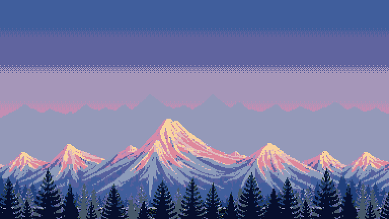
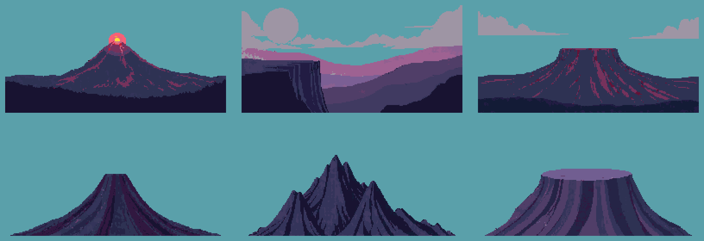
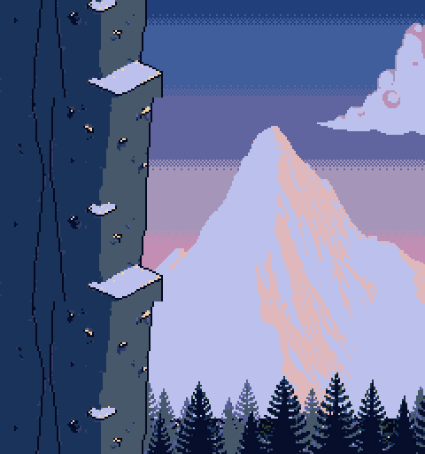
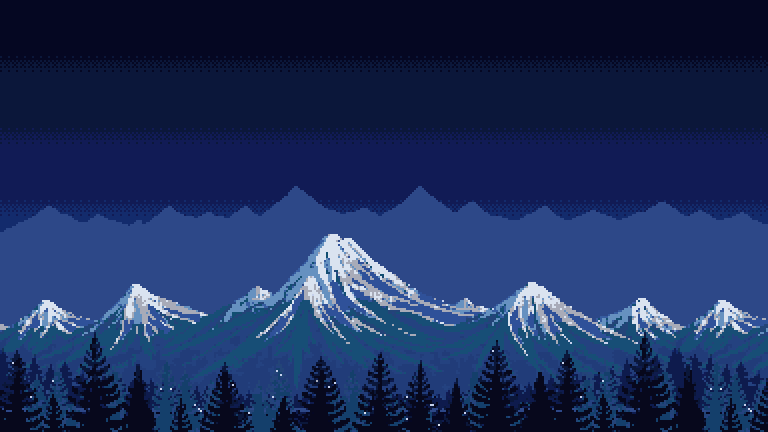

# Parallax backgrounds

A parallax background is a stack of layers that scroll at different speeds as
the camera moves. PixelKiln has no parallax command yet, so this guide builds
one from ordinary manifest assets and a free script. Everything below was run
to make the pictures on this page: two biomes, 51 PixelLab generations in all,
including the retries, and a climb for a camera that scrolls up. The evidence behind each choice is in the
[research note](./RESEARCH_PARALLAX.md).




## Pick a route

Both routes start the same way, with one palette and a pixflux style. They
differ in what you generate.

| Route | What you generate | Best for |
|---|---|---|
| Silhouettes | Four or five isolated landforms a biome, each about 240 px wide. The game lays them in overlapping runs. | Levels wider than any picture. No layer needs to loop, and the runs never repeat exactly. |
| Whole layers | A far range, a middle layer and a near layer, each 400×100, looped afterwards. | The fewest steps. A short level, a title screen, a menu. |

The two mix well. Both pictures above use a whole far range and a whole near
layer; the volcanic one puts two runs of silhouettes between them.

The sky is not generated in either route. It is a few flat bands of palette
colours, drawn by the script or by the engine. Hosted generators draw
mountains and suns into a sky whatever the prompt says.

## 1. Choose one palette

Every layer uses the same forced `palette`. It is the single setting that
makes separately generated layers look like one scene. The easiest source is
a picture you already like: its colours, 30 to 50 of them, become the palette.
The volcanic set uses the 44 colours of a PixelLab volcano; the alpine set uses
the 38 colours of a PixelLab mountain valley.

Check the palette has pale colours as well as dark ones. A tier is pushed
toward the sky by mixing its colours and snapping the result back to the
palette (step 5). A palette with few pale colours flattens a tinted tier into
one or two colours.

## 2. Write the manifest

One pixflux style per seed, with background removal, `view: side` and the
palette. Listing several styles on an asset gives several candidates of it,
one per seed, so you can keep the best.

```jsonc
{
  "name": "my-game",
  "provider": "pixellab",
  "styles": {
    "parallax-a": {
      "generator": "pixflux",
      "noBackground": true,
      "view": "side",
      "seed": 101,
      "palette": ["#050a14", "#2e3253", "#7b5f94", "..."],
      "outDir": "assets/parallax/volcanic/a"
    },
    "parallax-b": {
      "generator": "pixflux",
      "noBackground": true,
      "view": "side",
      "seed": 202,
      "palette": ["#050a14", "#2e3253", "#7b5f94", "..."],
      "outDir": "assets/parallax/volcanic/b"
    }
  },
  "assets": {
    "landform-cone": {
      "prompt": "a single dark basalt volcanic cone, muted violet, low contrast, simple shading, about two thirds as wide as the picture, its slopes flare out to a flat base, a lone landform game sprite on a plain empty background, nothing else in the picture: no clouds, no moon, no sun, no hills or ground around it, side view, transparent background",
      "width": 256,
      "height": 128,
      "styles": ["parallax-a", "parallax-b"]
    },
    "layer-near": {
      "prompt": "dark jagged volcanic hills close to the viewer, uneven heights and irregular shapes, a few glowing lava cracks, nearly black, spans the full width, flat bottom edge, no sky, no ground plane, side view, transparent background",
      "width": 400,
      "height": 100,
      "styles": ["parallax-a", "parallax-b"]
    }
  }
}
```

The complete manifests for both biomes are in
[`benchmarks/parallax-refined`](../benchmarks/parallax-refined).

Keep transparent pixflux pictures at 40,000 px or less (400×100, 256×128).
Larger ones come back with their background.

### Prompts that work

For a silhouette, describe one object as a game sprite and list what must not
be in the picture. Leave the distance out of the prompt: the haze comes later,
from the palette.

- Use "a lone landform game sprite on a plain empty background, nothing else in
  the picture: no clouds, no moon, no sun, no hills or ground around it".
- Use "about two thirds as wide as the picture" so it does not run off the
  sides.
- Avoid "distant", "seen from far away", "hazy dusk light" and "fading to
  nothing at its foot". They make pixflux paint a whole scene. In the first
  round, every volcanic silhouette asked for that way came back with ground,
  clouds or a moon, and 14 of 18 silhouettes ran off the canvas.
- Avoid a glow at a crater's top. Pixflux draws it as a setting sun.



For a whole layer, ask for the full width and a flat bottom edge. A far range
comes back as a flat single-colour band, which is right for the farthest layer;
it is recoloured in step 5.

## 3. Plan and generate

```bash
pixelkiln plan
pixelkiln gen --budget pixellab=18
```

`plan` lists one generation an image at these sizes. Three seeds of six assets
is 18 generations a biome. Plan for a retry round: the alpine and volcanic sets
each needed one.

## 4. Keep the best candidate

Look at every candidate on a plain colour, then reject the ones that break the
stack:

- A silhouette that touches the left or right edge. Its cut-off side shows as a
  straight vertical line in a run.
- Anything with a horizon line, a reflection, clouds or a moon in it.
- A whole layer that does not span the width. It leaves gaps when it repeats.
- A middle layer that is one landmark, such as a single volcano. It is fine,
  but draw it once instead of looping it (step 6), or the repeat is obvious.

The script prints the numbers for the first check:

```bash
python3 research/scripts/parallax.py screen assets/parallax/volcanic/*/landform-*.png
```

`edge 0.00/0.00` means nothing touches either side. The script needs numpy,
pillow and scipy.

## 5. Finish the pieces

All of these are free and keep every pixel on the palette.

```bash
P="python3 research/scripts/parallax.py"

# Silhouettes: trim, then thin out the bottom 30% with an ordered dither.
$P foot cone.png cone.foot.png 0.3

# One copy a tier, each pulled toward its own colour and snapped to the palette.
$P tint cone.foot.png cone.far.png  "#7f4776" 0.55 pixelkiln.manifest.json
$P tint cone.foot.png cone.near.png "#403a61" 0.4  pixelkiln.manifest.json

# Whole layers: loop at the best matching columns. Recolour the flat far range.
$P loop layer-far.png far.png cut
$P tint far.png far.png "#936090" 1 pixelkiln.manifest.json
$P loop layer-near.png near.png cut
```


**The dithered foot.** Background removal leaves every pixel fully on or off,
so a silhouette cannot fade by alpha. Thinning its bottom rows with a 4×4
pattern makes it dissolve into whatever is behind it and keeps it pixel art.

**Depth order.** The farther a layer, the closer to the sky's colour and the
lower its contrast. Check the order from back to front: the far range lightest,
then the far tier, the near tier, and the near layer darkest. Snow can stay
bright on a near tier, as long as its shadows are darker than the range behind
it. Tinting every tier toward one light haze colour gets the order backwards:
the near tier ends up lighter than the range behind it.

**The far range.** Pick a palette colour that sits between the sky bands behind
it, darker than the horizon and lighter than the tiers.

## 6. Preview the stack

The script draws the sky and scrolls the whole stack, from a small JSON file:

```jsonc
{
  "view": [384, 216],
  "sky": ["#2e3253", "#503e68", "#7b5f94", "#ad628e", "#d66283", "#f96076"],
  "seed": 7,
  "frames": 120,
  "travel": 480,
  "layers": [
    { "image": "far.png", "bottom": 150, "speed": 0.125, "extend": true },
    { "run": ["cone.far.png", "rim.far.png", "mesa.far.png"], "foot": 158, "speed": 0.25 },
    { "run": ["cone.near.png", "rim.near.png", "mesa.near.png"], "foot": 176, "speed": 0.5 },
    { "fill": "#0e0c20", "top": 206, "speed": 1 },
    { "image": "near.png", "bottom": 246, "speed": 1 }
  ]
}
```

```bash
STILL=still.png SCALE=2 python3 research/scripts/parallax.py skyline preview.webp stack.json
```

- `extend` on the far range repeats its bottom row to the foot of the view, so
  the tiers' dithered feet dissolve into distant land, not into sky.
- A run lays its sprites left to right, each starting 72% of the way across
  the last, flipped at random and never the same one twice in a row.
- An image with `"repeat": false` and an `x` is drawn once: use it for a
  landmark.
- The camera pans `travel` pixels and back. Watch the far end of the pan for
  seams, floating feet and gaps under the near layer.

The specs and the build script for both biomes are in
[`benchmarks/parallax-refined`](../benchmarks/parallax-refined).

## 7. Put it in the engine

Speed is the fraction of the camera's movement a layer follows. The previews
use 0 for the sky, 1/8 for the far range, 1/4 and 1/2 for the two tiers, and 1
for the near layer.

- Round the camera to whole pixels first, then take each layer's offset from
  that rounded position. Rounding each layer on its own moves layers while the
  camera stands still.
- Prefer simple fractions (1/2, 1/4, 1/8). They step on an even rhythm; 0.3 or
  0.6 do not.
- Keep the tiers' speeds close together. A wide spread opens bands of sky
  between them.
- A bounded level needs no loop. Lay each run past both ends of the level by
  the most that layer can drift.

The same layer at a quarter of the camera's speed in each tool:

| Tool | Setting |
|---|---|
| Tiled | `parallaxx: 0.25` |
| Godot 4 | `Parallax2D.scroll_scale = Vector2(0.25, 1)` |
| Phaser 3 | `setScrollFactor(0.25, 1)` |
| LDtk | `parallaxFactorX: 0.75` with `parallaxScaling: false` |

LDtk counts the other way: its factor is how much the layer follows the
camera, so write 1 − speed. With `parallaxScaling` on it also shrinks a far
layer off the pixel grid. PixelKiln's LDtk export writes factor 0 today.

## 8. Scroll vertically

A camera that climbs needs more than the sideways stack. The climb below uses
the alpine palette, 14 PixelLab generations and one Retro Diffusion picture for
the loop further down.



- **Draw layers tall, or place things at height.** The 400×100 strips above are
  made for one height. Climbing past them, the near layer drops out early and
  the far range's extension fills half the view. Give the camera something to
  pass at every height: a tall landmark, clouds scattered up the climb, a wall.
- **Give every layer headroom.** A layer has to be drawn the view's height plus
  climb × its vertical speed above it. For a 480 px climb that is 48 rows at
  1/10 and all 480 at full speed.
- **Place the layers for the lowest view.** Then a climb only moves them down
  the screen and never uncovers their feet.
- **Move the sky.** A sky at speed 0 looks the same at every height. At 0.3 of
  the climb its bands walk from dusk at the horizon to night at the top.
- **Generate clouds as puffy sprites.** "a single puffy cumulus cloud, pink-lit
  top and blue-violet shaded underside, simple shading, about two thirds as
  wide as the picture, a lone cloud game sprite on a plain empty background,
  nothing else in the picture: no sky, no sun, no moon, no mountains" came back
  usable on three seeds of three. Thin streaks and flat banks did not, on four
  tries.
- **Build the wall from a pillar.** Asked for a cliff wall, pixflux draws a
  pillar with a summit. `wall` keeps the summit and repeats the body below it
  at the rows where it loops best. Pick the candidate whose ledges are far
  apart, so the repeat is hard to spot.

```bash
# Stack a cliff into a wall 700 rows tall, keeping its top 100 rows as the summit.
$P wall cliff.png wall.png 700 100

# Vertical preview: the camera climbs and comes back.
STILL=strip.png SCALE=2 $P climb climb.webp climb.json
```

A climb spec is the side-scrolling one with `climb` in place of `travel`,
`speed_y` on any layer whose vertical speed differs, and two more layer kinds:

```jsonc
{
  "view": [240, 256],
  "sky": ["#040920", "#142b60", "#405e9c", "#a596b9", "#de889c", "#f9b59c"],
  "sky_speed": 0,
  "sky_speed_y": 0.3,
  "stars": 80,
  "climb": 480,
  "layers": [
    { "image": "far.png", "bottom": 200, "speed": 0.1, "extend": true },
    { "image": "massif.png", "repeat": false, "x": 60, "bottom": 262, "speed": 0.2, "extend": true },
    { "scatter": ["puff-a.far.png", "puff-b.far.png"], "top": -520, "bottom": 60, "count": 7, "speed": 0.4 },
    { "image": "wall.png", "repeat": false, "x": -8, "bottom": 300, "speed": 1 },
    { "scatter": ["puff-a.png", "puff-b.png"], "top": -720, "bottom": -120, "count": 5, "speed": 1.3 }
  ]
}
```

Rows count from the top of the view at the start of the climb, so negative
rows are above it. `scatter` places one sprite per height band between `top`
and `bottom`. An image with `"repeat_y": true` repeats upward instead of
sideways.

For a background that scrolls up forever, such as a vertical shooter's,
generate it with Retro Diffusion's `tileY` on `rd_plus__default` and no
background removal. It wraps vertically; pixflux has no seamless option. Keep
the rest of the set on that picture's colours: snapped to a palette with few of
its colours, the sky below kept 5 of its 47.


The same layer at a quarter of the camera's speed both ways:

| Tool | Setting |
|---|---|
| Tiled | `parallaxx: 0.25`, `parallaxy: 0.25`; `repeaty` on an image layer that loops |
| Godot 4 | `Parallax2D.scroll_scale = Vector2(0.25, 0.25)`; `repeat_size.y` for a loop |
| Phaser 3 | `setScrollFactor(0.25, 0.25)` |
| LDtk | `parallaxFactorX: 0.75`, `parallaxFactorY: 0.75` with `parallaxScaling: false` |

The specs, manifests and build script are in
[`benchmarks/parallax-vertical`](../benchmarks/parallax-vertical), and step 19
of the [research note](./RESEARCH_PARALLAX.md) has the numbers.

## 9. A second time of day

To show the same place at another time, recolour the finished set instead of
generating it again. A palette swap keeps every shape, so the two times line up
when the game fades from one to the other, and it costs nothing.



1. Take a palette for the new time the way you took the first one. The night
   palette here is the 42 colours of PixelLab's mountain valley, sent again
   with the same prompt and seed and "at night" in place of "at dusk".
2. Swap each finished piece onto it by luminance rank, the far range, layers,
   landforms and tier copies alike:

   ```bash
   $P recolour far.png far.night.png dusk.manifest.json night.manifest.json cool
   ```

   `cool` leaves out the new palette's light colours, those whose red is above
   their blue: lit windows, lamplight and the moon. Without it, pink-lit snow
   turns orange.
3. Draw the sky from the new palette.

Generating the set again on the new palette also gives layers that agree, but
in a different place. Every peak moves. "At night" in a prompt also brought a
moon or stars into 7 of 9 pictures, two of them despite "no moon, no stars" in
the prompt. Generate only
what the new time adds, such as a moon, as its own sprite. A swap keeps the
light where the first time put it, which suits dusk to night; light from
another side needs new pictures. The manifests and build script are in
[`benchmarks/parallax-night`](../benchmarks/parallax-night).

## What this guide does not cover

- Splitting a finished scene into layers. A depth model and inpainting can do
  it, at 10 to 25 PixelLab generations a layer for the fill; see steps 4, 13
  and 14 of the [research note](./RESEARCH_PARALLAX.md).
- Retro Diffusion for sideways layers, beyond this. Its environment style
  draws a whole scene whatever the prompt says (step 15). `rd_plus__default`
  with `tileX`, no background removal and "a plain flat chroma-key green
  background" in the prompt gives a layer that loops as generated, once the
  background is keyed out by script (`parallax.py key`). Retro Diffusion's own
  background removal breaks the seam. The default style drew a flat background
  on 2 of 3 tries, and its colours are its own, so the rest of the set has to
  follow them (step 21).
- A `pixelkiln parallax` command. The research note sketches one.
