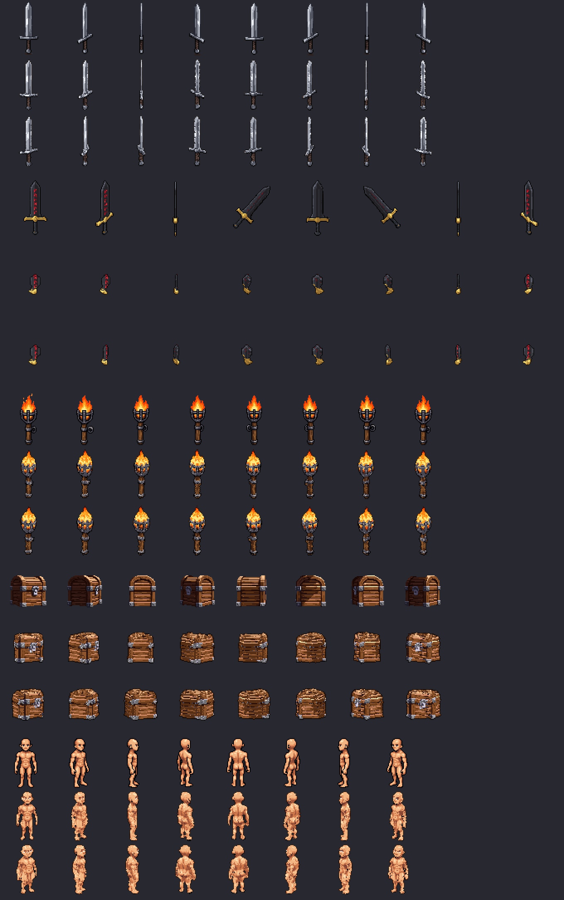
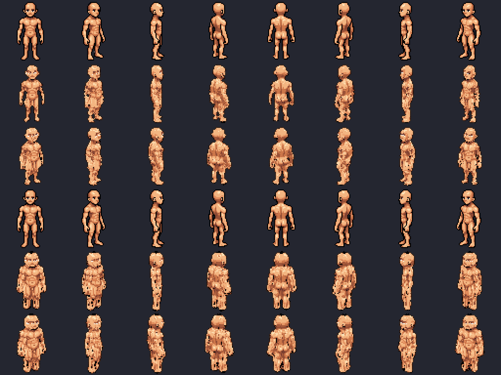
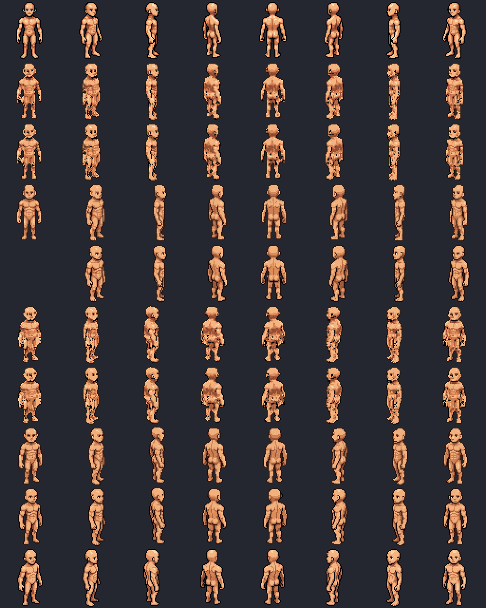

# 3D models from directional sprites

This is a research note, not a feature: nothing here is a PixelKiln command, and the scripts are rough. PixelKiln already generates an object or a character from eight directions. This note records every attempt to turn those eight pictures into a 3D model: what was tried, with what, and what came out.

Last updated 16 November 2026.

## Summary

| # | Approach | Tool or model | Result | Verdict |
|---|---|---|---|---|
| 1 | Carve a voxel model from the eight silhouettes | Our script | 92 to 96% on round objects, 39 to 68% on long ones | The long objects were drawn tilted. See 2. |
| 2 | Ask for the object standing upright | PixelLab 8-direction object | Sword 66% to 94%, torch 68% to 93% | Keep. The prompt wording matters more than the algorithm. |
| 3 | Detect tilted views and carve without them | Our script | Greatsword 98% from six views | Keep. The model fills in the views the generator got wrong. |
| 4 | Smooth, colour and render the carved model | Our script | Readable from 16 sides | Keep for shape. Colour is still rough between the drawn views. |
| 5 | Carve a character | Our script | 95% | Keep. |
| 6 | Triangulate a 3D skeleton from 2D joints | PixelLab skeleton estimate + our script | 18 joints, 1.3 px mean error | Keep. This is a rig. |
| 7 | Build the body from tubes around the bones | Our script | 79% | Drop. Carving is better. |
| 8 | Generate a mesh from four views | Hunyuan3D-2mv in ComfyUI, RTX 3060 12 GB | About two minutes a mesh; 70 to 83% | Cleaner geometry, looser match. Needs its own texture step. |
| 9 | Unwrap the mesh and texture it from the sprites, in stages | Our script, with xatlas for the unwrap | Colour error down by a fifth to a half against one-pass colouring, on all five | Keep. The texture is now a picture that can be repaired. |
| 10 | Let the views vote on each texel's colour | Our script | Colour error down another 1 to 4 on every subject and shape | Keep, as the default. |
| 11 | Texture the carved shape the same way | Our script, marching cubes | Better than the mesh on the character and torch, worse on the two swords | Keep both shapes. Which is better depends on the object. |
| 12 | Carved shape cut back to the mesh | Our script | No better than carving alone | Drop. |
| 13 | Have an image model redraw the model's rough renders | PixelLab `edit_image`, `inpaint_image`, `correct_pixelart` | Clean sprites at angles the generator never drew: sixteen directions from eight, for 10 generations | Keep. This is the best result so far, and it changes what the 3D model is for. |
| 14 | Paint the redrawn views back onto the model | Our script | Smoother, still muddy | Drop for now. The model is a guide, not the final picture. |
| 15 | Flatten the texture to a few materials and light it in the renderer | Our script | No blotches, and no detail either | Partly. The lighting is worth keeping; the flattening loses too much. |
| 16 | Put the skeleton in the mesh, skin it, add a walk, export a rigged `.glb` | Our script | Valid glTF with 15 bones and a walk, for both characters | Keep. This is the first file here a 3D game can import and animate. |
| 17 | Install Hunyuan3D's paint stage on the RTX 3060 | Second ComfyUI, community node | Runs in 12 GB after one patch; about 40 seconds a pass | Keep. |
| 18 | Flat base with trusted sprite pixels laid back on top | Our script | Eyes and trim return; the tearing does not change | Drop. The tearing is in the shape, not the shading. |
| 19 | Use the Hunyuan3D mesh for the knight, not the carved shape | Hunyuan3D-2mv | Real horns, separate arms and legs; the same texturing reads far better | Keep for complex characters. No gain on the bare character. |
| 20 | Paint the mesh with the paint stage, once per sprite direction | Hunyuan3D-2 paint | Each sprite redrawn to fit the mesh; a clean texture from every side | Keep. The best texture in this note. |

**How the percentages are measured.** The model is projected back to each of the eight camera positions and its outline is compared with the sprite's outline. The score is the area the two share divided by the area either covers, averaged over the views. 100% means the model casts exactly the sprite's shadow from every side. It measures shape only, not colour. It also favours carving, which is built from those same outlines.

## What we start from

- **Sprites.** PixelLab's `create_8_direction_object` gives eight 64px views of one object, at 45 degree steps: south, south-east, east, north-east, north, north-west, west, south-west. It costs 10 generations per object at this size. Characters come from `create_character` with the same eight directions.
- **Camera.** The views are drawn from slightly above, not level. PixelLab's `view` option sets this: `low top-down` (the default), `high top-down` or `side`. The carving script does not assume the angle; it tries 0, 10, 20, 30 and 40 degrees and keeps the one whose model matches the sprites best. It landed on 20 to 30 degrees for default views.
- **Subjects.** A lantern, a round shield, a kite shield, a torch, a sword, a greatsword, a treasure chest, and the bare character used for the paperdoll work.

## 1. Carving from eight silhouettes

**Question.** Is the shape recoverable from the outlines alone, with no model?

**Setup.** Start with a solid 64×64×64 block of voxels. For each of the eight views, remove every voxel that falls outside that view's outline. What is left is the largest shape consistent with all eight views (a visual hull). The camera height and a small per-view shift are fitted by trying values and keeping the best score. Script: [`scripts/carve.ts`](../research/scripts/carve.ts).

**Result.** Each block of three rows is one object: the sprites, the model from the same eight directions, and the model from the eight directions in between.


| Object | Match |
|---|---|
| Lantern, round shield, kite shield | 92 to 96% |
| Torch | 68% |
| Sword | 66% |
| Greatsword | 39% |

The lantern and shields hold their shape. The torch, sword and greatsword are carved down to stumps. Look at their sprite rows: in the diagonal views the object is leaning over. The generator drew a tilted picture of the sword instead of turning it in space, so the eight views describe eight different poses and almost nothing is consistent with all of them.

The surfaces are also ragged and the colours speckled, because eight hand-drawn pictures do not agree with each other pixel for pixel.

**Verdict.** The method works when the views agree. The problem is the input.

## 2. Asking for upright objects

**Question.** If the output is going to be 3D, can the generator be told to draw the object standing straight up, so the views agree?

**Setup.** Same tool, with this added to the description: "standing perfectly upright and vertical, blade pointing straight up, spinning in place around its vertical axis like a turntable model". Tried with `view: side` and with the default.

**Result.** The inputs, one row per object:


The sword, torch and chest stand upright in every view. The ornate greatsword (second row) ignored the wording and leans on all four diagonals.

| Object | Before | With upright wording |
|---|---|---|
| Sword, `view: side` | 66% | 94% |
| Sword, default view | 66% | 89% |
| Torch | 68% | 93% |
| Treasure chest | not tried | 93% |
| Ornate greatsword | 39% | 28% |

**Verdict.** Keep the wording. It fixes plain objects and is not a guarantee for detailed ones.

## 3. Finding tilted views and carving without them

**Question.** Can a tilted view be detected automatically, and can the model be built from the good views only?

**Setup.** Two parts.

- *Tilt check.* For each view, find the long axis of the outline and measure how far it leans from vertical. Script: [`scripts/tilt.py`](../research/scripts/tilt.py). Good objects leaned 0 to 2 degrees in every view. Every bad view leaned 36 to 46 degrees. There is nothing in between, so a threshold anywhere around 10 to 20 degrees separates them.
- *Second greatsword.* Generated again with the good sword passed as `style_object_id`. It came back upright in six views and tilted in two. (The first try at this failed outright: the new object's size must be at least the style object's content size.)
- *Carving with views left out.* The script takes a list of views to skip. A skipped view neither carves nor gives colour.

**Result.** The greatsword carved from its six upright views. Top row: the sprites, with the two tilted ones still shown. Below: the model from the same directions and from in between.


It matched the six views it was built from 98%. Rendered from the two directions that were left out, it stands upright there as well.

**Verdict.** Keep both. The tilt check is a cheap gate before spending anything further, and the model can supply the views the generator got wrong.

## 4. Smoothing, colouring and rendering

**Question.** Can the carved model be made presentable?

**Setup.** Three changes to the script.

- *Smoothing.* Each voxel is kept or removed by a majority vote of its 26 neighbours, twice. This fills pits and removes spikes.
- *Colour.* Each surface voxel takes its colour from the view that faces it most squarely and can actually see it. Outline pixels (the sprites' near-black edge) are avoided, because they were landing on the surface as dark speckle.
- *Render.* One ray is marched per output pixel, so there are no holes, and a one-pixel dark outline is drawn around the result.

**Result.** All the upright subjects, three rows each as before:



The directions that have a sprite come out close to it. The directions in between are recognisable but rougher: the colour there is borrowed from a neighbouring view and stretched.

**Verdict.** Good enough for shape. Colouring per voxel straight from the sprites is the weak part, which is the reason for step 9.

## 5. A character

**Setup.** The bare character base, its eight rotations, same script.

**Result.** 95% match, with the camera fitted at 20 degrees above level. It is the last block in the picture above. Arms and legs survive; the gap between the legs partly fills in, because a gap is only carved if some view can see through it.

**Verdict.** Keep.

## 6. A 3D skeleton from 2D joints

**Question.** PixelLab's skeleton estimate gives 18 joints in each 2D view. Do the eight views agree on where those joints are in space?

**Setup.** For each joint, solve for the one 3D point that best explains its eight 2D positions, using the camera fitted in step 1. The estimator sometimes names left and right by the picture and not by the body; the script tries both namings for each view and keeps the one that agrees with the others.

**Result.** All 18 joints placed, with a mean error of 1.3 pixels and a worst case of 2.1 at an elbow. Left and right came out consistent in every view.

**Verdict.** Keep. This is a rig for the carved model, from data PixelKiln already stores in the anchors file.

## 7. A body from tubes

**Question.** A Discord thread described building characters from tubes or capsules around a skeleton. Is that better than carving?

**Setup.** One tube per bone (upper arms, forearms, thighs, shins, torso, shoulders, hips, head), with each tube's radius taken from the carved voxels nearest that bone.

**Result.** Top three rows are carving, bottom three are tubes:



Tubes matched 79% against carving's 95%. The result is a blob with limbs: no hands, feet, face or shoulders.

**Verdict.** Drop tubes as the shape. Carving for the shape with the skeleton from step 6 as the rig is the combination worth keeping.

## 8. Hunyuan3D multi-view meshes

**Question.** Does a model trained to make meshes from pictures do better than carving, and does it run on hardware we have?

**Setup.**

- *Model.* Tencent Hunyuan3D-2mv, the `hunyuan3d-dit-v2-mv` checkpoint in fp16, 4.93 GB, from the `tencent/Hunyuan3D-2mv` repository on Hugging Face.
- *Runner.* ComfyUI 0.34.0, which has Hunyuan3D nodes built in. No custom nodes. PyTorch 2.13 with CUDA.
- *Hardware.* A desktop with an RTX 3060, 12 GB.
- *Graph.* `ImageOnlyCheckpointLoader` → `ModelSamplingAuraFlow` (shift 1.0). Four `LoadImage` → `CLIPVisionEncode` (crop none) → `Hunyuan3Dv2ConditioningMultiView`. `EmptyLatentHunyuan3Dv2` (resolution 3072) → `KSampler` (30 steps, cfg 5, euler, normal) → `VAEDecodeHunyuan3D` (8000 chunks, octree 256) → `VoxelToMesh` (surface net, threshold 0.6) → `SaveGLB`. Script: [`scripts/hunyuan3d.py`](../research/scripts/hunyuan3d.py).
- *Inputs.* The model takes four views: front, left, back, right. Those are south, west, north and east of the eight. Each 64px sprite was scaled to 512px with hard pixel edges and put on white:


**Result.** 106 to 119 seconds per mesh. Each block of three rows below is one subject (character, chest, sword, torch; the greatsword is not pictured): the sprites, the carved model, and the Hunyuan3D mesh. The mesh was turned into voxels and coloured from the sprites the same way as the carved model, so the two can be compared directly.


| Subject | Carved | Hunyuan3D mesh |
|---|---|---|
| Bare character | 95% | 83% |
| Chest | 93% | 82% |
| Sword | 94% | 80% |
| Greatsword | 98% | 72% |
| Torch | 93% | 70% |

- **Better than carving:** the geometry is real. The character's legs are separate, the sword blade is thin from the side, the chest has a lid.
- **Worse than carving:** the model redraws the object in its own proportions. The mesh does not line up with the sprites pixel for pixel, so colour taken straight from the sprites lands a pixel or two off.
- **Lost:** the torch's flame. A flame is not a solid object and the mesh leaves it out.
- **Caveat on the numbers:** the mesh was lined up with the sprites crudely (scaled to the same height, tried at each quarter turn). A better fit would close some of the gap. Carving also has a built-in advantage on this score.
- **Not measured:** the same run on an Apple M1, so there is no speed comparison.
- **Licence:** the Hunyuan3D community licence does not apply in the EU, the UK or South Korea.

**Verdict.** Use it when clean geometry matters more than matching the sprite exactly. It needs a texture step of its own.

## 9. Texturing in stages

**Question.** Steps 4 and 8 coloured the model in one pass, straight from the sprites onto voxels. Does splitting the work into stages (fit, unwrap, project, fill, render) give a better result on the Hunyuan3D meshes?

**Setup.** Script: [`scripts/texture.py`](../research/scripts/texture.py). It takes about six seconds a mesh on a laptop. Libraries: trimesh, xatlas, fast-simplification, numpy, scipy.

1. **Fit.** The mesh is simplified to 30,000 triangles, then lined up with the sprites' cameras by searching for the turn, the camera height, a scale for each of the three axes, and a one or two pixel shift per view that make its outline match the sprites best. Step 8 only tried quarter turns and one scale.
2. **Unwrap.** xatlas flattens the surface into a 256×256 texture.
3. **Project.** Every texel is given the colour of the sprite pixel it lands on, from the one view that faces it most squarely and can see it. Outline pixels are never used. Texels then agree with their neighbours on which view to use, so the surface does not speckle where two views meet.
4. **Fill.** A texel no view could see takes the colour of the nearest texel that was seen, measured across the surface in 3D.
5. **Render.** Unlit, at sprite size, each pixel taking the most common colour among the texels in front, with a drawn outline.

It also writes a textured `.glb` that opens in Blender or any glTF viewer.

**Result.** Four rows per subject: the sprites; the same mesh coloured in one pass (step 8); the mesh textured in stages; and the staged model from the eight directions in between.


The texture itself, for the chest. Left: the unwrapped texture. Right: which of the eight sprites each texel took its colour from, one colour per view; dark grey was seen by none and filled in.


Three numbers per method. *Shape* is the outline match used throughout. *Colour error* is the mean difference per colour channel, out of 255, over the pixels where model and sprite overlap; lower is better. *Close* is the share of those pixels within 24 of the sprite's colour on every channel. All three are measured on the rendered pictures by [`scripts/score.py`](../research/scripts/score.py), which first slides each render to where it overlaps its sprite best, so the shape numbers here are a little lower than the ones in the earlier steps.

| Subject | Method | Shape | Colour error | Close |
|---|---|---|---|---|
| Character | Carved, one pass | 92% | 40.5 | 42% |
| | Mesh, one pass | 85% | 49.4 | 37% |
| | Mesh, staged | 88% | 42.9 | 46% |
| Chest | Carved, one pass | 92% | 42.3 | 41% |
| | Mesh, one pass | 85% | 49.2 | 30% |
| | Mesh, staged | 90% | 32.0 | 54% |
| Sword | Carved, one pass | 91% | 36.3 | 50% |
| | Mesh, one pass | 79% | 52.2 | 37% |
| | Mesh, staged | 89% | 31.3 | 60% |
| Torch | Carved, one pass | 89% | 35.4 | 48% |
| | Mesh, one pass | 76% | 53.3 | 25% |
| | Mesh, staged | 83% | 28.6 | 59% |
| Greatsword | Carved, one pass | 94% | 18.4 | 72% |
| | Mesh, one pass | 71% | 22.3 | 70% |
| | Mesh, staged | 89% | 13.9 | 81% |

- **The better fit closed most of the shape gap.** The meshes went from 71 to 85% to 83 to 90%, with no change to the meshes themselves. Carving is still ahead on shape by 2 to 6 points.
- **Staged texturing beat one-pass colouring on every subject,** and beat the carved model's colour on four of five. The character is the exception: the mesh's hands, head and chest are a different shape from the sprite's, so muscle lines land in the wrong place.
- **The torch has a flame again.** The mesh has no flame, but the sprite's flame pixels land on the top of the basket.
- **The greatsword's two tilted views were left out,** and the model is upright from those directions with the runes in place.
- **A mirror image cannot be told apart by outline.** For every subject the mirrored fit scored within a tenth of a point of the true one. The script assumes the mesh is not mirrored, which held for all five. Front and back are nearly as close on symmetric objects (83.2 against 83.1 for the chest), so the result should be looked at, not trusted.

**Tried and dropped,** on the character, none of which moved the colour error by more than a point or two:

- Blending views by weight and snapping to the palette, instead of one view per texel: 48% close against 54%. Blending muddies the pixel art.
- Letting a texel that lands just outside the sprite take the nearest pixel inside it: slightly worse.
- Refusing colour from pixels beside a jump in the mesh's depth (its outer edge, an arm in front of the body): no better, and a quarter of the texels left to fill.

The remaining error on the character is the mesh's shape, not the texturing.

**Verdict.** Keep. Staging is the better way to colour a mesh, and it leaves a texture file that can be repaired as an ordinary picture.

## 10. Letting the views vote

**Question.** After step 9 the remaining flaws are dark specks where one sprite has a contour line and its neighbour has plain colour. The eight sprites are eight separate drawings and do not agree. Can the texture take the consensus instead of trusting one view?

**Setup.** Three rules for choosing a texel's colour, all in `texture.py`:

- `MODE=best` (step 9): the one view that faces the texel most squarely.
- `MODE=vote`: when three or more views can see the texel, take the colour closest to the middle of what they all say, leaning toward views that face it. Colours still come straight from a sprite, so the palette is kept.
- `DESPECKLE`: after colouring, replace any texel much darker than the surface around it.

**Result.** Voting lowered the colour error on all five subjects, on both shapes, by 1 to 4 points (table under step 11). It loses a little crispness on a face seen head-on. Despeckling made the numbers slightly worse at every threshold tried (25, 40, 60) and removed wanted detail with the specks.

**Verdict.** Vote is the better default. Despeckle is dropped.

## 11. Texturing the carved shape

**Question.** Carving matches the sprite's outline best and staged texturing colours best. Do they combine?

**Setup.** `carve.ts` with `DUMP=1` writes its voxels and its fitted camera. `texture.py` with `VOX` and `CAMERA` turns the voxels into a mesh with marching cubes and runs the same unwrap, project, fill and render on it, using the carve's camera so nothing needs fitting.

Two things had to be right before the numbers meant anything, and both are easy to get wrong again:

- **Where the surface is cut.** The carve treats each voxel as a point at its centre. A mesh cut half a voxel outside those centres (the usual setting) renders a pixel fatter than the sprite all round. The surface is cut through the outermost centres instead (`LEVEL=0.9`).
- **Half a pixel.** The carve drops a voxel into a pixel by rounding down. In views whose centre falls on a half pixel, that puts every voxel half a pixel to the right of where its cube really is. The camera is corrected for this on import. Before the fix the carved sword scored 86%; after, 89%.

**Result.** Four rows per subject: the sprites; the Hunyuan3D mesh with one view per texel (step 9); the same mesh with voting (step 10); the carved shape with voting.


These numbers come from `texture.py` itself, which scores its render in place, so they differ by a point or two from the table in step 9.

| Subject | Shape and rule | Shape | Colour error | Close |
|---|---|---|---|---|
| Character | Mesh, one view | 88.0% | 37.7 | 54% |
| | Mesh, vote | 88.0% | 35.9 | 56% |
| | Carved, vote | 90.5% | 34.5 | 53% |
| Chest | Mesh, one view | 91.2% | 31.1 | 56% |
| | Mesh, vote | 91.2% | 28.5 | 56% |
| | Carved, vote | 91.0% | 28.1 | 57% |
| Sword | Mesh, one view | 89.6% | 32.7 | 56% |
| | Mesh, vote | 89.6% | 29.1 | 58% |
| | Carved, vote | 88.6% | 32.7 | 52% |
| Torch | Mesh, one view | 82.2% | 28.2 | 59% |
| | Mesh, vote | 82.2% | 25.7 | 60% |
| | Carved, vote | 88.0% | 25.6 | 58% |
| Greatsword | Mesh, one view | 88.7% | 14.4 | 79% |
| | Mesh, vote | 88.7% | 13.5 | 81% |
| | Carved, vote | 86.9% | 21.9 | 70% |

- **Carving wins where the object is bulky or not solid.** The character gains 2.5 points of shape and the best colour so far. The torch gains 6 points of shape and gets its whole flame back, because carving keeps anything the sprites show.
- **The mesh wins on thin, flat objects.** Both swords are better as Hunyuan3D meshes. A blade two voxels thick is at the limit of what a 64-voxel grid can hold, and the greatsword was carved from only six views.
- **The chest is a tie.**
- Neither shape is better everywhere, so the choice should be made per object, by score.

**Verdict.** Keep both. The useful rule so far: carve characters, soft or hollow things and anything with parts that are not solid; use a generated mesh for thin rigid objects.

## 12. Carved shape, cut back to the mesh

**Question.** Carving cannot see a gap that no view looks through, such as between the legs. The generated mesh has those gaps. Does keeping only the carved voxels that are near the mesh give the best of both?

**Setup.** `HYBRID=2`: the Hunyuan3D mesh is fitted into the carve's camera and filled in, grown by two voxels, and intersected with the carved voxels. Also tried at one and three voxels.

**Result.** No gain. On the character it changed the scores by a tenth of a point. On both swords the grown mesh covered the whole carved shape, so the result was identical to carving. On the torch it cut part of the flame away (shape 86.3% against 88.0%).

**Verdict.** Drop. The gaps it was meant to open are small at this size, and the mesh does not line up closely enough with the sprite to cut safely.

## 13. Redrawing the rough renders with an image model

**Question.** Everything up to step 12 tries to make the textured model look right by itself. What if the model only has to be roughly right, and an image model draws the final sprite from it?

**Setup.** The carved, vote-textured character from step 11, rendered from sixteen directions: the eight the generator drew and the eight halfway between. Four ways of repairing the sixteen rough renders, all through PixelLab:

| Method | Call | Cost |
|---|---|---|
| Tidy | `correct_pixelart`, strength 0.4, 16 frames | 0.1 |
| Edit by instruction | `edit_image`, 16 frames in one call, told to remove specks and torn patches and keep pose and direction | 10 |
| Edit by reference | `edit_image` with the true south sprite as the reference, 15 frames | 10 |
| Guide sheet | `inpaint_image` on a 256×256 sheet: each true sprite beside the rough view next to it, only the rough ones masked open | 10 |

**Result.** Ten rows. 1: the true sprites. 2 to 5: the model at those same eight directions, as rendered, tidied, edited by instruction, edited by reference (which has no first frame; it was the reference). 6 to 10: the eight directions in between, as rendered, tidied, edited by instruction, edited by reference, and from the guide sheet.



- **Tidying does nothing useful.** It is built for stray pixels, not for a torn surface.
- **The two edits and the guide sheet all return clean sprites,** at directions the generator never drew, in the same style and proportions as the eight it did. These are the first in-between views in this note that look like finished art.
- **The outline survives.** Each redraw kept 93 to 100% of the rough render's outline, so the model is deciding the pose and the image model the surface.
- **Edits move the figure.** `edit_image` re-centred some frames by up to six pixels; the guide sheet moved none. A redrawn frame has to be slid back to where its render was.
- **The score does not see the improvement.** Against the true sprites, the instruction edit scores 36.3 colour error where the rough render scores 37.6, and fewer pixels within tolerance (39% against 49%), because the image model picks its own shades. The number says "no better"; the picture says otherwise. Colour error against one drawing was the wrong measure for this step.

**A dressed character.** The same thing on a clothed one: the bare base with greaves, plate, cape and helm composited from the paperdoll layers, on an 80px canvas. It carved at 92%. Held items had to be left off: a sword is held at a different angle in every view, so the carve removes it.

Top pair of rows: directions 1 to 8 as rendered from the model, then after `edit_image` by instruction. Bottom pair: directions 9 to 16. Every second figure is one the generator drew; the ones between are new.


The redrawn in-between views are a clean, recognisable knight. They are also a little squat next to the drawn ones: the carve loses some of the horns' height and the head sits lower, and the redraw keeps the model's proportions. Editing by reference cleaned less than editing by instruction here.

The sixteen directions are on the website as a viewer that turns the character, on the [paperdoll page](https://pixelkiln.griffen.codes/paperdoll#turnaround), with a switch to the raw model.

**Verdict.** Keep, and change direction. The 3D model does not have to look good. It has to put the right shapes and rough colours in the right place from any angle, and an image model does the drawing. Eight new directions cost 10 generations.

## 14. Painting the redrawn views back onto the model

**Question.** If the redrawn in-between views are clean, does projecting all sixteen onto the model give a clean texture?

**Setup.** `EXTRA` in `texture.py` adds the eight redrawn views as extra cameras, so each texel has sixteen views to vote among.

**Result.** Pairs of rows (drawn directions, then between): the eight-view texture; with the guide-sheet views added; with the instruction edits added; with the reference edits added.


Slightly smoother, still blotchy, and the score against the sprites got worse (colour error 39 against 34.5), since the new views bring their own shades.

**Verdict.** Drop for now. Sixteen separate drawings disagree as much as eight did. A texture stitched from separate drawings of a 64-pixel figure comes out muddy however the stitching is done, which is the lesson of steps 9 to 14 together.

## 15. Flat materials and light from the renderer

**Question.** The blotches on the stitched texture are each sprite's own hand-drawn shading. If the texture is reduced to flat colour and the light is added by the renderer instead, the same from every side, do they go?

**Setup.** `FLAT=<k>` in `texture.py` sorts the texels into k materials by colour (mostly hue, a little brightness), lets neighbours on the surface agree, and paints each material one colour taken from its lit side. The render then adds three flat bands of light from the upper left, using normals from a smoothed copy of the mesh, since the carved surface is bumpy at the scale of a voxel and raw normals break the bands into noise. `TOON=1` adds the same light without flattening.

**Result.** Each pair of rows is the model from the eight drawn directions and the eight between. Top pair: the bare character as two materials. Middle pair: the knight as nine materials. Bottom pair: the knight with its full stitched texture and the same light.


- **The blotches are gone, and so is everything else.** The bare character is a clean clay figure with no face or muscle. The knight keeps its cape and fur and loses its trim, eyes and armour detail; skin and gold run together as orange patches.
- **Black armour came out brown at five materials** and dark grey at nine. Sorting by hue has little to work with on dark, unsaturated colours.
- **The full texture with renderer light (bottom pair) reads best of the three.** The light gives the form a consistent shape that helps hide the stitching.

**Verdict.** Keep the lighting, drop the flattening as a default. Flat colour would suit a simple object or a deliberately flat style. For a character, the detail has to come from somewhere better than eight disagreeing drawings, which is what step 17 is for.

## 16. A skeleton in the mesh

**Question.** Can the carved, textured character leave here as something a 3D game can animate?

**Setup.** [`scripts/rig.py`](../research/scripts/rig.py).

- **Bones.** The 18 joints from step 6 become fifteen bones named the way engines name a humanoid: Hips, Spine, Head, and Upper Arm, Lower Arm, Hand, Upper Leg, Lower Leg, Foot on each side. For the knight, the joints estimated on the bare character were triangulated again in the knight's own frame (mean error 1.4 pixels).
- **Skin weights.** Each vertex follows up to four bones, weighted by how close it is to each. Distance alone would bind an arm hanging at the side to the spine, so a bone is penalised when the straight line from the vertex to it leaves the body.
- **A walk.** One nine-key loop: thighs and upper arms swing against each other, knees bend on the back swing.
- **The file.** A `.glb` in metres, y up, 1.8 m tall, with the texture inside it set to hard pixel edges, the skin, and the animation named `Walk`.

**Result.** Which bone each part of the surface follows most, from four sides:


The walk, posed here with the file's own bones and weights and drawn from the front, three-quarters and side. Top three rows: the bare character. Bottom three: the knight.


- **Both files pass the Khronos glTF validator** with no errors or warnings.
- **Sizes:** the bare character is 7,571 vertices and 10,460 triangles in 562 KB; the knight is 10,433 vertices and 15,120 triangles.
- **They load and play in three.js**, which is what the viewer on the [paperdoll page](https://pixelkiln.griffen.codes/paperdoll#mesh) uses. They were not opened in Blender, Unity, Godot or Unreal here.
- **The knight's cape follows the legs,** because it is bound to the nearest bones like everything else. A cape wants bones of its own or cloth simulation.
- **Dark patches open up on the inner thighs** as the legs part: that surface was never seen by any sprite and was filled in.
- **The hands, feet and head are single bones.** There are no fingers, toes, jaw or eyes.

**Verdict.** Keep. The rig is the part of this note closest to the goal: characters that can be animated and imported into 3D games. The mesh and skeleton are sound. The texture is what is holding the result back.

## 17. Hunyuan3D's paint stage, installed

**Question.** Hunyuan3D has a second stage that textures a mesh from a reference image, consistently from every side. Can it run on the RTX 3060 used in step 8?

**Setup.** The ComfyUI already on that machine could not run it: its built-in Hunyuan3D nodes make shapes only, and the community node that adds the paint stage, [ComfyUI-Hunyuan3DWrapper](https://github.com/kijai/ComfyUI-Hunyuan3DWrapper), ships its compiled renderer for Python 3.12, where that install is Python 3.13. So a second ComfyUI went in beside the first, which was not touched:

- Python 3.12 in its own virtual environment, PyTorch 2.6.0 for CUDA 12.6, and the node's renderer wheel built for that pair.
- ComfyUI pinned to v0.3.27. The current release needs a newer PyTorch than the wheel was built for and fails on start.
- The paint model, `hunyuan3d-paint-v2-0`, which the node downloads on first use: 9.2 GB. The delight model was not used; the sprites carry no photographic lighting to remove.

**Result.**

- **The prebuilt renderer has no GPU code for this card.** It fails with "no kernel image is available for execution on the device": the wheel was compiled for a newer GPU generation. The same library has a CPU path that gives the same result, so one line in `custom_rasterizer/render.py` was changed to move its inputs to the CPU and its outputs back. Rasterising a 1024-pixel view on the CPU takes well under a second. No compiler or CUDA toolkit was installed.
- **It fits in 12 GB.** A full pass, six views at 512 pixels and 25 steps, takes about 40 seconds once the model is loaded, and about two minutes cold.
- **Given one front view, it invents the rest, and gets the back wrong.** The six views it painted for the knight from the south sprite alone: front, side, back, side, top, bottom. The back has a second face and chest where the cape should be.


**Verdict.** Keep. It runs, it is fast, and its front view is the first picture in this note that is both faithful to the sprite and fitted to the mesh. Step 20 uses that.

## 18. A flat base with the sprites laid back on top

**Question.** Step 15's flat materials were clean and featureless. If the flat texture is the base, and the sprites' own pixels are put back only where they can be trusted, is the result both clean and detailed?

**Setup.** `OVERLAY=<0 to 1>` in `texture.py`, with `FLAT`. A texel takes its sprite colour back when the surface faces the view at least that squarely, it is not on the sprite's rim or beside a jump in depth, the views that see it agree within `AGREE`, and its colour differs from the flat material by at least `DEV` (so soft painted shading stays out and eyes and trim come back).

**Result.** On the carved knight, 58% of texels were trusted. Colour error: 22.5 for the full stitched texture, 30.6 flat, 24.6 with the overlay.

- **The eyes, belt and gold trim come back** over a cleaner cape.
- **The torn areas look the same as before.** They sit exactly where the overlay trusts the sprites least, so they fall back to flat patches of the wrong material.
- **The flat row shows why.** With the detail gone, the carved knight is a lump: arms fused to the torso, legs fused together, horns reduced to stubs. Eight silhouettes cannot carve the gap between an arm and the body. No way of laying colour on that shape gives a clean arm.

**Verdict.** Drop. The tearing is in the shape, not the shading. This sent the work back to the mesh, in step 19.

## 19. The generated mesh for the knight

**Question.** Step 11 found the carved shape better than the Hunyuan3D mesh for bulky subjects. Is that still true for a character with horns, a cape and limbs?

**Setup.** The knight's south, west, north and east sprites through the Hunyuan3D-2mv graph from step 8 (147 seconds), then the same staged texturing, fitted into the carve's camera.

**Result.** The drawn sprite, then the model from the front, a drawn diagonal and three in-between directions. Row 1: carved shape. Row 2: generated mesh. Row 3: generated mesh, flat. Row 4: generated mesh with step 18's overlay.


- **The generated mesh has what carving cannot give:** curved horns, arms away from the body, two legs, a cape that hangs behind.
- **The same texturing reads far better on it,** though it scores lower on shape (82% against 87%), because the model's proportions are its own.
- **On the bare character there is no gain.** Shape 86.8% against 90.5%, colour error 36.3 against 34.5, and more stray dark specks. A simple body carves well.
- **The rig script needed one fix for it.** Horns that reach past the carved hull were following the arm bones; everything above the ears is now bound to the head.

**Verdict.** Keep, for anything with parts that stand away from the body. The carved shape stays the better choice for simple, solid subjects, and its camera is still what fits the mesh to the sprites.

## 20. The paint stage, once for each sprite

**Question.** Step 17's model paints a faithful, well-fitted front and a wrong everything else. There are eight sprites. Can each one be the front?

**Setup.** [`scripts/hunyuan3d_paint_turn.py`](../research/scripts/hunyuan3d_paint_turn.py). For each of the eight directions the mesh is turned to face the camera, that direction's sprite is the reference, the model paints its six views, and only the first is kept. Asked for one view alone the model returns grey noise; it was trained to paint six together. The eight kept views are then baked onto the unturned mesh with the node's own baking, each from the angle it was painted at, and the gaps are filled. About six minutes for a character.

**Result.** Top row: the eight sprites. Middle: the mesh turned to face each. Bottom: what the model painted.


Every painted view is its sprite, redrawn to sit exactly on the mesh: the cape is on the back, the emblem is on the chest, the arms are where the mesh's arms are. This is the image-model redraw of step 13 with one thing added, which is that the model is told the shape.

The baked result against the stitched texture of step 10, on the same meshes, drawn large from the front, an in-between angle, a diagonal, the side, an in-between angle and the back. Top of each pair: stitched. Bottom: painted.


- **The tearing is gone.** Armour, belt, face and limbs are continuous from every angle, including the ones no sprite was drawn from.
- **The scores do not show it.** At sprite size, against the drawn sprites, the painted knight scores a colour error of 37.8 where the stitched one scores 31.1. The painted texture is a redraw, not a copy, and a render of it shrunk to 80 pixels picks up noise the stitched texture, made at that size, does not. The measure rewards copying pixels; step 13 met the same limit.
- **It is no longer pixel art on the surface.** The views are 512 pixels with soft-edged blocks. The texture is 1024 pixels, shrunk to 512 in the rigged files.
- **Light rims on the cape's edges,** where the grey ground of a painted view was baked onto the silhouette.
- **Seams where two views meet,** most visible on the bare character's arms and head, as blocks that do not line up.
- **Both characters were rigged again from the painted meshes** and pass the glTF validator: 23,565 vertices and 2.0 MB for the knight, 21,327 vertices and 1.9 MB for the bare character. These are the files in the viewer on the [paperdoll page](https://pixelkiln.griffen.codes/paperdoll#mesh).
- **Licence.** The paint model is published with the shape model, under the same Tencent licence and regional exclusion. The source files of its renderer name a non-commercial licence in their headers. Which terms apply to textures made with it was not settled here: treat these as a research result, and read the licence before shipping one in a game.

**Verdict.** Keep. A generated mesh, fitted to the sprites' camera, painted once per sprite and rigged is the best route found so far from eight sprites to an animated 3D character.

## What has not worked, in one place

So nobody repeats them:

- Tubes around a skeleton as the body (step 7).
- Blending colours between views (step 9).
- Reaching inward for a colour when a texel lands just outside the sprite (step 9).
- Refusing colour near jumps in depth (step 9).
- Despeckling the texture by darkness (step 10).
- Rounding the carved voxels more before meshing: no effect on the scores.
- Intersecting the carved shape with the generated mesh (step 12).
- `correct_pixelart` on a torn render (step 13).
- Projecting image-model redraws back onto the model (step 14).
- Flattening a character's texture to a few materials (step 15).
- Laying trusted sprite pixels over a flat base (step 18).
- Asking the paint stage for a single view (step 20): grey noise.
- Letting the paint stage invent the sides from one front reference (step 17).

Two bugs worth remembering, because both produced plausible wrong pictures: glTF's axes turned into ours by swapping two of them is a mirror image, which silhouettes cannot detect; and a mesh whose faces point inward gets no texture at all, only fill.

## What is next

- **More directions, and animation.** Step 13 gives sixteen directions. Thirty-two would spin smoothly, and the same trick on a walk cycle would give walks in the in-between directions, which the generator does not offer.
- **Fix the squat proportions.** Carve at a finer grid, or let the redraw see a true neighbour at full height (the guide sheet does this and kept proportions better on the bare character).
- **Held items.** Carve them separately, upright, and place them on the model the way the paperdoll layers place them on the sprite.
- **A score that sees cleanliness.** Colour error against one drawing cannot tell a clean redraw from a torn render.
- **Fewer, larger pieces in the unwrap.** The chest unwraps into a few large pieces, but the character comes out in hundreds of small ones, which is fine for a program and poor for a person or an image model to paint on. One piece per view, like a folded paper model, would make the texture a sprite sheet.
- **Carve at a finer grid** than one voxel per pixel, so thin objects survive.
- **Remove baked shading.** The sprites are drawn lit from one side, and that light is now painted on the model.
- **Open the rigged file in real engines.** Blender, Godot, Unity and Unreal each have their own expectations of a humanoid.
- **More animations, and bones for capes and held items.**
- **Clean up the painted texture.** Keep the grey ground off the silhouette, choose one view per region instead of blending where two disagree, and snap the result to the sprites' palette.
- **A render of the painted mesh that reads as pixel art** at sprite size, which would also give in-between directions without the redraw of step 13.
- **Paint the carved shape too,** for the simple subjects where carving beats the generated mesh.
- **Sprite normal maps.** PixelLab can draw a normal map for a sprite. Baked onto the mesh the same way, it would add surface relief the low-polygon mesh lacks. Not tried.
- Can the eight-view input of the hosted Hunyuan3D 3.1 use all eight sprites? (Unverified; see below.)

## What other people are doing

From a web survey on 16 November 2026. Items marked *unverified* were seen in a listing or a search result and not read in full or tried here.

**Image-to-3D models**

- [Hunyuan3D-2mv](https://huggingface.co/tencent/Hunyuan3D-2mv) (Tencent). Open weights, multi-view. The one used in step 8.
- [Hunyuan3D 2.1](https://huggingface.co/tencent/Hunyuan3D-2.1) (Tencent). Open weights, with a texture stage. Same regional licence limits.
- [Hunyuan3D 3.1](https://www.3daistudio.com/Models/Hunyuan3D-3-1). Hosted only. Listed as accepting up to eight views. *Unverified.*
- [TRELLIS.2](https://huggingface.co/microsoft/trellis.2-4b) (Microsoft). MIT licence, single image, reported to need about 24 GB. *Unverified.*
- [Stable Point Aware 3D](https://stability.ai/news/stable-point-aware-3d) (Stability). Single image.
- [Pixal3D](https://ldyang694.github.io/projects/pixal3d/) (Tencent ARC). Aligned to the input image's camera, which is the property step 8 lacked. Licence not stated.
- Meshy and Tripo are paid hosted services; neither was tried.

No report was found of any of these being tested on pixel art.

**Without a model**

- [Turning 8-bit sprites into printable 3D models](https://0fps.net/2012/09/18/turning-8-bit-sprites-into-printable-3d-models/) (0fps, 2012). Voxels from sprites.
- [Pix 2D to 3D](https://korben.info/en/pix-2d-to-3d-sprites-to-3d-models-no-ai-gpu.html). Inflates one sprite by distance from its edge. *Unverified.*
- [A browser tool that extrudes pixel art layers into animated 3D](https://80.lv/articles/this-browser-based-tool-turns-pixel-art-into-animated-3d-models).
- [A manual sprite-to-3D workflow in Blender](https://80.lv/articles/2d-pixel-art-sprites-to-3d-workflow-shared-by-indie-game-developer).

**The other direction, 3D to pixel art**

- [Voxify3D](https://arxiv.org/abs/2512.07834). Turns a mesh into voxel art with a small palette.
- [Blender to Pixels](https://astropulse.itch.io/blender-to-pixels). Renders a 3D scene as pixel art.

**The Discord pipeline.** The thread that started this described: build the character from tubes or capsules, or generate a mesh with Hunyuan or Meshy; unwrap it "as a folded piece of paper"; retexture the unwrapped image with an image model; carve hair and clothes as separate pieces; remove baked shadows and highlights; render with a toon or pixel shader. None of it could be checked against a public source. Step 7 here tested the tubes part, steps 9 to 11 the unwrap and texture part, and step 13 the image model, on the rendered views and not on the unwrapped texture.

No public tool was found that takes several directional pixel sprites and returns a mesh.

## Cost so far

- Six upright objects at 10 generations each: 60 PixelLab generations.
- Carving, tilt check, skeleton and rendering: nothing. They run locally in seconds.
- Hunyuan3D: nothing but about two minutes of GPU time per mesh, after a 4.93 GB download.
- Staged texturing: nothing. About six seconds a mesh on a laptop.
- Image-model redraws in steps 13 and 14: 50.1 generations for six calls.
- The paint stage: no generations. A 9.2 GB download, then about six minutes of GPU time per character.

## Running the scripts

They are written for the files this session had on disk and take paths as arguments.

```bash
# Carve, smooth, colour and render <name>-<direction>.png from a folder. Prints the match.
node --experimental-strip-types research/scripts/carve.ts <folder> <name> <out-folder>

# The same, leaving out tilted views.
SKIP=north-east,south-west node --experimental-strip-types research/scripts/carve.ts <folder> <name> <out-folder>

# Voxelise a mesh and score it against the same sprites.
GLB=<mesh.glb> node --experimental-strip-types research/scripts/carve.ts <folder> <name> <out-folder>

# How far each view leans.
python3 research/scripts/tilt.py <folder> <name>

# Four views to a mesh, through a ComfyUI server (address at the top of the script).
python3 research/scripts/hunyuan3d.py <folder> <name> <out-folder>

# Fit, unwrap, texture and render a mesh from the sprites. Writes the texture, a textured .glb and a sheet.
python3 research/scripts/texture.py <folder> <name> <mesh.glb> <out-folder>

# The same stages on the carved shape: export the carve, then texture it. MODE=vote lets the views vote.
DUMP=1 node --experimental-strip-types research/scripts/carve.ts <folder> <name> <out-folder>
MODE=vote VOX=<out-folder>/<name>.vox CAMERA=<out-folder>/<name>.camera.json python3 research/scripts/texture.py <folder> <name> - <out-folder>

# A rigged, animated .glb. The rig file comes from carve.ts run with an anchors file.
python3 research/scripts/rig.py <name.textured.glb> <name.rig.json> <name.vox> <name.camera.json> <out.glb> <preview.png>

# Texture a mesh with Hunyuan3D's paint stage, one pass per sprite direction. Needs the second ComfyUI of step 17.
python3 research/scripts/hunyuan3d_paint_turn.py <name.textured.glb> <folder> <name> <out-folder>

# The paint stage as published: one front reference, six invented views.
python3 research/scripts/hunyuan3d_paint.py <mesh.glb> <reference.png> <out-folder> <name>

# Render any textured mesh from sixteen directions at sprite size and score it.
python3 research/scripts/render.py <textured.glb> <folder> <name> <sheet.png>

# Score the second row of a sheet against the first.
python3 research/scripts/score.py <sheet.png>
```
