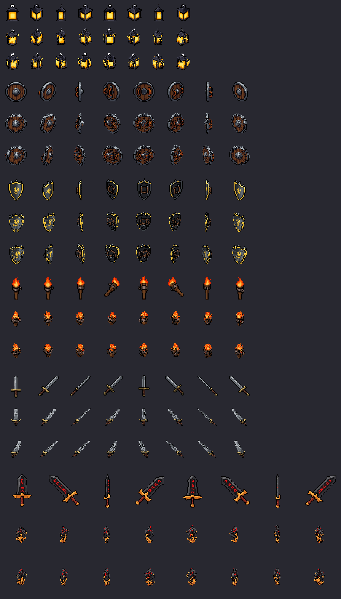
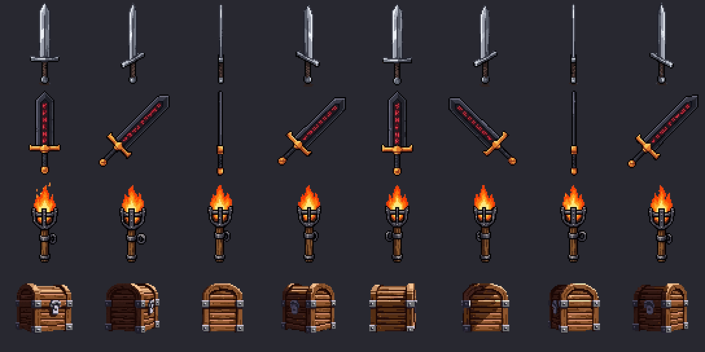
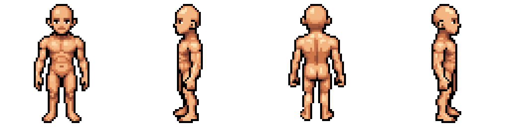

# 3D models from directional sprites

This is a research note, not a feature: nothing here is a PixelKiln command, and the scripts are rough. PixelKiln already generates an object or a character from eight directions. This note records every attempt to turn those eight pictures into a 3D model: what was tried, with what, and what came out.

Last updated 16 November 2026.

## Summary

| # | Approach | Tool or model | Result | Verdict |
|---|---|---|---|---|
| 1 | Carve a voxel model from the eight silhouettes | Our script | 92 to 96% on round objects, 39 to 68% on long ones | The long objects were drawn tilted. See 2. |
| 2 | Ask for the object standing upright | PixelLab 8-direction object | Sword 66% to 94%, torch 68% to 93% | Keep. The prompt wording matters more than the algorithm. |
| 3 | Detect tilted views and carve without them | Our script | Greatsword 98% from six views | Keep. The model fills in the views the generator got wrong. |
| 4 | Smooth, colour and render the carved model | Our script | Readable from 16 sides | Keep for shape. Colour is still rough between the drawn views. |
| 5 | Carve a character | Our script | 95% | Keep. |
| 6 | Triangulate a 3D skeleton from 2D joints | PixelLab skeleton estimate + our script | 18 joints, 1.3 px mean error | Keep. This is a rig. |
| 7 | Build the body from tubes around the bones | Our script | 79% | Drop. Carving is better. |
| 8 | Generate a mesh from four views | Hunyuan3D-2mv in ComfyUI, RTX 3060 12 GB | About two minutes a mesh; 70 to 83% | Cleaner geometry, looser match. Needs its own texture step. |
| 9 | Unwrap the mesh and texture it from the sprites, in stages | Our script, with xatlas for the unwrap | Colour error down by a fifth to a half against one-pass colouring, on all five | Keep. The texture is now a picture that can be repaired. |

**How the percentages are measured.** The model is projected back to each of the eight camera positions and its outline is compared with the sprite's outline. The score is the area the two share divided by the area either covers, averaged over the views. 100% means the model casts exactly the sprite's shadow from every side. It measures shape only, not colour. It also favours carving, which is built from those same outlines.

## What we start from

- **Sprites.** PixelLab's `create_8_direction_object` gives eight 64px views of one object, at 45 degree steps: south, south-east, east, north-east, north, north-west, west, south-west. It costs 10 generations per object at this size. Characters come from `create_character` with the same eight directions.
- **Camera.** The views are drawn from slightly above, not level. PixelLab's `view` option sets this: `low top-down` (the default), `high top-down` or `side`. The carving script does not assume the angle; it tries 0, 10, 20, 30 and 40 degrees and keeps the one whose model matches the sprites best. It landed on 20 to 30 degrees for default views.
- **Subjects.** A lantern, a round shield, a kite shield, a torch, a sword, a greatsword, a treasure chest, and the bare character used for the paperdoll work.

## 1. Carving from eight silhouettes

**Question.** Is the shape recoverable from the outlines alone, with no model?

**Setup.** Start with a solid 64×64×64 block of voxels. For each of the eight views, remove every voxel that falls outside that view's outline. What is left is the largest shape consistent with all eight views (a visual hull). The camera height and a small per-view shift are fitted by trying values and keeping the best score. Script: [`scripts/carve.ts`](../research/scripts/carve.ts).

**Result.** Each block of three rows is one object: the sprites, the model from the same eight directions, and the model from the eight directions in between.



| Object | Match |
|---|---|
| Lantern, round shield, kite shield | 92 to 96% |
| Torch | 68% |
| Sword | 66% |
| Greatsword | 39% |

The lantern and shields hold their shape. The torch, sword and greatsword are carved down to stumps. Look at their sprite rows: in the diagonal views the object is leaning over. The generator drew a tilted picture of the sword instead of turning it in space, so the eight views describe eight different poses and almost nothing is consistent with all of them.

The surfaces are also ragged and the colours speckled, because eight hand-drawn pictures do not agree with each other pixel for pixel.

**Verdict.** The method works when the views agree. The problem is the input.

## 2. Asking for upright objects

**Question.** If the output is going to be 3D, can the generator be told to draw the object standing straight up, so the views agree?

**Setup.** Same tool, with this added to the description: "standing perfectly upright and vertical, blade pointing straight up, spinning in place around its vertical axis like a turntable model". Tried with `view: side` and with the default.

**Result.** The inputs, one row per object:



The sword, torch and chest stand upright in every view. The ornate greatsword (second row) ignored the wording and leans on all four diagonals.

| Object | Before | With upright wording |
|---|---|---|
| Sword, `view: side` | 66% | 94% |
| Sword, default view | 66% | 89% |
| Torch | 68% | 93% |
| Treasure chest | not tried | 93% |
| Ornate greatsword | 39% | 28% |

**Verdict.** Keep the wording. It fixes plain objects and is not a guarantee for detailed ones.

## 3. Finding tilted views and carving without them

**Question.** Can a tilted view be detected automatically, and can the model be built from the good views only?

**Setup.** Two parts.

- *Tilt check.* For each view, find the long axis of the outline and measure how far it leans from vertical. Script: [`scripts/tilt.py`](../research/scripts/tilt.py). Good objects leaned 0 to 2 degrees in every view. Every bad view leaned 36 to 46 degrees. There is nothing in between, so a threshold anywhere around 10 to 20 degrees separates them.
- *Second greatsword.* Generated again with the good sword passed as `style_object_id`. It came back upright in six views and tilted in two. (The first try at this failed outright: the new object's size must be at least the style object's content size.)
- *Carving with views left out.* The script takes a list of views to skip. A skipped view neither carves nor gives colour.

**Result.** The greatsword carved from its six upright views. Top row: the sprites, with the two tilted ones still shown. Below: the model from the same directions and from in between.


It matched the six views it was built from 98%. Rendered from the two directions that were left out, it stands upright there as well.

**Verdict.** Keep both. The tilt check is a cheap gate before spending anything further, and the model can supply the views the generator got wrong.

## 4. Smoothing, colouring and rendering

**Question.** Can the carved model be made presentable?

**Setup.** Three changes to the script.

- *Smoothing.* Each voxel is kept or removed by a majority vote of its 26 neighbours, twice. This fills pits and removes spikes.
- *Colour.* Each surface voxel takes its colour from the view that faces it most squarely and can actually see it. Outline pixels (the sprites' near-black edge) are avoided, because they were landing on the surface as dark speckle.
- *Render.* One ray is marched per output pixel, so there are no holes, and a one-pixel dark outline is drawn around the result.

**Result.** All the upright subjects, three rows each as before:


The directions that have a sprite come out close to it. The directions in between are recognisable but rougher: the colour there is borrowed from a neighbouring view and stretched.

**Verdict.** Good enough for shape. Colouring per voxel straight from the sprites is the weak part, which is the reason for step 9.

## 5. A character

**Setup.** The bare character base, its eight rotations, same script.

**Result.** 95% match, with the camera fitted at 20 degrees above level. It is the last block in the picture above. Arms and legs survive; the gap between the legs partly fills in, because a gap is only carved if some view can see through it.

**Verdict.** Keep.

## 6. A 3D skeleton from 2D joints

**Question.** PixelLab's skeleton estimate gives 18 joints in each 2D view. Do the eight views agree on where those joints are in space?

**Setup.** For each joint, solve for the one 3D point that best explains its eight 2D positions, using the camera fitted in step 1. The estimator sometimes names left and right by the picture and not by the body; the script tries both namings for each view and keeps the one that agrees with the others.

**Result.** All 18 joints placed, with a mean error of 1.3 pixels and a worst case of 2.1 at an elbow. Left and right came out consistent in every view.

**Verdict.** Keep. This is a rig for the carved model, from data PixelKiln already stores in the anchors file.

## 7. A body from tubes

**Question.** A Discord thread described building characters from tubes or capsules around a skeleton. Is that better than carving?

**Setup.** One tube per bone (upper arms, forearms, thighs, shins, torso, shoulders, hips, head), with each tube's radius taken from the carved voxels nearest that bone.

**Result.** Top three rows are carving, bottom three are tubes:


Tubes matched 79% against carving's 95%. The result is a blob with limbs: no hands, feet, face or shoulders.

**Verdict.** Drop tubes as the shape. Carving for the shape with the skeleton from step 6 as the rig is the combination worth keeping.

## 8. Hunyuan3D multi-view meshes

**Question.** Does a model trained to make meshes from pictures do better than carving, and does it run on hardware we have?

**Setup.**

- *Model.* Tencent Hunyuan3D-2mv, the `hunyuan3d-dit-v2-mv` checkpoint in fp16, 4.93 GB, from the `tencent/Hunyuan3D-2mv` repository on Hugging Face.
- *Runner.* ComfyUI 0.34.0, which has Hunyuan3D nodes built in. No custom nodes. PyTorch 2.13 with CUDA.
- *Hardware.* A desktop with an RTX 3060, 12 GB.
- *Graph.* `ImageOnlyCheckpointLoader` → `ModelSamplingAuraFlow` (shift 1.0). Four `LoadImage` → `CLIPVisionEncode` (crop none) → `Hunyuan3Dv2ConditioningMultiView`. `EmptyLatentHunyuan3Dv2` (resolution 3072) → `KSampler` (30 steps, cfg 5, euler, normal) → `VAEDecodeHunyuan3D` (8000 chunks, octree 256) → `VoxelToMesh` (surface net, threshold 0.6) → `SaveGLB`. Script: [`scripts/hunyuan3d.py`](../research/scripts/hunyuan3d.py).
- *Inputs.* The model takes four views: front, left, back, right. Those are south, west, north and east of the eight. Each 64px sprite was scaled to 512px with hard pixel edges and put on white:



**Result.** 106 to 119 seconds per mesh. Each block of three rows below is one subject (character, chest, sword, torch; the greatsword is not pictured): the sprites, the carved model, and the Hunyuan3D mesh. The mesh was turned into voxels and coloured from the sprites the same way as the carved model, so the two can be compared directly.


| Subject | Carved | Hunyuan3D mesh |
|---|---|---|
| Bare character | 95% | 83% |
| Chest | 93% | 82% |
| Sword | 94% | 80% |
| Greatsword | 98% | 72% |
| Torch | 93% | 70% |

- **Better than carving:** the geometry is real. The character's legs are separate, the sword blade is thin from the side, the chest has a lid.
- **Worse than carving:** the model redraws the object in its own proportions. The mesh does not line up with the sprites pixel for pixel, so colour taken straight from the sprites lands a pixel or two off.
- **Lost:** the torch's flame. A flame is not a solid object and the mesh leaves it out.
- **Caveat on the numbers:** the mesh was lined up with the sprites crudely (scaled to the same height, tried at each quarter turn). A better fit would close some of the gap. Carving also has a built-in advantage on this score.
- **Not measured:** the same run on an Apple M1, so there is no speed comparison.
- **Licence:** the Hunyuan3D community licence does not apply in the EU, the UK or South Korea.

**Verdict.** Use it when clean geometry matters more than matching the sprite exactly. It needs a texture step of its own.

## 9. Texturing in stages

**Question.** Steps 4 and 8 coloured the model in one pass, straight from the sprites onto voxels. Does splitting the work into stages (fit, unwrap, project, fill, render) give a better result on the Hunyuan3D meshes?

**Setup.** Script: [`scripts/texture.py`](../research/scripts/texture.py). It takes about six seconds a mesh on a laptop. Libraries: trimesh, xatlas, fast-simplification, numpy, scipy.

1. **Fit.** The mesh is simplified to 30,000 triangles, then lined up with the sprites' cameras by searching for the turn, the camera height, a scale for each of the three axes, and a one or two pixel shift per view that make its outline match the sprites best. Step 8 only tried quarter turns and one scale.
2. **Unwrap.** xatlas flattens the surface into a 256×256 texture.
3. **Project.** Every texel is given the colour of the sprite pixel it lands on, from the one view that faces it most squarely and can see it. Outline pixels are never used. Texels then agree with their neighbours on which view to use, so the surface does not speckle where two views meet.
4. **Fill.** A texel no view could see takes the colour of the nearest texel that was seen, measured across the surface in 3D.
5. **Render.** Unlit, at sprite size, each pixel taking the most common colour among the texels in front, with a drawn outline.

It also writes a textured `.glb` that opens in Blender or any glTF viewer.

**Result.** Four rows per subject: the sprites; the same mesh coloured in one pass (step 8); the mesh textured in stages; and the staged model from the eight directions in between.


The texture itself, for the chest. Left: the unwrapped texture. Right: which of the eight sprites each texel took its colour from, one colour per view; dark grey was seen by none and filled in.


Three numbers per method. *Shape* is the outline match used throughout. *Colour error* is the mean difference per colour channel, out of 255, over the pixels where model and sprite overlap; lower is better. *Close* is the share of those pixels within 24 of the sprite's colour on every channel. All three are measured on the rendered pictures by [`scripts/score.py`](../research/scripts/score.py), which first slides each render to where it overlaps its sprite best, so the shape numbers here are a little lower than the ones in the earlier steps.

| Subject | Method | Shape | Colour error | Close |
|---|---|---|---|---|
| Character | Carved, one pass | 92% | 40.5 | 42% |
| | Mesh, one pass | 85% | 49.4 | 37% |
| | Mesh, staged | 88% | 42.9 | 46% |
| Chest | Carved, one pass | 92% | 42.3 | 41% |
| | Mesh, one pass | 85% | 49.2 | 30% |
| | Mesh, staged | 90% | 32.0 | 54% |
| Sword | Carved, one pass | 91% | 36.3 | 50% |
| | Mesh, one pass | 79% | 52.2 | 37% |
| | Mesh, staged | 89% | 31.3 | 60% |
| Torch | Carved, one pass | 89% | 35.4 | 48% |
| | Mesh, one pass | 76% | 53.3 | 25% |
| | Mesh, staged | 83% | 28.6 | 59% |
| Greatsword | Carved, one pass | 94% | 18.4 | 72% |
| | Mesh, one pass | 71% | 22.3 | 70% |
| | Mesh, staged | 89% | 13.9 | 81% |

- **The better fit closed most of the shape gap.** The meshes went from 71 to 85% to 83 to 90%, with no change to the meshes themselves. Carving is still ahead on shape by 2 to 6 points.
- **Staged texturing beat one-pass colouring on every subject,** and beat the carved model's colour on four of five. The character is the exception: the mesh's hands, head and chest are a different shape from the sprite's, so muscle lines land in the wrong place.
- **The torch has a flame again.** The mesh has no flame, but the sprite's flame pixels land on the top of the basket.
- **The greatsword's two tilted views were left out,** and the model is upright from those directions with the runes in place.
- **A mirror image cannot be told apart by outline.** For every subject the mirrored fit scored within a tenth of a point of the true one. The script assumes the mesh is not mirrored, which held for all five. Front and back are nearly as close on symmetric objects (83.2 against 83.1 for the chest), so the result should be looked at, not trusted.

**Tried and dropped,** on the character, none of which moved the colour error by more than a point or two:

- Blending views by weight and snapping to the palette, instead of one view per texel: 48% close against 54%. Blending muddies the pixel art.
- Letting a texel that lands just outside the sprite take the nearest pixel inside it: slightly worse.
- Refusing colour from pixels beside a jump in the mesh's depth (its outer edge, an arm in front of the body): no better, and a quarter of the texels left to fill.

The remaining error on the character is the mesh's shape, not the texturing.

**Verdict.** Keep. Staging is the better way to colour a mesh, and it leaves a texture file that can be repaired as an ordinary picture.

## What is next

- **Texture the carved shape the same way.** Carving matches the sprite best, and staged texturing colours best. Turning the carved voxels into a mesh and running step 9 on it should combine the two, and is the obvious next experiment.
- **Repair the texture as a picture.** The chest unwraps into a few large pieces, but the character comes out in hundreds of small ones, which is fine for a program and poor for a person or an image model to paint on. Fewer, larger pieces (a simpler mesh, or one piece per view like a folded paper model) would make inpainting the filled areas and seams practical.
- **Remove baked shading.** The sprites are drawn lit from one side, and that light is now painted on the model. Nothing here removes it yet.
- **Use the rig.** The skeleton from step 6 has not been attached to a mesh.
- Can the eight-view input of the hosted Hunyuan3D 3.1 use all eight sprites? (Unverified; see below.)

## What other people are doing

From a web survey on 16 November 2026. Items marked *unverified* were seen in a listing or a search result and not read in full or tried here.

**Image-to-3D models**

- [Hunyuan3D-2mv](https://huggingface.co/tencent/Hunyuan3D-2mv) (Tencent). Open weights, multi-view. The one used in step 8.
- [Hunyuan3D 2.1](https://huggingface.co/tencent/Hunyuan3D-2.1) (Tencent). Open weights, with a texture stage. Same regional licence limits.
- [Hunyuan3D 3.1](https://www.3daistudio.com/Models/Hunyuan3D-3-1). Hosted only. Listed as accepting up to eight views. *Unverified.*
- [TRELLIS.2](https://huggingface.co/microsoft/trellis.2-4b) (Microsoft). MIT licence, single image, reported to need about 24 GB. *Unverified.*
- [Stable Point Aware 3D](https://stability.ai/news/stable-point-aware-3d) (Stability). Single image.
- [Pixal3D](https://ldyang694.github.io/projects/pixal3d/) (Tencent ARC). Aligned to the input image's camera, which is the property step 8 lacked. Licence not stated.
- Meshy and Tripo are paid hosted services; neither was tried.

No report was found of any of these being tested on pixel art.

**Without a model**

- [Turning 8-bit sprites into printable 3D models](https://0fps.net/2012/09/18/turning-8-bit-sprites-into-printable-3d-models/) (0fps, 2012). Voxels from sprites.
- [Pix 2D to 3D](https://korben.info/en/pix-2d-to-3d-sprites-to-3d-models-no-ai-gpu.html). Inflates one sprite by distance from its edge. *Unverified.*
- [A browser tool that extrudes pixel art layers into animated 3D](https://80.lv/articles/this-browser-based-tool-turns-pixel-art-into-animated-3d-models).
- [A manual sprite-to-3D workflow in Blender](https://80.lv/articles/2d-pixel-art-sprites-to-3d-workflow-shared-by-indie-game-developer).

**The other direction, 3D to pixel art**

- [Voxify3D](https://arxiv.org/abs/2512.07834). Turns a mesh into voxel art with a small palette.
- [Blender to Pixels](https://astropulse.itch.io/blender-to-pixels). Renders a 3D scene as pixel art.

**The Discord pipeline.** The thread that started this described: build the character from tubes or capsules, or generate a mesh with Hunyuan or Meshy; unwrap it "as a folded piece of paper"; retexture the unwrapped image with an image model; carve hair and clothes as separate pieces; remove baked shadows and highlights; render with a toon or pixel shader. None of it could be checked against a public source. Step 7 here tested the tubes part, and step 9 the unwrap and texture part, without the image model.

No public tool was found that takes several directional pixel sprites and returns a mesh.

## Cost so far

- Six upright objects at 10 generations each: 60 PixelLab generations.
- Carving, tilt check, skeleton and rendering: nothing. They run locally in seconds.
- Hunyuan3D: nothing but about two minutes of GPU time per mesh, after a 4.93 GB download.
- Staged texturing: nothing. About six seconds a mesh on a laptop.

## Running the scripts

They are written for the files this session had on disk and take paths as arguments.

```bash
# Carve, smooth, colour and render <name>-<direction>.png from a folder. Prints the match.
node --experimental-strip-types research/scripts/carve.ts <folder> <name> <out-folder>

# The same, leaving out tilted views.
SKIP=north-east,south-west node --experimental-strip-types research/scripts/carve.ts <folder> <name> <out-folder>

# Voxelise a mesh and score it against the same sprites.
GLB=<mesh.glb> node --experimental-strip-types research/scripts/carve.ts <folder> <name> <out-folder>

# How far each view leans.
python3 research/scripts/tilt.py <folder> <name>

# Four views to a mesh, through a ComfyUI server (address at the top of the script).
python3 research/scripts/hunyuan3d.py <folder> <name> <out-folder>

# Fit, unwrap, texture and render a mesh from the sprites. Writes the texture, a textured .glb and a sheet.
python3 research/scripts/texture.py <folder> <name> <mesh.glb> <out-folder>

# Score the second row of a sheet against the first.
python3 research/scripts/score.py <sheet.png>
```
