# 3D models from directional sprites

This is a research note, not a feature: nothing here is a PixelKiln command, and the scripts are rough. PixelKiln already generates an object or a character from eight directions. This note records every attempt to turn those eight pictures into a 3D model: what was tried, with what, and what came out.

Last updated 17 November 2026.

## Summary

| # | Approach | Tool or model | Result | Verdict |
|---|---|---|---|---|
| 1 | Carve a voxel model from the eight silhouettes | Our script | 92 to 96% on round objects, 39 to 68% on long ones | The long objects were drawn tilted. See 2. |
| 2 | Ask for the object standing upright | PixelLab 8-direction object | Sword 66% to 94%, torch 68% to 93% | Keep. The prompt wording matters more than the algorithm. |
| 3 | Detect tilted views and carve without them | Our script | Greatsword 98% from six views | Keep. The model fills in the views the generator got wrong. |
| 4 | Smooth, colour and render the carved model | Our script | Readable from 16 sides | Keep for shape. Colour is still rough between the drawn views. |
| 5 | Carve a character | Our script | 95% | Keep. |
| 6 | Triangulate a 3D skeleton from 2D joints | PixelLab skeleton estimate + our script | 18 joints, 1.3 px mean error | Keep. This is a rig. |
| 7 | Build the body from tubes around the bones | Our script | 79% | Drop. Carving is better. |
| 8 | Generate a mesh from four views | Hunyuan3D-2mv in ComfyUI, RTX 3060 12 GB | About two minutes a mesh; 70 to 83% | Cleaner geometry, looser match. Needs its own texture step. |
| 9 | Unwrap the mesh and texture it from the sprites, in stages | Our script, with xatlas for the unwrap | Colour error down by a fifth to a half against one-pass colouring, on all five | Keep. The texture is now a picture that can be repaired. |
| 10 | Let the views vote on each texel's colour | Our script | Colour error down another 1 to 4 on every subject and shape | Keep, as the default. |
| 11 | Texture the carved shape the same way | Our script, marching cubes | Better than the mesh on the character and torch, worse on the two swords | Keep both shapes. Which is better depends on the object. |
| 12 | Carved shape cut back to the mesh | Our script | No better than carving alone | Drop. |
| 13 | Have an image model redraw the model's rough renders | PixelLab `edit_image`, `inpaint_image`, `correct_pixelart` | Clean sprites at angles the generator never drew: sixteen directions from eight, for 10 generations | Keep. This is the best result so far, and it changes what the 3D model is for. |
| 14 | Paint the redrawn views back onto the model | Our script | Smoother, still muddy | Drop for now. The model is a guide, not the final picture. |
| 15 | Flatten the texture to a few materials and light it in the renderer | Our script | No blotches, and no detail either | Partly. The lighting is worth keeping; the flattening loses too much. |
| 16 | Put the skeleton in the mesh, skin it, add a walk, export a rigged `.glb` | Our script | Valid glTF with 15 bones and a walk, for both characters | Keep. This is the first file here a 3D game can import and animate. |
| 17 | Install Hunyuan3D's paint stage on the RTX 3060 | Second ComfyUI, community node | Runs in 12 GB after one patch; about 40 seconds a pass | Keep. |
| 18 | Flat base with trusted sprite pixels laid back on top | Our script | Eyes and trim return; the tearing does not change | Drop. The tearing is in the shape, not the shading. |
| 19 | Use the Hunyuan3D mesh for the knight, not the carved shape | Hunyuan3D-2mv | Real horns, separate arms and legs; the same texturing reads far better | Keep for complex characters. No gain on the bare character. |
| 20 | Paint the mesh with the paint stage, once per sprite direction | Hunyuan3D-2 paint | Each sprite redrawn to fit the mesh; a clean texture from every side | Keep. The best texture in this note. |
| 21 | Redraw the character in an A-pose before meshing | PixelLab character state | Arms clear of the body in all eight views, for 10 generations a character | Keep. The mesh and the rig both need it. |
| 22 | Round the pixel edges off the pictures the mesh model sees | Our script, Hunyuan3D-2mv | The bare character goes from a figure made of boxes to a sculpted body with a face | Keep. The largest gain in shape since step 8. |
| 23 | Bake the painted views on this machine, with side views and colour correction | Our script | 24 views from 8 passes, no visible seams; the rim and colour-matching ideas made it worse | Keep the side views and the correction. Drop the other two. |
| 24 | Measure skin weights through the inside of the mesh | Our script | The cape hangs from the shoulders, not the legs; the walk lowers the arms | Keep. |
| 25 | Carry the sprites' palette in the file and snap to it when drawing | Our script, a shader in the viewer | Renders at sprite size read as sprites; the colour score still prefers the stitched texture | Keep the look. The score is the wrong judge. |
| 26 | A leaner bare body, with each item drawn as its own layer | PixelLab v3 character, PixelKiln layers | A slim figure in underwear and four clean item layers; the mesh is still stocky | Keep. The mesh inherits the sprite's four-heads-tall build. |
| 27 | Mesh each item on its own, or mesh the body wearing it and cut the item out | Hunyuan3D-2mv, our scripts | Alone, thin items collapse into slabs; cut from the worn mesh, all four hold their shape | Cut from the worn mesh. |
| 28 | The body and four items as separate meshes on one skeleton | Our script | One .glb, items switch on and off, all walk together | Keep. Painted in step 29. |
| 29 | Paint the body and each worn mesh before cutting the item out | Hunyuan3D paint stage, our bake | Clean armour, cape and skin in place of speckle; colours drift cooler and the gold is duller | Keep. The colour drift is handled in step 30. |
| 30 | Hide the skin under what is worn, and bake each item in its own colours | Our script | The body is six pieces, each hidden while its item is on; orange flecks in the walk turned out to be dulled gold snapped to skin colour, and are gone | Keep. |
| 31 | Draw the character as sprite cards on the skeleton, with no textured mesh shown | Our script, three.js | Crisp drawn pixels from any angle, walking, with items that switch off | Keep as a second way to show a character. Eight directions and open joints are the limits. |
| 32 | Redraw the sprites large with a local image model, and paint from those | SDXL with a tile control model, Hunyuan3D paint stage | Painted armour with real detail in place of enlarged pixels; 768 pixel views fit in 12 GB | Keep. The eight redraws do not agree on details, and colours move. |
| 33 | Make the redraws agree: one sheet for all eight, or each alone with the sprite's colours held | SDXL with a tile control model | Holding colours fixes the drift and keeps the detail; the one-sheet redraw agrees but is soft | Keep the colour hold. Drop the sheet. |
| 34 | Mesh from redrawn pictures in place of smoothed sprites | SDXL redraw, Hunyuan3D-2mv | A round skull, a face, ears, arms and legs with shape, where there were flat facets | Keep. The largest gain in the mesh since step 22. |
| 35 | Rebuild the body and all four items from redrawn pictures, end to end | SDXL redraw, Hunyuan3D-2mv and its paint stage, our scripts | A sculpted body and detailed helm, armour and cape on the same skeleton; one sleeve short, a gap at the hip, a teal fur collar | Keep as the viewer's model. The item masks still come from the sprites and no longer fit exactly. |
| 36 | Move each item's edge to where the paint puts it, and stop the bake shifting colours | Our scripts | Skin scraps and the hip gap are gone; the collar is grey again, the helm black, the underwear grey | Keep. One sleeve still ends at mid forearm. |
| 37 | Open the parts model in a game engine | Godot 4.7.2, headless | Ten skinned meshes, fifteen named bones, the walk, and each body piece's hide list all arrive | Keep. The first check outside three.js. |

**How the percentages are measured.** The model is projected back to each of the eight camera positions and its outline is compared with the sprite's outline. The score is the area the two share divided by the area either covers, averaged over the views. 100% means the model casts exactly the sprite's shadow from every side. It measures shape only, not colour. It also favours carving, which is built from those same outlines.

## What we start from

- **Sprites.** PixelLab's `create_8_direction_object` gives eight 64px views of one object, at 45 degree steps: south, south-east, east, north-east, north, north-west, west, south-west. It costs 10 generations per object at this size. Characters come from `create_character` with the same eight directions.
- **Camera.** The views are drawn from slightly above, not level. PixelLab's `view` option sets this: `low top-down` (the default), `high top-down` or `side`. The carving script does not assume the angle; it tries 0, 10, 20, 30 and 40 degrees and keeps the one whose model matches the sprites best. It landed on 20 to 30 degrees for default views.
- **Subjects.** A lantern, a round shield, a kite shield, a torch, a sword, a greatsword, a treasure chest, and the bare character used for the paperdoll work.

## 1. Carving from eight silhouettes

**Question.** Is the shape recoverable from the outlines alone, with no model?

**Setup.** Start with a solid 64×64×64 block of voxels. For each of the eight views, remove every voxel that falls outside that view's outline. What is left is the largest shape consistent with all eight views (a visual hull). The camera height and a small per-view shift are fitted by trying values and keeping the best score. Script: [`scripts/carve.ts`](../research/scripts/carve.ts).

**Result.** Each block of three rows is one object: the sprites, the model from the same eight directions, and the model from the eight directions in between.


| Object | Match |
|---|---|
| Lantern, round shield, kite shield | 92 to 96% |
| Torch | 68% |
| Sword | 66% |
| Greatsword | 39% |

The lantern and shields hold their shape. The torch, sword and greatsword are carved down to stumps. Look at their sprite rows: in the diagonal views the object is leaning over. The generator drew a tilted picture of the sword instead of turning it in space, so the eight views describe eight different poses and almost nothing is consistent with all of them.

The surfaces are also ragged and the colours speckled, because eight hand-drawn pictures do not agree with each other pixel for pixel.

**Verdict.** The method works when the views agree. The problem is the input.

## 2. Asking for upright objects

**Question.** If the output is going to be 3D, can the generator be told to draw the object standing straight up, so the views agree?

**Setup.** Same tool, with this added to the description: "standing perfectly upright and vertical, blade pointing straight up, spinning in place around its vertical axis like a turntable model". Tried with `view: side` and with the default.

**Result.** The inputs, one row per object:


The sword, torch and chest stand upright in every view. The ornate greatsword (second row) ignored the wording and leans on all four diagonals.

| Object | Before | With upright wording |
|---|---|---|
| Sword, `view: side` | 66% | 94% |
| Sword, default view | 66% | 89% |
| Torch | 68% | 93% |
| Treasure chest | not tried | 93% |
| Ornate greatsword | 39% | 28% |

**Verdict.** Keep the wording. It fixes plain objects and is not a guarantee for detailed ones.

## 3. Finding tilted views and carving without them

**Question.** Can a tilted view be detected automatically, and can the model be built from the good views only?

**Setup.** Two parts.

- *Tilt check.* For each view, find the long axis of the outline and measure how far it leans from vertical. Script: [`scripts/tilt.py`](../research/scripts/tilt.py). Good objects leaned 0 to 2 degrees in every view. Every bad view leaned 36 to 46 degrees. There is nothing in between, so a threshold anywhere around 10 to 20 degrees separates them.
- *Second greatsword.* Generated again with the good sword passed as `style_object_id`. It came back upright in six views and tilted in two. (The first try at this failed outright: the new object's size must be at least the style object's content size.)
- *Carving with views left out.* The script takes a list of views to skip. A skipped view neither carves nor gives colour.

**Result.** The greatsword carved from its six upright views. Top row: the sprites, with the two tilted ones still shown. Below: the model from the same directions and from in between.


It matched the six views it was built from 98%. Rendered from the two directions that were left out, it stands upright there as well.

**Verdict.** Keep both. The tilt check is a cheap gate before spending anything further, and the model can supply the views the generator got wrong.

## 4. Smoothing, colouring and rendering

**Question.** Can the carved model be made presentable?

**Setup.** Three changes to the script.

- *Smoothing.* Each voxel is kept or removed by a majority vote of its 26 neighbours, twice. This fills pits and removes spikes.
- *Colour.* Each surface voxel takes its colour from the view that faces it most squarely and can actually see it. Outline pixels (the sprites' near-black edge) are avoided, because they were landing on the surface as dark speckle.
- *Render.* One ray is marched per output pixel, so there are no holes, and a one-pixel dark outline is drawn around the result.

**Result.** All the upright subjects, three rows each as before:


The directions that have a sprite come out close to it. The directions in between are recognisable but rougher: the colour there is borrowed from a neighbouring view and stretched.

**Verdict.** Good enough for shape. Colouring per voxel straight from the sprites is the weak part, which is the reason for step 9.

## 5. A character

**Setup.** The bare character base, its eight rotations, same script.

**Result.** 95% match, with the camera fitted at 20 degrees above level. It is the last block in the picture above. Arms and legs survive; the gap between the legs partly fills in, because a gap is only carved if some view can see through it.

**Verdict.** Keep.

## 6. A 3D skeleton from 2D joints

**Question.** PixelLab's skeleton estimate gives 18 joints in each 2D view. Do the eight views agree on where those joints are in space?

**Setup.** For each joint, solve for the one 3D point that best explains its eight 2D positions, using the camera fitted in step 1. The estimator sometimes names left and right by the picture and not by the body; the script tries both namings for each view and keeps the one that agrees with the others.

**Result.** All 18 joints placed, with a mean error of 1.3 pixels and a worst case of 2.1 at an elbow. Left and right came out consistent in every view.

**Verdict.** Keep. This is a rig for the carved model, from data PixelKiln already stores in the anchors file.

## 7. A body from tubes

**Question.** A Discord thread described building characters from tubes or capsules around a skeleton. Is that better than carving?

**Setup.** One tube per bone (upper arms, forearms, thighs, shins, torso, shoulders, hips, head), with each tube's radius taken from the carved voxels nearest that bone.

**Result.** Top three rows are carving, bottom three are tubes:


Tubes matched 79% against carving's 95%. The result is a blob with limbs: no hands, feet, face or shoulders.

**Verdict.** Drop tubes as the shape. Carving for the shape with the skeleton from step 6 as the rig is the combination worth keeping.

## 8. Hunyuan3D multi-view meshes

**Question.** Does a model trained to make meshes from pictures do better than carving, and does it run on hardware we have?

**Setup.**

- *Model.* Tencent Hunyuan3D-2mv, the `hunyuan3d-dit-v2-mv` checkpoint in fp16, 4.93 GB, from the `tencent/Hunyuan3D-2mv` repository on Hugging Face.
- *Runner.* ComfyUI 0.34.0, which has Hunyuan3D nodes built in. No custom nodes. PyTorch 2.13 with CUDA.
- *Hardware.* A desktop with an RTX 3060, 12 GB.
- *Graph.* `ImageOnlyCheckpointLoader` → `ModelSamplingAuraFlow` (shift 1.0). Four `LoadImage` → `CLIPVisionEncode` (crop none) → `Hunyuan3Dv2ConditioningMultiView`. `EmptyLatentHunyuan3Dv2` (resolution 3072) → `KSampler` (30 steps, cfg 5, euler, normal) → `VAEDecodeHunyuan3D` (8000 chunks, octree 256) → `VoxelToMesh` (surface net, threshold 0.6) → `SaveGLB`. Script: [`scripts/hunyuan3d.py`](../research/scripts/hunyuan3d.py).
- *Inputs.* The model takes four views: front, left, back, right. Those are south, west, north and east of the eight. Each 64px sprite was scaled to 512px with hard pixel edges and put on white:


**Result.** 106 to 119 seconds per mesh. Each block of three rows below is one subject (character, chest, sword, torch; the greatsword is not pictured): the sprites, the carved model, and the Hunyuan3D mesh. The mesh was turned into voxels and coloured from the sprites the same way as the carved model, so the two can be compared directly.

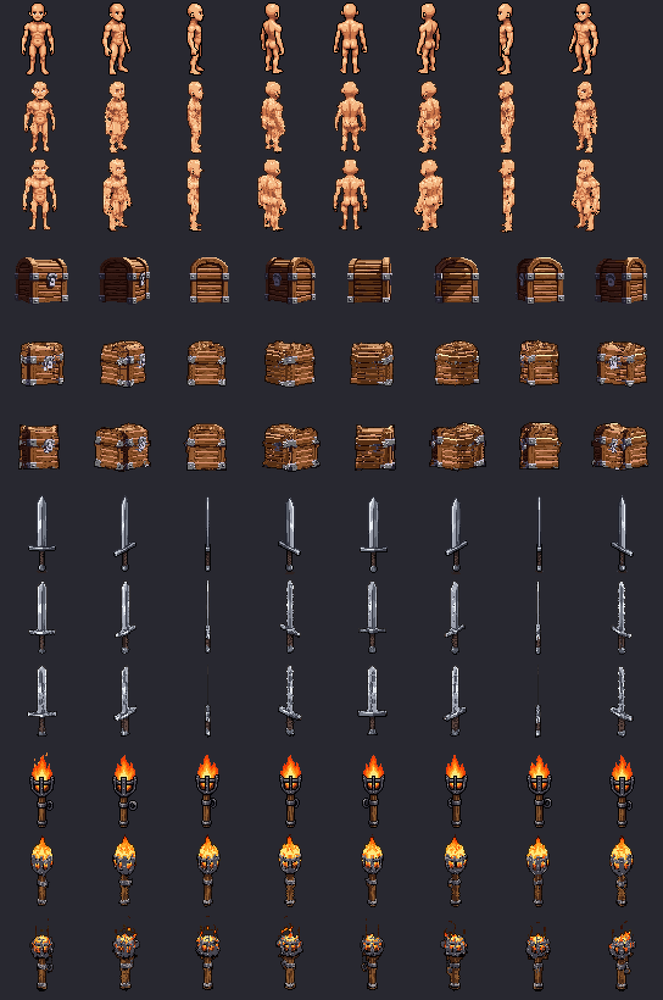

| Subject | Carved | Hunyuan3D mesh |
|---|---|---|
| Bare character | 95% | 83% |
| Chest | 93% | 82% |
| Sword | 94% | 80% |
| Greatsword | 98% | 72% |
| Torch | 93% | 70% |

- **Better than carving:** the geometry is real. The character's legs are separate, the sword blade is thin from the side, the chest has a lid.
- **Worse than carving:** the model redraws the object in its own proportions. The mesh does not line up with the sprites pixel for pixel, so colour taken straight from the sprites lands a pixel or two off.
- **Lost:** the torch's flame. A flame is not a solid object and the mesh leaves it out.
- **Caveat on the numbers:** the mesh was lined up with the sprites crudely (scaled to the same height, tried at each quarter turn). A better fit would close some of the gap. Carving also has a built-in advantage on this score.
- **Not measured:** the same run on an Apple M1, so there is no speed comparison.
- **Licence:** the Hunyuan3D community licence does not apply in the EU, the UK or South Korea.

**Verdict.** Use it when clean geometry matters more than matching the sprite exactly. It needs a texture step of its own.

## 9. Texturing in stages

**Question.** Steps 4 and 8 coloured the model in one pass, straight from the sprites onto voxels. Does splitting the work into stages (fit, unwrap, project, fill, render) give a better result on the Hunyuan3D meshes?

**Setup.** Script: [`scripts/texture.py`](../research/scripts/texture.py). It takes about six seconds a mesh on a laptop. Libraries: trimesh, xatlas, fast-simplification, numpy, scipy.

1. **Fit.** The mesh is simplified to 30,000 triangles, then lined up with the sprites' cameras by searching for the turn, the camera height, a scale for each of the three axes, and a one or two pixel shift per view that make its outline match the sprites best. Step 8 only tried quarter turns and one scale.
2. **Unwrap.** xatlas flattens the surface into a 256×256 texture.
3. **Project.** Every texel is given the colour of the sprite pixel it lands on, from the one view that faces it most squarely and can see it. Outline pixels are never used. Texels then agree with their neighbours on which view to use, so the surface does not speckle where two views meet.
4. **Fill.** A texel no view could see takes the colour of the nearest texel that was seen, measured across the surface in 3D.
5. **Render.** Unlit, at sprite size, each pixel taking the most common colour among the texels in front, with a drawn outline.

It also writes a textured `.glb` that opens in Blender or any glTF viewer.

**Result.** Four rows per subject: the sprites; the same mesh coloured in one pass (step 8); the mesh textured in stages; and the staged model from the eight directions in between.


The texture itself, for the chest. Left: the unwrapped texture. Right: which of the eight sprites each texel took its colour from, one colour per view; dark grey was seen by none and filled in.


Three numbers per method. *Shape* is the outline match used throughout. *Colour error* is the mean difference per colour channel, out of 255, over the pixels where model and sprite overlap; lower is better. *Close* is the share of those pixels within 24 of the sprite's colour on every channel. All three are measured on the rendered pictures by [`scripts/score.py`](../research/scripts/score.py), which first slides each render to where it overlaps its sprite best, so the shape numbers here are a little lower than the ones in the earlier steps.

| Subject | Method | Shape | Colour error | Close |
|---|---|---|---|---|
| Character | Carved, one pass | 92% | 40.5 | 42% |
| | Mesh, one pass | 85% | 49.4 | 37% |
| | Mesh, staged | 88% | 42.9 | 46% |
| Chest | Carved, one pass | 92% | 42.3 | 41% |
| | Mesh, one pass | 85% | 49.2 | 30% |
| | Mesh, staged | 90% | 32.0 | 54% |
| Sword | Carved, one pass | 91% | 36.3 | 50% |
| | Mesh, one pass | 79% | 52.2 | 37% |
| | Mesh, staged | 89% | 31.3 | 60% |
| Torch | Carved, one pass | 89% | 35.4 | 48% |
| | Mesh, one pass | 76% | 53.3 | 25% |
| | Mesh, staged | 83% | 28.6 | 59% |
| Greatsword | Carved, one pass | 94% | 18.4 | 72% |
| | Mesh, one pass | 71% | 22.3 | 70% |
| | Mesh, staged | 89% | 13.9 | 81% |

- **The better fit closed most of the shape gap.** The meshes went from 71 to 85% to 83 to 90%, with no change to the meshes themselves. Carving is still ahead on shape by 2 to 6 points.
- **Staged texturing beat one-pass colouring on every subject,** and beat the carved model's colour on four of five. The character is the exception: the mesh's hands, head and chest are a different shape from the sprite's, so muscle lines land in the wrong place.
- **The torch has a flame again.** The mesh has no flame, but the sprite's flame pixels land on the top of the basket.
- **The greatsword's two tilted views were left out,** and the model is upright from those directions with the runes in place.
- **A mirror image cannot be told apart by outline.** For every subject the mirrored fit scored within a tenth of a point of the true one. The script assumes the mesh is not mirrored, which held for all five. Front and back are nearly as close on symmetric objects (83.2 against 83.1 for the chest), so the result should be looked at, not trusted.

**Tried and dropped,** on the character, none of which moved the colour error by more than a point or two:

- Blending views by weight and snapping to the palette, instead of one view per texel: 48% close against 54%. Blending muddies the pixel art.
- Letting a texel that lands just outside the sprite take the nearest pixel inside it: slightly worse.
- Refusing colour from pixels beside a jump in the mesh's depth (its outer edge, an arm in front of the body): no better, and a quarter of the texels left to fill.

The remaining error on the character is the mesh's shape, not the texturing.

**Verdict.** Keep. Staging is the better way to colour a mesh, and it leaves a texture file that can be repaired as an ordinary picture.

## 10. Letting the views vote

**Question.** After step 9 the remaining flaws are dark specks where one sprite has a contour line and its neighbour has plain colour. The eight sprites are eight separate drawings and do not agree. Can the texture take the consensus instead of trusting one view?

**Setup.** Three rules for choosing a texel's colour, all in `texture.py`:

- `MODE=best` (step 9): the one view that faces the texel most squarely.
- `MODE=vote`: when three or more views can see the texel, take the colour closest to the middle of what they all say, leaning toward views that face it. Colours still come straight from a sprite, so the palette is kept.
- `DESPECKLE`: after colouring, replace any texel much darker than the surface around it.

**Result.** Voting lowered the colour error on all five subjects, on both shapes, by 1 to 4 points (table under step 11). It loses a little crispness on a face seen head-on. Despeckling made the numbers slightly worse at every threshold tried (25, 40, 60) and removed wanted detail with the specks.

**Verdict.** Vote is the better default. Despeckle is dropped.

## 11. Texturing the carved shape

**Question.** Carving matches the sprite's outline best and staged texturing colours best. Do they combine?

**Setup.** `carve.ts` with `DUMP=1` writes its voxels and its fitted camera. `texture.py` with `VOX` and `CAMERA` turns the voxels into a mesh with marching cubes and runs the same unwrap, project, fill and render on it, using the carve's camera so nothing needs fitting.

Two things had to be right before the numbers meant anything, and both are easy to get wrong again:

- **Where the surface is cut.** The carve treats each voxel as a point at its centre. A mesh cut half a voxel outside those centres (the usual setting) renders a pixel fatter than the sprite all round. The surface is cut through the outermost centres instead (`LEVEL=0.9`).
- **Half a pixel.** The carve drops a voxel into a pixel by rounding down. In views whose centre falls on a half pixel, that puts every voxel half a pixel to the right of where its cube really is. The camera is corrected for this on import. Before the fix the carved sword scored 86%; after, 89%.

**Result.** Four rows per subject: the sprites; the Hunyuan3D mesh with one view per texel (step 9); the same mesh with voting (step 10); the carved shape with voting.


These numbers come from `texture.py` itself, which scores its render in place, so they differ by a point or two from the table in step 9.

| Subject | Shape and rule | Shape | Colour error | Close |
|---|---|---|---|---|
| Character | Mesh, one view | 88.0% | 37.7 | 54% |
| | Mesh, vote | 88.0% | 35.9 | 56% |
| | Carved, vote | 90.5% | 34.5 | 53% |
| Chest | Mesh, one view | 91.2% | 31.1 | 56% |
| | Mesh, vote | 91.2% | 28.5 | 56% |
| | Carved, vote | 91.0% | 28.1 | 57% |
| Sword | Mesh, one view | 89.6% | 32.7 | 56% |
| | Mesh, vote | 89.6% | 29.1 | 58% |
| | Carved, vote | 88.6% | 32.7 | 52% |
| Torch | Mesh, one view | 82.2% | 28.2 | 59% |
| | Mesh, vote | 82.2% | 25.7 | 60% |
| | Carved, vote | 88.0% | 25.6 | 58% |
| Greatsword | Mesh, one view | 88.7% | 14.4 | 79% |
| | Mesh, vote | 88.7% | 13.5 | 81% |
| | Carved, vote | 86.9% | 21.9 | 70% |

- **Carving wins where the object is bulky or not solid.** The character gains 2.5 points of shape and the best colour so far. The torch gains 6 points of shape and gets its whole flame back, because carving keeps anything the sprites show.
- **The mesh wins on thin, flat objects.** Both swords are better as Hunyuan3D meshes. A blade two voxels thick is at the limit of what a 64-voxel grid can hold, and the greatsword was carved from only six views.
- **The chest is a tie.**
- Neither shape is better everywhere, so the choice should be made per object, by score.

**Verdict.** Keep both. The useful rule so far: carve characters, soft or hollow things and anything with parts that are not solid; use a generated mesh for thin rigid objects.

## 12. Carved shape, cut back to the mesh

**Question.** Carving cannot see a gap that no view looks through, such as between the legs. The generated mesh has those gaps. Does keeping only the carved voxels that are near the mesh give the best of both?

**Setup.** `HYBRID=2`: the Hunyuan3D mesh is fitted into the carve's camera and filled in, grown by two voxels, and intersected with the carved voxels. Also tried at one and three voxels.

**Result.** No gain. On the character it changed the scores by a tenth of a point. On both swords the grown mesh covered the whole carved shape, so the result was identical to carving. On the torch it cut part of the flame away (shape 86.3% against 88.0%).

**Verdict.** Drop. The gaps it was meant to open are small at this size, and the mesh does not line up closely enough with the sprite to cut safely.

## 13. Redrawing the rough renders with an image model

**Question.** Everything up to step 12 tries to make the textured model look right by itself. What if the model only has to be roughly right, and an image model draws the final sprite from it?

**Setup.** The carved, vote-textured character from step 11, rendered from sixteen directions: the eight the generator drew and the eight halfway between. Four ways of repairing the sixteen rough renders, all through PixelLab:

| Method | Call | Cost |
|---|---|---|
| Tidy | `correct_pixelart`, strength 0.4, 16 frames | 0.1 |
| Edit by instruction | `edit_image`, 16 frames in one call, told to remove specks and torn patches and keep pose and direction | 10 |
| Edit by reference | `edit_image` with the true south sprite as the reference, 15 frames | 10 |
| Guide sheet | `inpaint_image` on a 256×256 sheet: each true sprite beside the rough view next to it, only the rough ones masked open | 10 |

**Result.** Ten rows. 1: the true sprites. 2 to 5: the model at those same eight directions, as rendered, tidied, edited by instruction, edited by reference (which has no first frame; it was the reference). 6 to 10: the eight directions in between, as rendered, tidied, edited by instruction, edited by reference, and from the guide sheet.


- **Tidying does nothing useful.** It is built for stray pixels, not for a torn surface.
- **The two edits and the guide sheet all return clean sprites,** at directions the generator never drew, in the same style and proportions as the eight it did. These are the first in-between views in this note that look like finished art.
- **The outline survives.** Each redraw kept 93 to 100% of the rough render's outline, so the model is deciding the pose and the image model the surface.
- **Edits move the figure.** `edit_image` re-centred some frames by up to six pixels; the guide sheet moved none. A redrawn frame has to be slid back to where its render was.
- **The score does not see the improvement.** Against the true sprites, the instruction edit scores 36.3 colour error where the rough render scores 37.6, and fewer pixels within tolerance (39% against 49%), because the image model picks its own shades. The number says "no better"; the picture says otherwise. Colour error against one drawing was the wrong measure for this step.

**A dressed character.** The same thing on a clothed one: the bare base with greaves, plate, cape and helm composited from the paperdoll layers, on an 80px canvas. It carved at 92%. Held items had to be left off: a sword is held at a different angle in every view, so the carve removes it.

Top pair of rows: directions 1 to 8 as rendered from the model, then after `edit_image` by instruction. Bottom pair: directions 9 to 16. Every second figure is one the generator drew; the ones between are new.


The redrawn in-between views are a clean, recognisable knight. They are also a little squat next to the drawn ones: the carve loses some of the horns' height and the head sits lower, and the redraw keeps the model's proportions. Editing by reference cleaned less than editing by instruction here.

The sixteen directions are on the website as a viewer that turns the character, on the [paperdoll page](https://pixelkiln.griffen.codes/paperdoll#turnaround), with a switch to the raw model.

**Verdict.** Keep, and change direction. The 3D model does not have to look good. It has to put the right shapes and rough colours in the right place from any angle, and an image model does the drawing. Eight new directions cost 10 generations.

## 14. Painting the redrawn views back onto the model

**Question.** If the redrawn in-between views are clean, does projecting all sixteen onto the model give a clean texture?

**Setup.** `EXTRA` in `texture.py` adds the eight redrawn views as extra cameras, so each texel has sixteen views to vote among.

**Result.** Pairs of rows (drawn directions, then between): the eight-view texture; with the guide-sheet views added; with the instruction edits added; with the reference edits added.

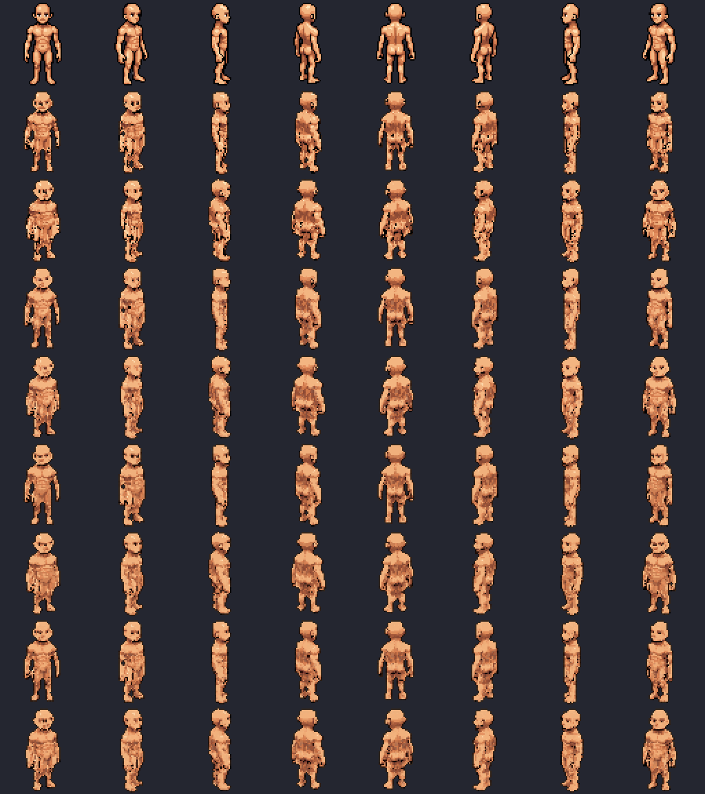

Slightly smoother, still blotchy, and the score against the sprites got worse (colour error 39 against 34.5), since the new views bring their own shades.

**Verdict.** Drop for now. Sixteen separate drawings disagree as much as eight did. A texture stitched from separate drawings of a 64-pixel figure comes out muddy however the stitching is done, which is the lesson of steps 9 to 14 together.

## 15. Flat materials and light from the renderer

**Question.** The blotches on the stitched texture are each sprite's own hand-drawn shading. If the texture is reduced to flat colour and the light is added by the renderer instead, the same from every side, do they go?

**Setup.** `FLAT=<k>` in `texture.py` sorts the texels into k materials by colour (mostly hue, a little brightness), lets neighbours on the surface agree, and paints each material one colour taken from its lit side. The render then adds three flat bands of light from the upper left, using normals from a smoothed copy of the mesh, since the carved surface is bumpy at the scale of a voxel and raw normals break the bands into noise. `TOON=1` adds the same light without flattening.

**Result.** Each pair of rows is the model from the eight drawn directions and the eight between. Top pair: the bare character as two materials. Middle pair: the knight as nine materials. Bottom pair: the knight with its full stitched texture and the same light.


- **The blotches are gone, and so is everything else.** The bare character is a clean clay figure with no face or muscle. The knight keeps its cape and fur and loses its trim, eyes and armour detail; skin and gold run together as orange patches.
- **Black armour came out brown at five materials** and dark grey at nine. Sorting by hue has little to work with on dark, unsaturated colours.
- **The full texture with renderer light (bottom pair) reads best of the three.** The light gives the form a consistent shape that helps hide the stitching.

**Verdict.** Keep the lighting, drop the flattening as a default. Flat colour would suit a simple object or a deliberately flat style. For a character, the detail has to come from somewhere better than eight disagreeing drawings, which is what step 17 is for.

## 16. A skeleton in the mesh

**Question.** Can the carved, textured character leave here as something a 3D game can animate?

**Setup.** [`scripts/rig.py`](../research/scripts/rig.py).

- **Bones.** The 18 joints from step 6 become fifteen bones named the way engines name a humanoid: Hips, Spine, Head, and Upper Arm, Lower Arm, Hand, Upper Leg, Lower Leg, Foot on each side. For the knight, the joints estimated on the bare character were triangulated again in the knight's own frame (mean error 1.4 pixels).
- **Skin weights.** Each vertex follows up to four bones, weighted by how close it is to each. Distance alone would bind an arm hanging at the side to the spine, so a bone is penalised when the straight line from the vertex to it leaves the body.
- **A walk.** One nine-key loop: thighs and upper arms swing against each other, knees bend on the back swing.
- **The file.** A `.glb` in metres, y up, 1.8 m tall, with the texture inside it set to hard pixel edges, the skin, and the animation named `Walk`.

**Result.** Which bone each part of the surface follows most, from four sides:


The walk, posed here with the file's own bones and weights and drawn from the front, three-quarters and side. Top three rows: the bare character. Bottom three: the knight.


- **Both files pass the Khronos glTF validator** with no errors or warnings.
- **Sizes:** the bare character is 7,571 vertices and 10,460 triangles in 562 KB; the knight is 10,433 vertices and 15,120 triangles.
- **They load and play in three.js**, which is what the viewer on the [paperdoll page](https://pixelkiln.griffen.codes/paperdoll#mesh) uses. They were not opened in Blender, Unity, Godot or Unreal here.
- **The knight's cape follows the legs,** because it is bound to the nearest bones like everything else. A cape wants bones of its own or cloth simulation.
- **Dark patches open up on the inner thighs** as the legs part: that surface was never seen by any sprite and was filled in.
- **The hands, feet and head are single bones.** There are no fingers, toes, jaw or eyes.

**Verdict.** Keep. The rig is the part of this note closest to the goal: characters that can be animated and imported into 3D games. The mesh and skeleton are sound. The texture is what is holding the result back.

## 17. Hunyuan3D's paint stage, installed

**Question.** Hunyuan3D has a second stage that textures a mesh from a reference image, consistently from every side. Can it run on the RTX 3060 used in step 8?

**Setup.** The ComfyUI already on that machine could not run it: its built-in Hunyuan3D nodes make shapes only, and the community node that adds the paint stage, [ComfyUI-Hunyuan3DWrapper](https://github.com/kijai/ComfyUI-Hunyuan3DWrapper), ships its compiled renderer for Python 3.12, where that install is Python 3.13. So a second ComfyUI went in beside the first, which was not touched:

- Python 3.12 in its own virtual environment, PyTorch 2.6.0 for CUDA 12.6, and the node's renderer wheel built for that pair.
- ComfyUI pinned to v0.3.27. The current release needs a newer PyTorch than the wheel was built for and fails on start.
- The paint model, `hunyuan3d-paint-v2-0`, which the node downloads on first use: 9.2 GB. The delight model was not used; the sprites carry no photographic lighting to remove.

**Result.**

- **The prebuilt renderer has no GPU code for this card.** It fails with "no kernel image is available for execution on the device": the wheel was compiled for a newer GPU generation. The same library has a CPU path that gives the same result, so one line in `custom_rasterizer/render.py` was changed to move its inputs to the CPU and its outputs back. Rasterising a 1024-pixel view on the CPU takes well under a second. No compiler or CUDA toolkit was installed.
- **It fits in 12 GB.** A full pass, six views at 512 pixels and 25 steps, takes about 40 seconds once the model is loaded, and about two minutes cold.
- **Given one front view, it invents the rest, and gets the back wrong.** The six views it painted for the knight from the south sprite alone: front, side, back, side, top, bottom. The back has a second face and chest where the cape should be.


**Verdict.** Keep. It runs, it is fast, and its front view is the first picture in this note that is both faithful to the sprite and fitted to the mesh. Step 20 uses that.

## 18. A flat base with the sprites laid back on top

**Question.** Step 15's flat materials were clean and featureless. If the flat texture is the base, and the sprites' own pixels are put back only where they can be trusted, is the result both clean and detailed?

**Setup.** `OVERLAY=<0 to 1>` in `texture.py`, with `FLAT`. A texel takes its sprite colour back when the surface faces the view at least that squarely, it is not on the sprite's rim or beside a jump in depth, the views that see it agree within `AGREE`, and its colour differs from the flat material by at least `DEV` (so soft painted shading stays out and eyes and trim come back).

**Result.** On the carved knight, 58% of texels were trusted. Colour error: 22.5 for the full stitched texture, 30.6 flat, 24.6 with the overlay.

- **The eyes, belt and gold trim come back** over a cleaner cape.
- **The torn areas look the same as before.** They sit exactly where the overlay trusts the sprites least, so they fall back to flat patches of the wrong material.
- **The flat row shows why.** With the detail gone, the carved knight is a lump: arms fused to the torso, legs fused together, horns reduced to stubs. Eight silhouettes cannot carve the gap between an arm and the body. No way of laying colour on that shape gives a clean arm.

**Verdict.** Drop. The tearing is in the shape, not the shading. This sent the work back to the mesh, in step 19.

## 19. The generated mesh for the knight

**Question.** Step 11 found the carved shape better than the Hunyuan3D mesh for bulky subjects. Is that still true for a character with horns, a cape and limbs?

**Setup.** The knight's south, west, north and east sprites through the Hunyuan3D-2mv graph from step 8 (147 seconds), then the same staged texturing, fitted into the carve's camera.

**Result.** The drawn sprite, then the model from the front, a drawn diagonal and three in-between directions. Row 1: carved shape. Row 2: generated mesh. Row 3: generated mesh, flat. Row 4: generated mesh with step 18's overlay.


- **The generated mesh has what carving cannot give:** curved horns, arms away from the body, two legs, a cape that hangs behind.
- **The same texturing reads far better on it,** though it scores lower on shape (82% against 87%), because the model's proportions are its own.
- **On the bare character there is no gain.** Shape 86.8% against 90.5%, colour error 36.3 against 34.5, and more stray dark specks. A simple body carves well.
- **The rig script needed one fix for it.** Horns that reach past the carved hull were following the arm bones; everything above the ears is now bound to the head.

**Verdict.** Keep, for anything with parts that stand away from the body. The carved shape stays the better choice for simple, solid subjects, and its camera is still what fits the mesh to the sprites.

## 20. The paint stage, once for each sprite

**Question.** Step 17's model paints a faithful, well-fitted front and a wrong everything else. There are eight sprites. Can each one be the front?

**Setup.** [`scripts/hunyuan3d_paint_turn.py`](../research/scripts/hunyuan3d_paint_turn.py). For each of the eight directions the mesh is turned to face the camera, that direction's sprite is the reference, the model paints its six views, and only the first is kept. Asked for one view alone the model returns grey noise; it was trained to paint six together. The eight kept views are then baked onto the unturned mesh with the node's own baking, each from the angle it was painted at, and the gaps are filled. About six minutes for a character.

**Result.** Top row: the eight sprites. Middle: the mesh turned to face each. Bottom: what the model painted.


Every painted view is its sprite, redrawn to sit exactly on the mesh: the cape is on the back, the emblem is on the chest, the arms are where the mesh's arms are. This is the image-model redraw of step 13 with one thing added, which is that the model is told the shape.

The baked result against the stitched texture of step 10, on the same meshes, drawn large from the front, an in-between angle, a diagonal, the side, an in-between angle and the back. Top of each pair: stitched. Bottom: painted.

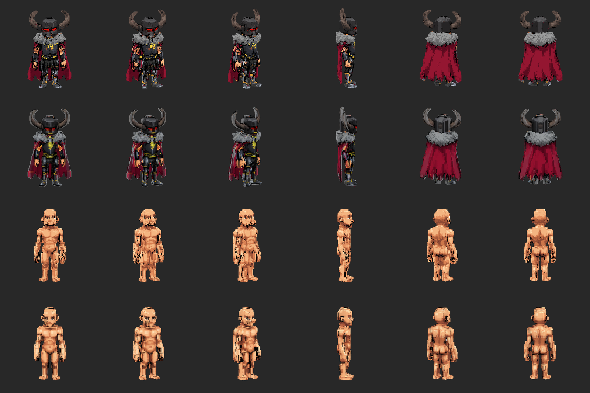

- **The tearing is gone.** Armour, belt, face and limbs are continuous from every angle, including the ones no sprite was drawn from.
- **The scores do not show it.** At sprite size, against the drawn sprites, the painted knight scores a colour error of 37.8 where the stitched one scores 31.1. The painted texture is a redraw, not a copy, and a render of it shrunk to 80 pixels picks up noise the stitched texture, made at that size, does not. The measure rewards copying pixels; step 13 met the same limit.
- **It is no longer pixel art on the surface.** The views are 512 pixels with soft-edged blocks. The texture is 1024 pixels, shrunk to 512 in the rigged files.
- **Light rims on the cape's edges,** where the grey ground of a painted view was baked onto the silhouette.
- **Seams where two views meet,** most visible on the bare character's arms and head, as blocks that do not line up.
- **Both characters were rigged again from the painted meshes** and pass the glTF validator: 23,565 vertices and 2.0 MB for the knight, 21,327 vertices and 1.9 MB for the bare character. These are the files in the viewer on the [paperdoll page](https://pixelkiln.griffen.codes/paperdoll#mesh).
- **Licence.** The paint model is published with the shape model, under the same Tencent licence and regional exclusion. The source files of its renderer name a non-commercial licence in their headers. Which terms apply to textures made with it was not settled here: treat these as a research result, and read the licence before shipping one in a game.

**Verdict.** Keep. A generated mesh, fitted to the sprites' camera, painted once per sprite and rigged is the best route found so far from eight sprites to an animated 3D character.

## 21. An A-pose, drawn by the generator

**Question.** Every mesh so far was made from a character standing with its arms at its sides, so the arms fuse to the body or sit against it, and the rig has to guess where one ends and the other begins. 3D characters are modelled with the arms held out for this reason. Can the generator redraw ours that way?

**Setup.** PixelLab's `create_character_state` on each character, with the edit "standing in an A-pose: both arms straight and held out to the sides, 45 degrees away from the body, hands open and well clear of the hips, legs straight and slightly apart with a clear gap between them", and the palette locked to the source. The knight is a composite of paperdoll layers, not a PixelLab character, so its eight sprites were first imported as one with `create_character` (a reference image plus seven direction images; nothing is generated). Cost: 10 generations for each state, 0.25 for the import.

**Result.** Each pair is the character as it was and its A-pose.


- **The character survives.** Helmet, horns, fur, cape, emblem and palette are the same; only the pose moved.
- **The eight views do not agree on the pose.** The knight's back view came out as a T-pose, arms level, while the other seven have them at 45 degrees. Triangulating the joints shows it: about 1.8 pixels of mean error on both characters, against 1.3 to 1.4 standing, and 4.5 at the wrists.
- **The generated mesh tolerates it.** Carving needs the views to agree; the mesh model reads four views as hints, and built one consistent pose from them.

**Verdict.** Keep. It is cheap, and steps 22 and 24 depend on it.

## 22. Smooth pictures for the mesh model

**Question.** The first A-pose mesh of the bare character came out as a figure made of boxes, with a cube for a head. Why?

**Setup.** Since step 8 the four input pictures have been the 64 pixel sprites enlarged with hard edges, so every sprite pixel is a square eight pixels wide. Here they are enlarged with bicubic filtering instead, and the outline is cut through a blurred copy of the transparency so the stair steps round off. Nothing else changes. The fit in [`scripts/texture.py`](../research/scripts/texture.py) also gained `TURNS=0`: a bare, symmetric figure has the same outline from the front and the back, and the fit put this one in backwards until it was told the mesh already faces the way the south sprite does.

**Result.** Each pair is the mesh from hard-edged inputs, then from smooth ones. Top pair: the bare character. Bottom pair: the knight.


- **The model took the squares literally.** Given blocks, it built a block figure, 0.56 units deep where the smooth one is 0.61, with flat panels for a chest. Given a smooth picture it sculpts a head with a brow, ears, a chest, hands with fingers.
- **The knight changes less,** because its hard-edged mesh was already recognisable, but the cape gains folds and the limbs round off.
- **This was true all along.** The bare character's mesh in steps 8 and 19 was the block figure; step 19's finding that the generated mesh was "no gain" for it was measured on that.

**Verdict.** Keep. One resize, and the largest gain in shape since step 8.

## 23. Baking the painted views here, with side views

**Question.** Step 20 left three faults in the texture: light rims on the cape, seams where two views meet, and only eight views to cover the whole surface. Baking was done inside the paint node, which offers no control over any of them.

**Setup.** [`scripts/bake.py`](../research/scripts/bake.py) does the bake on this machine in seconds. It finds where the mesh sits in each painted view from the node's own render of it (the two agree on 99% of pixels), then gives each texel a blend of the views that see it, weighted by how squarely the surface faces each view. Four things were tried on top:

- **Side views.** The paint model always paints six views at once, and step 20 threw five away. With `SPREAD=22` in [`scripts/hunyuan3d_paint_turn.py`](../research/scripts/hunyuan3d_paint_turn.py) two of the six cameras sit 22 degrees to either side of the sprite's own, and those are kept too: 24 views from the same eight passes, at no extra time.
- **Colour correction.** Each painted view is moved back to its sprite's mean and spread per channel, because the model redraws the sprite a little lighter and warmer than it is.
- **Rims.** Give a view no weight within a few pixels of its outline or of a jump in depth.
- **Colour matching.** Shift each view's colour so views agree where they overlap.

**Result.** The knight from the front, a diagonal, the side and the back. Top: eight views, colour corrected. Middle: 24 views. Bottom: eight views with the rim rule.

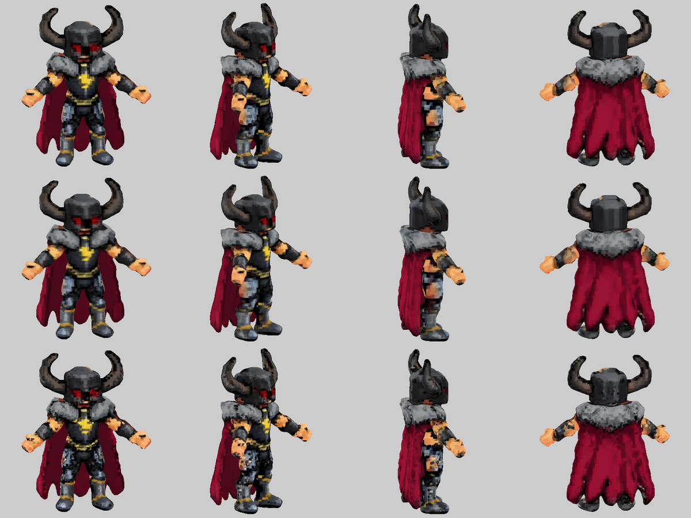

- **Side views smooth the joins.** With 24 views no two neighbours are more than 23 degrees apart, and the cape and collar lose the blocks that did not line up.
- **The rim rule made it worse.** It pushes good views out near every edge and what replaces them is a view from the side, which has only its dark outline to offer there: speckles on the legs and helmet. The light rims of step 20 are gone without it. They came from the node's bake, not from the views.
- **Colour matching made it worse too.** The sprites are lit from the front, so back views are darker on purpose. Matching them moved colours by up to 34 levels, and the bare character's colour error went from 36.5 to 38.5.
- **Colour correction is a small gain:** colour error 37.4 to 36.5 on the bare character.

The result against step 20's, each pair the old model then the new, from the front, a diagonal, the side and the back:

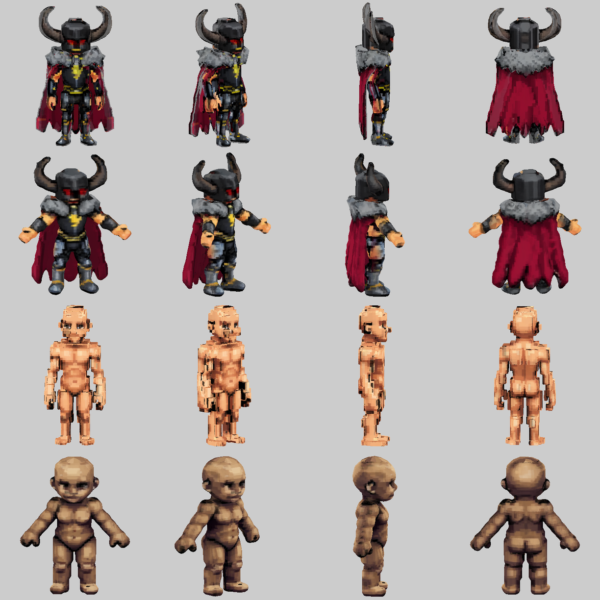

**Verdict.** Keep the local bake, the side views and the colour correction. Rims and matching are still in the script, off.

## 24. Skin weights measured through the mesh

**Question.** Step 16 bound each vertex to the nearest bones in a straight line, with a penalty when the line left the carved shape. The cape, which hangs beside the legs, followed the legs. And the rest pose is now an A-pose, so a walk that only swings the arms walks with them held out.

**Setup.** Three changes to [`scripts/rig.py`](../research/scripts/rig.py), used when it is given `-` in place of the carved voxels:

- **The mesh is filled in** on a grid of half sprite pixels, and distance from a vertex to a bone is the shortest path through the inside of the body. A cape is a long way from a leg by that measure: up to the collar and back down.
- **Elbows, wrists, knees and ankles move to the middle of the mesh's own limbs.** The joints were found on the sprites and the mesh is a redraw of them.
- **The walk lowers the arms first,** turning each upper arm from where it rests to hanging 12 degrees out from straight down, and swings them from there.

**Result.** Top row: which bone owns each part, by straight-line distance. Second row: through the mesh. Below: the walk from the front, three-quarters and the side.


- **The cape is one piece now,** owned by the spine at the top and the hips below, where the straight-line weights cut it into strips that followed each leg bone.
- **It is also rigid.** A leg swinging back passes through it. It wants bones of its own.
- **Both files pass the glTF validator** with no errors or warnings: 1.8 MB for the knight, 1.7 MB for the bare character.

**Verdict.** Keep.

## 25. The pixel look, in the renderer

**Question.** The painted texture is a 512 pixel painting. Drawn small it should still read as pixel art, in the sprites' colours. Does that belong in the texture or in the renderer?

**Setup.**

- *In the file.* `PALETTE=<dir>:<name>` in `rig.py` stores 24 of the sprites' colours on the material, as glTF extras. The colours are picked by spreading them across everything the sprites use. Pillow's median cut was tried first and gave the knight eight near-blacks and no gold.
- *In the viewer.* The pixel look draws the scene into a small picture, then onto the screen with each pixel moved to the nearest stored colour and a dark line drawn inside the outline.
- *In the score.* [`scripts/render.py`](../research/scripts/render.py) gained `SAMPLE=mean`: each sprite-size pixel is the average of the surface under it, then snapped to the palette, which is what a renderer that filters its texture shows. Before, it took the commonest single colour, which is noise on a detailed texture.

**Result.** The bare character at sprite size. Row 1: the drawn sprites. Row 2: the stitched texture of step 10. Rows 3 and 4: the painted texture from the drawn directions and from the eight between.

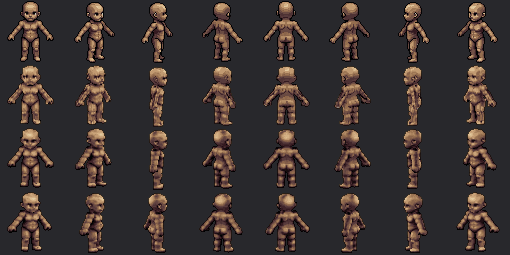

The knight: sprites, the painted model from the same directions, and from the eight between.

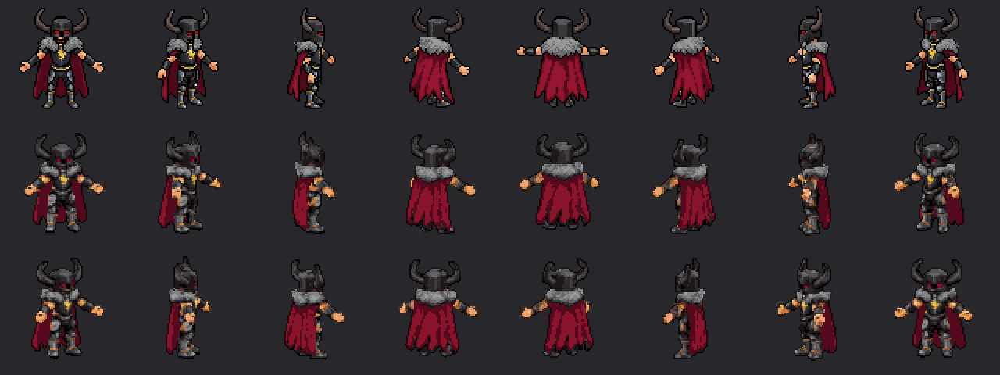

| | Stitched | Painted, commonest colour | Painted, averaged and snapped |
|---|---|---|---|
| Bare character, colour error | 30.0 | 36.7 | 35.1 |
| Knight, colour error | 30.7 | 37.3 | 36.7 |

- **The painted renders are shaded like sprites,** with a face and a lit side, in directions nobody drew. The stitched ones are flat.
- **The score still says the opposite.** It compares pixel against pixel, and the mesh's arms are not where the sprite's arms are (the outlines agree 83% and 78%), so a clean shaded arm one pixel over scores worse than a flat smear in the right place.
- **Snapping the texture itself was not pursued.** The texture's islands lie at every angle on the surface, so texture pixels cannot line up with screen pixels. The renderer is the place for it.

**Verdict.** Keep the palette in the file and the snap in the renderer. The score needs replacing before it can steer anything.

## 26. A body made to be dressed

**Question.** Steps 19 to 25 meshed the knight with its armour on, as one piece. A game that swaps gear needs the reverse: one bare body, and each item a mesh of its own that any body can wear. That starts with a body. The bare character used so far also read as an infant once meshed: short, round and unclothed.

**Setup.**

- *The body.* PixelLab's v3 character at 64 pixels, through a PixelKiln manifest, with the base prompt from the [paperdoll guide](./PAPERDOLL.md) plus the pose: "bald adult human figure with adult proportions, slim and lean with a small head, broad shoulders and long legs ... standing straight in an A-pose with both arms held straight and out to the sides at 45 degrees". 2 generations.
- *The items.* Five PixelKiln `layer` assets over the body's eight directions: underwear, leg armour, a cuirass, a horned helm and a cape. Each is one masked inpaint that returns only the pixels it added. 10 generations each. The helm's first job failed at PixelLab and passed on a retry.
- *The joints.* `pixelkiln anchors`, 0.8 generations for the eight views.

**Result.** Row 1 is the body, rows 2 to 5 the layers for underwear, leg armour, cuirass and cape, and row 6 the body wearing the first three.


- **The arms came out level in all eight views,** a T-pose and not the 45 degrees asked for. The views agree with each other, which step 21 could not get from an edit.
- **The layers are clean.** Nothing but the item in each, in every direction.

The body in underwear, meshed from smoothed inputs (step 22) and textured by stitching (step 10):


- **It no longer reads as an infant,** but it is stockier than the sprite. The sprite is about four heads tall, as pixel characters are so that a face fits in a dozen pixels, and the mesh model fills that build out. The outline matches the sprites 82.1%.

**Verdict.** Keep the body. An adult's seven or eight heads would need a sprite too tall to be a game sprite, so the build is the style's, not a fault to fix here.

## 27. An item as its own mesh: alone, or cut from the body wearing it

**Question.** What is the best way to get a mesh of one item that fits the body?

**Setup.** Two routes, on the same four items.

- *Alone.* The item's layer, with no body, enlarged to fill the picture ([`scripts/smooth_inputs.py`](../research/scripts/smooth_inputs.py) with `FILL=1`), meshed by Hunyuan3D-2mv.
- *Cut from the worn mesh.* The body wearing that one item is meshed. A second set of sprites with the same outline is painted green where the item's layer has a pixel and magenta elsewhere. Texturing the mesh from those says which triangles are the item, and [`scripts/cut_item.py`](../research/scripts/cut_item.py) keeps them.

Every mesh is fitted in the body's camera frame, so each lands where it is worn. `texture.py` now starts a fit at the point in space where the item's sprites are, since a helm is nowhere near the middle of the frame.

The cut for the helm: the worn mesh, the same mesh textured from the mask sprites, and what is kept.

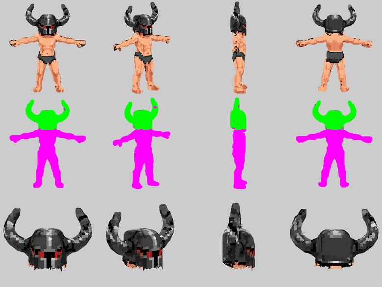

**Result.** Left: each item meshed alone. Right: each cut from the worn mesh. Rows are helm, cuirass, leg armour, cape.

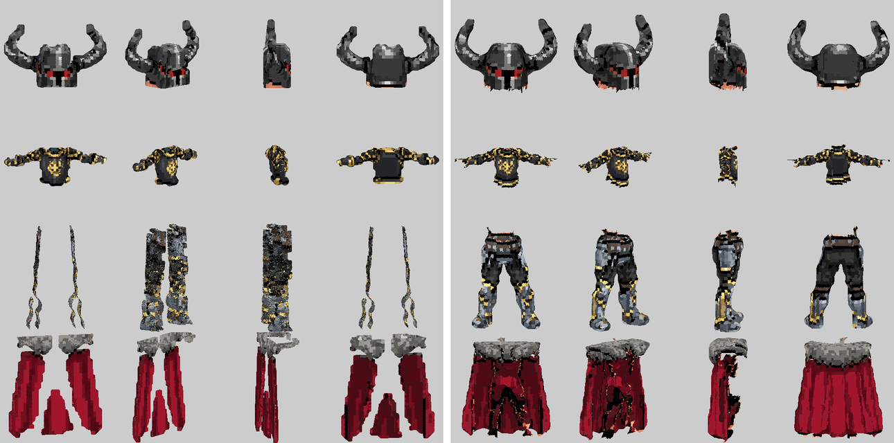

| Item | Outline match, alone | Outline match, worn | Triangles kept by the cut |
|---|---|---|---|
| Helm | 71.2% | 74.9% | 8,992 of 29,999 |
| Cuirass | 76.5% | 81.4% | 10,811 |
| Leg armour | 62.5% | 82.3% | 11,830 |
| Cape | 61.7% | 84.3% | 15,427 |

The two outline columns are not like for like: alone, the mesh is compared with the item's layer, and worn, the whole dressed figure with its sprites.

- **Alone, the model does not know what it is looking at.** The leg armour became two flat boards and the cape three separate slabs. The helm became a box with horns, and the cuirass a solid torso.
- **Worn, the body tells it.** The leg armour wraps two legs, the cape hangs as one sheet from a collar, and the helm is round.
- **The cut is ragged at the edges** and leaves a fringe of skin-coloured triangles where an outline pixel was shared. Each cut also leaves 25 to 40 loose pieces, most of them crumbs.
- **A cut item is a shell.** It has no inside, which is what a game wants from clothing.

**Verdict.** Cut from the worn mesh. It costs one mesh per item either way, about two minutes each.

## 28. A character assembled from parts

**Question.** Do a body and items made separately go together, and move together?

**Setup.** [`scripts/rig.py`](../research/scripts/rig.py) gained `ITEMS`: a list of item meshes to put on the body's skeleton.

- *Fit.* An item is drawn one pixel outside the body and meshed from a different run, so parts of it land inside the body's mesh: the first helm showed the face through its front. Each item vertex closer than 0.6 sprite pixels to the skin is moved out along the body's surface direction until it is that far above it. Triangles buried deep in the body that face inward are dropped.
- *Weights.* An item vertex takes the bone distances of the nearest point inside the body (step 24), so tight armour moves as the skin under it does. A slot can name the bones it may follow: the helm follows the head only, the cape the hips and spine only.
- *File.* One .glb with five meshes on one skeleton and one walk. The viewer shows a switch per mesh.

**Result.**


- **It reads as the knight,** from parts that were never meshed together. Nothing pokes through in the rest pose.
- **Items come off one at a time** in the viewer on the [paperdoll page](https://pixelkiln.griffen.codes/paperdoll#mesh), and the body under them is whole.
- **The file is 3.6 MB:** five meshes of up to 30,000 triangles and five 256 pixel textures. It passes the glTF validator with no errors or warnings.
- **The textures are the stitched ones of step 10,** noisy on the armour. Step 29 paints them.

Not checked: whether skin shows through armour at the extremes of the walk, an item on a second body, two items in the same slot, and any engine other than three.js.

**Verdict.** Keep. This is the shape a game can use: a body, a rack of items, one skeleton.

## 29. Painting the parts

**Question.** Step 28's textures are stitched from the sprites and noisy. Does the paint stage of steps 20 and 23 work on parts?

**Setup.** The body and each of the four worn meshes went through `hunyuan3d_paint_turn.py` with `SPREAD=22` and `bake.py` at 1024 pixels, exactly as in step 23, each with its own sprites as references. The item is cut out afterwards with the same mask as before: painting changes the texture and not the triangles, so `cut_item.py` takes the painted mesh and the mask mesh from step 27 unchanged. About 40 seconds a direction, five to six minutes a mesh.

**Result.** The body, stitched and then painted:


The assembled character, stitched and then painted:

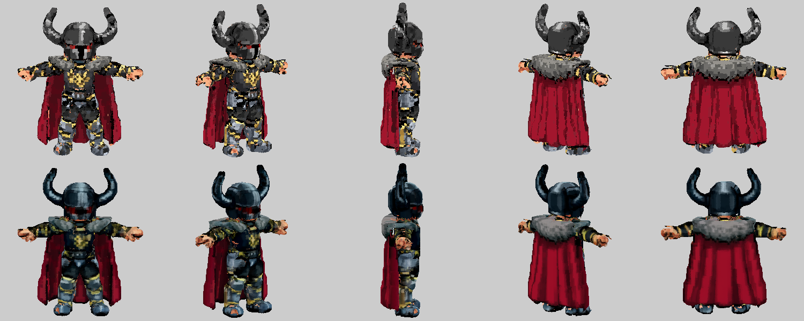

- **The speckle is gone.** The armour has plates and trim, the cape has folds, the helm is one metal, and the body's black outline flecks are gone.
- **Colours drift.** The helm and underwear turn blue-grey, and the gold is duller with the chest crest fainter. Step 23's colour correction is on and does not hold them. The viewer's palette snap pulls them part of the way back.
- **Painting the worn mesh paints the item in context,** so the cuirass is shaded as something on a chest. The price is that each item's texture is 1024 pixels of which the item uses a third.
- **Orange flecks appear on the leg armour during the walk** in the viewer with the pixel look on. They were first taken for skin showing through. Step 30 shows they are not.
- **The file grew to 5.6 MB** with five 512 pixel textures. It passes the glTF validator with no errors or warnings.

**Verdict.** Keep the painted parts.

## 30. Hiding the skin under an item

**Question.** Games hide the body under clothing so that skin cannot show through it in motion. Can the file say which skin each item hides?

**Setup.** `rig.py` now writes the body as one mesh per set of items that cover it.

- *Covered.* A body vertex is covered by an item when the item's surface is within 1.2 sprite pixels of it (`COVER`). A triangle is hidden by the item only when its corners and all their neighbours are covered, which leaves a rim of skin under the item's edge.
- *Loose items.* A third field in an item's entry, `loose`, marks one that hides nothing. The cape is loose: it swings away from the back it hangs behind.
- *In the file.* Each body piece is a node whose extras carry `"hiddenBy": ["Cuirass"]`. A piece is hidden while any item in its list is worn. The pieces share one material and texture.

**Result.** The body came out as six pieces:

| Piece | Triangles |
|---|---|
| Never hidden (face, neck, hands, edges) | 6,359 |
| Under the leg armour | 9,222 |
| Under the cuirass | 8,988 |
| Under both | 1,602 |
| Under the helm | 3,714 |
| Under the cuirass and the helm | 115 |

- **It works in the viewer.** With everything worn, 79% of the body is not drawn. Taking the cuirass and helm off brings the chest and head back.
- **The orange flecks of step 29 were still there,** which showed they were never skin. With the pixel look off there were none. The paint stage had dulled the gold trim, and the viewer's palette snap moved the dulled gold to the nearest stored colour, which was a skin tone.
- **Baking each item in its own colours fixes that.** `bake.py` already had `PALETTE`; each worn mesh is baked snapped to the 32 colours of that item's own layer, so the item carries no colour its sprite lacks. Top row: before. Bottom row: after. The helm is steel again and not blue.

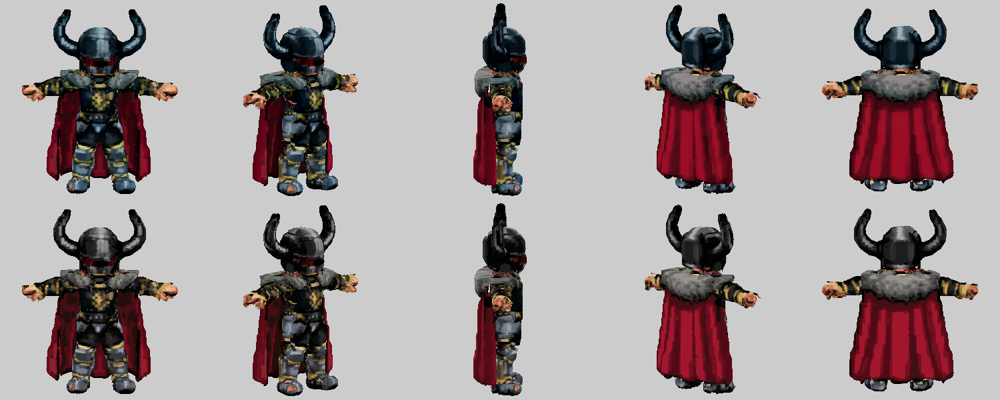

- **The gold is darker than the sprite's** after the snap, closer to olive on the arms. The paint stage's drift is reduced, not undone.
- **The file is 5.4 MB.**

Not checked: whether the rim of skin kept under an item's edge is enough when a limb bends far, and whether an engine reads the extras (three.js does; Godot and Unity each have their own way).

**Verdict.** Keep both. A wrong guess about the flecks cost a step, and the test that settled it was turning the pixel look off.

## 31. Sprite cards on the skeleton

**Question.** Steps 26 to 30 show a painted mesh, and every flaw in the paint is on screen. The Cor Mundi Studios short (see [what other people are doing](#what-other-people-are-doing)) shows the sprites themselves, as a flat card per body part moved by a rig, with a mesh underneath that is never seen. Do the pieces made so far add up to that?

**Setup.** No new art and no generations.

- *Cutting.* [`scripts/cards.py`](../research/scripts/cards.py) draws the body mesh into each of the eight sprite views, coloured by the bone that owns each point (`rig.py` writes that with `SKIN=<file>`). Every sprite pixel takes the bone of the mesh under it, or of the nearest pixel that has one. Each sprite and each item layer is then cut into one piece per bone, reaching two pixels into its neighbours to cover the joints. The helm goes whole on the head and the cape whole on the spine.
- *The sheet.* 259 pieces from five layers pack into one 512 by 128 picture of 45 KB, with a list of where each piece is and how far its corner is from its bone's joint.


- *Drawing.* In the viewer each bone carries a card turned to face the camera. The camera's direction is taken into the bone's own frame, and the card shows the piece from the drawn view that best matches it. A view is preferred when it sees the bone as end-on or as side-on as the camera now does: an arm drawn sticking out sideways and then lowered by the walk is seen side-on from the character's side, so it uses the front view's arm, turned to hang down. The plain "nearest direction" rule picked the side view's arm, which is a foreshortened stub.
- *Order.* Cards sit at their bones, so the near arm is in front of the body and the far arm behind it with no rule. Item layers sit a few millimetres nearer the camera than the body. The cape moves behind or in front with the side the camera is on.
- *Motion.* The same fifteen bones and walk as the mesh. The file that carries them is the body mesh with a 64 pixel texture, 1.3 MB, most of which a real use would drop.

**Result.** Front, side and back standing, and the side walking, in the viewer with the pixel look on:

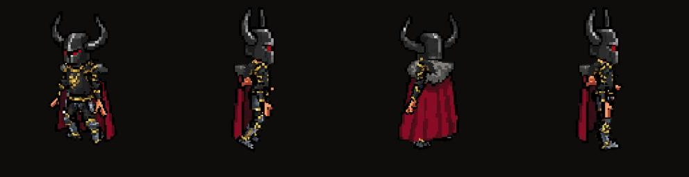

- **It is the sprite, in motion, from any angle.** The emblem, the trim and the helm's eyes are the drawn pixels, with none of the paint stage's blur or colour drift.
- **Items switch on and off** as layers, as in the 2D builder, and the walk moves all of them.
- **It worked on the first run,** which says the camera fit, the joints and the bone ownership from the earlier steps agree with each other.
- **Between the eight directions the picture is one of the eight,** turned to face the camera, so the character snaps from view to view as it turns.
- **Pieces are rotated pictures,** so a lowered arm is the raised arm's pixels on a slant, and the joints overlap or open a little as limbs swing.
- **There is no lighting.** The short lights its cards from the hidden mesh; that was not tried.

Not checked: sixteen directions (step 13 could supply them), any engine other than three.js, and poses far from the drawn one.

**Verdict.** Keep, beside the painted mesh and not instead of it. The cards are sharper today; the mesh is the only one that can be lit, seen from above, or posed freely.

## 32. Larger references, redrawn locally

**Question.** The goal from here is the best painted surface, not pixel art. The survey says the reference picture is the first cap: the paint stage has been shown a 46 pixel figure enlarged with hard edges. Can the sprites be redrawn large, for nothing, and does the paint improve?

**Setup.**

- *Redraw.* [`scripts/redraw.py`](../research/scripts/redraw.py) cuts the figure out of each sprite, enlarges it smoothly to 1024 pixels and has SDXL redraw it on the ComfyUI already used for meshes. The checkpoint (`sd_xl_base_1.0`) and a tile control model (`controlnet-union-sdxl-promax`) were already on the machine, so nothing was downloaded and no generations were spent. About 25 seconds a direction.
- *Settings.* A tile control held at 0.8 for every step, with the model allowed to change half the picture, returned the blurry enlargement unchanged. Letting the model change 90% while the control applies at 0.6 for the first half of the steps gives a redraw that keeps the layout. Left to right: the sprite, a cautious setting, the setting kept, and an anime checkpoint that flattened it.

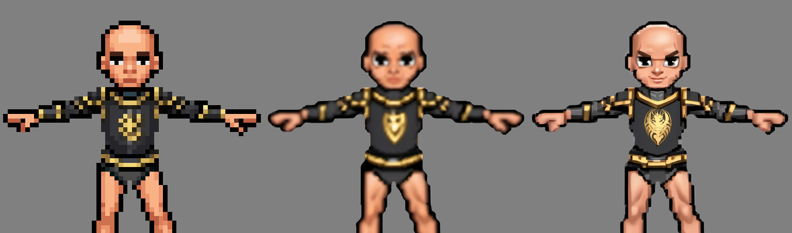

- *Paint.* The body wearing the cuirass, the same mesh as step 29, painted from the eight redraws and baked at 2048 pixels. Once with 512 pixel views as before, once with 768.

**Result.** The eight redraws:


The mesh painted from the sprites (step 29), from the redraws at 512 pixel views, and from the redraws at 768:

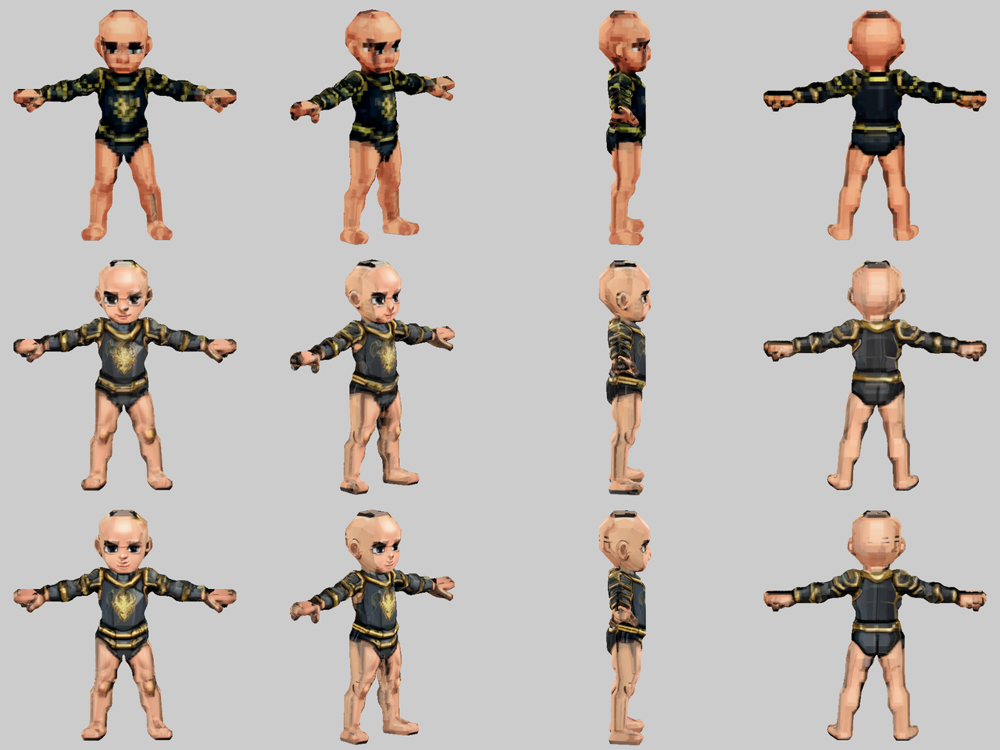

- **The paint now has things in it:** plate edges, a collar, a crest with a shape, a face with brows and ears. Before, it was the sprite's pixels enlarged.
- **768 pixel views fit in 12 GB** and are a little sharper, at about 110 seconds a direction against 40.
- **The redraws do not agree with each other.** Each direction is redrawn alone, so the crest, the shoulder plates and the face differ from view to view, and the bake averages them. The back view came back still pixelated.
- **Colours move.** The black armour became grey steel and the skin paler. Nothing ties a redraw to the sprite's palette.
- **The mesh is now the limit you see.** Flat facets show on the head and limbs under a detailed texture.

Not done: the other items, the bare body, and the assembled model in the viewer, which still carries step 30's textures.

**Verdict.** Keep. The largest gain in texture quality so far, for no cost but GPU time. The next gains are in making the eight redraws agree and in a smoother mesh.

## 33. Making the redraws agree

**Question.** Step 32's eight redraws each invent their own details and their own colours. Two fixes were tried.

**Setup.** Both are options of [`scripts/redraw.py`](../research/scripts/redraw.py).

- *One sheet* (`SHEET=1`). All eight figures are put on one 2048 by 1024 picture and redrawn together, so the model sees one character from eight angles. Each figure is then enlarged and sharpened alone, with the model allowed to change 35%.
- *Colours held* (`COLOUR=1`, now the default). The redraw's broad colour is swapped for the sprite's, region by region: a blurred copy of the redraw is taken out and a blurred copy of the enlarged sprite put in, leaving only the redraw's detail. The blur is a fortieth of the picture wide.

**Result.** The same mesh painted from: step 32's redraws; redraws made alone with colours held; one-sheet redraws with colours held.

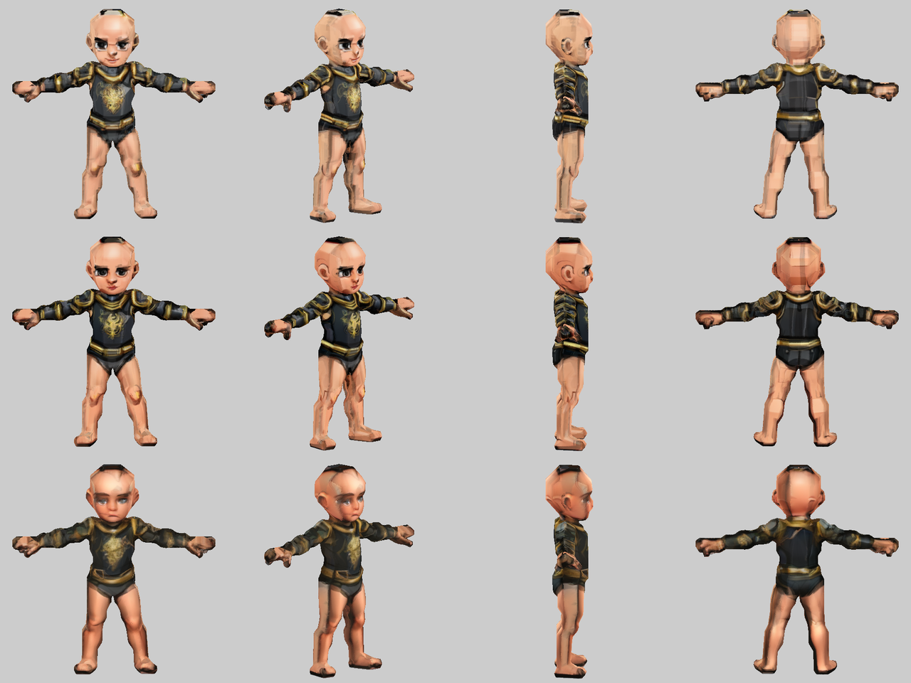

- **Holding the colours is the fix.** The armour is black again and the skin is the sprite's, with the plates, crest and face of step 32 intact. Because every view now shares the sprite's colours, the views also disagree less where they meet.
- **The sheet agrees and loses the rest.** At a quarter of the pixels a figure, the model drew a soft suit with gold swirls in place of plates, and a child's face. The sharpening pass cannot put back a design that was never drawn.

**Verdict.** Keep the colour hold, drop the sheet. Details still differ between directions; the bake blends them.

## 34. A mesh from redrawn pictures

**Question.** The mesh model has been shown the sprites, enlarged smoothly (step 22). Its meshes have a faceted skull and lumpy limbs. Is that the model, or the pictures it is given?

**Setup.** The bare body's front, left, back and right sprites were redrawn at 1024 pixels as in step 32, with `OUTLINE=own`. By default a redraw is cut with the sprite's own enlarged outline, which keeps its stair steps: a head drawn in a dozen pixels has corners. `OUTLINE=own` keeps the outline the model drew, taking as ground whatever is near the ground colour and joined to the picture's border. The four redraws went to Hunyuan3D-2mv with nothing else changed.

Top: what the mesh model was given before. Bottom: the redraws.

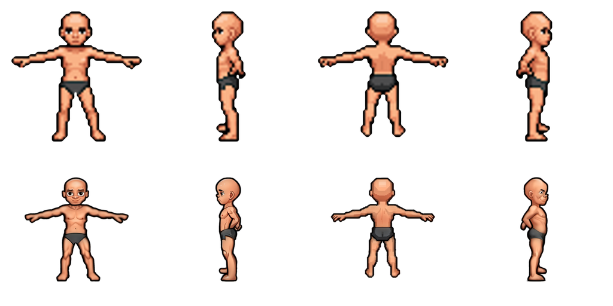

**Result.** Top: the mesh of step 26. Bottom: the mesh from the redraws.

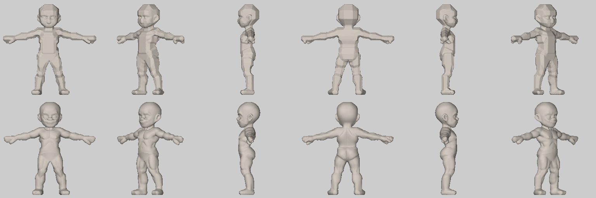

- **It was the pictures.** The new mesh has a round skull, a brow, nose and ears, a chest, shoulder blades, arms that taper, calves. The old one is a figure of flat panels.
- **The redraw's outline matters as much as its inside.** The model builds what the outline shows, and the sprite's outline is a staircase.
- **The back view's outline is still partly stepped,** where the redraw kept the sprite's edge.

Not done: fitting this mesh to the sprites, painting it, the worn meshes, or anything in the viewer. The redraws are no longer pixel for pixel on the sprites, so the fit of step 9 and the item cut of step 27 need checking against them.

**Verdict.** Keep. Next is to rebuild the body and items from redrawn pictures end to end.

## 35. Everything rebuilt from redrawn pictures

**Question.** Steps 32 to 34 each improved one piece. Does the whole chain of steps 26 to 30 still hold when it starts from redrawn pictures?

**Setup.** One script ran, for the bare body and for the body wearing each of the four items:

1. `redraw.py` on all eight directions, with the model's own outline and a white ground (`OUTLINE=own GROUND=255`). 25 to 45 seconds a direction.
2. Hunyuan3D-2mv on the front, left, back and right redraws. About two minutes a mesh.
3. `texture.py` to fit each mesh into the body's camera, against the sprites as before.
4. The paint stage from the eight redraws with 768 pixel views, and `bake.py` at 2048 pixels. About 15 minutes a mesh.
5. `cut_item.py` with the mask sprites of step 27, then `rig.py` as in step 30.

About two hours of GPU time, unattended, and no generations.

Two faults in our own scripts surfaced and were fixed:

- **The cut was throwing away good triangles.** It drops loose crumbs by counting connected triangles, but the unwrap splits vertices along its seams, so every patch of the unwrap counted as a separate piece and small patches were dropped as crumbs. It now joins vertices that are in the same place first. The four items went from 25 to 60 "pieces" each to 1 to 3. Steps 27 to 30 had this fault too; their holes were blamed on a ragged cut.
- **`rig.py` gained `ALIGN`,** which slides an item until it is evenly spaced round the body. Here it moved items less than half a sprite pixel, so the separate fits already agree; it is kept as a safeguard.

**Result.** The bare body, before and after:

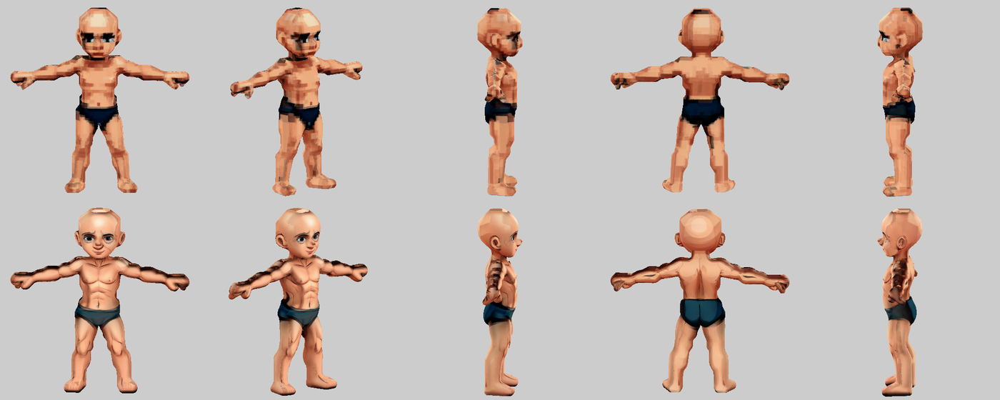

The cape, leg armour and helm, cut from their rebuilt worn meshes:


The assembled character with hidden skin left out, step 30 above and the rebuild below:

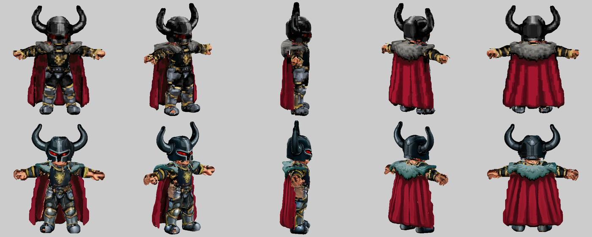

- **The body is sculpted and painted,** with a face, ears, muscle and a round skull. Dark smears run along the tops of the arms, where the redraws' outlines were baked in.
- **The helm and leg armour are the best pieces so far:** plates, rivets, trim and a visor, on smooth shapes.
- **One sleeve of the cuirass ends at mid forearm,** and there is bare skin at one hip between the cuirass and the leg armour. The item masks are still the sprites' layers, and a redrawn figure is not pixel for pixel where the sprite was, so the mask lands a pixel or two off on the new mesh.
- **The fur collar is teal.** This was first put down to the colour hold of step 33 not reaching outside the sprite. Step 36 shows the redraw is grey and the bake is what turns it teal.
- **The cuts carry scraps of skin** at the hands and neck, for the same reason as the short sleeve.
- **The file is 6.0 MB** with 512 pixel textures (10.8 MB at 1024), and passes the glTF validator with no errors or warnings.

In the viewer the rebuilt model loads, walks, and its items switch off. It is shown smooth by default now, with the pixel look as a switch.

**Verdict.** Keep as the viewer's model. The next fault to fix is the masks: they should be made from the redraws, not the sprites.

## 36. Item edges from the paint, and a colour fault in the bake

**Question.** Step 35 left three faults: skin where an item should be, scraps of skin on the items, and a teal collar. Are the masks to blame, as supposed?

**Setup.**

- *Edges.* [`scripts/cut_item.py`](../research/scripts/cut_item.py) takes the bare body's painted mesh as `BODY`. The mask from the sprites still says roughly where the item is. Within three sprite pixels of the mask's edge the paint decides: a triangle painted as skin is left out, and a triangle is taken in when it is not skin and is painted unlike the bare body at the same place. Skin is learned from the body's own texture, as a spread of colour with brightness left out. Both meshes are in the same frame, so "the same place" is the nearest point of the body.
- *Why two tests.* The first version took in anything near the edge that was not skin, and the cuirass grew a skirt of underwear. The underwear is on both meshes, so comparing against the body leaves it alone.
- *Colour.* The collar was traced from sprite to redraw to painted view to texture. It is grey in all but the last.

**Result.** The cuirass cut with the sprite mask alone, and with the edge moved:


The assembled character: step 35 with the new edges, the same with the bake corrected, and the bare body.

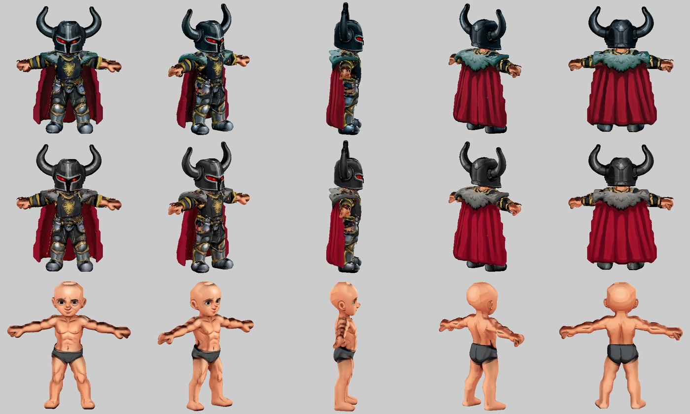

- **The scraps of hand and neck are gone,** and so is the bare patch at the hip. Each cut moved about a thousand triangles each way.
- **The teal was `bake.py`'s `TONE`,** not the redraw. `TONE` moves each painted view's colours to match its reference's average, one channel at a time. It was added in step 23, when the references were sprites, as a small gain. A painted view of the back shows more red cape than its reference does, so matching averages takes red out of everything else and grey fur goes teal. With it off the collar is grey, the helm is black and not blue, and the underwear is grey. The blue cast noted in steps 29 and 32 was the same fault. `TONE` is now off unless asked for.
- **One cuirass sleeve still ends at mid forearm.** The worn mesh's arm is thinner than the body's there, and the edge rule only reaches three pixels.

**Verdict.** Keep both. The viewer's model is rebuilt with them, 6.0 MB.

## 37. The model in a game engine

**Question.** Every check so far has been three.js or the glTF validator. Does a game engine read the file the way it was meant?

**Setup.** The viewer's `parts.glb` of step 36 in an empty Godot 4.7.2 project, imported headless (`--headless --import`), then a script that loads the scene and lists what it finds.

**Result.**

- **It imports with no errors or warnings.**
- **One skeleton of fifteen bones,** with their names: Hips, Spine, Head, and upper, lower and end bones for each arm and leg.
- **Ten meshes, all skinned to it:** six pieces of body and four items, 79,216 triangles in all.
- **The walk arrives** as an animation named Walk, 0.9 seconds, eight tracks.
- **The hide lists survive.** Godot puts each node's glTF extras in its metadata, so `"hiddenBy": ["Cuirass"]` can be read by a script, as in step 30.

Not checked: how it looks drawn in Godot (this ran with no screen), Godot's humanoid retargeting against these bone names, Unity, and Unreal.

**Verdict.** Keep. The file is a working rigged character in one engine. What it lacks to be an asset is in the survey below: triangle count, unwrap, a standard skeleton, materials.

## What has not worked, in one place

So nobody repeats them:

- Tubes around a skeleton as the body (step 7).
- Blending colours between views (step 9).
- Reaching inward for a colour when a texel lands just outside the sprite (step 9).
- Refusing colour near jumps in depth (step 9).
- Despeckling the texture by darkness (step 10).
- Rounding the carved voxels more before meshing: no effect on the scores.
- Intersecting the carved shape with the generated mesh (step 12).
- `correct_pixelart` on a torn render (step 13).
- Projecting image-model redraws back onto the model (step 14).
- Flattening a character's texture to a few materials (step 15).
- Laying trusted sprite pixels over a flat base (step 18).
- Asking the paint stage for a single view (step 20): grey noise.
- Letting the paint stage invent the sides from one front reference (step 17).
- Enlarging sprites with hard pixel edges for the mesh model (step 22): it builds a figure out of boxes.
- Keeping painted views away from their own outlines, and shifting views to agree in colour (step 23).
- Median cut for a sprite palette (step 25): most of the colours go to near-blacks.

Two bugs worth remembering, because both produced plausible wrong pictures: glTF's axes turned into ours by swapping two of them is a mirror image, which silhouettes cannot detect; and a mesh whose faces point inward gets no texture at all, only fill.

## What is next

- **Hold the paint stage's colours** to the sprites' (step 29): the gold dulls and the dark metal turns blue.
- **A smaller file.** Repack each cut item's texture to the part it uses, and thin the meshes.
- **Tidy the cut's edge,** which is ragged and carries a fringe of skin colour.
- **An item on a second body.** The fit of step 28 moves an item to just above whatever body it is given. Whether a helm cut on one body sits right on another is untested.
- **Higher quality paint.** The texture does not have to be pixel art: aim for the best painted surface the models can give, and pixelate afterwards if wanted. Step 32 starts it. Steps 33 to 35 continue it. Step 36 fixes the item edges and a colour fault. Still to do: the short sleeve, a second painter (MV-Adapter), and repacking each item's texture so it uses the whole picture and the file shrinks.
- **Towards game-ready** (see the survey below): a smaller file; sprites drawn at 256 pixels at the source; a thinned mesh with the paint and a normal map baked onto it; a standard humanoid skeleton and stock animations; metal and roughness; bones and springs for the cape.
- **Sixteen directions and lighting for the sprite cards** (step 31): the in-between views of step 13, and normals from the hidden mesh.
- **More directions, and animation.** Step 13 gives sixteen directions. Thirty-two would spin smoothly, and the same trick on a walk cycle would give walks in the in-between directions, which the generator does not offer.
- **Fix the squat proportions.** Carve at a finer grid, or let the redraw see a true neighbour at full height (the guide sheet does this and kept proportions better on the bare character).
- **Held items.** Carve them separately, upright, and place them on the model the way the paperdoll layers place them on the sprite.
- **A score that sees cleanliness.** Colour error against one drawing cannot tell a clean redraw from a torn render.
- **Fewer, larger pieces in the unwrap.** The chest unwraps into a few large pieces, but the character comes out in hundreds of small ones, which is fine for a program and poor for a person or an image model to paint on. One piece per view, like a folded paper model, would make the texture a sprite sheet.
- **Carve at a finer grid** than one voxel per pixel, so thin objects survive.
- **Remove baked shading.** The sprites are drawn lit from one side, and that light is now painted on the model.
- **Open the rigged file in real engines.** Blender, Godot, Unity and Unreal each have their own expectations of a humanoid.
- **More animations, and bones for capes and held items.**
- **Bones for the cape,** now that it is one piece (step 24), and a check that a leg swinging back does not pass through it.
- **A pose the eight views agree on.** The knight's A-pose has one view in a T-pose (step 21). Drawing the pose from a skeleton, not a sentence, might fix it.
- **A score that forgives a pixel of offset** (step 25), so a clean render is not marked below a smear.
- **A licence-clean route.** TRELLIS or TripoSG for the mesh, MV-Adapter for the paint, UniRig for the bones. Their licences were not checked here.
- **Paint the carved shape too,** for the simple subjects where carving beats the generated mesh.
- **Sprite normal maps.** PixelLab can draw a normal map for a sprite. Baked onto the mesh the same way, it would add surface relief the low-polygon mesh lacks. Not tried.
- Can the eight-view input of the hosted Hunyuan3D 3.1 use all eight sprites? (Unverified; see below.)

## What other people are doing

From a web survey on 16 November 2026. Items marked *unverified* were seen in a listing or a search result and not read in full or tried here.

**Image-to-3D models**

- [Hunyuan3D-2mv](https://huggingface.co/tencent/Hunyuan3D-2mv) (Tencent). Open weights, multi-view. The one used in step 8.
- [Hunyuan3D 2.1](https://huggingface.co/tencent/Hunyuan3D-2.1) (Tencent). Open weights, with a texture stage. Same regional licence limits.
- [Hunyuan3D 3.1](https://www.3daistudio.com/Models/Hunyuan3D-3-1). Hosted only. Listed as accepting up to eight views. *Unverified.*
- [TRELLIS.2](https://huggingface.co/microsoft/trellis.2-4b) (Microsoft). MIT licence, single image, reported to need about 24 GB. *Unverified.*
- [Stable Point Aware 3D](https://stability.ai/news/stable-point-aware-3d) (Stability). Single image.
- [Pixal3D](https://ldyang694.github.io/projects/pixal3d/) (Tencent ARC). Aligned to the input image's camera, which is the property step 8 lacked. Licence not stated.
- Meshy and Tripo are paid hosted services; neither was tried.

No report was found of any of these being tested on pixel art.

**Without a model**

- [Turning 8-bit sprites into printable 3D models](https://0fps.net/2012/09/18/turning-8-bit-sprites-into-printable-3d-models/) (0fps, 2012). Voxels from sprites.
- [Pix 2D to 3D](https://korben.info/en/pix-2d-to-3d-sprites-to-3d-models-no-ai-gpu.html). Inflates one sprite by distance from its edge. *Unverified.*
- [A browser tool that extrudes pixel art layers into animated 3D](https://80.lv/articles/this-browser-based-tool-turns-pixel-art-into-animated-3d-models).
- [A manual sprite-to-3D workflow in Blender](https://80.lv/articles/2d-pixel-art-sprites-to-3d-workflow-shared-by-indie-game-developer).

**The other direction, 3D to pixel art**

- [Voxify3D](https://arxiv.org/abs/2512.07834). Turns a mesh into voxel art with a small palette.
- [Blender to Pixels](https://astropulse.itch.io/blender-to-pixels). Renders a 3D scene as pixel art.

**The Discord pipeline.** The thread that started this described: build the character from tubes or capsules, or generate a mesh with Hunyuan or Meshy; unwrap it "as a folded piece of paper"; retexture the unwrapped image with an image model; carve hair and clothes as separate pieces; remove baked shadows and highlights; render with a toon or pixel shader. None of it could be checked against a public source. Step 7 here tested the tubes part, steps 9 to 11 the unwrap and texture part, and step 13 the image model, on the rendered views and not on the unwrapped texture.

**Painting a mesh you already have.** From a second survey on 17 November 2026, for step 29's question of how to get a better texture. Nothing here was run; figures are as their sources give them, and several sources disagree.

| Option | Runs where | What it takes | Licence | Fit for a 12 GB card |
|---|---|---|---|---|
| Hunyuan3D-Paint 2.0 | Local, installed (step 17) | One reference per pass, 512 pixel views | Tencent community licence, regional limits | Runs today |
| [MV-Adapter](https://github.com/huanngzh/MV-Adapter), image to texture | Local, has ComfyUI nodes | A mesh and a reference image; 768 pixel views on SDXL, then RealESRGAN upscaling and LaMa inpainting | Apache-2.0 | README suggests the SD2.1 variant under 10 GB and SDXL above 16 GB |
| [Hunyuan3D 2.1](https://github.com/Tencent-Hunyuan/Hunyuan3D-2.1) paint | Local | Reference image; base colour, metal and roughness maps | Tencent community licence, regional limits | Official figure is 21 GB for texture. [A low-memory route exists](https://github.com/kijai/ComfyUI-Hunyuan3DWrapper/issues/165) by offloading; no 12 GB report was found |
| [TRELLIS.2](https://docs.comfy.org/tutorials/3d/trellis2), texture only | Local, native in ComfyUI | A mesh and one image | MIT | Claims range from 6 GB in a low-memory mode to 24 GB. *Unverified.* One image only, so the back is invented (the fault of step 17) |
| [Meshy Retexture](https://docs.meshy.ai/api/retexture) | Hosted, paid | An uploaded mesh and reference images; 2K to 8K textures | Closed | No card needed. About 10 credits a task. *Unverified pricing.* |
| UniTEX, MaterialMVP, MVPainter, RomanTex | Research code | Mesh and reference image | Not checked | Not checked |

- **The reference is the first cap, whichever painter is used.** Every option paints what its reference shows, and ours is a 64 to 80 pixel sprite enlarged with hard edges. A redraw of each direction as a large, detailed picture would raise the ceiling for all of them.
- **MV-Adapter is the likeliest local step up:** larger views, a permissive licence, and it sits on SDXL, so style models and edge or depth guides apply.
- **The turn-per-sprite trick of step 20 should carry over** to any painter that takes a reference and a mesh, since it only decides which way the mesh faces. It does not carry over to TRELLIS.2, which paints the whole surface at once.

**From a painted mesh to a game-ready asset.** From a third survey on 17 November 2026. The model of step 36 looks right and is not yet what a studio would call an asset. This lists what is missing, and what exists for each gap. Nothing here was run; most sources are vendor pages or the authors' own papers, and are marked where a claim could not be checked.

| Gap | Where the model stands | What exists |
|---|---|---|
| Triangle count and edge flow | About 30,000 triangles a part, 150,000 worn, straight from the generator, with no loops at the joints | [AutoRemesher](https://www.cgchannel.com/2026/07/get-free-retopology-tool-autoremesher-and-its-blender-bridge/) (free, MIT, all-quad, a target count); QuadriFlow in Blender; [CurioMesh](https://github.com/CurioCrafter/CurioMesh) (GPLv3, Blender). Guides put a rigged game character at 10,000 to 100,000 triangles. Then the paint is baked from the dense mesh onto the light one, with a normal map for the lost relief |
| Unwrap | Hundreds of small pieces from xatlas, and each item's texture mostly empty | A fresh unwrap of the light mesh with few seams; one packed texture per character or per item |
| Skeleton | Fifteen bones placed from 2D joints, our own layout | A standard humanoid skeleton so that stock animations fit. [Mixamo](https://helpx.adobe.com/creative-cloud/faq/mixamo-faq.html) rigs an uploaded humanoid in a T-pose for free and has a large animation library; it wants one joined mesh, and is described as unmaintained. Open models: [UniRig](https://dl.acm.org/doi/abs/10.1145/3730930) (MIT code; its checkpoints and data have their own terms), [Puppeteer](https://arxiv.org/pdf/2508.10898), RigAnything, Anymate (Apache-2.0). No memory figures were found for any of them. *Unverified.* |
| Animation | One walk made by formula | Mixamo's library; [HY-Motion 1.0](https://arxiv.org/abs/2512.23464) (Tencent, open weights, text to human motion, a community licence). Its skeleton and export formats were not checked |
| Materials | Base colour only, with the redraw's lighting painted in | Roughness and metal maps: Hunyuan3D 2.1's paint stage (21 GB), MaterialMVP, and 2026 work that estimates materials from several views together ([ReLi3D](https://arxiv.org/abs/2603.19753), Intrinsic Image Fusion). A crude start costs nothing: metal and rough values per item |
| Parts | Cut from a worn mesh by a sprite mask and a colour test (steps 27 and 36) | Generators that make parts natively: [Hunyuan3D-Part](https://x.com/TencentHunyuan/status/1971491034044694798) (open, segments a mesh into parts and regenerates each whole), [OmniPart](https://arxiv.org/pdf/2507.06165) (planned from 2D part masks, which the paperdoll layers are), PartCrafter. None was checked for clothing or for a 12 GB card |
| References that agree | Eight directions redrawn one at a time (step 33) | Models that turn one picture into consistent views: Qwen-Image-Edit with a multiple-angles LoRA, a Flux Kontext turnaround LoRA. Or draw the sprites larger at the source: PixelLab's v3 character goes to 256 pixels, four times step 26's |
| Cloth | The cape is one rigid sheet on two bones | A chain of bones down the cape with spring physics in the engine, or the engine's cloth |
| Delivery | A 6 MB .glb that imports into Godot (step 37) | Import tests in Godot, Unity and Unreal; mesh and texture compression (meshopt, KTX2); levels of detail |
| A yardstick | None | [Meshy's API](https://docs.meshy.ai/api/pricing) takes an uploaded mesh and sells each step: retexture 10 credits, remesh 5, rigging 5 with a walk and a run, an animation 3. One character through all of it would show what a paid pipeline returns. A paid plan is said to be needed for the API. *Unverified.* |

- **The largest gaps are not in the paint.** A studio would reject this model first for its triangle count, its unwrap and its home-made skeleton, and only then look at the texture.
- **A standard skeleton is worth more than any one animation,** because it makes every stock animation usable.
- **Several gaps close with no new model:** thinning the mesh and re-baking, a normal map from the dense mesh, values for metal and roughness, compression, an engine import test.

**Sprite cards on a 3D skeleton.** [A short from Cor Mundi Studios](https://www.youtube.com/shorts/84clZXpwRc0) (28 seconds, read from its transcript on 17 November 2026) shows a 2.5D player character in Unreal Engine 5. Each body part is a flat card with its own sprite sheet in sixteen directions. Under the cards is a 3D mesh that is not what the player sees: it carries the lighting and the bones, and the bones tell each card where to be and which direction to show. The picture stays hand-drawn pixels and the motion comes from a rig. Step 31 tries it with eight directions and no lighting.

No public tool was found that takes several directional pixel sprites and returns a mesh.

## Cost so far

- Six upright objects at 10 generations each: 60 PixelLab generations.
- Carving, tilt check, skeleton and rendering: nothing. They run locally in seconds.
- Hunyuan3D: nothing but about two minutes of GPU time per mesh, after a 4.93 GB download.
- Staged texturing: nothing. About six seconds a mesh on a laptop.
- Image-model redraws in steps 13 and 14: 50.1 generations for six calls.
- The paint stage: no generations. A 9.2 GB download, then about six minutes of GPU time per character.
- A-poses in step 21: 20 generations for the two states, 0.25 for importing the knight, 1.6 for sixteen joint estimates.
- The body and its five layers in step 26: 52.8 generations (2 for the body, 10 for each layer, 0.8 for the joints), read from the balance before and after.
- Nine meshes in step 27: about two minutes of GPU time each. Five paint runs in step 29: five to six minutes each.

## Running the scripts

They are written for the files this session had on disk and take paths as arguments.

```bash
# Carve, smooth, colour and render <name>-<direction>.png from a folder. Prints the match.
node --experimental-strip-types research/scripts/carve.ts <folder> <name> <out-folder>

# The same, leaving out tilted views.
SKIP=north-east,south-west node --experimental-strip-types research/scripts/carve.ts <folder> <name> <out-folder>

# Voxelise a mesh and score it against the same sprites.
GLB=<mesh.glb> node --experimental-strip-types research/scripts/carve.ts <folder> <name> <out-folder>

# How far each view leans.
python3 research/scripts/tilt.py <folder> <name>

# Four views to a mesh, through a ComfyUI server (address at the top of the script).
python3 research/scripts/hunyuan3d.py <folder> <name> <out-folder>

# Fit, unwrap, texture and render a mesh from the sprites. Writes the texture, a textured .glb and a sheet.
python3 research/scripts/texture.py <folder> <name> <mesh.glb> <out-folder>

# The same stages on the carved shape: export the carve, then texture it. MODE=vote lets the views vote.
DUMP=1 node --experimental-strip-types research/scripts/carve.ts <folder> <name> <out-folder>
MODE=vote VOX=<out-folder>/<name>.vox CAMERA=<out-folder>/<name>.camera.json python3 research/scripts/texture.py <folder> <name> - <out-folder>

# A rigged, animated .glb. The rig file comes from carve.ts run with an anchors file.
python3 research/scripts/rig.py <name.textured.glb> <name.rig.json> <name.vox> <name.camera.json> <out.glb> <preview.png>

# Texture a mesh with Hunyuan3D's paint stage, one pass per sprite direction. Needs the second ComfyUI of step 17.
python3 research/scripts/hunyuan3d_paint_turn.py <name.textured.glb> <folder> <name> <out-folder>

# The same, keeping two side views from each pass and leaving the bake to bake.py.
SPREAD=22 STAGE=paint python3 research/scripts/hunyuan3d_paint_turn.py <name.textured.glb> <folder> <name> <out-folder>
python3 research/scripts/bake.py <name.textured.glb> <out-folder>/<name>.views.json <bake-folder> <name>

# Rig a mesh through its own inside, with the sprites' palette stored in the file.
PALETTE=<folder>:<name> TEX=512 python3 research/scripts/rig.py <name.baked.glb> <name.rig.json> - - <out.glb> <preview.png>

# A character from parts (steps 26 to 28). Sprites and layers share one canvas size; the camera is the body's.
python3 research/scripts/smooth_inputs.py <art> <base> <in> worn base,<underwear-layer>,<item-layer>
python3 research/scripts/hunyuan3d.py <in> worn <mesh-folder>
TURNS=0 CAMERA=<body.camera.json> python3 research/scripts/texture.py <sprites> <worn> <mesh-folder>/worn-mv.glb <tex>
TURNS=0 CAMERA=<body.camera.json> python3 research/scripts/texture.py <sprites> <mask> <mesh-folder>/worn-mv.glb <tex>
python3 research/scripts/cut_item.py <tex>/<worn>.textured.glb <tex>/<mask>.textured.glb <item.glb>
ITEMS="Helm=<helm.glb>:Head;Cape=<cape.glb>:Hips,Spine;Cuirass=<cuirass.glb>" python3 research/scripts/rig.py <body.textured.glb> <body.rig.json> - - <out.glb>

# Sprite cards (step 31): the bone that owns each vertex, then the sprites cut into pieces per bone.
SKIN=<skin.npz> python3 research/scripts/rig.py <body.textured.glb> <body.rig.json> - - <skeleton.glb>
LAYERS="Body=<body>;Cape=<cape>:Spine:behind;Helm=<helm>:Head" python3 research/scripts/cards.py <skin.npz> <body.camera.json> <sprites> <out-prefix>

# Redraw sprites large with a local image model, then paint from the redraws with larger views (step 32).
python3 research/scripts/redraw.py <sprites> <name> <redraw-folder> "<what the character is>"
VIEW=768 SPREAD=22 STAGE=paint python3 research/scripts/hunyuan3d_paint_turn.py <name.textured.glb> <redraw-folder> <name> <out-folder>
python3 research/scripts/bake.py <name.textured.glb> <out-folder>/<name>.views.json <bake-folder> <name> 2048

# Draw textured meshes large, one row each.
python3 research/scripts/look.py <sheet.png> <a.glb> <b.glb>

# The paint stage as published: one front reference, six invented views.
python3 research/scripts/hunyuan3d_paint.py <mesh.glb> <reference.png> <out-folder> <name>

# Render any textured mesh from sixteen directions at sprite size and score it.
python3 research/scripts/render.py <textured.glb> <folder> <name> <sheet.png>

# Score the second row of a sheet against the first.
python3 research/scripts/score.py <sheet.png>
```
