# Parallax backgrounds

This is a research note. Its scripts are rough. What it found is now built into `pixelkiln parallax`, which previews a manifest's parallax set and exports it to Tiled, Godot and LDtk ([what was built](#the-pixelkiln-parallax-command)).

PixelKiln can generate a scenic background as one flat picture. A parallax background is several layers that scroll at different speeds as the camera moves. This note tries the ways to build one and the ways to get the layers out of AI generators. Steps 1 to 11 use art we already had. Step 12 records how a game that already uses PixelKiln builds its skyline. Steps 13 to 16 spent 17 PixelLab generations and $0.24 of Retro Diffusion. Step 17 ran a layer-splitting model on our own 12 GB GPU. Step 18 spent 51 PixelLab generations turning the two routes that worked into the sets below. Step 19 turns the camera upward, with 14 PixelLab generations and $0.12 of Retro Diffusion. Step 20 takes the alpine set to night with 10 PixelLab generations, and step 21 spent $0.30 of Retro Diffusion on seamless layers keyed by script. Step 22 checks the command's exports in Godot and against LDtk's own drawing code, for free.

The short version is that generators are good at one isolated shape and bad at agreeing across several pictures, so ask them for shapes and do the agreeing yourself. Steps 12 and 18 show how. To build a background, follow the [parallax guide](./PARALLAX.md). This note is the evidence behind it. A picture stays in this note only if it shows a result worth using or the one fault a step found. The rest is in the text and the scripts.


Last updated 24 November 2026.

## Summary

| # | Approach | Tool or model | Result | Verdict |
|---|---|---|---|---|
| 1 | Check whether our backgrounds wrap horizontally | Our script | 9 of 10 benchmark backgrounds show a seam 1.3 to 5.6 times the normal step between neighbouring columns | None of them loops as generated. |
| 2 | Make a flat picture loop with no new generation | Our script | A cut at matching columns, a crossfade snapped to the palette, or a mirror image each closes the seam with no new colours | Keep the cut and the crossfade. Both repeat a picture with a clear focal point. |
| 3 | Split a flat picture into depth layers by distance from the sky colour | Our script | Recombines exactly, but the bands follow colour, not distance. The volcano is cut in half. | Drop. |
| 4 | Split by a depth model's map | Depth Anything V2 Small, CPU, under 1.2 s a picture | Clean bands on the two PixelLab landscapes. A scene framed by tall trees cannot be split this way. | Keep for open landscapes. |
| 5 | Pan a camera over the layers | Our script | Reads as depth. Two faults: outlines left behind, and a plume that drags a strip of sky with it. | Keep, with a 2 px grow (step 6). |
| 6 | Grow each near layer upward | Our script | The stray outlines are gone. The plume fault stays. | Keep. |
| 7 | Scroll each row at its own speed instead of using layers | Our script | Good on ground that recedes to a horizon. Shears anything tall. | Keep for floors, water and valleys. |
| 8 | Measure atmospheric perspective by depth band | Our script | PixelLab's scenes get closer to the sky colour with distance. Retro Diffusion's and ComfyUI's do not. | Push far layers back by hand (step 9). |
| 9 | Push a layer toward the sky colour with the palette held | Our script | Contrast down a third, no new colours | Keep. |
| 10 | Round layer offsets so they never move when the camera does not | Simulation | Rounding each layer's own position moves layers 3 to 25 times while the camera stands still. Rounding the camera first moves them 0 times. | Keep. Round the camera first. |
| 11 | Read what LDtk does with a parallax factor | LDtk source | A layer moves on screen at 1 − factor of the camera, and LDtk shrinks it to that scale unless `parallaxScaling` is off | Export pixel art with `parallaxScaling: false`. |
| 12 | Build layers from separate silhouettes instead of cutting one picture | A game using PixelKiln, Godot 4; our script to replay it | Three generated silhouettes a biome, laid in overlapping runs in two hazed tiers over a shader sky. The layers only ever rise from where they were placed. | Keep. The best route we found. Nothing is cut, so nothing hidden has to be invented. |
| 13 | Cut by depth per pixel instead of per column | Depth Anything V2 Small, our script | The plume moves on its own and the sky stays whole. The cheap fill smears sideways where a framing tree moves away. | Keep the per-pixel cut. The fill needs step 14. |
| 14 | Inpaint what a near layer hid | PixelLab `inpaint_image`, 10 generations | Forest and slope in place of smears, nothing outside the mask changed, 2 new colours | Keep for a scene that has to be split. |
| 15 | Generate each layer on its own, wide | PixelLab pixflux with one forced palette, 4 generations; Retro Diffusion environment with `tile_x`, $0.24 | PixelLab's four layers agree and scroll as one scene. Retro Diffusion's each draw a whole scene, and background removal breaks the seam `tile_x` made. | Keep PixelLab with a shared palette. Retro Diffusion's environment style is not a layer generator. |
| 16 | Generate silhouettes and compose a skyline from them | PixelLab pixflux, 3 generations; our script | Usable landforms, but none fades at the foot as asked, so each run ends on a hard dark base | Keep the route. The foot needs a cleanup pass, which step 18 adds. |
| 17 | Ask a layer-splitting model for the layers | Qwen-Image-Layered fp8 in ComfyUI, RTX 3060 12 GB, 35 to 42 minutes a picture | The sky and sun come apart from the land, with the hidden sun filled in. Far range, volcano, near ridges and lava stay in one layer. A blank fill layer and a pink blob take the other slots. | Drop for parallax. It splits sky from scene, not near from far, and it is too slow on this card. |
| 18 | Refine steps 12, 15 and 16 with better prompts, three candidates each, and finishing by script | PixelLab pixflux, 51 generations over two biomes; our script | A sprite-style prompt gives isolated landforms where a scene-style one did not. A dithered foot, a tint per tier and a scripted sky turn them into stacks that read as one scene. | Keep. This is the route the [parallax guide](./PARALLAX.md) teaches. |
| 19 | Scroll vertically: a climb, and a loop that scrolls up forever | PixelLab pixflux, 14 generations; Retro Diffusion `rd_plus__default` with `tile_y`, $0.12; our script | Sideways strips run out within a quarter of a climb. Tall layers, clouds placed up the climb, a sky that moves and a wall stacked from a generated cliff read as one climb. `tile_y` wraps vertically. | Keep. Every layer needs headroom of climb × its vertical speed. |
| 20 | A second time of day: generate the alpine set again on a night palette, or recolour the dusk set | PixelLab pixflux, 10 generations; our script | Regenerated layers stay on the palette and agree, but 7 of 9 drew a moon or stars and every peak moved. A palette swap by luminance rank gives the same place at night, free. | Recolour for a second time of day. Generate only what the new time adds. |
| 21 | Retro Diffusion `tile_x` without background removal, keyed by script | Retro Diffusion `rd_plus__default` and `rd_plus__environment`, $0.30; our script | Keyed layers join with seam ratios of 0.3 to 1.4, against 3.9 with `remove_bg`. The default style drew a flat background on 2 of 3 layers; the environment style drew a sky behind both of its layers. | Keep, with `rd_plus__default`. A transparent layer that loops as generated. |
| 22 | Check `pixelkiln parallax` exports in engines, pixel for pixel | Godot 4.7.2; LDtk's drawing code from its source; three sets from steps 18 and 19 | Godot matched the preview at all 19 camera positions with 2D pixel snapping on, half pixels included. The LDtk level matched except 7 tiles of the fastest cloud, past the level's edge. | Keep. Turn on Godot's pixel snapping. Tiled and Phaser are not yet checked. |

## Ways to make the effect

There are six ways to make a background move with depth. Most games combine two of them.

**Layers composed from separate sprites.** The engine assembles each layer from several transparent silhouettes, generated one at a time and laid side by side with overlap, flips and jitter. Nothing is cut from a finished scene, so nothing hidden behind a near layer has to be invented. A layer is as wide as the run, not the generator's canvas. Step 12 is a working example.

**Separate layers.** Each depth is its own picture, scrolled at a fraction of the camera's speed, and the far layer moves least. This is the standard approach, and every editor and engine supports it directly. The usual split is sky, far range, middle ground, near ground and foreground occluders. That is our reading of common practice; we found no source that states it as a rule. An artist's guide asks for "several layers" and cares more about balance than a fixed count ([Pixelblog 23](https://www.slynyrd.com/blog/2019/11/12/pixelblog-23-parallax-scrolling)). Godot's tutorial uses five ([Godot 2D parallax](https://docs.godotengine.org/en/stable/tutorials/2d/2d_parallax.html)).

**Line scroll (raster scroll).** One picture, with each row scrolled at its own speed. The Mega Drive's video chip can scroll each line or each 8 pixel row of a plane on its own ([Sega Retro](https://segaretro.org/Sega_Mega_Drive/Scrolling)), and the SNES does it through HDMA ([nesdev HDMA examples](https://snes.nesdev.org/wiki/HDMA_examples)). It suits ground that recedes to a horizon, water and cloud bands. It shears anything tall (step 7).

**Pseudo-3D floors (Mode 7).** The hardware scales a floor plane differently on every line, so it recedes in perspective ([nesdev Mode 7](https://snes.nesdev.org/wiki/Mode_7_transform)). It belongs to racing and overhead games more than to side-scrolling backgrounds. Out of scope here.

**Depth-map displacement (2.5D).** One picture and a depth map. A shader moves each pixel by its depth, as in Facebook's 3D photos. Facebook's format fills the gaps that open with heuristics tuned for phones, and learned fill tends to look "too smooth" ([Shih et al. 2020](https://arxiv.org/abs/2004.04727v3)). For pixel art we expect resampling to break the grid and the filled gaps to break the palette. We have not tested that. Discrete layers keep both, so we did not pursue this one.

**Pointer or tilt parallax.** The same layers, driven by the mouse or the device's tilt in a menu or title screen instead of by a camera. Only the input differs.

## Ways to get the layers out of a generator

| Route | What it needs | Status here |
|---|---|---|
| Generate silhouettes and compose each layer from them in the engine | A few transparent landforms a biome, each fading out at its foot, and placement rules in the game | Step 12 is in use in a game. Step 18 made two working sets with PixelLab. |
| Generate each layer on its own, with a transparent background | A prompt per layer. The layers must agree in palette, light and horizon. | Steps 15 and 18. A forced palette shared by every layer is what makes them agree. |
| Generate one picture and split it with a depth model | A depth model, and a fill for what the near layers hid | Steps 4 to 6, 13 and 14. |
| A model that outputs layers directly | LayerDiffuse on SDXL, or Qwen-Image-Layered | Step 17. Qwen-Image-Layered splits sky from scene, not by distance, and takes over half an hour a picture on a 12 GB card. LayerDiffuse is untried. Neither is trained on pixel art. |
| A wide picture that wraps, then cut into layers | A provider's seamless option, or step 2 on the result | Retro Diffusion's `tile_x` and `tile_y` are the only hosted seamless flags we found. Step 19 loops a sky vertically with `tile_y`. Step 21 keeps the `tile_x` seam on a transparent layer by keying the background out by script. |

## 1. Do our backgrounds wrap?

**Question.** A parallax layer usually repeats sideways forever. Do the backgrounds PixelKiln already generates join up when placed end to end?

**Setup.** `parallax.py seam` on the ten scenic backgrounds from the [provider benchmark](./PROVIDER_BENCHMARK.md). The seam is the mean absolute RGB difference between the last column and the first. The script divides it by the median difference between neighbouring columns inside the picture. A ratio near 1 means the join is no rougher than the picture itself.

**Result.**

| Picture | Seam | Inside | Ratio |
|---|---|---|---|
| ComfyUI alpine valley | 14.9 | 3.1 | 4.7 |
| ComfyUI volcanic pass | 8.2 | 1.7 | 4.8 |
| PixelLab alpine valley A | 11.6 | 6.1 | 1.9 |
| PixelLab volcanic pass A | 7.5 | 3.2 | 2.4 |
| PixelLab alpine valley B | 10.0 | 7.4 | 1.3 |
| PixelLab volcanic pass B | 4.8 | 2.1 | 2.3 |
| Retro Diffusion alpine valley A | 1.5 | 7.7 | 0.2 |
| Retro Diffusion volcanic pass A | 20.6 | 6.6 | 3.1 |
| Retro Diffusion alpine valley B | 43.1 | 7.7 | 5.6 |
| Retro Diffusion volcanic pass B | 22.7 | 6.3 | 3.6 |

The one low ratio is luck. Retro Diffusion's alpine valley A has near-black trees down both edges, so its first and last columns already match.

**Verdict.** No benchmark background loops as generated, and none was asked to. A layer has to be made to loop, either when it is generated or afterwards.

## 2. Make a flat picture loop

**Question.** Can a picture that does not wrap be made to, without a new generation and without new colours?

**Setup.** `parallax.py loop` with three methods, on PixelLab's alpine valley A (256×256) and volcanic pass A (384×384).

- **Cut.** Find the two columns at least 60% of the width apart where the right one best continues into the left, and crop to them.
- **Crossfade.** Blend the last eighth of the width into the first eighth, drop the last eighth, and snap every blended pixel to the nearest colour already in the picture.
- **Mirror.** Place the picture next to its mirror image.

**Result.**

| Method | Alpine valley | Volcanic pass | New colours |
|---|---|---|---|
| Cut | 1.9 → 1.0, columns 12 to 245 | 2.4 → 0.9, columns 50 to 384 | 0 |
| Crossfade | 1.9 → 0.8, 224 wide | 2.4 → 0.6, 336 wide | 0 |
| Mirror | 1.9 → 0.0, 512 wide | not run | 0 |


**Verdict.** The cut and the crossfade both make a loop that holds up at the join. The mirror closes the seam perfectly and gives itself away at once with its symmetry. All three expose the bigger problem. A scenic picture has a focal point, and a peak or volcano that comes round again every few seconds is obvious. A loop wants a layer with no single landmark, which is also Pixelblog 23's advice. Landmarks belong on a layer of their own that does not repeat, or repeats rarely.

## 3. Split by distance from the sky colour

**Question.** Distant things in a landscape are closer to the sky colour. Is that enough to cut a flat picture into depth layers, with no model?

**Setup.** `parallax.py split <png> <out> 4`. Nearness is each pixel's RGB distance from the median colour of the top rows, median-filtered over 5×5. A 1D k-means finds three cut points. For each cut, the skyline is the first row in each column where nearness stays above the cut for three rows, kept in depth order. Layer *k* is everything from its skyline down. Where a nearer layer hid it, the script fills the gap by reflecting the layer's own rows, so a revealed gap shows its texture rather than a smear. Composited at rest, the layers rebuild the source exactly, and the script checks this.

**Result.** On the volcano the bands follow colour. The lit flank of the volcano lands in one band, its shadowed flank in another, and the sun gets a band of its own.

**Verdict.** Drop. Colour stops standing in for distance as soon as a scene has its own light.

## 4. Split by a depth model

**Question.** Does a monocular depth model give bands that follow the scene's real depth?

**Setup.** `depth.py` runs [Depth Anything V2 Small](https://github.com/DepthAnything/Depth-Anything-V2) through Hugging Face Transformers 5.24 and PyTorch 2.15 on a Mac's CPU. The model has 24.8M parameters and is Apache-2.0; the larger checkpoints are CC-BY-NC-4.0. The script enlarges the picture twice with nearest neighbour first, then shrinks the map back to the picture's size. The split is the same as step 3, with the map as nearness.

**Result.** Under 1.2 s a picture. On both PixelLab landscapes the bands follow the scene: sky and distant range, the volcano or the far valley, the middle ridges, and the near ridges or trees.


Retro Diffusion's alpine valley A is the exception. Tall trees frame it from top to bottom on both sides. A skyline split assumes the near ground starts lower in every column than whatever is behind it. Here it puts the whole frame in the nearest layer, along with the full column above it, and most of each layer would have to be invented as the camera moves.

The script also counts the pixels a layer lacks but would show if the layer in front moved a twelfth of the picture's width relative to it (32 px on the volcano). The fill has to make these pixels up. With the depth map they come to 15 to 40% of a layer on the PixelLab pictures, and 29 to 101% on the framed Retro Diffusion one. The count is an upper bound and depends on how far the camera travels.

**Verdict.** Keep, for open landscapes that were composed in layers to begin with. A scene composed for one frame needs per-pixel layers and a real fill (steps 13 and 14).

## 5. Pan a camera over the layers

**Question.** Do the depth-model layers read as depth when they move, and what breaks?

**Setup.** `parallax.py preview` moves the four layers at 0.1, 0.3, 0.6 and 1.0 of the camera's movement. The view is three quarters of the picture wide, the pan is 96 px and eased over 60 frames, and offsets are rounded as in step 10.

**Result.** It reads as depth. The volcano drifts against the sky and the near ridges sweep across it. Two faults show at the far end of the pan (left, before step 6).

- **Outlines left behind.** Each ridge's dark outline sits just above its skyline, so the split assigned it to the layer behind. When the ridge moves, its outline stays put as a stray line.
- **The plume drags a strip of sky.** The depth model puts the smoke nearer than the sky behind it. A layer here is everything below a skyline, so the strip of sky between the smoke and the volcano's slope moves with the volcano.

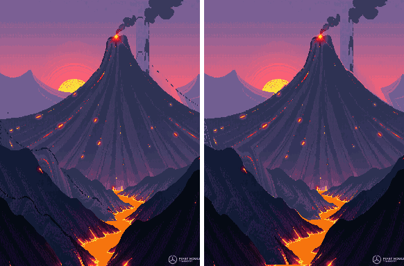

**Verdict.** Keep, with step 6. Floating things such as smoke, clouds, birds and a moon have to be cut out as their own sprites instead of riding a skyline.

## 6. Grow each near layer

**Question.** Does lifting each skyline a couple of pixels make the near shapes take their outlines with them?

**Setup.** `GROW=2`, and 4, on the split. Each skyline moves up by that many rows before the layers are cut.

**Result.** At 2 px the stray lines are gone (picture above, right). 4 px looks no better, so we kept the smaller grow. The plume fault from step 5 is unchanged, as expected.

**Verdict.** Keep 2 px.

## 7. Scroll each row instead

**Question.** For a scene that is mostly ground receding to a horizon, is per-row scrolling cheaper than layers, with nothing to cut or fill?

**Setup.** `parallax.py line <png> <out> <horizon-row>`. Rows above the horizon move at 0.15 of the camera. Below it the factor rises to 1.0 at the bottom row along a 1.5 power curve. The horizon is row 100 of 256 for the alpine valley and row 150 of 384 for the volcano.

**Result.** The alpine valley's forested floor and river sweep past convincingly, with no gaps to fill. The volcano shows the limit. Its cone and the near ridges stand across many rows, each row slides by a different amount, and they lean.


**Verdict.** Keep for floors, water, cloud bands and wide valleys. Combine it with layers: line-scroll the ground layer and move the tall shapes as layers.

## 8. Do generators already push the distance back?

**Question.** Atmospheric perspective makes distant layers lower in contrast and closer to the sky colour. That is a summary of several art guides, such as [Pinnguaq](https://pinnguaq.com/?p=1295), not checked against each one. Do the generated backgrounds already do this, so the layers can be used as cut?

**Setup.** `parallax.py bands <png> 4 <depth.png>` gives, for each depth band, the standard deviation of luminance and the mean RGB distance from the sky colour.

**Result.** Distance from the sky colour, far band to near band:

| Picture | Band 0 | 1 | 2 | 3 | Colours |
|---|---|---|---|---|---|
| PixelLab volcanic pass A | 36.8 | 97.6 | 156.5 | 186.7 | 25 to 39 a band |
| PixelLab alpine valley A | 61.4 | 140.1 | 170.9 | 243.7 | 26 to 30 a band |
| Retro Diffusion volcanic pass A | 119.2 | 63.6 | 80.7 | 96.7 | 20 to 26 a band |
| ComfyUI volcanic pass | 58.0 | 36.8 | 66.4 | 73.5 | 11,204 to 17,903 a band |

Luminance contrast does not fall steadily with distance in any of them.

**Verdict.** PixelLab's scenes are lit for depth. Retro Diffusion's night canyon and the ComfyUI benchmark are not. The ComfyUI output was never reduced to a palette, so its colour counts are not comparable. Layers cut from a picture that is not lit for depth need pushing back by hand.

## 9. Push a layer back

**Question.** Can a layer be pushed toward the sky colour without adding colours?

**Setup.** `parallax.py haze <layer.png> <out.png> 0.35` mixes each pixel 35% toward the sky colour, then snaps it to the nearest colour already in the layer.

**Result.** On the alpine valley's second layer, luminance contrast falls from 21.8 to 14.6, and the layer uses 19 of its 35 colours. No colour is new.

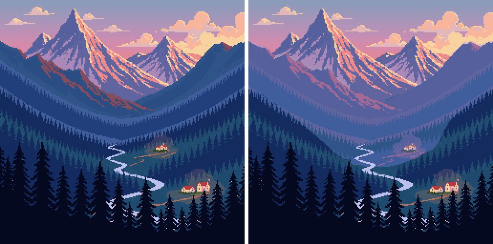

**Verdict.** Keep. The snap limits the layer to colours it already has. To push toward a sky colour the layer lacks, add the sky's colours to its palette first.

## 10. Rounding

**Question.** Pixel art has to move in whole pixels, and a layer at a factor of 0.3 sits at a fractional position most of the time. Which rounding keeps layers from twitching when the camera stops?

**Setup.** `parallax.py jitter` simulates a camera that follows a character walking 120 px in 3 s, then stops and settles with a small overshoot: 360 frames at 60 fps. It counts the frames where a layer moves a pixel while the rounded camera does not. It compares two schemes. One rounds each layer's own position, `round(cam × f)`. The other rounds the camera and takes the layer from it, `floor(round(cam) × f)`.

**Result.**

| Factor | Moves while the camera is still, own rounding | Camera rounded first | Steps in all |
|---|---|---|---|
| 0.10 | 3 | 0 | 12 |
| 0.25 | 21 | 0 | 30 |
| 0.30 | 10 | 0 | 36 |
| 0.50 | 22 | 0 | 60 |
| 0.60 | 25 | 0 | 72 |

At a steady 1 px a frame, factors 0.25 and 0.5 step every 4 and 2 frames. Factors 0.3, 0.4, 0.6 and 0.75 step on an uneven rhythm, such as 3, 3, 4 for 0.3.

**Verdict.** Round the camera to whole pixels first and derive every layer from that. Where an even rhythm matters, prefer simple fractions (1/2, 1/4, 1/8). An artist's guide comes at it from the other end with whole pixels per frame and loop widths with many divisors, such as 96 ([Pixelblog 23](https://www.slynyrd.com/blog/2019/11/12/pixelblog-23-parallax-scrolling)).

## 11. What LDtk does with a parallax factor

**Question.** PixelKiln's LDtk export writes `parallaxFactorX: 0`, `parallaxFactorY: 0` and `parallaxScaling: true` on every layer ([`ldtk-export.ts`](../src/pipeline/ldtk-export.ts)). What would a non-zero factor do?

**Setup.** We read the LDtk source. `Camera.getParallaxOffsetX` returns `levelX * parallaxFactorX`, minus half the layer's width times the factor when scaling is off ([Camera.hx](https://github.com/deepnight/ldtk/blob/master/src/electron.renderer/display/Camera.hx)). `LayerDef.getScale` returns `1 - parallaxFactorX` when `parallaxScaling` is on and the factor is not zero ([LayerDef.hx](https://github.com/deepnight/ldtk/blob/master/src/electron.renderer/data/def/LayerDef.hx)). The schema gives the range as -1 to 1, default 0 ([JSON schema](https://ldtk.io/files/JSON_SCHEMA.json)).

**Result.** LDtk offsets the layer by the camera position times the factor, so on screen it moves at 1 − factor of the camera's speed. 0 is an ordinary layer. A positive factor is farther away, and 1 never moves. A negative factor is nearer than the level. With `parallaxScaling` on, LDtk also draws the layer at 1 − factor of its size, so a far layer shrinks.

The same layer, at a quarter of the camera's speed, in each tool:

| Tool | Setting | Source |
|---|---|---|
| LDtk | `parallaxFactorX: 0.75`, `parallaxScaling: false` | Source above |
| Tiled | `parallaxx: 0.25` | [Tiled manual](https://doc.mapeditor.org/en/latest/manual/layers/) |
| Godot 4 `Parallax2D` | `scroll_scale = Vector2(0.25, 1)` | [Godot class reference](https://docs.godotengine.org/en/stable/classes/class_parallax2d.html) |
| Phaser 3 | `setScrollFactor(0.25, 1)` | [Phaser API](https://docs.phaser.io/api-documentation/3.90.0/namespace/gameobjects-components-scrollfactor) |
| Unity | Scripted. We found no official parallax package. | None |

**Verdict.** LDtk counts the other way from every other tool here. Its factor is how much the layer follows the camera, not how fast it moves, so an exporter has to write 1 − speed. It also has to set `parallaxScaling: false` for pixel art, or LDtk draws a far layer at a fraction of its size and off the pixel grid. Not yet checked in the LDtk editor itself.

## 12. Layers built from separate silhouettes

**Question.** Steps 3 to 6 cut one picture into layers and then have to invent what the near layers hid. A game that uses PixelKiln does the opposite and composes each layer from separate sprites. How is it built, and what does it settle that splitting does not?

**Setup.** We read the game's Godot 4 source (its backdrop and sky scripts and their tests) and did not run the game. The game is top-down with an isometric look. The camera can pan north past the playfield's edge to look at the skyline, so the movement is mostly vertical. `parallax.py compose` replays the layout and the offsets outside the engine to check the numbers.

**Result.** How it is put together:

- **The art is silhouettes, not scenes.** Each biome has three landforms, generated one at a time from prompts of the form "distant <landform>, fading to nothing at its foot, hazy dusk lighting as if seen from far away, no ground plane, no sky, isolated landform only, transparent background". The first set came from PixelLab at 224 to 256 px wide. They were later redrawn at 768×336 through Scenario, with the bottom 30% faded to transparent so the foot dissolves into the haze instead of ending on a hard edge. A forest or jungle biome has none, because its treeline is its horizon.
- **A layer is a run of those silhouettes.** Each next sprite starts 72% of the way across the one before it, plus a random gap of up to 16 px, so the shapes overlap into one skyline instead of reading as a row of objects. Each sprite is flipped at random, the same one never comes twice in a row, and the feet jitter ±12 px. The game places them with a seeded generator of their own, so adding a landform never moves anything else.
- **Two tiers.** The far tier stands 40 px deeper than the near one. Both are tinted toward the biome's dusk colour, the far one by 0.5 and the near one by 0.3. The aerial perspective comes from the tint, not from the art (compare step 9). A dust storm pales both further.
- **The sky is not generated.** It is a shader with four flat colour bands for each time of day, each nudged toward a colour for the biome's air, and clouds, an overcast deck, or stars and a moon drawn over the bands. The same sky colour tints the playfield a little, so the two agree.
- **Movement.** The playfield moves 1:1 with the camera. The sky follows at 0.6, the far tier at 0.85 and the near tier at 0.92. The offset is `round((1 − rate) × clamp(viewTop − edge, −360, 0))`, where 360 px is how far the camera may look past the edge. The x offset has the same shape, centred on the playfield. Offsets are whole world pixels, and a world pixel is one texel at every zoom the game allows.
- **Anchored so nothing ever sinks.** At the southernmost view that can see the skyline, every layer sits exactly where it would with parallax off. From there the layers only rise. So the game's rule that a tree's foot must stand in front of the mountains' base holds at every camera position.
- **The gap under a rising layer is ground, not sky.** A rising tier would open a strip above the playfield. A thin "skirt" of distant ground fills it: the biome's ground colour hazed 0.2 toward the horizon band, 24 px solid with a 12 px stepped fade above and below. Its top rides with the tier and its foot stays put. The sky's top rises while its foot stays fixed, so its bottom edge never shows. Nothing floats.
- **No loop.** The world is bounded, so each run extends past both ends of the playfield by the most that layer can drift, `(1 − rate) × reach`, plus a 400 px margin. No side edge shows and no seam is needed (compare steps 1 and 2).
- **Heat shimmer** in hot biomes moves each band of three texel rows sideways by whole texels, stepped at the game's 8 fps animation rate. That is line scroll (step 7) used for an effect rather than for depth.

**Tuning.** The first prototype moved the layers at 0.3, 0.5 and 0.75, each tier with a 64 px skirt. The owner's review was that less could be more. At full headroom the old rates lift the sky, far and near layers 252, 180 and 90 px, against 144, 54 and 29 px for the current ones, and `compose` gives the same figures from the formula. Close rates keep the two tiers together, so no band of sky opens between them. One thin skirt replaced two wide ones that had read as haze between the layers and the playfield.

**Open check.** The game rounds the offsets from the camera's own, unrounded view top. Step 10 found that this moves a layer while the camera is still, unless the camera's position is already whole pixels. The game snaps 2D transforms to pixels and snaps its smoothed view onto its target, but we did not check whether the view top is ever fractional while it settles.

**Verdict.** Keep. This is the most practical route in this note. Generators are good at one isolated shape on a transparent background and poor at agreeing across several pictures, and this route asks them only for the first. Splitting a picture (steps 3 to 6) is still the route when you have one finished scene to animate.

## 13. Cut by depth per pixel

**Question.** Steps 4 to 6 cut along one skyline per column. That fails on a scene framed by tall trees and drags sky along with anything floating. Does assigning each pixel to its own depth band fix both?

**Setup.** `parallax.py cut <png> <out> 4 <depth.png> <reach>`, with `GROW=2`. Each pixel goes to its band from the Depth Anything map. A 3×3 median then removes specks, and each near band takes 2 px from the bands behind it (step 6). The script fills a layer only where it could be uncovered, meaning hidden pixels within `reach` px of something at its depth or farther. Reach is the pan, 96 px on the volcano and 64 on the framed valley. The fill copies the nearest pixel of the layer's own in the same row, then the nearest in any direction. The script writes each layer's invented pixels as a mask for step 14.

**Result.** Both pictures recombine exactly at rest. On the volcano the plume now moves with its own band, and the sky behind it stays sky (right; the skyline cut of step 6 is on the left). The framed valley no longer loses whole columns to the trees.

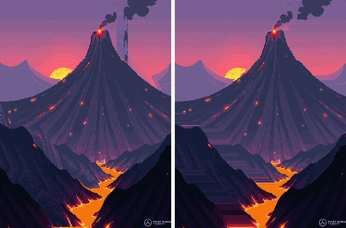

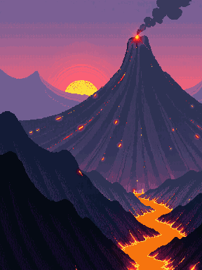

The price is invention. Because the bands are thin and the pan is long, the fill has to make up 115 to 189% of a layer's own pixel count on the volcano and 175 to 333% on the framed valley. Where a framing tree slides away, the cheap fill shows as sideways smears (step 14, left).

**Verdict.** Keep the per-pixel cut. The fill is the weak part.

## 14. Inpaint what a near layer hid

**Question.** Can a hosted inpainting model replace the smeared fill with something that belongs in the scene, without changing the pixels around it?

**Setup.** The framed valley's third layer, the trees and cabins in the middle ground, whose fill covers 22,794 pixels. The input was layers 0 to 2 composited, so the model sees an opaque picture, and the mask was the invented pixels from step 13. PixelLab `inpaint_image` at 256×256, seed 4242, `crop_to_mask` on, with the description "the valley floor continuing behind: pine trees, grassy riverbank and distant mountain slopes in the same pixel-art style and colours, no large tree trunks in the foreground". 10 generations.

**Result.** No pixel outside the mask changed. The fill used 31 colours, 2 of them new to the picture. At the far end of the pan, the smears to the left of the cabin and along the mountain's edge became forest and slope (right). The two farther layers still carry the cheap fill.

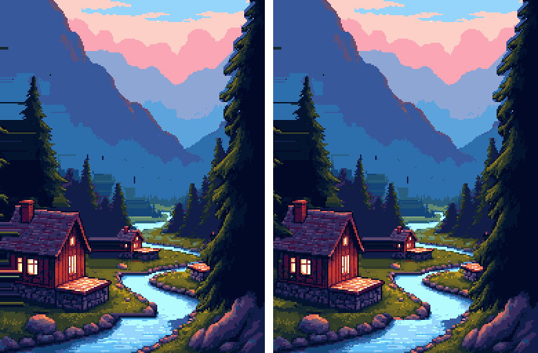

**Verdict.** Keep, for a scene that has to be split. A full set costs one inpaint per layer that can be uncovered: 30 generations for a four-layer 256 px scene, 75 at 384 px. Generating the layers separately (step 15) costs far less.

## 15. Generate each layer on its own

**Question.** Instead of cutting a scene, can each layer be generated as its own wide picture that agrees with the others and wraps?

**Setup.** One volcanic dusk set from each hosted provider, with a sky, a far range, a volcano and near ridges. The manifests are in [`benchmarks/parallax-layers`](../benchmarks/parallax-layers).

- **PixelLab** through PixelKiln, using pixflux, `view: side`, seed 4242, and one forced palette for every layer (the 44 colours of the step 4 volcano). The sky is 400×160 and opaque. The three layers are 400×100 with background removal, under pixflux's 40,000 px transparency limit. 4 generations.
- **Retro Diffusion** with `rd_plus__environment` and `tile_x`, seed 4242. The sky is 384×160 and the layers are 384×96 with `remove_bg`, at $0.06 an image, $0.24 in all. PixelKiln refused to send these at the time. Retro Diffusion quoted $0.06 for every size tried, above PixelKiln's offline estimate of $0.044 for 384×96, so we sent the four straight to the API with the same quote check. PixelKiln 0.138.1 plans every `rd_plus__` style at the flat $0.06, so it would send them now.

Pixflux has no seamless option, so we looped the PixelLab layers with step 2's crossfade. Both sets were stacked with their bottoms on rows 150, 175 and 200 of a 200 px canvas, and scrolled one way at 0.05, 0.25, 0.5 and 1.0 so every seam passes.

**Result.**

- **PixelLab reads as one scene.** Same palette, same light, and a clean cutout on all three layers (60 to 71% transparent). The far range came back as a flat two-colour silhouette, so it reads as a band of fog. The sky drew a mountain and hills along its bottom despite "no mountains".
- **Retro Diffusion does not.** The environment style draws a whole scene whatever the prompt says. The sky has its own volcano and river, the far layer is a range with sky still on it, and the near layer is a wall. `tile_x` does work on the drawing, and the sky wraps with a seam no rougher than its inside (ratio 1.0). Background removal then breaks it. The near layer keeps ground on one side of the join and removes it on the other (seam ratio 3.9).

**Verdict.** Keep PixelLab pixflux with one forced palette for every layer. It is the cheapest route in this note, and the layers agree. Retro Diffusion's environment style is a scene generator, not a layer generator. Its `tile_x` is still the only hosted seamless option we found, and would suit a sky or any layer that needs no background removal. Step 18 fixes the fog-band far range and the sky with mountains in it, and its pictures replace this step's.

## 16. A skyline from generated silhouettes

**Question.** Step 12's route asks a generator for isolated landforms that fade out at the foot. Does a cheap generator deliver them?

**Setup.** Three PixelLab pixflux silhouettes at 200×100, background removed, on the step 15 palette, with prompts in step 12's pattern: "a distant <landform>, fading to nothing at its foot, hazy dusk light as if seen from far away, no ground plane, no sky, isolated landform only". 3 generations. `parallax.py compose` laid them in runs at three times their size, with step 12's rates (0.6, 0.85, 0.92) and the camera panning north.

**Result.** The landforms are usable and cut out cleanly, 44 to 73% transparent. None fades at the foot. Pixel-art background removal leaves each pixel fully on or fully off, so each landform comes back with a hard dark base, a disc under the cone and a plateau under the mesa. In a run those bases read as a black band where step 12's game shows haze.

**Verdict.** Keep the route. The faded foot has to come from somewhere else. The options are a generator that returns soft alpha (the game's redraws came from Scenario), a dithered fade drawn afterwards, or a skirt and treeline in front, as step 12's game uses. Step 18 draws the dithered fade and finds the prompt that gives isolated landforms.

## 17. A model that splits a picture into layers

**Question.** [Qwen-Image-Layered](https://github.com/QwenLM/Qwen-Image-Layered) is trained to break a picture into RGBA layers and fill in what each layer hides. Does it give depth bands, and does it run on a 12 GB card?

**Setup.** ComfyUI 0.34 on an RTX 3060 (12 GB) with 32 GB of RAM, using the fp8 model (20.5 GB), the fp8 Qwen 2.5 VL 7B text encoder and the layered VAE, about 30 GB of downloads. We enlarged the step 4 volcano from 384 to 640 px by nearest neighbour and ran it through the official "Image to Layers" graph as an API workflow: euler, 50 steps, CFG 4.0, seed 42, a short description of the scene as the prompt. One run asked for 4 layers, one for 3.

**Result.**

- **It runs, slowly.** The model does not fit beside the desktop's own use of the card, so ComfyUI streams the weights from system RAM every step. That is about 40 s a step, 35 minutes for 4 layers and 42 for 3.
- **The split is sky against everything else.** In both runs the back layer is a flat near-white fill and one layer holds the sky and sun. A single layer holds the far range, the volcano and its plume, the near ridges and the lava. The 4-layer run spent its extra slot on a pink blob over the lower half that matches nothing in the scene. Nothing in front can move at a different speed from anything behind it.
- **What it does well.** It fills in the sun behind the volcano on the sky layer, which is the work step 14 paid PixelLab to do. Stacked back to front, the layers rebuild the input to within 3.5 of 255 per channel on average.
- **It is not pixel art afterwards.** The input has 44 colours. Each layer has 22,000 to 50,000, and the scene layer's alpha is mostly 192 to 254 rather than fully opaque. Every layer would need snapping back to the palette and a hard alpha.

We did not try other prompts, other seeds or the full-precision model. The model's documentation says the prompt does not choose what goes in each layer.

**Verdict.** Drop for parallax. It separates the objects a person would select, not the distances a camera would see, and a picture takes over half an hour on this card. For a picture that has to be split, use a depth map (steps 4 and 13) with inpainting (step 14).

## 18. Refine the two routes that worked

**Question.** Steps 12, 15 and 16 found two routes worth keeping, but their pictures were weak. The silhouettes had hard dark bases, the far range read as a band of fog, and the sky had mountains drawn into it. How good can they get with better prompts, a choice of candidates, and finishing by script?

**Setup.** Two biomes, each on one forced palette. Volcanic dusk uses the 44 colours of the step 4 volcano, and alpine dusk the 38 colours of PixelLab's alpine valley A. Every asset was generated through PixelKiln at three seeds (101, 202, 303): three silhouettes at 256×128 and three whole layers (far, middle, near) at 400×100, all pixflux with background removal and `view: side`. That is 36 generations. The silhouette retries cost 9 more volcanic and 6 more alpine, 51 in all. The manifests, lockfiles, preview specs and build script are in [`benchmarks/parallax-refined`](../benchmarks/parallax-refined). We did not generate the sky. `parallax.py sky` draws six flat palette bands with a dithered step between neighbours.

**Result.**

- **The prompt decides whether a silhouette is a sprite or a scene.** The first round used step 16's pattern, with "distant", "hazy dusk light as if seen from far away" and "fading to nothing at its foot". All nine volcanic silhouettes came back as small scenes, with ground, clouds or a moon. 14 of the 18 silhouettes over both biomes ran off the side of the canvas, and pixflux drew a glow asked for at a crater as a setting sun. The retry described one object as "a lone landform game sprite on a plain empty background", listed what must not be in the picture, asked for "about two thirds as wide as the picture", and left out the distance and the glow. All 15 retries came back as one isolated landform each, and 14 were clear of both sides. The fifteenth, a ridge, touched the right edge at its foot, where the dithered fade thins it out anyway.


- **Whole layers came back usable on the first round.** Every far range was a flat one-colour band, which suits the farthest layer once it is recoloured. The alpine middle and near layers (sunlit peaks, a pine treeline) were good on every seed. Every volcanic middle layer was a single volcano. Looped, it would repeat obviously, so the preview draws it once as a landmark.
- **A dithered foot replaces soft alpha.** `parallax.py foot` trims a silhouette and thins its bottom 30% with a 4×4 ordered dither. The foot dissolves into whatever is behind it and stays pixel art.


- **Each tier needs its own tint target.** `parallax.py tint` mixes a picture toward a colour and snaps it to the biome palette. Tinting both tiers toward one light haze colour made the near tier lighter than the far range behind it, so depth read backwards. Pulling the far tier toward a mid violet and the near tier toward a dark one gives the right order, with the far range lightest and the near layer darkest.
- **A sparse palette flattens a pale tint.** The alpine palette has few pale colours, so snow tinted toward the haze snapped to two or three colours. The alpine near tier keeps its snow with a light tint (0.2) instead.
- **Extend the far range down instead of floating it.** Repeating the far range's bottom row to the foot of the view gives the tiers' dithered feet distant land to dissolve into. A flat haze band in its place read as a separate rectangle.

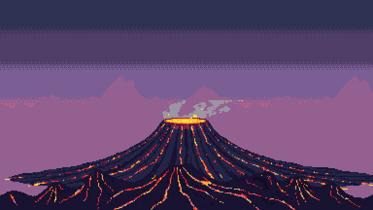

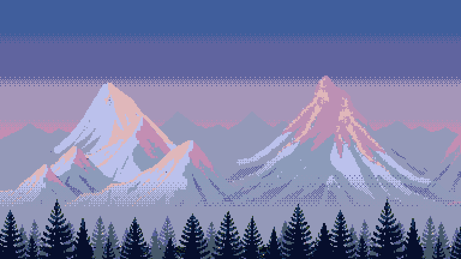

The four previews scroll the whole stack 480 px and back at 0, 1/8, 1/4, 1/2 and 1 of the camera's speed. They are lossless animated WebP, about 1.1 MB each against 2.3 to 3.2 MB as GIF.

**Verdict.** Keep both routes, finished this way. Generate silhouettes as sprites, never as distant scenery, and add the distance afterwards with a palette-held tint per tier. Draw the sky yourself. Take two or three seeds of everything. Only 15 of the 51 candidates made it into the previews, and none came from the first silhouette round. The [parallax guide](./PARALLAX.md) walks through it.

## 19. Scroll vertically

**Question.** Every step so far moves the camera sideways, apart from step 12's pan north. A platformer's camera also rises and falls, and a climbing level or a vertical shooter scrolls up the whole time. What changes when the camera climbs?

**Setup.** `parallax.py climb` is a vertical preview. Each layer has its own vertical speed, and the camera climbs and comes back down, eased and rounded to whole pixels first (step 10). Three tests, with the manifests, lockfiles, preview specs and build script in [`benchmarks/parallax-vertical`](../benchmarks/parallax-vertical):

- **Free.** Step 18's alpine whole layers, climbing 240 px in a 256×240 view.
- **A climb set** on the alpine palette. PixelLab pixflux with background removal at seeds 101, 202 and 303: a tall massif (200×200), puffy clouds (160×96), thin cloud streaks (192×48) and a cliff (128×304), then two flat cloud banks (256×64) as a retry. 14 generations, one of which failed. The preview climbs 480 px in a 240×256 view.
- **A loop for a vertical shooter.** Retro Diffusion `rd_plus__default` with `tile_y` and no background removal: a 192×384 sky and a 128×384 cliff, $0.12.

**Result.**

- **Sideways strips run out.** Step 18's layers are 100 px tall and made to be seen from one height. On the free climb the treeline drops out of the view within the first quarter, and the far range, extended down as step 18 does, becomes a flat lilac block filling the lower half of the view. A climb needs layers drawn tall, or things placed at height for the camera to pass.
- **Every layer needs headroom of climb × its vertical speed.** A layer has to be drawn the view's height plus that many rows above it. On the 480 px climb that is 48 rows for the far range at 0.1, 96 for the massif at 0.2, 192 for the far clouds at 0.4, 480 for the wall at 1.0 and 624 for the foreground clouds at 1.3. It is step 12's rule for a bounded level turned on its side: extend each layer by the most it can drift. Placed for the lowest view, the layers only move down the screen as the camera climbs, so nothing under a layer is ever uncovered. A camera that drops below that view uncovers their feet, which is why step 12 anchors at the southernmost view.
- **A sky that changes with height has to move.** A sky at infinity, speed 0, looks the same however high the camera goes. Scrolling the sky's bands at 0.3 of the climb walks the view from dusk at the horizon through blue to night at the top, where the script scatters single-pixel stars over the top third.
- **Clouds work as puffy sprites, not as flat ones.** All three puffy clouds came back isolated and usable on the sprite prompt from step 18. The thin streaks and flat banks did not: four of four came back as a small mound, a one-pixel line, or a bank with a yellow sun rising out of it. Two of the three massifs ignored "no clouds" and came with clouds attached. The third, a tall peak cut off by the right and bottom edges, is the one used, with its cut left edge hidden behind the wall. Placed one per height band up the climb, the clouds give the camera something to pass at every height: tinted toward the haze at 0.4, and as generated at 1.3, in front of the wall.

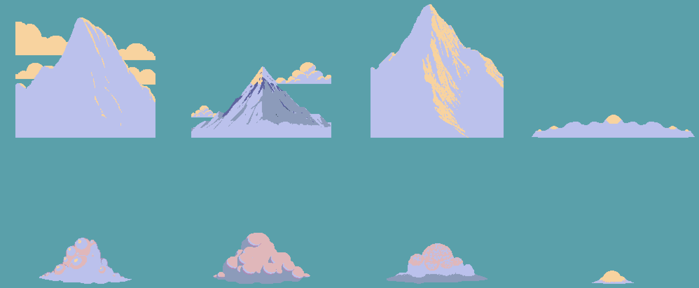

- **A cliff comes back as a pillar with a top, which is what a climb needs.** None of the three cliffs filled the picture from top to bottom as asked; each has a summit. `parallax.py wall` keeps the summit, finds the two rows where the body best loops (step 2's cut turned on its side) and repeats the body below. The seam ratios are 2.8 to 8.3. On cliff b, whose ledges are far apart, the join is hard to find. On the other two a repeated ledge of trees or a horizontal line gives it away.

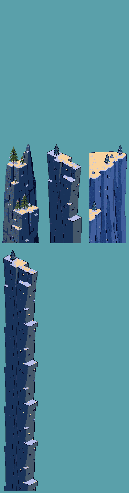


- **Retro Diffusion's `tile_y` works on `rd_plus__default`.** Stacked on themselves, the cliff joins with a seam ratio of 1.1 and the sky 1.9. Sideways the same pictures are not seamless (6.4 and 10.0), as expected. The sky is in Retro Diffusion's own violets. Snapped to the alpine palette it kept 5 of its 47 colours and turned blotchy, so the loop keeps the sky as generated and snaps the PixelLab clouds to the sky's colours instead.

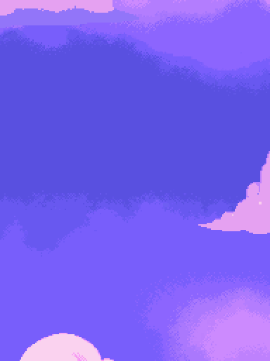

The engine settings carry over from step 11 on the other axis. Tiled has `parallaxy`, and `repeaty` on an image layer. Godot's `Parallax2D` takes the y of `scroll_scale` and `repeat_size`. Phaser's `setScrollFactor(x, y)` takes both. LDtk's `getParallaxOffsetY` is the same formula as x with `parallaxFactorY`, so write 1 − speed there too. Its shrink follows only `parallaxFactorX`, so a layer with only a vertical factor never shrinks.

**Verdict.** Keep. A vertical level needs tall layers or things placed at height, a sky that moves, and headroom of climb × vertical speed on every layer, placed for the lowest view. Generate clouds as puffy sprites and a cliff as a pillar, then stack the pillar's body into the wall. For a background that scrolls up forever, Retro Diffusion's `tile_y` is the one generator option that wraps vertically; keep the rest of the set on its colours.

## 20. A second time of day

**Question.** Step 18's alpine set is dusk, on a forced palette of 38 colours. A game with a day cycle wants the same place at another time. Does forcing one palette on every layer keep a set consistent at a different time of day? And is generating the set again any better than recolouring the dusk set by script, which is free?

**Setup.** We chose night over midday. It moves the colours furthest from dusk, from warm sunlit snow to cold moonlit snow, so it is the harder test for both a forced palette and a recolour. The manifests, lockfiles, preview specs and build script are in [`benchmarks/parallax-night`](../benchmarks/parallax-night).

- **The palette.** The dusk palette is the 38 colours of PixelLab's alpine valley A from the provider benchmark. For night we sent the same prompt and seed (31415) with "at dusk" changed to "at night", and took all 42 colours of the result. That is 1 generation. The night palette has the same origin as the dusk one, and it holds what PixelLab paints at night: a navy sky, pale blue snow, lit windows and a moon.
- **Regenerated.** Step 18's three whole layers at seeds 101 and 202, and its three landforms at seed 202, with the night palette forced on every one. The prompts are step 18's with "at night" added and the light changed: "lit pink by the setting sun" became "lit pale blue by the moon", and the landforms' "pink-lit snow" became "moonlit pale blue snow", with "no stars" added to their list. 9 generations, 10 with the palette, none failed.
- **Recoloured.** `parallax.py recolour` swaps one palette for another by luminance rank. Both palettes are sorted dark to light, and a colour a given share of the way up the dusk palette becomes the colour the same share of the way up the night palette. Every finished dusk piece from step 18 goes through the same table: the far range, the middle layer, the treeline, the landforms and their tier copies. No generation.

Both night sets use the same scripted sky of six night palette bands and step 18's preview spec.

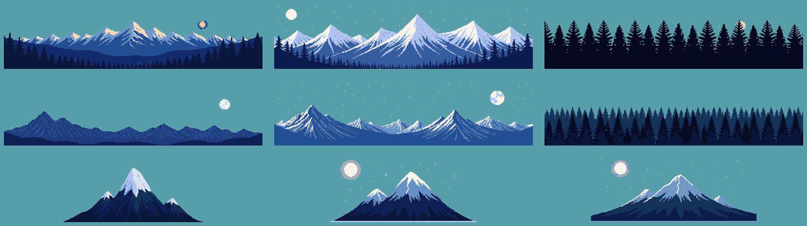

**Result.**

- **The forced palette holds.** All nine regenerated pictures use only night palette colours, and each seed's three layers agree in colour and light, as step 15 and 18 found at dusk.
- **"At night" brings a moon.** Five of the six layers drew a moon, stars or both; their prompts said only "no sky". Two of the three landforms drew a moon and stars although the prompt said "no moon, no stars", and the same two stand on a pale ground line two rows deep. `parallax.py isolate` keeps the largest shape and whatever touches the bottom row. It cleared the moon and stars from six of the seven pictures. On the seventh, seed 101's treeline, the moon sits behind a treetop.
- **The far range changes character.** At dusk every far range came back as a flat band of one colour. At night seed 202 gave a two-tone range, 12 colours once the moon was gone, and seed 101 a whole scene with its own treeline and moon.
- **The regenerated set is a different place.** The picks, all seed 202, read as one scene. No peak stands where it stood at dusk, so a game that fades from dusk to night would show the mountains move.
- **The recoloured set is the same place at night.** Every shape stays, so dusk and night line up exactly. The set is consistent by construction, because every piece goes through one table. Colour counts barely change. The middle layer goes from 26 colours to 24 and the treeline from 19 to 18, where two dusk colours land on one night colour.
- **Leave the lights out of the swap.** Onto all 42 night colours, the pink-lit snow took the colours of the lit windows and turned orange (middle row below). The night palette has 8 colours whose red is above their blue: the windows, the lamplight on the ground and the moon. Swapped onto the other 34, the snow is cold and moonlit (bottom row).

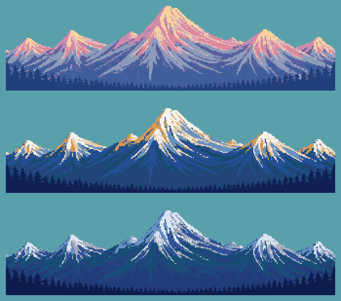

- **The recolour keeps dusk's light.** The lit faces stay where the low sun put them, and read as moonlight from the same side. A palette swap cannot move the light, so a time of day lit from another direction would need new pictures. We did not try one.


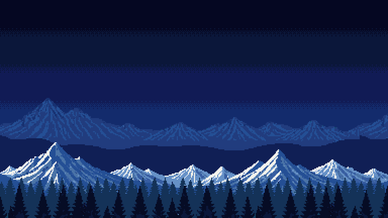

The silhouette route behaves the same way. Step 18's runs recoloured keep their shapes, and the three regenerated landforms, cleaned and with the ground line cut off, make two tiers in the night colours. The stills are `recoloured-silhouettes.png` and `regenerated-silhouettes.png` in the same folder.

**Verdict.** A forced palette keeps a regenerated set consistent with itself at another time of day. It does not keep it consistent with the first time. The shapes change, and the night prompt adds a moon and stars to clean off. For a second time of day of the same place, recolour the finished set by luminance rank onto the new palette, leaving out the colours of lights. It is free, and the two times line up. Generate only what the new time adds, such as a moon, as its own sprite.

## 21. Key Retro Diffusion layers by script

**Question.** Step 15 found that Retro Diffusion's `tile_x` makes a seamless picture and its `remove_bg` breaks the seam (ratio 3.9 on the near layer). If a layer is generated with `tile_x` and no background removal, on a flat background, and keyed by script, does the seam survive? And is the result usable as a layer?

**Setup.** Step 15's volcanic far range and near ridges, at seed 4242 and 384×96, with `tileX: true` and `removeBg: false`. Each prompt is step 15's with "isolated on a plain flat chroma-key green background" added. Two styles: `rd_plus__environment`, as in step 15, and `rd_plus__default`, which step 19 found honours `tile_y`. The default style also got a row of volcanoes as a middle layer. 5 images through PixelKiln at $0.06 each, $0.30 in all. The manifest, lockfile, preview spec and build script are in [`benchmarks/parallax-rd-key`](../benchmarks/parallax-rd-key).

`parallax.py key` takes the most common colour on the top row as the background. It removes every pixel within 24 of it on each channel that connects to the top row through other such pixels. It works out the connection on three copies side by side, so both edges of a picture that wraps key alike. The seam ratio is step 1's, measured before and after keying.

**Result.**

| Style | Layer | Background drawn | Seam ratio as generated | Keyed | Share removed |
|---|---|---|---|---|---|
| Environment | Far range | A pale lilac sky | 0.4 | 0.3 | 28% |
| Environment | Near ridges | A near-black sky | 0.7 | 0.6 | 27% |
| Default | Far range | Flat pale mint | 1.1 | 1.4 | 45% |
| Default | Volcanoes | A teal to violet gradient | 0.5 | 0.4 | 46% |
| Default | Near ridges | Flat dark green | 1.4 | 1.3 | 51% |

- **The seam survives keying.** Every keyed layer joins with a ratio of 0.3 to 1.4, against 3.9 for step 15's near layer with Retro Diffusion's own background removal. A colour key decides pixel by pixel, so where the two edges of a seamless picture match, their alpha matches too. The left and right edges disagree on at most 1% of rows.
- **`rd_plus__default` honours `tile_x` too.** Its three pictures wrap with ratios of 0.5 to 1.4 as generated. With step 19, it honours both axes.
- **The environment style still draws whole scenes.** Neither of its pictures has the green background. The far range sits under a pale sky and the near ridges under a near-black one, much as in step 15 at the same seed. The pale sky keys out cleanly and leaves a usable stack of far ranges. The near ridges are as dark as their sky, so no threshold separates them. The key takes 16% of the picture at 8, 27% at 24 and 61% at 48, and at 24 it already cuts into the ridges.
- **The default style drew a flat background on two of three.** The near ridges came on one flat dark green and keyed out with no green pixel left on the layer. The far range came on a flat pale mint rather than green, which keys as well, and leaves a flat one-colour band like PixelLab's far ranges in step 18. The volcanoes came under a dusk gradient. The key takes the top band only and leaves violet bands behind the cones.

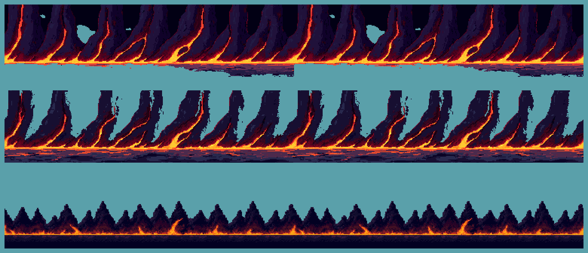

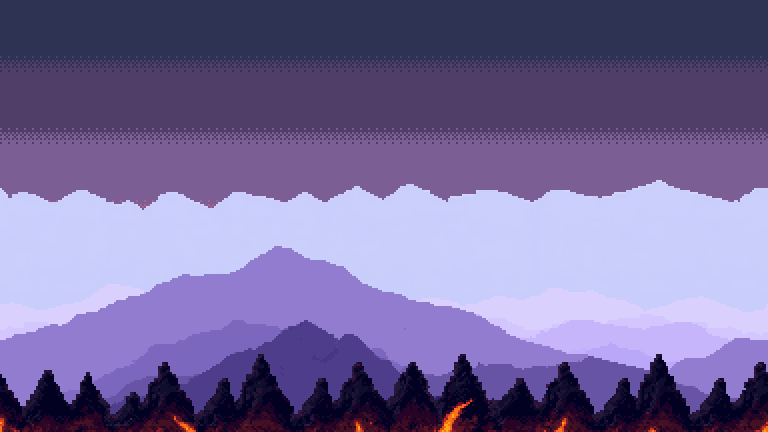

**Verdict.** Keep, with `rd_plus__default`. Generate with `tileX` and no background removal, ask for a plain flat background, and key it out by script, and the seam survives. Check each candidate for a flat background first, since one in three came with a gradient. The environment style is still a scene generator; its pale-sky far ranges key well and its dark layers do not. This is the one way in this note to get a transparent layer that loops sideways as generated, with no cut or crossfade, at $0.06 a layer. Its colours are Retro Diffusion's own, so keep the rest of the set on them, as step 19 found.

## 22. Check the exports in engines

**Question.** `pixelkiln parallax export` writes a Tiled map, a Godot scene and an LDtk level from a manifest's set (see [below](#the-pixelkiln-parallax-command)). Does each engine draw the set the way the preview does, at every camera position?

**Setup.** Three sets, all from art we already had, so nothing was generated. Step 18's alpine dusk scrolls 480 px sideways. Step 19's climb rises 480 px, with eleven layers at vertical speeds from 0.1 to 1.3. Step 19's loop rises 768 px over the Retro Diffusion sky repeating vertically. [`parallax-engines.ts`](../research/scripts/parallax-engines.ts) exports each set, puts the Godot scene in a small project with a `Camera2D`, renders chosen camera positions with Godot's Movie Maker, and compares every frame with the command's own frame for that position. A pixel counts as different when a channel is off by more than 2. LDtk's editor has no command line, so the script draws the LDtk level the way the editor's source does (`Camera.getParallaxOffsetX` and `LayerInstance.pxParallaxX`) and compares that. We picked camera positions where a layer lands on a half pixel (2, 6 and 50 sideways; 5 and 15 up) as well as ordinary ones.

**Result.**

- **Godot matches exactly with pixel snapping on.** With Rendering > 2D > Snap 2D Transforms to Pixel, all 19 camera positions over the three sets came out identical to the preview. Without it, the positions where a layer lands on a half pixel differed in 1,069 to 5,902 pixels of a frame. Godot then samples the texture between two pixels.
- **A repeating Godot layer has to start inside its first repeat.** Godot keeps a repeating `Parallax2D` within one repeat of the screen's edge and draws `repeat_times` + 1 copies centred on it. The first export put the loop's sprite 640 rows down, and Godot drew nothing at the start of the climb. The exporter now wraps the sprite into the first repeat and asks for enough copies on both sides.
- **The preview had to round the way the engines do.** At first the preview floored each layer's offset and then rounded it up at a half pixel. Godot and LDtk both put a half pixel toward the right and bottom of the screen. The preview now does the same.
- **LDtk needs one picture per layer, not a shared tile grid.** LDtk draws a tile only on its layer's grid. The alpine layers are 398, 338 and 275 px wide, which share no divisor, so the first export cut them into 1 px tiles: a 109 MB file. The exporter now draws everything the camera can see of each layer across the level, repeats included, into one picture and cuts that into 16 px tiles.
- **LDtk's offset feeds back into its centre.** LDtk offsets a layer by (camera centre − layer centre) × factor, and it measures the layer as the level less the layer's own pixel offset, then rounds. The exporter searches offsets for one that lands the start view exactly and keeps the offset whole, so later positions round as the preview does. Where no whole offset exists, a half pixel can land one pixel off.
- **LDtk matched otherwise.** All 19 positions matched, except the top of the climb, where 7 tiles of the fastest cloud (speed 1.3) sit past the level's top edge. A layer faster than the camera shows more than the level holds, and LDtk draws nothing past a level's edge. The command warns about it.

| Set | Positions | Godot, snapping on | Godot, snapping off | LDtk |
|---|---|---|---|---|
| Alpine, sideways | 8 | 0 differ | 3 differ (half pixels) | 0 differ |
| Climb | 6 | 0 differ | 2 differ (half pixels) | 2 differ (the cloud past the edge) |
| Endless loop | 5 | 0 differ | 1 differs (a half pixel) | 0 differ |

**Verdict.** Keep the Godot and LDtk exports, and tell people to turn on Godot's pixel snapping. Nothing here opened the LDtk editor itself, so the drawing code was read, not run, and the factor's direction comes from step 11's reading. The Tiled map has not been opened in Tiled, and Phaser has no file format to export, so `setScrollFactor` is still the guide's table and not a checked export.

## The `pixelkiln parallax` command

Steps 1 to 22 led to a command. It is narrower than the proposal this note used to carry: it has no `palette`, `loop` or `haze` field, because finishing a layer still needs judgment (steps 2, 9 and 18), and the script does it.

A manifest's `parallax` section names sets. A set has the `view`, how far the camera moves (`travel`, `climb`) and its layers, far to near. A layer is a generated `asset`, read from the lockfile, a finished `file`, or `sky` bands drawn by PixelKiln, with `speed` and optional `speedY`, `x`, `bottom`, `extend`, `repeat` and `repeatY`. The [manifest reference](./MANIFEST.md#parallax-sets) lists them.

- `pixelkiln parallax preview <set>` writes a page that scrolls the set and a strip of frames. It measures each looping layer's join as step 1 does and warns above 2.
- `pixelkiln parallax export <set>` writes all three formats, or one with `--format`. Tiled gets image layers with `parallaxx`, `parallaxy`, `repeatx` and `repeaty`. Godot gets a `Parallax2D` per layer. LDtk gets a Tiles layer per layer, factor 1 − speed, scaling off, as step 11 found it must.

The sets checked in step 22 are in the manifests of [`benchmarks/parallax-refined/alpine`](../benchmarks/parallax-refined/alpine) and [`benchmarks/parallax-vertical/climb`](../benchmarks/parallax-vertical/climb).

## What other people are doing

- **Layered generation models.** [LayerDiffuse](https://arxiv.org/abs/2402.17113) (Apache-2.0) adds transparency to latent diffusion models and can generate several layers of one scene together. [Qwen-Image-Layered](https://github.com/QwenLM/Qwen-Image-Layered) (Apache-2.0, December 2025) breaks a picture into a chosen number of RGBA layers, at 640 or 1024 px buckets. ComfyUI ships it with an fp8 variant because the default needs a lot of VRAM ([ComfyUI docs](https://docs.comfy.org/tutorials/image/qwen/qwen-image-layered)). Neither was trained on pixel art. Step 17 ran Qwen-Image-Layered on a 12 GB card. It works, slowly, and splits sky from scene rather than by distance. LayerDiffuse is untried.
- **Seamless generation.** Circular padding in the convolutional layers makes a diffusion model's output wrap, and ComfyUI has nodes for it, including X-only tiling ([ComfyUI-seamless-tiling](https://github.com/spinagon/ComfyUI-seamless-tiling)). It works on U-Net models such as SDXL. Reports say it does not work on transformer models; we have not checked. The other route is to shift the picture by half its width and inpaint the seam.
- **Providers.** Retro Diffusion's API takes `tile_x` and `tile_y` booleans for seamless output and `remove_bg` for transparency ([api-examples](https://github.com/Retro-Diffusion/api-examples)). PixelKiln already exposes them as `tileX` and `tileY` ([Retro Diffusion](./RETRO_DIFFUSION.md)). `rd_plus__environment` honours `tile_x` (step 15) and `rd_plus__default` honours both `tile_y` and `tile_x` (steps 19 and 21). We have not checked the other styles. We found no parallax or seamless option in PixelLab's v2 API. Pixflux offers a transparent background, a forced palette and an init image, up to 400×400 ([API](https://api.pixellab.ai/v2/llms.txt)). Scenario's tiling options are texture tools rather than scene tools ([help](https://help.scenario.com/articles/3312894507-scenario-texture-the-essentials)).
- **Classic hardware.** The Mega Drive has two scrolling planes with per-line scroll tables ([RasterScroll](https://rasterscroll.com/mdgraphics/graphical-effects/row-column-scrolling/)). Games such as *Thunder Force IV* fake many layers from them by scrolling groups of lines at different speeds.

## What has not worked

- Splitting by colour (step 3). A scene's own lighting moves colours around more than distance does.
- Skyline layers for a scene framed by tall near objects (step 4), and for anything floating (step 5).
- Line scroll on tall shapes (step 7).
- A cheap fill for what near layers hid, wherever a framing object moves far (step 13).
- Retro Diffusion's environment style as a layer generator (step 15), and its background removal on a seamless picture.
- Asking pixflux for a foot that fades out (step 16).
- Qwen-Image-Layered as a depth splitter (step 17).
- Describing a silhouette as distant or hazy in the prompt (step 18). Pixflux paints a scene around it.
- Tinting every tier toward one light haze colour (step 18). Depth reads backwards.
- Sideways strips for a climb (step 19). The far range's extension ends up filling half the view.
- Thin or flat clouds from pixflux (step 19). Four of four came back as a mound, a line, or a bank with a sun in it.
- Snapping a generated sky to a palette with few of its colours (step 19). It kept 5 of 47 and turned blotchy.
- Generating a set again for a second time of day (step 20). It stays on the palette, but every peak moves, and "at night" drew a moon or stars into 7 of 9 pictures.
- A palette swap onto a night palette's light colours (step 20). Pink-lit snow took the colours of the lit windows and turned orange.
- Keying a dark layer off a dark sky (step 21). Retro Diffusion's environment ridges are as dark as the sky it drew behind them.
- One tile grid for every LDtk layer (step 22). Layers of unrelated widths left only 1 px tiles and a 109 MB file.

## What is next

- **Open the exports in Tiled and the LDtk editor.** Step 22 checked Godot by rendering and LDtk by its source. The Tiled map is unchecked.
- **Phaser.** A small loader for the Tiled map's image layers, checked against the preview the same way.
- **Runs and finishing in the command.** Silhouette runs (step 12), a dithered foot and tier tints (step 18) are still script steps.
- **A palette swap in the engine.** Step 20's table could run as a lookup in a shader, so one set covers a day cycle with no extra pictures.
- **A time of day lit from another side**, such as midday. A palette swap cannot move the light, so this is where generating again might earn its cost.
- **A full sideways Retro Diffusion set** from `rd_plus__default`, keyed by script and scrolled, with retries for candidates that come on a gradient.

## Running the scripts

They need numpy, pillow and scipy. `depth.py` also needs torch and transformers.

`parallax-engines.ts` runs from a checkout with Node and needs a Godot 4.3+ binary (set `GODOT`). Godot's Movie Maker opens a window while it renders.

```bash
# Render camera positions in Godot and draw them as LDtk does; compare both with the preview.
npx tsx research/scripts/parallax-engines.ts benchmarks/parallax-refined/alpine/pixelkiln.manifest.json alpine-dusk 0,0 2,0 50,0 480,0 --snap
```

```bash
# How badly each picture wraps.
python3 research/scripts/parallax.py seam <png>...

# Make one wrap: cut, crossfade or mirror. Also writes <out>.twice.png.
python3 research/scripts/parallax.py loop <png> <out.png> cut

# Depth map, brighter is nearer.
python3 research/scripts/depth.py <png> <depth.png>

# Four layers along depth skylines, grown 2 px. Writes layer0..3.png, bands.png and nearness.png.
GROW=2 python3 research/scripts/parallax.py split <png> <out-dir> 4 <depth.png>

# Pan a camera over the layers.
python3 research/scripts/parallax.py preview <out.gif> 0.1,0.3,0.6,1.0 <out-dir>/layer0.png <out-dir>/layer1.png <out-dir>/layer2.png <out-dir>/layer3.png

# Per-row scroll below a horizon row.
python3 research/scripts/parallax.py line <png> <out.gif> 100

# Contrast and sky distance per depth band; push a layer back.
python3 research/scripts/parallax.py bands <png> 4 <depth.png>
python3 research/scripts/parallax.py haze <layer.png> <out.png> 0.35

# Rounding schemes.
python3 research/scripts/parallax.py jitter

# Per-pixel layers with a fill within <reach> px, and each layer's invented pixels as a mask.
GROW=2 python3 research/scripts/parallax.py cut <png> <out-dir> 4 <depth.png> 96

# Stack layers that wrap, each with its bottom on a row of a 200 px canvas, and scroll one way.
python3 research/scripts/parallax.py scroll <out.gif> 0.05,0.25,0.5,1.0 200 sky.png@160 far.png@150 mid.png@175 near.png@200

# Layers composed from separate silhouettes; the camera pans north to the skyline. Rates are sky,far,near.
python3 research/scripts/parallax.py compose <out.gif> 0.6,0.85,0.92 7 <silhouette.png>...

# Step 18. Numbers for choosing between candidates: how much touches each side, colours, the opaque box.
python3 research/scripts/parallax.py screen <png>...

# Trim a silhouette and dither its bottom 30% out. A fourth argument cuts that many rows off the bottom first.
python3 research/scripts/parallax.py foot <png> <out.png> 0.3

# Mix toward a colour and snap to the biome palette (a manifest's or a picture's).
python3 research/scripts/parallax.py tint <png> <out.png> "#7f4776" 0.55 pixelkiln.manifest.json

# Flat sky bands with dithered steps, top to bottom.
python3 research/scripts/parallax.py sky <out.png> 384 216 "#2e3253,#503e68,#7b5f94,#ad628e,#d66283,#f96076"

# Side-scrolling preview of runs, whole layers and fills from a JSON spec; .webp or .gif.
STILL=<first-frame.png> SCALE=2 python3 research/scripts/parallax.py skyline <out.webp> <spec.json>

# Everything for step 18 at once.
sh benchmarks/parallax-refined/build.sh

# Step 19. Stack a cliff into a wall 700 rows tall, keeping its top 100 rows as the summit.
python3 research/scripts/parallax.py wall <cliff.png> <out.png> 700 100

# Vertical preview: the camera climbs through the layers and back; .webp or .gif.
STILL=<strip.png> SCALE=2 python3 research/scripts/parallax.py climb <out.webp> <spec.json>

# Everything for step 19 at once.
sh benchmarks/parallax-vertical/build.sh

# Step 20. Swap palettes by luminance rank; cool leaves out target colours whose red is above their blue.
python3 research/scripts/parallax.py recolour <png> <out.png> <dusk.json> <night.json> cool

# Keep the largest shape and whatever touches the bottom row, then trim empty rows. Drops a moon and stars.
python3 research/scripts/parallax.py isolate <png> <out.png>

# Everything for step 20 at once, after step 18's build.
sh benchmarks/parallax-night/build.sh

# Step 21. Key out the top row's colour within 24, flooding from the top with the picture wrapped sideways.
python3 research/scripts/parallax.py key <png> <out.png> 24

# The picture twice side by side, so its seam is in the middle.
python3 research/scripts/parallax.py twice <png> <out.png>

# Everything for step 21 at once.
sh benchmarks/parallax-rd-key/build.sh
```
