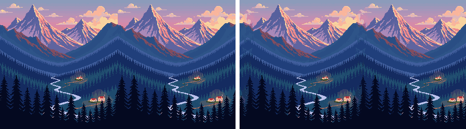
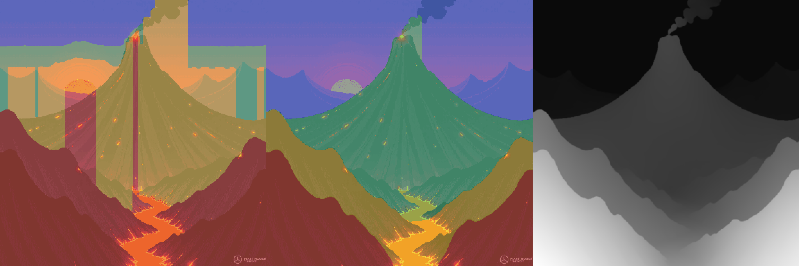
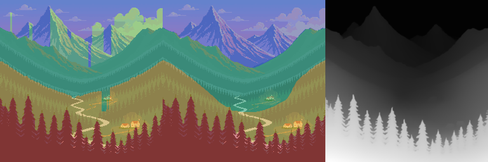
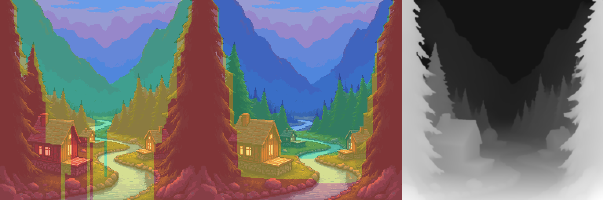
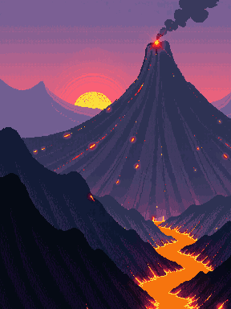
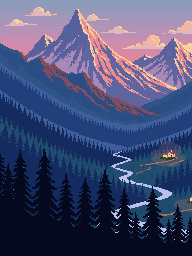

# Parallax backgrounds

This is a research note, not a feature: nothing here is a PixelKiln command, and the scripts are rough. PixelKiln can generate a scenic background as one flat picture. A parallax background is several layers that scroll at different speeds as the camera moves. This note covers the ways to build one and the ways to get the layers out of AI generators. It tests what can be tested on art we already have, without new generations, and records how a game that already uses PixelKiln builds its skyline (step 12).

Last updated 23 November 2026.

## Summary

| # | Approach | Tool or model | Result | Verdict |
|---|---|---|---|---|
| 1 | Check whether our backgrounds wrap horizontally | Our script | 9 of 10 benchmark backgrounds show a seam 1.3 to 5.6 times the normal column-to-column step | None of them loops as generated. |
| 2 | Make a flat picture loop with no new generation | Our script | A cut at matching columns, a crossfade snapped to the palette, or a mirror image all close the seam with no new colours | Keep the cut and the crossfade. Both repeat a picture with a clear focal point. |
| 3 | Split a flat picture into depth layers by distance from the sky colour | Our script | Recombines exactly, but the bands follow colour, not distance: the volcano is cut in half | Drop. |
| 4 | Split by a depth model's map | Depth Anything V2 Small, CPU, under 1.2 s a picture | Clean bands on the two PixelLab landscapes; a scene framed by tall trees cannot be split this way | Keep for open landscapes. |
| 5 | Pan a camera over the layers | Our script | Reads as depth. Outlines left behind and a plume that drags a strip of sky with it are the two faults | Keep, with a 2 px grow (step 6). |
| 6 | Grow each near layer upward | Our script | The stray outline lines are gone; the plume fault stays | Keep. |
| 7 | Scroll each row at its own speed instead of using layers | Our script | Good on ground that recedes to a horizon; shears anything tall | Keep for floors, water and valleys. |
| 8 | Measure atmospheric perspective by depth band | Our script | PixelLab's scenes get closer to the sky colour with distance; Retro Diffusion's and ComfyUI's do not | Push far layers back by hand: step 9. |
| 9 | Push a layer toward the sky colour with the palette held | Our script | Contrast down a third, no new colours | Keep. |
| 10 | Round layer offsets so they never move when the camera does not | Simulation | Rounding each layer's own position moves layers 3 to 25 times while the camera stands still; rounding the camera first moves them 0 times | Keep: round the camera first. |
| 11 | Read what LDtk does with a parallax factor | LDtk source | A layer moves on screen at 1 − factor of the camera, and is shrunk to that scale unless `parallaxScaling` is off | Export pixel art with `parallaxScaling: false`. |
| 12 | Build layers from separate silhouettes instead of cutting one picture | A game using PixelKiln, Godot 4; our script to replay it | Three generated silhouettes a biome, laid in overlapping runs in two hazed tiers over a shader sky; the layers only ever rise from where they were placed | Keep. The best route found: nothing is cut, nothing hidden has to be invented. |

## Ways to make the effect

There are six ways to make a background move with depth. Most games combine two of them.

**Layers composed from separate sprites.** Each layer is assembled in the engine from several transparent silhouettes, generated one at a time, laid side by side with overlap, flips and jitter. Nothing is cut from a finished scene, so nothing hidden behind a near layer has to be invented, and a layer is as wide as the run, not the generator's canvas. Step 12 is a working example.

**Separate layers.** Each depth is its own picture, scrolled at a fraction of the camera's speed. The far layer moves least. This is the standard approach and what every editor and engine supports directly. Sky, far range, middle ground, near ground and foreground occluders is the usual split, though no single source states it as a rule (unverified). An artist's guide uses "several layers" and stresses balance over a fixed count ([Pixelblog 23](https://www.slynyrd.com/blog/2019/11/12/pixelblog-23-parallax-scrolling)); Godot's tutorial uses five ([Godot 2D parallax](https://docs.godotengine.org/en/stable/tutorials/2d/2d_parallax.html)).

**Line scroll (raster scroll).** One picture, with each row scrolled at its own speed. The Mega Drive's video chip can scroll each line or each 8 pixel row of a plane on its own ([Sega Retro](https://segaretro.org/Sega_Mega_Drive/Scrolling)), and the SNES does it through HDMA ([nesdev HDMA examples](https://snes.nesdev.org/wiki/HDMA_examples)). It suits ground that recedes to a horizon, water and cloud bands. It shears anything tall (step 7).

**Pseudo-3D floors (Mode 7).** A floor plane is scaled differently on every line, so it recedes in perspective ([nesdev Mode 7](https://snes.nesdev.org/wiki/Mode_7_transform)). It belongs with racing and overhead games more than side-scrolling backgrounds, and is out of scope here.

**Depth-map displacement (2.5D).** One picture and a depth map; a shader moves each pixel by its depth, as in Facebook's 3D photos. Facebook's format fills the gaps that open with mobile-tuned heuristics, and learned fill tends to look "too smooth" ([Shih et al. 2020](https://arxiv.org/abs/2004.04727v3)). For pixel art, resampling each pixel breaks the grid and the filled gaps break the palette (our inference, not tested). Discrete layers keep both. Not pursued.

**Pointer or tilt parallax.** The same layers, driven by the mouse or the device's tilt in a menu or title screen instead of by a camera. The layers are the same; only the input differs.

## Ways to get the layers out of a generator

| Route | What it needs | Status here |
|---|---|---|
| Generate silhouettes and compose each layer from them in the engine | A few transparent landforms a biome, each fading out at its foot; placement rules in the game | Step 12: in use in a game. |
| Generate each layer on its own, with a transparent background | A prompt per layer; the layers must agree in palette, light and horizon | Not tested: needs paid generations. PixelLab's pixflux and Retro Diffusion both offer transparent output (survey below). |
| Generate one picture and split it with a depth model | A depth model and a fill for what the near layers hid | Steps 4 to 6. |
| A model that outputs layers directly | LayerDiffuse on SDXL, or Qwen-Image-Layered | Not tested. Neither is trained on pixel art. |
| A wide picture that wraps, then cut into layers | A provider's seamless option, or step 2 on the result | Retro Diffusion's `tile_x` is the only hosted seamless flag found. |

## 1. Do our backgrounds wrap?

**Question.** A parallax layer usually repeats sideways forever. Do the backgrounds PixelKiln already generates join up when placed end to end?

**Setup.** `parallax.py seam` on the ten scenic backgrounds from the [provider benchmark](./PROVIDER_BENCHMARK.md). The seam is the mean absolute RGB difference between the last column and the first. It is divided by the median difference between neighbouring columns inside the picture. A ratio near 1 means the join is no rougher than the picture itself.

**Result.**

| Picture | Seam | Inside | Ratio |
|---|---|---|---|
| ComfyUI alpine valley | 14.9 | 3.1 | 4.7 |
| ComfyUI volcanic pass | 8.2 | 1.7 | 4.8 |
| PixelLab alpine valley A | 11.6 | 6.1 | 1.9 |
| PixelLab volcanic pass A | 7.5 | 3.2 | 2.4 |
| PixelLab alpine valley B | 10.0 | 7.4 | 1.3 |
| PixelLab volcanic pass B | 4.8 | 2.1 | 2.3 |
| Retro Diffusion alpine valley A | 1.5 | 7.7 | 0.2 |
| Retro Diffusion volcanic pass A | 20.6 | 6.6 | 3.1 |
| Retro Diffusion alpine valley B | 43.1 | 7.7 | 5.6 |
| Retro Diffusion volcanic pass B | 22.7 | 6.3 | 3.6 |

The one low ratio is a coincidence of composition: Retro Diffusion's alpine valley A is framed by near-black trees down both edges.

**Verdict.** No benchmark background loops as generated, and none was asked to. A layer has to be made to loop, either when it is generated or afterwards.

## 2. Make a flat picture loop

**Question.** Can a picture that does not wrap be made to, without a new generation and without new colours?

**Setup.** `parallax.py loop` with three methods, on PixelLab's alpine valley A (256×256) and volcanic pass A (384×384):

- **Cut**: find the two columns at least 60% of the width apart where the right one best continues into the left, and crop to them.
- **Crossfade**: blend the last eighth of the width into the first eighth, drop the last eighth, and snap every blended pixel to the nearest colour already in the picture.
- **Mirror**: place the picture next to its mirror image.

**Result.**

| Method | Alpine valley | Volcanic pass | New colours |
|---|---|---|---|
| Cut | 1.9 → 1.0, columns 12 to 245 | 2.4 → 0.9, columns 50 to 384 | 0 |
| Crossfade | 1.9 → 0.8, 224 wide | 2.4 → 0.6, 336 wide | 0 |
| Mirror | 1.9 → 0.0, 512 wide | not run | 0 |



**Verdict.** The cut and the crossfade both make a loop that holds up at the join. The mirror closes the seam perfectly and shows its symmetry at once ([picture](../website/public/research/parallax/alpine-mirror.png)). All three expose the bigger problem: a scenic picture has a focal point, and a repeating peak or volcano is obvious. A loop wants a layer with no single landmark, which is also Pixelblog 23's advice. Landmarks belong on a layer of their own that does not repeat, or repeats rarely.

## 3. Split by distance from the sky colour

**Question.** Distant things in a landscape are closer to the sky colour. Is that enough to cut a flat picture into depth layers, with no model?

**Setup.** `parallax.py split <png> <out> 4`. Nearness is each pixel's RGB distance from the median colour of the top rows, median-filtered over 5×5. A 1D k-means finds three cut points. For each cut, a skyline is the first row in each column where nearness stays above the cut for three rows, kept in depth order. Layer *k* is everything from its skyline down. Where a nearer layer hid it, the gap is filled by reflecting the layer's own rows, so a revealed gap shows its texture rather than a smear. Composited at rest, the layers rebuild the source exactly; the script checks this.

**Result.** On the volcano (left), the bands follow colour: the lit flank of the volcano lands in one band and its shadowed flank in another, and the sun gets a band of its own.



**Verdict.** Drop. Colour is a poor stand-in for distance as soon as a scene has its own light.

## 4. Split by a depth model

**Question.** Does a monocular depth model give bands that follow the scene's real depth?

**Setup.** `depth.py` runs [Depth Anything V2 Small](https://github.com/DepthAnything/Depth-Anything-V2) (24.8M parameters, Apache-2.0; the larger checkpoints are CC-BY-NC-4.0) through Hugging Face Transformers 5.24 and PyTorch 2.15 on the CPU of a Mac. The picture is enlarged twice with nearest neighbour first, and the map is brought back to the picture's size. Then the same split as step 3, using the map as nearness.

**Result.** Under 1.2 s a picture. On both PixelLab landscapes the bands follow the scene: sky and distant range, the volcano or the far valley, the middle ridges, and the near ridges or trees.



Retro Diffusion's alpine valley A is the exception. Tall trees frame it from the top of the picture to the bottom on both sides. A skyline split assumes the near ground starts lower in every column than what is behind it, so it puts the whole frame in the nearest layer along with the full column above it, and most of each layer would have to be invented as the camera moves.



The script also counts the pixels a layer does not have but would show if the layer in front of it moved a twelfth of the picture's width (32 px on the volcano) relative to it. These are the pixels the fill makes up. With the depth map they are 15 to 40% of a layer on the PixelLab pictures, and 29 to 101% on the framed Retro Diffusion one. The count is an upper bound and depends on how far the camera travels.

**Verdict.** Keep, for open landscapes composed as layers already. A scene composed for one frame needs per-pixel layers and a real fill, which this note has not tried.

## 5. Pan a camera over the layers

**Question.** Do the depth-model layers read as depth when they move, and what breaks?

**Setup.** `parallax.py preview`: the four layers at factors 0.1, 0.3, 0.6 and 1.0 of the camera's movement, a view three quarters of the picture wide, a 96 px eased pan, 60 frames, offsets rounded as in step 10.

**Result.** It reads as depth: the volcano drifts against the sky and the near ridges sweep across it. Two faults show at the far end of the pan (left, before step 6):

- **Outlines left behind.** Each ridge's dark outline sits just above its skyline, so it was assigned to the layer behind. When the ridge moves, its outline stays put as a stray line.
- **The plume drags a strip of sky.** The depth model puts the smoke nearer than the sky behind it. Since a layer here is everything below a skyline, the strip of sky between the smoke and the volcano's slope moves with the volcano.






**Verdict.** Keep, with step 6. Floating things (smoke, clouds, birds, a moon) need to be cut out as their own sprites instead of riding a skyline.

## 6. Grow each near layer

**Question.** Does lifting each skyline a couple of pixels make the near shapes take their outlines with them?

**Setup.** `GROW=2` (and 4) on the split: each skyline moves up by that many rows before the layers are cut.

**Result.** At 2 px the stray lines are gone (picture above, right). 4 px looks no better, so the smaller grow is kept. The plume fault from step 5 is unchanged, as expected.

**Verdict.** Keep 2 px.

## 7. Scroll each row instead

**Question.** For a scene that is mostly ground receding to a horizon, is per-row scrolling a cheaper route than layers, with nothing to cut or fill?

**Setup.** `parallax.py line <png> <out> <horizon-row>`. Rows above the horizon move at 0.15 of the camera; below it the factor rises to 1.0 at the bottom row along a 1.5 power curve. Horizon at row 100 of 256 for the alpine valley and row 150 of 384 for the volcano.

**Result.** The alpine valley's forested floor and river sweep convincingly, with no gaps to fill. The volcano shows the limit: its cone and the near ridges stand across many rows, so each row slides by a different amount and they lean.


**Verdict.** Keep for floors, water, cloud bands and wide valleys. Combine it with layers: line-scroll the ground layer and move the tall shapes as layers.

## 8. Do generators already push the distance back?

**Question.** Atmospheric perspective makes distant layers lower in contrast and closer to the sky colour (a summary of several art guides, such as [Pinnguaq](https://pinnguaq.com/?p=1295); not checked against each). Do the generated backgrounds already do this, so the layers can be used as cut?

**Setup.** `parallax.py bands <png> 4 <depth.png>`: for each depth band, the standard deviation of luminance and the mean RGB distance from the sky colour.

**Result.** Distance from the sky colour, far band to near band:

| Picture | Band 0 | 1 | 2 | 3 | Colours |
|---|---|---|---|---|---|
| PixelLab volcanic pass A | 36.8 | 97.6 | 156.5 | 186.7 | 25 to 39 a band |
| PixelLab alpine valley A | 61.4 | 140.1 | 170.9 | 243.7 | 26 to 30 a band |
| Retro Diffusion volcanic pass A | 119.2 | 63.6 | 80.7 | 96.7 | 20 to 26 a band |
| ComfyUI volcanic pass | 58.0 | 36.8 | 66.4 | 73.5 | 11,204 to 17,903 a band |

Luminance contrast does not fall steadily with distance in any of them.

**Verdict.** PixelLab's scenes are lit for depth; Retro Diffusion's night canyon and the ComfyUI benchmark are not. The ComfyUI benchmark output was not reduced to a palette, so its colour counts are not comparable. Layers cut from a picture that is not lit for depth need pushing back by hand.

## 9. Push a layer back

**Question.** Can a layer be pushed toward the sky colour without adding colours?

**Setup.** `parallax.py haze <layer.png> <out.png> 0.35`: each pixel is mixed 35% toward the sky colour, then snapped to the nearest colour already in the layer.

**Result.** On the alpine valley's second layer, luminance contrast falls from 21.8 to 14.6, and the layer uses 19 of its 35 colours. No colour is new.


**Verdict.** Keep. The snap means the layer can only use colours it already has, so a push toward a sky colour the layer lacks would need the sky's colours added to its palette first.

## 10. Rounding

**Question.** Pixel art has to move in whole pixels. A layer at a factor of 0.3 is at a fractional position most of the time. Which rounding keeps layers from twitching when the camera stops?

**Setup.** `parallax.py jitter` simulates a camera that follows a character walking 120 px in 3 s, then stops and settles with a small overshoot: 360 frames at 60 fps. It counts the frames where a layer moves a pixel while the rounded camera does not. Two schemes: round each layer's own position, `round(cam × f)`; or round the camera, then take the layer from it, `floor(round(cam) × f)`.

**Result.**

| Factor | Moves while the camera is still, own rounding | Camera rounded first | Steps in all |
|---|---|---|---|
| 0.10 | 3 | 0 | 12 |
| 0.25 | 21 | 0 | 30 |
| 0.30 | 10 | 0 | 36 |
| 0.50 | 22 | 0 | 60 |
| 0.60 | 25 | 0 | 72 |

At a steady 1 px a frame, factors 0.25 and 0.5 step every 4 and 2 frames. Factors 0.3, 0.4, 0.6 and 0.75 step on an uneven rhythm, such as 3, 3, 4 for 0.3.

**Verdict.** Round the camera to whole pixels first and derive every layer from that. Prefer factors that are simple fractions (1/2, 1/4, 1/8) where an even rhythm matters. An artist's guide takes the same line from the other end: whole pixels per frame, and loop widths with many divisors, such as 96 ([Pixelblog 23](https://www.slynyrd.com/blog/2019/11/12/pixelblog-23-parallax-scrolling)).

## 11. What LDtk does with a parallax factor

**Question.** PixelKiln's LDtk export writes `parallaxFactorX: 0`, `parallaxFactorY: 0` and `parallaxScaling: true` on every layer ([`ldtk-export.ts`](../src/pipeline/ldtk-export.ts)). What would a non-zero factor do?

**Setup.** Read the LDtk source. `Camera.getParallaxOffsetX` returns `levelX * parallaxFactorX`, minus half the layer's width times the factor when scaling is off ([Camera.hx](https://github.com/deepnight/ldtk/blob/master/src/electron.renderer/display/Camera.hx)). `LayerDef.getScale` returns `1 - parallaxFactorX` when `parallaxScaling` is on and the factor is not zero ([LayerDef.hx](https://github.com/deepnight/ldtk/blob/master/src/electron.renderer/data/def/LayerDef.hx)). The schema gives the range as -1 to 1, default 0 ([JSON schema](https://ldtk.io/files/JSON_SCHEMA.json)).

**Result.** The layer is offset by the camera position times the factor, so on screen it moves at 1 − factor of the camera's speed. 0 is an ordinary layer. A positive factor is farther away, and 1 never moves. A negative factor is nearer than the level. With `parallaxScaling` on, the layer is also drawn at 1 − factor of its size, so a far layer shrinks.

The same layer, at a quarter of the camera's speed, in each tool:

| Tool | Setting | Source |
|---|---|---|
| LDtk | `parallaxFactorX: 0.75`, `parallaxScaling: false` | Source above |
| Tiled | `parallaxx: 0.25` | [Tiled manual](https://doc.mapeditor.org/en/latest/manual/layers/) |
| Godot 4 `Parallax2D` | `scroll_scale = Vector2(0.25, 1)` | [Godot class reference](https://docs.godotengine.org/en/stable/classes/class_parallax2d.html) |
| Phaser 3 | `setScrollFactor(0.25, 1)` | [Phaser API](https://docs.phaser.io/api-documentation/3.90.0/namespace/gameobjects-components-scrollfactor) |
| Unity | Scripted; no official parallax package found (unverified) | — |

**Verdict.** LDtk counts the other way from every other tool here: its factor is how much the layer follows the camera, not how fast it moves. An exporter has to write 1 − speed. It also has to set `parallaxScaling: false` for pixel art, or LDtk draws a far layer at a fraction of its size and off the pixel grid. Not yet checked in the LDtk editor itself.

## 12. Layers built from separate silhouettes

**Question.** Steps 3 to 6 cut one picture into layers and then have to invent what the near layers hid. A game that uses PixelKiln does the opposite: it composes each layer from separate sprites. How is it built, and what does it settle that splitting does not?

**Setup.** Read from the game's Godot 4 source (its backdrop and sky scripts and their tests), not run in the game. The game is top-down with an isometric look. The camera can pan north past the playfield's edge to look at the skyline, so the movement is mostly vertical. `parallax.py compose` replays the layout and the offsets outside the engine to check the numbers.

**Result.** How it is put together:

- **The art is silhouettes, not scenes.** Each biome has three landforms, generated one at a time from prompts of the form "distant <landform>, fading to nothing at its foot, hazy dusk lighting as if seen from far away, no ground plane, no sky, isolated landform only, transparent background". The first set was 224 to 256 px wide from PixelLab. They were later redrawn at 768×336 through Scenario, with the bottom 30% faded to transparent so the foot dissolves into the haze rather than ending on a hard edge. A forest or jungle biome has none: its treeline is its horizon.
- **A layer is a run of those silhouettes.** Each next sprite starts 72% of the way across the one before it, plus a random gap of up to 16 px, so the shapes overlap into one skyline instead of reading as a row of objects. Each sprite is flipped at random, the same one never comes twice in a row, and the feet jitter ±12 px. A seeded generator of its own places them, so adding a landform never moves anything else.
- **Two tiers.** The far tier stands 40 px deeper than the near one. Both are tinted toward the biome's dusk colour, the far one by 0.5 and the near one by 0.3. That is aerial perspective from a tint, not from the art (compare step 9). A dust storm pales both further.
- **The sky is not generated.** It is a shader: four flat colour bands for each time of day, each nudged toward a colour for the biome's air, with clouds, an overcast deck, or stars and a moon drawn over the bands. The same sky colour tints the playfield a little, so the two agree.
- **Movement.** The playfield moves 1:1 with the camera. The sky follows at 0.6, the far tier at 0.85 and the near tier at 0.92. The offset is `round((1 − rate) × clamp(viewTop − edge, −360, 0))`, where 360 px is how far the camera may look past the edge. The x offset is the same shape, centred on the playfield. Offsets are whole world pixels, and a world pixel is one texel at every zoom the game allows.
- **Anchored so nothing ever sinks.** At the southernmost view that can see the skyline, every layer sits exactly where it sits with parallax off; from there the layers only rise. So the game's rule that a tree's foot must stand in front of the mountains' base holds at every camera position.
- **The gap under a rising layer is ground, not sky.** A rising tier would open a strip above the playfield. A thin "skirt" of distant ground fills it: the biome's ground colour hazed 0.2 toward the horizon band, 24 px solid with a 12 px stepped fade above and below. Its top rides with the tier and its foot stays put. The sky's top rises while its foot stays fixed, so its bottom edge never shows. Nothing ever floats.
- **No loop.** The world is bounded, so each run is laid past both ends of the playfield by the most that layer can drift, `(1 − rate) × reach`, plus a 400 px margin. No side edge shows and no seam is needed (compare steps 1 and 2).
- **Heat shimmer** in hot biomes moves each band of three texel rows sideways by whole texels, stepped at the game's 8 fps animation rate: line scroll (step 7) used for an effect rather than for depth.

**Tuning.** The first prototype moved the layers at 0.3, 0.5 and 0.75, each tier with a 64 px skirt. The owner's review was that less could be more. At full headroom the old rates lift the sky, far and near layers 252, 180 and 90 px, against 144, 54 and 29 px for the current ones: `compose` gives the same figures from the formula. Close rates for the two tiers keep them together, so no band of sky opens between them, and one thin skirt replaced two wide ones that had read as haze between the layers and the playfield.

**Open check.** The offsets are rounded from the camera's own, unrounded view top. Step 10 found that this moves a layer while the camera is still, unless the camera's position is already whole pixels. The game snaps 2D transforms to pixels and snaps its smoothed view onto its target, but whether the view top is ever fractional while settling was not checked.

**Verdict.** Keep. This is the most practical route in this note. Generators are good at one isolated shape on a transparent background and poor at agreeing across several pictures. Composing layers from silhouettes asks them only for the first. Splitting a picture (steps 3 to 6) is still the route when there is one finished scene to animate.

## What other people are doing

- **Layered generation models.** [LayerDiffuse](https://arxiv.org/abs/2402.17113) (Apache-2.0) adds transparency to latent diffusion models and can generate several layers of one scene together. [Qwen-Image-Layered](https://github.com/QwenLM/Qwen-Image-Layered) (Apache-2.0, December 2025) decomposes a picture into a chosen number of RGBA layers, at 640 or 1024 px buckets; ComfyUI ships it with an fp8 variant because the default needs a lot of VRAM ([ComfyUI docs](https://docs.comfy.org/tutorials/image/qwen/qwen-image-layered)). Neither was trained on pixel art, and whether either fits a 12 GB card is unverified.
- **Seamless generation.** Circular padding in the convolutional layers makes a diffusion model's output wrap; ComfyUI has nodes for it, including X-only tiling ([ComfyUI-seamless-tiling](https://github.com/spinagon/ComfyUI-seamless-tiling)). It works on U-Net models such as SDXL and reportedly not on transformer models (unverified). The other route is to shift the picture by half its width and inpaint the seam.
- **Providers.** Retro Diffusion's API takes `tile_x` and `tile_y` booleans for seamless output and `remove_bg` for transparency ([api-examples](https://github.com/Retro-Diffusion/api-examples)); PixelKiln already exposes them as `tileX` and `tileY` ([Retro Diffusion](./RETRO_DIFFUSION.md)). Which styles honour them is unverified. PixelLab's v2 API has no parallax or seamless option that was found; pixflux offers a transparent background, a forced palette and an init image, up to 400×400 ([API](https://api.pixellab.ai/v2/llms.txt)). Scenario's tiling options are texture tools rather than scene tools ([help](https://help.scenario.com/articles/3312894507-scenario-texture-the-essentials)).
- **Classic hardware.** The Mega Drive has two scrolling planes with per-line scroll tables ([RasterScroll](https://rasterscroll.com/mdgraphics/graphical-effects/row-column-scrolling/)). Games such as *Thunder Force IV* fake many layers from them by scrolling groups of lines at different speeds.

## What has not worked

- Splitting by colour (step 3). A scene's own lighting moves colours around more than distance does.
- Skyline layers for a scene framed by tall near objects (step 4), and for anything floating (step 5).
- Line scroll on tall shapes (step 7).

## What is next

- **A recipe for silhouette sets** (step 12): a prompt pattern for distant landforms with faded feet, three a biome, sharing a palette and a haze colour, plus a preview that lays them in runs.
- **Generate the layers on their own.** Sky, far range, middle ground and near ground as separate transparent pictures, each wide and seamless, from PixelLab pixflux and Retro Diffusion with `tile_x`. Compare against the depth-split route on palette agreement, horizon agreement and cost. This needs paid generations.
- **Per-pixel layers and a real fill.** For framed scenes and floating things: cut by depth per pixel, not per column, and fill what the near layers hid with an inpainting model held to the palette.
- **Try Qwen-Image-Layered** on the PixelLab volcano, on the 12 GB card, and snap its layers back to the source palette.
- **An LDtk export with parallax.** Write each layer's factor as 1 − speed, with `parallaxScaling: false`, and open the result in the LDtk editor to check the direction.
- **A manifest shape for a parallax set.** One asset per layer, sharing a palette, a width and a horizon row, with its speed recorded for export.

## Running the scripts

They need numpy, pillow and scipy; `depth.py` also needs torch and transformers.

```bash
# How badly each picture wraps.
python3 research/scripts/parallax.py seam <png>...

# Make one wrap: cut, crossfade or mirror. Also writes <out>.twice.png.
python3 research/scripts/parallax.py loop <png> <out.png> cut

# Depth map, brighter is nearer.
python3 research/scripts/depth.py <png> <depth.png>

# Four layers along depth skylines, grown 2 px. Writes layer0..3.png, bands.png and nearness.png.
GROW=2 python3 research/scripts/parallax.py split <png> <out-dir> 4 <depth.png>

# Pan a camera over the layers.
python3 research/scripts/parallax.py preview <out.gif> 0.1,0.3,0.6,1.0 <out-dir>/layer0.png <out-dir>/layer1.png <out-dir>/layer2.png <out-dir>/layer3.png

# Per-row scroll below a horizon row.
python3 research/scripts/parallax.py line <png> <out.gif> 100

# Contrast and sky distance per depth band; push a layer back.
python3 research/scripts/parallax.py bands <png> 4 <depth.png>
python3 research/scripts/parallax.py haze <layer.png> <out.png> 0.35

# Rounding schemes.
python3 research/scripts/parallax.py jitter

# Layers composed from separate silhouettes; the camera pans north to the skyline. Rates are sky,far,near.
python3 research/scripts/parallax.py compose <out.gif> 0.6,0.85,0.92 7 <silhouette.png>...
```
