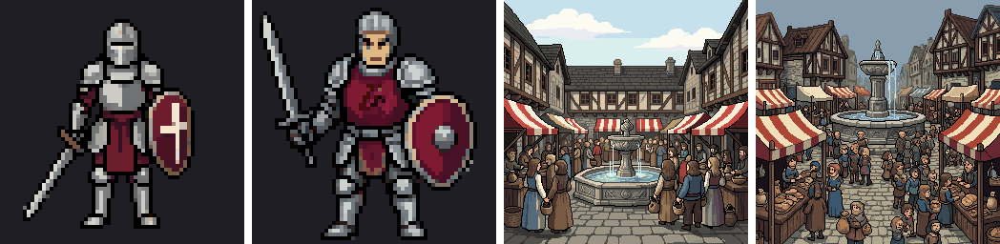

# Set up Retro Diffusion

Retro Diffusion support is experimental. Authenticated RD Fast and RD Plus
single-candidate stills have passed from the provider's cost quote through
validated download, provenance, and recovery. Multi-candidate, tileset, GIF,
and PNG spritesheet paths have integration tests but still need representative
paid live runs.

[Visit Retro Diffusion](https://www.retrodiffusion.ai/) or open the
[official API guide](https://www.retrodiffusion.ai/app/guide/api).

## Add the credential

Create `.env.local` beside `pixelkiln.manifest.json`:

```dotenv
RD_API_KEY=...
```

Keep this file out of Git. PixelKiln also reads the variable from the current
process environment.

## Select Retro Diffusion

Set the top-level provider when the whole manifest uses Retro Diffusion. In a
mixed manifest, set `"provider": "retrodiffusion"` on the relevant styles.
Keep service-specific choices under the provider namespace:

```jsonc
{
  "name": "my-game",
  "provider": "retrodiffusion",
  "styles": {
    "props": {
      "generator": "map",
      "outDir": "assets/generated/props",
      "providerOptions": {
        "retrodiffusion": {
          "promptStyle": "rd_plus__default",
          "numImages": 4,
          "removeBg": true
        }
      }
    }
  },
  "assets": {
    "anvil": {
      "prompt": "a compact blacksmith anvil",
      "width": 64,
      "height": 64
    }
  }
}
```

Run the free checks before a paid request:

```bash
pixelkiln doctor --dry-run
pixelkiln plan
pixelkiln gen --budget 0.1
```

Copy the exact USD estimate from `plan` into `--budget`. Before PixelKiln sends
the paid request, it asks Retro Diffusion for a free authoritative quote and
stops if that quote exceeds the remaining budget.

For still-image styles, `style.quality` can add the same closed-palette,
native-grid, and named-approval gate used by every provider. It does not change
the Retro Diffusion quote or request. Tilesets and animation are excluded until
refinement can preserve their roles and frames. See
[Manifest quality profiles](./MANIFEST.md#quality-profiles).

## Match the style to the workflow

| PixelKiln generator | Retro Diffusion selector | Output |
|---|---|---|
| `map` or `pixflux` | A normal RD still style such as `rd_lite__default`, `rd_fast__default`, `rd_plus__default`, or an environment style | 1 to 16 PNG candidates; 1 to 4 on RD Lite and RD Core |
| `tiles` | `rd_tile__*` | One PNG tileset or tile asset |
| `animation` | `rd_animation__*` or `rd_advanced_animation__*` | Animated GIF or PNG spritesheet |

The provider's style catalog can change. Use its live catalog when choosing a
selector instead of assuming an example name will remain available.

Useful options under `providerOptions.retrodiffusion` include:

- `numImages`: 1 to 16 still candidates, or 1 to 4 on RD Lite and RD Core
- `removeBg`: background removal for stills
- `framesDuration`: 4, 6, 8, 10, 12, or 16 for animation
- `returnSpritesheet`: PNG spritesheet instead of the default GIF
- `tileX` and `tileY`: seamless axes for supported still styles
- `extraPrompt`: outside texture for `rd_tile__tileset_advanced`

RD Pro, RD Core and user still styles accept up to nine reference images, and
RD Lite accepts one. Advanced
animation and tile modes have narrower input rules. PixelKiln validates those
rules during planning. See [Manifest fields](#manifest-fields) below for complete
examples.

## Manifest fields

Retro Diffusion maps `map` and `pixflux` to still generation, `tiles` to its
tileset family, and `animation` to GIF or PNG-spritesheet generation. Durable
sources and lock outputs record `image/png` or `image/gif`, so recovery retains
the correct extension and validates the correct structure.

```jsonc
{
  "name": "my-game",
  "provider": "retrodiffusion",
  "styles": {
    "base": {
      "generator": "map",
      "outDir": "assets/generated/base",
      "providerOptions": {
        "retrodiffusion": {
          "promptStyle": "rd_plus__default",
          "numImages": 4,
          "removeBg": true
        }
      }
    }
  },
  "assets": {
    "anvil": { "prompt": "a compact blacksmith anvil" }
  }
}
```

`promptStyle` accepts a live Retro Diffusion still-style selector,
`numImages` accepts 1–16 candidates (1–4 on RD Lite and RD Core), and `removeBg` overrides
`noBackground`. The Retro Diffusion API accepts 16–512px output. Selected
styles can impose smaller limits. RD Pro, RD Core and user styles accept up to
nine reference images, and RD Lite accepts one. Costs are
planned in USD and checked again with Retro Diffusion's free authoritative
quote endpoint before the paid request is sent. Authenticated single-candidate
RD Fast, RD Plus, RD Lite and RD Core paths have passed from quote through
validated output and recovery, including RD Lite with a reference image.
Multi-candidate, tileset, GIF, and spritesheet paths remain mock-tested, so the
adapter is still experimental.

Additional Retro Diffusion options are:

| Option | Meaning |
|---|---|
| `framesDuration` | Animation duration: `4`, `6`, `8`, `10`, `12`, or `16`. |
| `returnSpritesheet` | Return a PNG spritesheet instead of an animated GIF. |
| `extraPrompt` | Outside texture description for `rd_tile__tileset_advanced`. |
| `tileX` / `tileY` | Make supported still styles seamless on either axis. |

An animation style is declared explicitly:

```jsonc
{
  "generator": "animation",
  "size": 64,
  "outDir": "assets/generated/animations",
  "providerOptions": {
    "retrodiffusion": {
      "promptStyle": "rd_animation__any_animation",
      "numImages": 1,
      "framesDuration": 8,
      "returnSpritesheet": false
    }
  }
}
```

The default output is `<assetId>.gif`; `returnSpritesheet: true` produces
`<assetId>.png`. Advanced animation styles require exactly one `styleImages`
input. PixelKiln currently limits animation batches to one so selection never
loses the output media type.

For a Wang-style tileset sheet:

```jsonc
{
  "generator": "tiles",
  "tileSize": 32,
  "outDir": "assets/generated/tiles",
  "providerOptions": {
    "retrodiffusion": {
      "promptStyle": "rd_tile__tileset",
      "numImages": 1
    }
  }
}
```

`rd_tile__tileset_advanced` accepts `extraPrompt` and up to two style images;
`rd_tile__tile_variation` requires one style image. Provider-specific size and
input constraints are checked during the free planning phase.

## RD Lite, measured

RD Lite is Retro Diffusion's newest still model, launched in November 2026. It
runs the same style names as RD Core on a lighter model, at a flat $0.05 an
image against RD Core's $0.10. It replaced RD Fast on Retro Diffusion's website;
RD Fast stays available through the API at its old price. PixelKiln needs no
new setting for it: set `promptStyle` to an `rd_lite__*` style.

The live style catalog (`GET /v2/styles/selector`, 23 November 2026) lists 15
RD Lite styles: `default`, `painterly`, `simple`, `fantasy`, `horror`, `scifi`,
`isometric`, `topdown`, `platformer`, `dungeon_map`, `spritesheet`,
`hexagonal_tiles`, `fps_weapon`, `typography` and `ui_panel`. RD Core has the
same styles plus `inventory_items`; RD Lite has no `inventory_items`, and a
quote for it fails.

| Style | Width and height |
|---|---|
| `default` to `platformer` | 16–512 px, any aspect ratio |
| `fps_weapon`, `typography` | 64–512 px |
| `dungeon_map`, `spritesheet`, `hexagonal_tiles` | 128–512 px |
| `ui_panel` | 256–512 px (RD Core: 256 px only) |

Retro Diffusion's announcement and API README give RD Lite's floor as 12 px;
the live catalog says 16 px, which is PixelKiln's floor for every Retro
Diffusion style. The free quote endpoint priced every RD Lite request at $0.05
an image whatever the size, with or without `remove_bg`, `tile_x`, a palette or
reference images. It does not check sizes or reference counts, so a quote
alone does not prove a request is valid. Asked for 5 images, it priced 4: RD
Lite and RD Core return at most 4 a request, and PixelKiln now refuses a larger
`numImages` on them during planning instead of planning a set it will not get.
The README says RD Lite takes one reference image and RD Core up to nine;
PixelKiln enforces both. RD Lite does not tile, according to the README.

One run through `pixelkiln gen` on 23 November 2026, `seed` 4242, one image
each, billed $0.50 in all: six RD Lite images at $0.05 and two RD Core images at
$0.10. The manifest and lockfile are in
[`benchmarks/provider-rd-lite`](../benchmarks/provider-rd-lite).

| Request | Result |
|---|---|
| A knight, 64×64, `rd_lite__default` and `rd_core__default`, `removeBg` | Both clean, transparent sprites. RD Core drew a face and more armour detail. |
| A busy market square, 256×256, RD Lite and RD Core | Both full scenes with stalls, a fountain and a crowd. RD Core's has more depth and smaller figures. |
| A potion, 16×16, RD Lite | A readable bottle at the smallest size the catalog allows, with 51 colours in 256 pixels. |
| A ranger, 64×128, RD Lite | A clean, tall, full-body figure. |
| A forest with a waterfall, 480×270, RD Lite | A finished widescreen scene. |
| A chest, 64×64, RD Lite with one reference image of a green chest | A chest of the same shape, but brown and gold: the reference's colours did not carry over. |



One sample per row, so these are observations, not rates. All eight finished
in 31 seconds of wall time, submitted together; single-image timings were not
measured.

## Current operational limits

The adapter can report `balance`, but it does not yet expose Retro Diffusion
account listing, adoption, salvage, tagging, or deletion. Paid output still has
PixelKiln lockfile provenance and local cache recovery.

The lockfile records a durable `retrodiffusion://` result reference instead of
Retro Diffusion's temporary signed storage URL or an inline image. `fetch`
resolves that reference to the current result URL and downloads it immediately.
`restore` uses the validated local content cache first; if the cache is missing,
it needs `RD_API_KEY` to refresh the task result. Candidate image URLs are used
only by the local picker and are not written to the lockfile.

The PixelKiln manifest allows width and height from 16 to 8192 pixels, but
Retro Diffusion output is 16 to 512 pixels, and PixelKiln refuses a larger size
while planning. Many styles have narrower limits. In the live catalog on 23
November 2026, `rd_plus__environment` takes 64 to 512 pixels and
`rd_tile__scene_object` takes 64 to 384. Build very large scenes from separate
terrain, background, building, landmark, and foreground layers.

The [environment benchmark](./PROVIDER_BENCHMARK.md) found clean transparent,
low-color Retro Diffusion cutouts, while PixelLab followed the more complex
building prompts more closely. Read the [provider comparison](../PROVIDERS.md)
before committing to a large batch.

Retro Diffusion publishes its API examples and pricing formulas in the
[official API repository](https://github.com/Retro-Diffusion/api-examples).

On 2026-11-23 the live quote endpoint returned a flat price per image for each
style family, the same at every size tried and with or without `removeBg` and
`tileX`. The published pixel-count formulas no longer match those quotes. The
quote multiplies by `numImages`. PixelKiln plans with these prices:

| Style family | USD per image |
|---|---|
| RD Fast (`rd_fast__*` and older `*:rd_flux` ids) | 0.03 |
| RD Lite (`rd_lite__*`) | 0.05 |
| RD Plus (`rd_plus__*`, including `rd_plus__environment`), RD Mini (`rd_mini__*`) | 0.06 |
| Single tiles, tile objects, and scene objects (`rd_tile__*`) | 0.06 |
| Tilesets (`rd_tile__tileset`, `rd_tile__tileset_advanced`) | 0.10 |
| RD Core (`rd_core__*`) | 0.10 |
| RD Pro (`rd_pro__*`) | 0.18 |
| Animation (`rd_animation__*`) | 0.07, or 0.25 for `any_animation` and `8_dir_rotation` |

If a later quote comes back above the planned price, PixelKiln refuses the job
before the paid request and reports both amounts.
