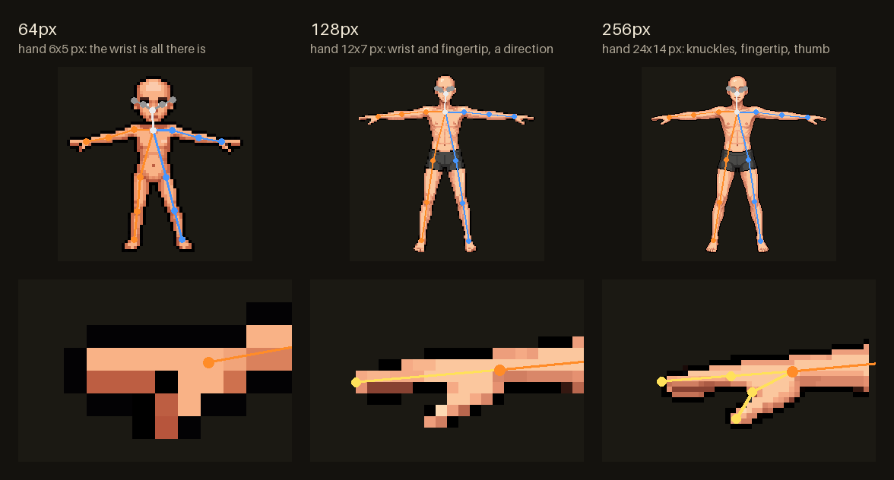
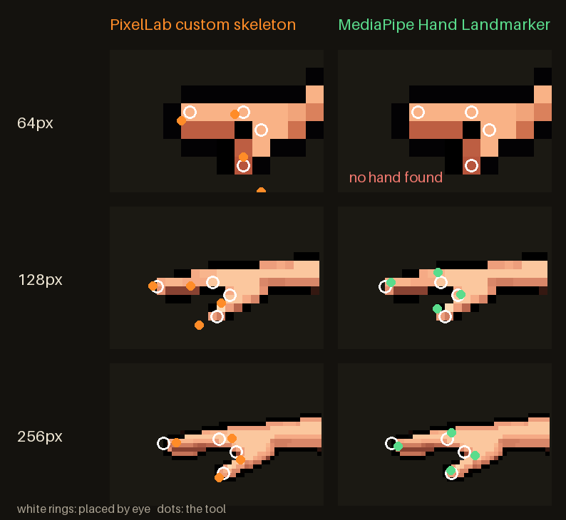
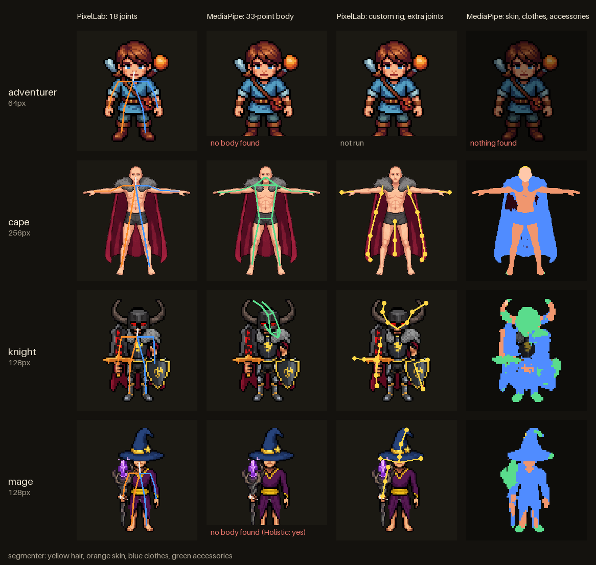

# Skeletons and rigging

A skeleton is where a character's joints are in one frame: 18 points, from the
nose and ears down to the ankles. PixelKiln uses that skeleton in several
places, and they share it. It is estimated from a sprite, corrected by hand,
used to pose an animation, used to find a hand to pin a sword to, used to pose
AI-drawn frames, and used to rig a 3D model. This guide shows how those pieces
connect. Each section links to the full reference.

| You want to | Use | Costs |
|---|---|---|
| Get the skeleton of a sprite | `pixelkiln estimate-skeleton`, or the gallery | 0.1 generation per estimate |
| Check or correct a skeleton | `pixelkiln skeleton-preview`, then edit the JSON | Nothing |
| Animate a sprite from poses you set | an `animate-skeleton` revision | 2 to 4 generations a loop |
| Animate a character from a sentence or template, posed through its 3D skeleton | a `skeleton-v3` loop | 3 generations a direction (measured) |
| Pin a held item to the hand in every frame | `pixelkiln anchors`, then an `attach` layer | 0.1 a frame to anchor, nothing to place |
| Pose frames drawn on your own GPU | OpenPose maps with ComfyUI | Nothing (in progress) |
| Rig a 3D model made from the sprites | the 3D research | Research, not a command |

## The 18 joints

PixelLab names a skeleton's joints with 18 labels, one point each:

| Joint | PixelLab label | OpenPose (COCO-18) index |
|---|---|---|
| nose | `NOSE` | 0 |
| neck | `NECK` | 1 |
| right shoulder, elbow, wrist | `RIGHT SHOULDER`, `RIGHT ELBOW`, `RIGHT ARM` | 2, 3, 4 |
| left shoulder, elbow, wrist | `LEFT SHOULDER`, `LEFT ELBOW`, `LEFT ARM` | 5, 6, 7 |
| right hip, knee, ankle | `RIGHT HIP`, `RIGHT KNEE`, `RIGHT LEG` | 8, 9, 10 |
| left hip, knee, ankle | `LEFT HIP`, `LEFT KNEE`, `LEFT LEG` | 11, 12, 13 |
| right eye, left eye | `RIGHT EYE`, `LEFT EYE` | 14, 15 |
| right ear, left ear | `RIGHT EAR`, `LEFT EAR` | 16, 17 |

`ARM` is the wrist and `LEG` the ankle. The two lists name the same 18
points, so a pose made for one can be converted to the other. They store it
differently:

- **PixelLab** stores each joint as `{label, x, y, z_index, depth}`. `x` and
  `y` run from 0 to 1 across the image, and `z_index` says what is drawn in
  front. A keypoints file holds the starting pose as `firstFrameKeypoints` and
  3 to 15 more as `frames`; `src/skeleton.ts` validates it.
- **OpenPose** draws the joints as an image: coloured limbs on black, one
  colour per limb. Left and right are told apart by colour, so a map must keep
  the figure's left side in the left colours in every frame.

"Right" is the character's own right. On a sprite facing the viewer, its right
hand is on the left of the picture.

## How much skeleton a sprite can carry

The 18 joints stop at the wrist. Whether a hand needs more depends on how many
pixels the hand has, so the right skeleton grows with the sprite. Measured on two
PixelLab characters of the same kind, a native 64px figure and a native 256px
one, with the 256px drawing also reduced to 128px. Each skeleton was estimated
with `estimate-skeleton`. The yellow hand points were read off the drawing by
eye: no tool estimates them yet.



| Sprite | Hand, past the wrist | What the hand can carry | Skeleton that fits | What it is good for |
|---|---|---|---|---|
| 64px | 6 × 5 px, 25 pixels | the wrist | the 18 joints | Animation from poses; held items pinned a little past the wrist. Fingers are one or two pixels; there is nothing to pose. |
| 128px (the 256px drawing reduced) | 12 × 7 px, 55 pixels | the wrist and the fingertip: which way the hand points | 18 + 1 point per hand | Turning a held sword or torch the way the hand points. |
| 256px | 24 × 14 px, 214 pixels; the four fingers drawn as one block, the thumb apart | the wrist, the knuckles, the fingertip, the thumb's base and tip | 18 + 4 points per hand | Closing a hand around a handle; a 3D rig with a hand, a thumb and one finger chain. |
| Larger, with each finger drawn | not measured | every finger joint | 18 + 21 points per hand (OpenPose, MediaPipe); 15 finger bones per hand (Godot, VRM) | Hand poses and gestures. |

Notes from the measurement:

- **Even 256px does not draw fingers apart.** The 256px figure's hand is a palm,
  one block of fingers and a thumb. A 21-point hand would put four of its five
  fingers on the same pixels, so a four-point hand is what a 256px sprite can
  honestly carry.
- **The four points map onto the bigger skeletons.** In the 21-point hand of
  OpenPose and MediaPipe they are the wrist (0), the thumb's base (2) and tip (4),
  the middle finger's knuckle (9) and its tip (12). In a 3D rig they are the hand
  bone, the thumb bones, and one finger chain that the other fingers can copy.
- **128px and 256px are where hands start to matter:** characters made as the
  source for a 3D model, such as the 256px research bodies the 3D work starts
  from, and any character that grips a sword, a staff or a shield.

**Not built yet.** PixelLab's `/estimate-skeleton` returns the 18 joints and no
hand points, `animate-skeleton` takes only those 18 labels, and a held item is
placed a little past the wrist. Two tools can find hand points; the next
section compares them. PixelKiln does not call either of them yet.

## Finding hand points: PixelLab or MediaPipe

Two tools were tried on the three figures above (November 2026), and scored
against the hand points placed by eye:

- **PixelLab's custom skeleton** (`estimate_custom_skeleton`, an MCP tool,
  beta). It builds a rig of any shape for a sprite up to 256×256. Asked about a
  figure "gripping a sword handle", it added a hand point, one or two finger
  points and a thumb base and tip to each hand by itself. 1 generation for up to
  8 frames.
- **MediaPipe's Hand Landmarker** (Google, Apache-2.0, version 1.2.3, the
  `hand_landmarker.task` model). It runs on your own machine, free and offline,
  and returns 21 points a hand. It was trained on photographs. Its Pose
  Landmarker was tried as well.

Each figure went to PixelLab as it is. MediaPipe got it on white and on mid
grey, at its own size and enlarged 2, 4, 8 and 16 times, and also as a close
crop of the hand alone. Error is the average distance from the four
hand-placed points (knuckles, fingertip, thumb base, thumb tip), in the
sprite's own pixels and as a share of the hand's length from wrist to
fingertip.



| Sprite | PixelLab custom skeleton | MediaPipe Hand Landmarker |
|---|---|---|
| 64px | 1.2 px, 25% of the hand: always answers, but the points sit one or two pixels apart and the thumb tip falls below the hand | No hand found at any enlargement, on either ground |
| 128px | 1.7 px, 13%: the thumb tip lands below the drawing | 0.8 to 1.2 px, 7 to 9%, at its own size and 2×; no hand found at 4× or more |
| 256px | 2.4 px, 10% | 1.7 to 2.3 px, 7 to 9%, found at every enlargement on both grounds |

How each handles the size of a sprite:

- **PixelLab works at the sprite's own size,** up to 256×256, and always
  returns a whole rig. The rig is built fresh on every call: the joint names
  and the number of finger points changed between the three calls, and so did
  which hand it called "near", so a script has to match hands by position, not
  by name. Below 128px it still returns hand points, but there is too little
  hand for them to mean much.
- **MediaPipe shrinks or stretches every picture to its own fixed input:**
  192×192 and 224×224 for the hand bundle, 224×224 and 256×256 for pose
  ([hand](https://developers.google.com/edge/mediapipe/solutions/vision/hand_landmarker),
  [pose](https://developers.google.com/edge/mediapipe/solutions/vision/pose_landmarker)).
  Enlarging a sprite adds no detail, so it does not help. At 128px the hand
  disappeared at 4× and above, and at 256px the error grew slightly with each
  enlargement. A crop of the hand alone was not found once enlarged; the hand
  detector needs the arm and body around it.
- **MediaPipe's Pose Landmarker found the figure at every size,** 64px
  included, at every enlargement. Its hand points are only the wrist, thumb,
  index and pinky: enough for a direction, not for a grip.

Which to use:

| Sprite | Use | Why |
|---|---|---|
| 64px | Neither | MediaPipe finds no hand; PixelLab's points are close to a guess. The 18 joints are enough. |
| 128px | MediaPipe at the sprite's own size, PixelLab when it finds nothing | MediaPipe is closer when it answers, but it does not always answer. |
| 256px | MediaPipe | Closest, found every time, free and offline. |

Limits of the trial: one figure per size, facing south, in a T-pose with open
hands, which is the easiest case. The hand-placed points are themselves only
good to about a pixel. Clothed or armoured characters, a hand already closed on
a handle, and other directions were not tried. Everything is in
`website/art/skeleton-resolution/` (`mediapipe-trial.py`, `score-hands.py`,
both tools' raw results) and can be run again.

## Estimate one

```bash
pixelkiln estimate-skeleton hero-south.png --out poses/hero-wave.json --frames 8
```

This sends the sprite to PixelLab's `/estimate-skeleton` and writes a
keypoints file: the estimated pose, and `--frames` copies of it (3 to 15) to
move into a motion. The image must be square at 16, 32, 64, 128 or 256
pixels. It is a direct call on your account, outside the plan and the budget,
like `balance`. See [`estimate-skeleton`](./CLI.md#estimate-skeleton).

In the gallery (`pixelkiln gallery --edit`), a sprite's **+ Skeleton
animation** form estimates the skeleton and declares the revision in one step.
It asks before each estimate, and `--estimate-limit` caps how many a session
makes. See [`gallery`](./CLI.md#gallery), under `--estimate-limit`.

## Check and correct it

```bash
pixelkiln skeleton-preview poses/hero-wave.json --from hero-south.png
```

This draws every pose over the sprite on one sheet: the starting pose at full
strength, each frame after it over a dimmed copy. Right-side bones are
orange, left-side blue, the head and spine white, and the eyes and ears grey.
It runs locally and
costs nothing.


Check the starting pose before anything else. PixelLab redraws that frame
first to learn the sprite's colours and background. A starting pose that does
not match the picture gives no error, but it degrades every frame drawn from
it. Read the sheet carefully on a small sprite: the lines from the nose to the
eyes and ears run up toward the top of the head, and an earlier version of the
sheet drew them in the same orange and blue as the arms. On a 64px adventurer
with a sword hilt and an orb behind its head, they looked like both arms raised,
although the estimate had the arms down correctly. The sheet now draws the eyes
and ears in grey. See
[`skeleton-preview`](./CLI.md#skeleton-preview).

## Animate from poses

An `animate-skeleton` revision sends a sprite and a keypoints file to
PixelLab's `/animate-with-skeleton-v3`. You get one frame per pose:

```json
"hero.wave": {
  "prompt": "waving",
  "revision": {
    "mode": "animate-skeleton",
    "from": "hero",
    "keypointsFile": "poses/hero-wave.json",
    "direction": "south",
    "description": "a young adventurer in a blue tunic"
  }
}
```

`prompt` is the motion's short label, and `description` is what the character
looks like; PixelLab requires both. Eight frames at 64×64 billed 3 generations.
PixelLab's own anchors are 3 frames for 2 generations and 15 frames for 4.
See [Skeleton-driven animation](./REVISIONS.md#skeleton-driven-animation).

## Custom rigs in PixelKiln

The 18 joints stop at the wrist, the head and the hips. For a staff, a cape, a
hat or a tail, build a custom rig:

```bash
pixelkiln estimate-skeleton mage.png --custom \
  --description "a wizard in a purple robe holding a long staff" \
  --action "swinging the staff overhead" --out poses/mage-rig.json
```

PixelLab's `/estimate-custom-skeleton` (beta, 1 generation, about a minute)
builds the rig from the picture, the description and the action, and the file
keeps it beside the poses: each joint's name, its parent, its side, and the
humanoid joint it stands for, if any. `skeleton-preview` draws it joint to
parent, the body in its usual colours and everything else in yellow. An
`animate-skeleton` revision with that file sends the rig, so the staff moves
with the hand; add `writeMotionFrames` to have PixelLab write the motion from
the prompt instead of posing every frame. See
[Custom rigs and written motion](./REVISIONS.md#custom-rigs-and-written-motion).

What the rig contains depends on what it is told; on the figures in
[Props, capes and hats](#props-capes-and-hats) it added cape chains, a sword,
a shield, horns, a staff and a hat. Joint names change from one estimate to the
next, so keep the file you animate from, and edit it rather than estimating
again.

## Animate through the character's own skeleton

A `skeleton-v3` loop uses a different skeleton: the 3D one PixelLab stores
with a character it drew on the v3 engine. You give it a template (`walk`) or
a sentence, and PixelLab poses that stored skeleton for you; you never edit
joints:

```json
"mira.wave": {
  "prompt": "cheerfully waving both arms overhead",
  "animation": { "of": "mira", "mode": "skeleton-v3", "frames": 8, "directions": ["south"] }
}
```

It needs a character PixelLab stored a skeleton for. A `v3` base has one; a
`standard` base does not, and PixelLab refuses it. Measured: 3 generations a
direction. See [Characters](./CHARACTERS.md#animations).

## Pin items to a hand

A held item in a paperdoll is a sprite placed on the hand in every frame, and
the skeleton is how the hand is found:

```bash
pixelkiln anchors hero.sword
```

This estimates the skeleton of every frame the item is held in, at 0.1
generation each, and writes an anchors file. The item goes a little past the
wrist, along the forearm. It is paid once per character: every item the
character holds reads the same file, and a rerun estimates only new or changed
frames. Placing the items costs nothing. On the site's knight, 56 frames cost
5.6 generations to anchor, and the sword stayed in the right hand in all 56.
See [Paperdoll layers: held items](./PAPERDOLL.md#held-items-and-accessories).

## Pose frames you draw yourself

With ComfyUI on your own machine, an OpenPose ControlNet poses each frame from
a pose map, the image form of the same 18 joints. Work on a recipe for this is
in progress ([#79](https://github.com/gfargo/pixelkiln/issues/79)); the maps
must keep scale, camera and ground line fixed across a set. See
[Set up ComfyUI](./COMFYUI.md).

## Rig a 3D model

The 3D research builds a mesh from a character's eight drawn directions,
binds it to a skeleton, and drives it with motion. It is research, not a
command yet. See [Research: 3D models from sprites](./RESEARCH_3D.md).

## Props, capes and hats

A body skeleton says nothing about what a character carries or wears. For an
animation or a 3D rig, those parts need joints of their own, and the joints say
how each part may move: a staff or a sword is rigid and follows the hand, while
a cape or a robe hangs from the shoulders and should bend. Four figures were
tried with three tools in November 2026:

- **PixelLab's 18-joint estimate** (`estimate-skeleton`, 0.1 generation).
- **PixelLab's custom skeleton** (`estimate_custom_skeleton`, an MCP tool in
  beta, 1 generation). Given a short description and an action, it builds a rig
  for whatever is in the picture.
- **MediaPipe** (Google, Apache-2.0, version 1.2.3, free and on your own
  machine): its Pose Landmarker (33 body points, a 3D position for each, and a
  mask of the body), its Holistic Landmarker (body, both hands and the face in
  one call), and its multiclass segmenter (`selfie_multiclass_256x256`: hair,
  skin, clothes, accessories).

The figures: the adventurer from earlier (64px, a sword and a pack on its back),
the 256px research body in a cape, and the paperdoll's knight (greatsword,
shield, horned helm, cape) and mage (staff, robe, pointed hat), both about 92px
on a 128px canvas.



What each tool did:

| Figure | PixelLab, 18 joints | MediaPipe, body | PixelLab, custom rig | MediaPipe, segmenter |
|---|---|---|---|---|
| Adventurer, 64px | Right: arms down at its sides | Found no body | Not tried | Found nothing |
| Cape, 256px | Right | Right; its body mask covered 51% of the sprite and left out the cape | Three cape chains (five joints down each side from the shoulders, three down the middle from the hips) and a point for each hand | Cape marked as clothes, body as skin |
| Knight, 128px | Right | Wrong, a tangle around the helm, with a body visibility of 0.44 | A three-joint sword from the right wrist, a shield top and bottom from the left, three joints up each horn, a four-joint cape chain | Helm and much of the sword and shield marked as accessories, the horns as skin |
| Mage, 128px | Right | Pose Landmarker found no body; Holistic found 33 points | A three-joint staff from the right wrist, three joints up the hat and one at each side of the brim | Most of the staff marked as accessories, the hat and robe as clothes |

What follows from it:

- **For props and capes, PixelLab's custom skeleton is the tool.** It named
  every prop it was told about and placed sensible chains on them: rigid items
  hang from the wrist they are held in, and capes hang from the shoulders. It
  needs a description and an action, the rig's joint names change between
  calls, and it costs a generation per eight frames.
- **MediaPipe knows bodies, not props,** and it was trained on photographs. On
  bare and lightly dressed figures at 256px it was as good as PixelLab and free.
  On the knight it was confidently wrong in shape but not in its own score: the
  body points' average visibility was 0.44, against 0.99 to 1.00 on the good
  figures, so check visibility and discard a body below about 0.9.
- **Its masks tell a game what may bend.** The Pose Landmarker's body mask
  leaves out a cape, and the multiclass segmenter separates clothes from
  accessories. Pixels inside the body mask follow the skeleton; clothes outside
  it, like a cape, want chains that bend; accessories, like a staff, want one
  rigid bone. The segmenter is rough on pixel art (it called the knight's horns
  skin), so treat it as a first guess to correct, not an answer.
- **Holistic is the one-call option at 256px:** on the 256px figures it returned
  33 body points, 21 points for each hand and 478 face points. At 64 and 128px
  it returned the body only.
- **MediaPipe also gives 3D:** every body point has a position in metres
  (`pose_world_landmarks`), with depth. On these flat front views the depth is
  small and not checked against anything, but it is a starting point for a 3D
  rig that PixelLab's 2D joints do not give.
- **MediaPipe cannot be trusted blind on a dressed or small character.** It
  found no body on the 64px adventurer and a wrong one on the knight. Check
  every estimate over the art (`skeleton-preview` for the 18 joints) before
  animating from it.

How a rigid or bending part maps onto the rigs elsewhere:

| Part | PixelLab custom rig | 3D research (`rig.py`, in #323) | Engines |
|---|---|---|---|
| Staff, sword, shield | A chain parented to the wrist | An item allowed to follow only named bones | One bone parented to the hand, weighted fully to it |
| Cape, robe hem | Chains from the shoulders or hips | `CHAINS`, e.g. `Cape=3x4`: three columns of four links | A bone chain with soft weights, often driven by physics |
| Hat, horns, helm | Short chains from the head | An item following the head | Bones under the head bone |

Not tried: MediaPipe's Interactive Segmenter (click a point, get a mask of that
part), because version 1.2.3 asks for a model bundle that is not published at
the usual address. Not tried either: objects that are not characters (a chest
with a lid, a door, a vehicle). PixelLab's custom skeleton says it handles them;
MediaPipe has no model for them.

Everything is in `website/art/rigging-tools/`: the sprites, both tools' raw
output, `mediapipe-run.py` and `draw-figure.py`.

## Open-source tools on your own machine: rtmlib and SAM 2.1

Two more free tools were tried on the same sprites (November 2026), picked from
a survey of open models for what PixelKiln could use without a paid service:
**rtmlib**, which runs the RTMW whole-body pose model (133 points: body, feet,
face and both hands), and **SAM 2.1**, Meta's segmenter, which cuts out whatever
you click on.


**rtmlib** (code Apache-2.0, version 0.0.16 with onnxruntime 1.32, on the CPU,
its "balanced" models) found a body on all seven test sprites, at the sprite's own
size and enlarged 2 and 4 times, in about a third of a second each on an M1 Max.
Agreement with PixelLab's 18 joints, as the average distance between the same
joints in torso heights:

| Sprite | rtmlib vs PixelLab | Note |
|---|---|---|
| Cuirass, 256px | 3.7% | |
| Bare, 256px | 4.3% | |
| Cape, 256px | 5.8% | |
| Bare, 64px | 8.2% | MediaPipe's legs went astray here |
| Adventurer, 64px | 8.6% | MediaPipe found no body |
| Mage, 128px | 10% | MediaPipe's Pose Landmarker found no body |
| Knight, 128px | 46% | Wrong: it ran both arms up into the horns |

Its hand points, scored as in [Finding hand points](#finding-hand-points-pixellab-or-mediapipe):
5 to 8% of the hand's length at 256px (MediaPipe: 7 to 9%), 6 to 14% at 128px,
and 20 to 51% at 64px, where it still answers but guesses (both its "balanced"
and "performance" models, at 1, 2 and 4 times). So at 256px rtmlib is
the closest of the three tools tried, and it is the only free one that found a
body on every figure here.

**Its model files are not ours to ship.** rtmlib's code is Apache-2.0, but its
person detector was trained on Human-Art (CC BY-NC-SA 4.0) and RTMW on fourteen
datasets with mixed terms. PixelKiln could call it when someone installs it
themselves, as it does with ComfyUI, but should not bundle or download the
weights for them.

**SAM 2.1** (code and weights Apache-2.0, `facebook/sam2.1-hiera-*` through
Hugging Face `transformers`) took one click on each prop, the same point
PixelLab's custom skeleton put a joint on:

| Prop | Small model, confidence | Large model, confidence | Mask |
|---|---|---|---|
| Staff (mage, 128px) | 0.78 | 0.56 | The whole staff, crystal included |
| Sword (knight, 128px) | 0.41 | 0.91 | The blade and hilt |
| Shield (knight, 128px) | 0.27 | 0.81 | Most of the shield |
| Knight's cape | 0.30 | 0.27 | A part of the cape |
| Cape (256px) | 0.92 | 0.97 | Small: one edge of the cape. Large: the whole figure |

- **Rigid props work; capes do not.** A clean mask of a staff or sword gives its
  bone directly: the mask's long axis, from end to end. On the staff that axis
  ran the full 46 pixels from the foot to the crystal, while PixelLab's staff
  joints started at the hand, 21 pixels up, so the two mean different things
  (the whole staff, or the part above the grip). A cape is one colour against a
  body of another and drapes around it; neither model cut one out reliably.
- **Bigger is not always better.** The large model was surer on the knight's
  small props and worse on the staff, and it took the whole caped figure for
  the cape. Its own confidence did not warn of that (0.97).
- **No GPU needed.** On an RTX 3060 (CUDA 12.4) both models gave exactly the same
  masks and scores as on the Mac, and were no faster for sprites this small:
  about 40 ms a prop for the large model there against 16 to 19 ms on the M1
  Max's GPU, after the model has loaded.

Which tool for what, from everything tried on this page:

| Job | Use | Why |
|---|---|---|
| Body joints, 64 to 128px | PixelLab's `estimate-skeleton` | Right on every figure here; rtmlib close behind, MediaPipe unreliable |
| Body joints, 256px, free | rtmlib, or MediaPipe | Both close to PixelLab; rtmlib also found every smaller body |
| Hand points, 256px | rtmlib (installed by the user), else MediaPipe | 5 to 8% off, against 7 to 9% |
| Joints for props, capes and hats | `estimate-skeleton --custom` (PixelLab's custom skeleton) | The only tool that adds them by itself |
| A prop's mask and its bone, free and shippable | SAM 2.1, then the mask's long axis | Clean on staffs and swords; Apache-2.0 code and weights |
| What may bend | MediaPipe's body mask or segmenter | Leaves a cape out of the body; rough |

Everything is in `website/art/rigging-tools/`: `rtmlib-trial.py`, `sam-trial.py`,
their results (`rtmlib-*.json`, `sam-*.json`, the `-cuda` ones from the RTX 3060),
and `draw-open-tools.py`.

## Which skeleton is which

These are separate skeletons that share the same 18 joints:

| Skeleton | Where it lives | Who moves it |
|---|---|---|
| A keypoints file | committed JSON, beside the manifest | you, joint by joint |
| An anchors file | committed JSON, one entry per frame | nobody: it records where the joints already are |
| PixelLab's stored 3D skeleton | on your PixelLab account, with a v3 character | PixelLab, from a template or a sentence |
| An OpenPose map | a committed PNG per frame | you, or a script |
| A 3D rig | the research's model files | motion data, retargeted |

A keypoints file and an anchors file are local files PixelKiln reads, hashes
and checks. A stored 3D skeleton is never downloaded, so PixelKiln cannot show
or edit it.

## Formats, libraries and rigs

The same body joints turn up under other names. Hands are where they part.
Counts are from each project's own documentation (November 2026); "unchecked"
means no primary source confirmed the number.

| Format | Kind | Body | Hand, per hand | License | Used in PixelKiln |
|---|---|---|---|---|---|
| [PixelLab skeleton](https://api.pixellab.ai/v2/openapi.json) | 2D joints | 18 | none | PixelLab's terms | `estimate-skeleton`, `animate-skeleton`, `anchors` |
| PixelLab custom skeleton (beta) | 2D rig | built per sprite | a hand, 1 or 2 finger points and a thumb base and tip, when asked about gripping | PixelLab's terms | Tried for hand points; see [Finding hand points](#finding-hand-points-pixellab-or-mediapipe) |
| [OpenPose](https://github.com/CMU-Perceptual-Computing-Lab/openpose) | 2D keypoints | 18 (COCO) or 25 (BODY_25, with feet) | 21 | Non-commercial; commercial use needs a paid license | Its 18-point *format*, drawn by our own script for ComfyUI pose maps. The OpenPose software is not used. |
| [COCO-WholeBody](https://github.com/jin-s13/COCO-WholeBody) / [DWPose](https://github.com/IDEA-Research/DWPose) | 2D keypoints | 17 + 6 feet (133 with face and hands) | 21 | DWPose code Apache-2.0; the training data is CC BY-NC, and the weights' terms are not stated | Not used |
| [MediaPipe Pose](https://developers.google.com/edge/mediapipe/solutions/vision/pose_landmarker) and [Hand Landmarker](https://developers.google.com/edge/mediapipe/solutions/vision/hand_landmarker) | 2D landmarks | 33 | 21 | Apache-2.0 | Tried for hand points: the closest at 256px; see [Finding hand points](#finding-hand-points-pixellab-or-mediapipe) |
| [xinsir OpenPose ControlNet (SDXL)](https://huggingface.co/xinsir/controlnet-openpose-sdxl-1.0) | pose control | body | not claimed: its card never says it was trained on hands | Apache-2.0 | The ComfyUI pose lane (#79) |
| [Godot 4 SkeletonProfileHumanoid](https://docs.godotengine.org/en/stable/classes/class_skeletonprofilehumanoid.html) | 3D rig | 56 bones in all | 15 | MIT | A target for exported rigs |
| [VRM 1.0 humanoid](https://github.com/vrm-c/vrm-specification/blob/master/specification/VRMC_vrm-1.0/humanoid.md) | 3D rig | 15 required bones, 40 optional | 15, all optional | VRM specification | Not used |
| [glTF 2.0 skins](https://github.com/KhronosGroup/glTF/blob/main/specification/2.0/Specification.adoc) | 3D file format | any | any | Khronos | The 3D research writes `.glb` |
| [Quaternius Universal Animation Library](https://quaternius.com/packs/universalanimationlibrary.html) | 3D animations | unchecked (Unreal mannequin names) | unchecked | CC0 | The 3D research retargets its walks and attacks |
| [DragonBones](https://github.com/DragonBones/DragonBonesJS) / [Spine](https://esotericsoftware.com/spine-runtimes-license) | 2D bones | any | any | DragonBones MIT; Spine needs an editor license per user | Not used |

Unity's Humanoid avatar, Mixamo and Unreal's mannequin all have finger bones, but
their counts were not confirmed from a primary source.

What this means in practice:

- **A 64px character needs nothing past the 18 joints,** and those convert to
  OpenPose's 18 directly.
- **For hands, the 21-point hand of OpenPose and MediaPipe is the 2D format to
  meet,** and Godot and VRM's 15 finger bones the 3D one. A 256px sprite's four
  hand points fill part of each, and the rest can be copied from the middle
  finger.
- **Check licenses before shipping.** OpenPose's software and DWPose's weights
  are not cleared for commercial use; MediaPipe, Godot and the xinsir ControlNet
  are.
- **Hand points in a ControlNet pose map are unproven.** The ControlNet in use
  does not say it learned hands, so drawing them may do nothing.
