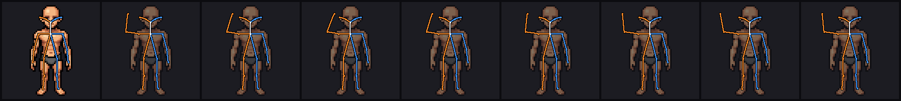

# Skeletons and rigging

A skeleton is where a character's joints are in one frame: 18 points, from the
nose and ears down to the ankles. PixelKiln uses that skeleton in several
places, and they share it. It is estimated from a sprite, corrected by hand,
used to pose an animation, used to find a hand to pin a sword to, used to pose
AI-drawn frames, and used to rig a 3D model. This guide shows how those pieces
connect. Each section links to the full reference.

| You want to | Use | Costs |
|---|---|---|
| Get the skeleton of a sprite | `pixelkiln estimate-skeleton`, or the gallery | 0.1 generation per estimate |
| Check or correct a skeleton | `pixelkiln skeleton-preview`, then edit the JSON | Nothing |
| Animate a sprite from poses you set | an `animate-skeleton` revision | 2 to 4 generations a loop |
| Animate a character from a sentence or template, posed through its 3D skeleton | a `skeleton-v3` loop | 3 generations a direction (measured) |
| Pin a held item to the hand in every frame | `pixelkiln anchors`, then an `attach` layer | 0.1 a frame to anchor, nothing to place |
| Pose frames drawn on your own GPU | OpenPose maps with ComfyUI | Nothing (in progress) |
| Rig a 3D model made from the sprites | the 3D research | Research, not a command |

## The 18 joints

PixelLab names a skeleton's joints with 18 labels, one point each:

| Joint | PixelLab label | OpenPose (COCO-18) index |
|---|---|---|
| nose | `NOSE` | 0 |
| neck | `NECK` | 1 |
| right shoulder, elbow, wrist | `RIGHT SHOULDER`, `RIGHT ELBOW`, `RIGHT ARM` | 2, 3, 4 |
| left shoulder, elbow, wrist | `LEFT SHOULDER`, `LEFT ELBOW`, `LEFT ARM` | 5, 6, 7 |
| right hip, knee, ankle | `RIGHT HIP`, `RIGHT KNEE`, `RIGHT LEG` | 8, 9, 10 |
| left hip, knee, ankle | `LEFT HIP`, `LEFT KNEE`, `LEFT LEG` | 11, 12, 13 |
| right eye, left eye | `RIGHT EYE`, `LEFT EYE` | 14, 15 |
| right ear, left ear | `RIGHT EAR`, `LEFT EAR` | 16, 17 |

`ARM` is the wrist and `LEG` the ankle. The two lists name the same 18
points, so a pose made for one can be converted to the other. They store it
differently:

- **PixelLab** stores each joint as `{label, x, y, z_index, depth}`. `x` and
  `y` run from 0 to 1 across the image, and `z_index` says what is drawn in
  front. A keypoints file holds the starting pose as `firstFrameKeypoints` and
  3 to 15 more as `frames`; `src/skeleton.ts` validates it.
- **OpenPose** draws the joints as an image: coloured limbs on black, one
  colour per limb. Left and right are told apart by colour, so a map must keep
  the figure's left side in the left colours in every frame.

"Right" is the character's own right. On a sprite facing the viewer, its right
hand is on the left of the picture.

## Estimate one

```bash
pixelkiln estimate-skeleton hero-south.png --out poses/hero-wave.json --frames 8
```

This sends the sprite to PixelLab's `/estimate-skeleton` and writes a
keypoints file: the estimated pose, and `--frames` copies of it (3 to 15) to
move into a motion. The image must be square at 16, 32, 64, 128 or 256
pixels. It is a direct call on your account, outside the plan and the budget,
like `balance`. See [`estimate-skeleton`](./CLI.md#estimate-skeleton).

In the gallery (`pixelkiln gallery --edit`), a sprite's **+ Skeleton
animation** form estimates the skeleton and declares the revision in one step.
It asks before each estimate, and `--estimate-limit` caps how many a session
makes. See [`gallery`](./CLI.md#gallery), under `--estimate-limit`.

## Check and correct it

```bash
pixelkiln skeleton-preview poses/hero-wave.json --from hero-south.png
```

This draws every pose over the sprite on one sheet: the starting pose at full
strength, each frame after it over a dimmed copy. Right-side bones are
orange, left-side blue, and the head and spine white. It runs locally and
costs nothing.



Check the starting pose before anything else. PixelLab redraws that frame
first to learn the sprite's colours and background. A starting pose that does
not match the picture gives no error, but it degrades every frame drawn from
it. Clothing and gear can fool the estimate: on a character carrying a sword
and a pack on its back, it read the straps and hilt as both arms raised,
although the arms hung at its sides. Use a sprite with nothing on its back,
such as a paperdoll's bare base, or move the joints back by hand. See
[`skeleton-preview`](./CLI.md#skeleton-preview).

## Animate from poses

An `animate-skeleton` revision sends a sprite and a keypoints file to
PixelLab's `/animate-with-skeleton-v3`. You get one frame per pose:

```json
"hero.wave": {
  "prompt": "waving",
  "revision": {
    "mode": "animate-skeleton",
    "from": "hero",
    "keypointsFile": "poses/hero-wave.json",
    "direction": "south",
    "description": "a young adventurer in a blue tunic"
  }
}
```

`prompt` is the motion's short label, and `description` is what the character
looks like; PixelLab requires both. Eight frames at 64×64 billed 3 generations.
PixelLab's own anchors are 3 frames for 2 generations and 15 frames for 4.
See [Skeleton-driven animation](./REVISIONS.md#skeleton-driven-animation).

## Animate through the character's own skeleton

A `skeleton-v3` loop uses a different skeleton: the 3D one PixelLab stores
with a character it drew on the v3 engine. You give it a template (`walk`) or
a sentence, and PixelLab poses that stored skeleton for you; you never edit
joints:

```json
"mira.wave": {
  "prompt": "cheerfully waving both arms overhead",
  "animation": { "of": "mira", "mode": "skeleton-v3", "frames": 8, "directions": ["south"] }
}
```

It needs a character PixelLab stored a skeleton for. A `v3` base has one; a
`standard` base does not, and PixelLab refuses it. Measured: 3 generations a
direction. See [Characters](./CHARACTERS.md#animations).

## Pin items to a hand

A held item in a paperdoll is a sprite placed on the hand in every frame, and
the skeleton is how the hand is found:

```bash
pixelkiln anchors hero.sword
```

This estimates the skeleton of every frame the item is held in, at 0.1
generation each, and writes an anchors file. The item goes a little past the
wrist, along the forearm. It is paid once per character: every item the
character holds reads the same file, and a rerun estimates only new or changed
frames. Placing the items costs nothing. On the site's knight, 56 frames cost
5.6 generations to anchor, and the sword stayed in the right hand in all 56.
See [Paperdoll layers: held items](./PAPERDOLL.md#held-items-and-accessories).

## Pose frames you draw yourself

With ComfyUI on your own machine, an OpenPose ControlNet poses each frame from
a pose map, the image form of the same 18 joints. Work on a recipe for this is
in progress ([#79](https://github.com/gfargo/pixelkiln/issues/79)); the maps
must keep scale, camera and ground line fixed across a set. See
[Set up ComfyUI](./COMFYUI.md).

## Rig a 3D model

The 3D research builds a mesh from a character's eight drawn directions,
binds it to a skeleton, and drives it with motion. It is research, not a
command yet. See [Research: 3D models from sprites](./RESEARCH_3D.md).

## Which skeleton is which

These are separate skeletons that share the same 18 joints:

| Skeleton | Where it lives | Who moves it |
|---|---|---|
| A keypoints file | committed JSON, beside the manifest | you, joint by joint |
| An anchors file | committed JSON, one entry per frame | nobody: it records where the joints already are |
| PixelLab's stored 3D skeleton | on your PixelLab account, with a v3 character | PixelLab, from a template or a sentence |
| An OpenPose map | a committed PNG per frame | you, or a script |
| A 3D rig | the research's model files | motion data, retargeted |

A keypoints file and an anchors file are local files PixelKiln reads, hashes
and checks. A stored 3D skeleton is never downloaded, so PixelKiln cannot show
or edit it.
